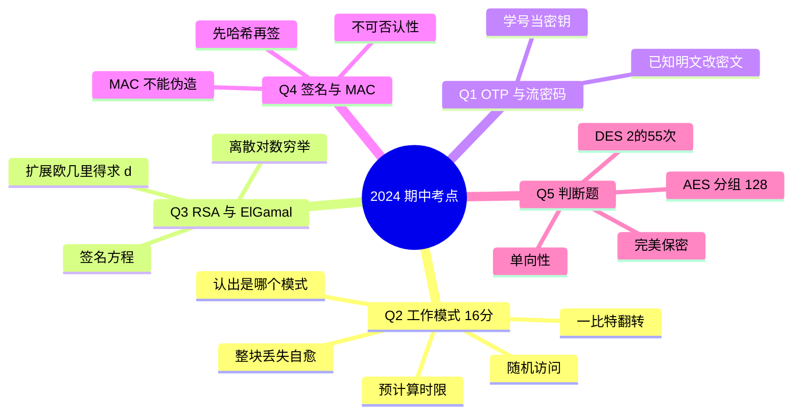

# CS5285 2024 期中真题解析

**2024 年 CS5285 期中卷的官方解答逐题拆解**。答案全部直接放出（原卷解答 + 我补的完整推导），标注了每部分的分值和踩分点。

这份卷子对复习的价值极高，因为它**一个人把五讲讲义的核心都考了一遍**，而且问法就是老师偏爱的问法：给一个你没见过的构造，让你推它的后果。**Q2 尤其典型——它不告诉你这是哪个工作模式，让你自己从加密方程判断。**

## 卷面结构与得分分布

| 题 | 考点 | 出自 | 分值 |
|---|---|---|---|
| Q1(a) | 用学号后六位当 one-time pad 加密 | Lecture 2 | 6 |
| Q1(b) | 已知部分明文，修改密文 | Lecture 2 | 4 |
| Q2(a) | 写出两个工作模式的解密方程 | Lecture 2 | 4 |
| Q2(b) | 一比特翻转的错误传播 | Lecture 2 | 3 |
| Q2(c) | 整块丢失的错误传播 | Lecture 2 | 3 |
| Q2(d) | 随机读写场景该用哪个模式 | Lecture 2 | 3 |
| Q2(e) | 预计算与时限约束 | Lecture 2 | 3 |
| Q3(a) | RSA 签名方程（含求 $d$） | Lecture 3+4 | 10 |
| Q3(b) | ElGamal 求私钥 + 困难问题 | Lecture 3+4 | 3+2+1 |
| Q4(a) | 不可否认性用什么机制 | Lecture 5 | 2 |
| Q4(b) | 能否用 Q2 的模式构造 MAC | Lecture 5 | 3 |
| Q4(c) | RSA 能签多长、实践中怎么办 | Lecture 4+5 | 2 |
| Q4(d) | 只发 MAC 不发消息行不行 | Lecture 5 | 2 |
| Q5(a)–(e) | 判断题五道 | 全课程 | 各 1 |

**观察**：Q2 一个题占 16 分，是**全卷最高权重的单题**。考前如果只来得及看一块，看工作模式。

---

## Q1 · One-time pad（10 分）

### Q1(a) 用学号后六位当 OTP 加密 `0xA5285B`（6 分）

> 题目要求：取学号后六位作为和明文等长的 one-time pad，加密 `0xA5285B`，结果写成十六进制，**并且要求 show all your calculations**。

**方法**：把两边都写成二进制，**逐位 XOR**，再换回十六进制。

**官方示例**（学号 $12345678$，后六位 $345678$，答案 `0x917e23`）：

```text
明文 0xA5285B  →  1010 0101  0010 1000  0101 1011
密钥 0x345678  →  0011 0100  0101 0110  0111 1000
              XOR ─────────────────────────────────
密文            →  1001 0001  0111 1110  0010 0011  = 0x917e23
```

**按字节验算**（考试时这样写，阅卷人一眼看到过程）：

| 字节 | 明文 | 密钥 | XOR |
|---|---|---|---|
| 1 | `A5` = 1010 0101 | `34` = 0011 0100 | `91` = 1001 0001 |
| 2 | `28` = 0010 1000 | `56` = 0101 0110 | `7E` = 0111 1110 |
| 3 | `5B` = 0101 1011 | `78` = 0111 1000 | `23` = 0010 0011 |

**你自己的答案**：学号 $72610374$ → 后六位 $610374$ → `0x610374`

```text
明文 0xA5285B  →  1010 0101  0010 1000  0101 1011
密钥 0x610374  →  0110 0001  0000 0011  0111 0100
              XOR ─────────────────────────────────
密文            →  1100 0100  0010 1011  0010 1111  = 0xC42B2F
```

| 字节 | 明文 | 你的密钥 | XOR |
|---|---|---|---|
| 1 | `A5` | `61` | `C4` |
| 2 | `28` | `03` | `2B` |
| 3 | `5B` | `74` | `2F` |

**答案：`0xC42B2F`**

> **六个踩分点**（题目给 6 分，几乎就是一步一分）：
> 1. 取出学号后六位；
> 2. 明文转二进制；
> 3. 密钥转二进制；
> 4. 逐位 XOR；
> 5. 结果转回十六进制；
> 6. 三个字节都做对。
>
> **题目明说要 show all calculations**，所以只写 `0xC42B2F` 大概只能拿到 1–2 分。**把上表画出来**。

**XOR 规则**（自检用）：相同得 0，不同得 1。

```text
0 ⊕ 0 = 0    1 ⊕ 0 = 1
0 ⊕ 1 = 1    1 ⊕ 1 = 0
```

### Q1(b) 已知部分明文，改造密文（4 分）

> 你截获密文 `A5285B`，并且知道明文是 `??BB??`（中间那个字节是 `BB`，前后两个字节未知）。
> **怎么改密文，让原来解出 `0xBB` 的那个位置解出 `0x77`？** 要求 show all calculations。

**核心原理**：$C=P\oplus K \Rightarrow K=C\oplus P$。**知道一对 $(P,C)$ 就能把密钥流恢复出来**，然后就能造出任意明文的密文。

**第一步：恢复密钥流**（用已知的明文 $BB$ 和对应的密文 $28$）

```text
密文 0x28  →  0010 1000
明文 0xBB  →  1011 1011
           XOR ─────────
密钥流      →  1001 0011  = 0x93
```

**第二步：用密钥流造新密文**（新明文 $0x77$）

```text
密钥流 0x93  →  1001 0011
新明文 0x77  →  0111 0111
             XOR ─────────
新密文       →  1110 0100  = 0xE4
```

**第三步：替换那一个字节**

$$\text{原密文 } \mathtt{A5\,28\,5B}\ \longrightarrow\ \text{新密文 } \mathtt{A5\,\mathbf{E4}\,5B}$$

**答案：新密文 `0xA5E45B`。**

> **这一步揭示了 OTP / 流密码的根本弱点**：密钥流和明文**逐位独立**（XOR 没有把前一位的影响传到后一位）。所以只要你猜到**任何一个字节**的明文，就拿到那一个字节的密钥流，就能随意改写那一个字节——**不需要知道密钥，也不需要知道其他字节**。
>
> **对应到讲义**：Exercise 2 Q4 那个"把转账账号从 1234 改成 5674"的攻击就是这个原理。**Q1(b) 是那个完整攻击的简化版。**
>
> **得分点**（4 分）：① 写出 $K=C\oplus P$ 得到 `0x93`（1 分）；② $0x93\oplus0x77$ 得到 `0xE4`（1 分）；③ 拼出新密文（1 分）；④ 计算过程可见（1 分）。

---

## Q2 · 分组密码工作模式（16 分）

**这是全卷的重头戏，也是最能拉开差距的一题。**

### 先认清题目给的是哪两个模式（关键前置）

题目只给了两条加密方程，**没说这是什么模式**：

$$\textbf{Mode 1:}\quad C_0=E_K(IV)\oplus P_0,\quad C_1=E_K(C_0)\oplus P_1,\quad C_2=E_K(C_1)\oplus P_2$$

$$\textbf{Mode 2:}\quad C_0=E_K(IV)\oplus P_0,\quad C_1=E_K(IV+1)\oplus P_1,\quad C_2=E_K(IV+2)\oplus P_2$$

**识别方法——看"反馈从哪来"**：

| | 反馈来源 | 模式 | 判别要点 |
|---|---|---|---|
| **Mode 1** | $C_i$ 由**前一个密文块**决定 | **CFB**（Cipher Feedback） | 链在密文里 |
| **Mode 2** | $C_i$ 用 **$\text{IV}+i$ 计数器**决定 | **CTR**（Counter） | 链在计数器里，与明文密文无关 |

> **一眼判断的技巧**：两式的 $P_i$ 都是和**分组加密的输出的 XOR**（不是和分组加密的输入的 XOR）。这就排除了 CBC（CBC 是 $C_i=E_K(P_i\oplus C_{i-1})$）和 ECB。剩下带反馈的只有 CFB；带计数器的只有 CTR。
>
> **再验一次**：官方解答说两个模式的解密**都用 ENC**（不是 DEC）。**只有 CFB 和 CTR 的解密用 ENC**——CBC 解密必须用 DEC。这个特征直接锁死了答案。
>
> 注意：**官方解答里没有写出模式名字**。答题时写不写名字不影响得分（题目也没问），但**你自己必须知道是哪个**，后面 (b)(c)(d)(e) 全建立在这个判断上。

### Q2(a) 写出两个模式的解密方程（4 分）

要求：**清楚标出用的是 ENC 还是 DEC**。

**Mode 1（CFB）**

$$P_0=E_K(IV)\oplus C_0,\qquad P_1=E_K(C_0)\oplus C_1,\qquad P_2=E_K(C_1)\oplus C_2$$

**Mode 2（CTR）**

$$P_0=E_K(IV)\oplus C_0,\qquad P_1=E_K(IV+1)\oplus C_1,\qquad P_2=E_K(IV+2)\oplus C_2$$

**推导过程**（试卷上值得写这一句）：加密是 $C_i=X_i\oplus P_i$，两边同 XOR $C_i$ 得 $P_i=X_i\oplus C_i$，其中 $X_i$ 是那一项的分组加密输出。**XOR 是自逆的，所以解密和加密用同一个式子**。

> **易错**：CBC 的解密是 $P_i=\mathrm{DEC}_K(C_i)\oplus C_{i-1}$，用的是 **DEC**。如果你按 CBC 的肌肉记忆写 DEC，这一题 4 分全丢。**CFB 和 CTR 都只用到加密方向**——这正是它们的价值：硬件只需要实现加密器。

### Q2(b) $C_0$ 里一个比特被改动（3 分）

> 传输中 $C_0$ 有一位翻转。哪个模式的错误传播更小？

**答案：Mode 2（CTR）**。

**逐个分析**：

| | Mode 1（CFB） | Mode 2（CTR） |
|---|---|---|
| $P_0$ | $E_K(IV)\oplus C_0$ → **那一位跟着反** | $E_K(IV)\oplus C_0$ → **那一位跟着反** |
| $P_1$ | $E_K(C_0)\oplus C_1$ → **$C_0$ 变了，$E_K(C_0)$ 整个变，$P_1$ 全乱** | $E_K(IV+1)\oplus C_1$ → **与 $C_0$ 无关，完好** ✓ |
| $P_2$ | $E_K(C_1)\oplus C_2$ → 与 $C_0$ 无关，完好 ✓ | $E_K(IV+2)\oplus C_2$ → 完好 ✓ |
| **受影响块数** | **2 块** | **1 块** |

$$\text{Mode 1: }2\text{ 块（其中第 2 块完全毁掉）}\qquad\text{Mode 2: }1\text{ 块（只错那一位）}$$

> **机制**：CFB 把密文**喂回加密器**，所以 $C_0$ 的一个比特错误会被"放大"成 $E_K(C_0)$ 的雪崩式变化，整个 $P_1$ 报废。CTR 的密钥流 $E_K(IV+i)$ **完全不由密文决定**，所以错误不传播。
>
> **这也说明 Mode 1 的错误有两级**：一位错误在 $P_0$ 里就是一位；但到了 $P_1$ 变成**整块随机**。**这一层区别值得写进答案**。

### Q2(c) 整个 $C_0$ 块丢失（3 分）

> 接收方不知道 $C_0$ 丢了，**把 $C_1$ 当成了 $C_0$**，后续密文块都正常收到。哪个模式的错误传播更小？

**答案：Mode 1（CFB）**。

**接收方实际算的是**（把 $C_1$ 顶到 slot 0、$C_2$ 顶到 slot 1、$C_3$ 顶到 slot 2）：

$$\textbf{Mode 1 接收方：}\quad P_1=E_K(IV)\oplus C_1,\quad P_2=E_K(C_1)\oplus C_2,\quad P_3=E_K(C_2)\oplus C_3$$

$$\textbf{Mode 2 接收方：}\quad P_0=E_K(IV)\oplus C_1,\quad P_1=E_K(IV+1)\oplus C_2,\quad P_2=E_K(IV+2)\oplus C_3$$

**逐个对照**：

| slot | Mode 1（CFB） | Mode 2（CTR） |
|---|---|---|
| 0 | $E_K(IV)\oplus C_1$ → **错**（本该是 $C_0$） | $E_K(IV)\oplus C_1$ → **错** |
| 1 | $E_K(C_1)\oplus C_2=E_K(C_1)\oplus E_K(C_1)\oplus P_2=\mathbf{P_2}$ → **是个真明文，只是错位** | $E_K(IV+1)\oplus C_2$ → **错** |
| 2 | $E_K(C_2)\oplus C_3=\mathbf{P_3}$ → **真明文，错位** | $E_K(IV+2)\oplus C_3$ → **错** |
| **结论** | 丢一块 + **1 块乱**，之后**重新同步**了 | 丢一块 + **后面全错**，**再也同步不回来** |

**为什么 Mode 1 能自愈**：**CFB 的链挂在密文上**。接收方拿到 $C_1$ 之后，用它算 $E_K(C_1)$，这个值**和发送方算的一模一样**——于是从这一刻起双方的算式重新对齐，剩下的每一块都能解出**一个合法的明文块**（只是位置整体错开了一块）。

**为什么 Mode 2 不能自愈**：**CTR 的链挂在计数器上，而计数器是接收方按自己的 slot 号数的**，密文里根本不携带同步信息。丢了一块，接收方的"第 $i$ 格"和发送方的"第 $i$ 格"就永久错位，**每一个后续块都用错了密钥流**。

> **答题模板**（官方给的三个得分点）：
> ① 选 **Mode 1**（1 分）
> ② Mode 1：丢一块 + 1 块错，**之后恢复**（1 分）
> ③ Mode 2：丢一块，**之后全部错，因为与发送方失去同步**（1 分）
>
> **"desynchronised with sender" 这三个词是官方解答的原话**，写进去最稳。

### Q2(d) 加密客户记录、需要经常读取和修改（3 分）

**答案：Mode 2（CTR）**。

| | Mode 1（CFB） | Mode 2（CTR） |
|---|---|---|
| 改一个明文块 | $C_i$ 变了 → 后面所有块依赖的链全断 → **必须把后面全部重新加密** | 每个 $C_i=E_K(IV+i)\oplus P_i$ **只用计数器** → **只改那一个密文块** |
| 访问方式 | **串行**：必须从头解 | **随机访问**：想读第 $i$ 块就直接算 $E_K(IV+i)$ |

**答案依据**：**CTR 是唯一支持随机访问的分组密码模式**。因为它把"位置"编码进了计数器，而不是编码进前一块密文。

> **得分点**（3 分）：① 选 Mode 2（1 分）；② 指出 Mode 1 更新时要重加密后续所有块（1 分）；③ 指出 Mode 2 只需改被修改的那块（1 分）。
>
> **这条和 Q2(c) 是同一件事的两面**：正因为 CTR 不依赖前面的密文，它才既有"随机访问"这个优点（d），又有"丢失后无法自愈"这个缺点（c）。**面试和考试都喜欢考这个 trade-off。**

### Q2(e) 工厂传感器：0.1 秒内要完成加密上传（3 分）

> 条件：传感器每 1 秒采一次数据；数据长 **3 个明文块**；设备做一次 XOR 要 **0.01 秒**；分组加密一个块要 **0.065 秒**。
> 采到数据后必须在 **0.1 秒**内加密并上传。

**先算不预计算的情况**（用 CFB / Mode 1 的思路，每块必须等前一块）：

$$3\times0.065\ \text{s}+3\times0.01\ \text{s}=0.195+0.03=0.225\ \text{s}>0.1\ \text{s}\quad\Longrightarrow\quad\textbf{来不及}$$

**再算 Mode 2（CTR）**：密钥流 $E_K(IV)$、$E_K(IV+1)$、$E_K(IV+2)$ **只依赖计数器，不依赖明文**——所以可以在**两次采样之间的空闲时间**（有整整 1 秒）先算好：

$$3\times0.065=0.195\ \text{s}\ll1\ \text{s}\quad\Longrightarrow\quad\textbf{空闲时间里从容算完}$$

**数据一到，只剩 XOR**：

$$3\times0.01=\mathbf{0.03\ s}\le0.1\ \text{s}\quad\Longrightarrow\quad\checkmark$$

**答案：用 Mode 2（CTR）。** 因为它允许**预计算密钥流**，把耗时的分组加密挪到空闲时间，采数瞬间只需要 0.03 秒的 XOR。

**完整时间线**：

```text
       采样             采样             采样
        │                │                │
        ├── 空闲 1 秒 ────┤                │
        │  预计算 E_K(IV), E_K(IV+1), E_K(IV+2)  ← 0.195 s，绰绰有余
        │                │                │
    数据到达 ──0.03 s──> 上传完毕 ✓（限额 0.1 s）
```

> **得分点**（3 分）：① 选 Mode 2（1 分）；② 说出**预计算密钥流**（1 分）；③ 算出 $3\times0.01=0.03$ s 在 0.1 s 内（1 分）。
>
> **这题考的是"模式的性质 → 系统能不能满足时限"**，不是单纯算术。**"密钥流与明文无关"这个性质**（叫 *pre-computability*）是 CTR 的三大优点之一，另两个是随机访问（d）和可并行。

### Q2 通用套路（遇到"给两个方程"的题）

1. **先判模式**：$P$ 和 $E_K(\cdot)$ 的输出 XOR → CFB/CTR/OFB；$P$ 和前一密文 XOR 后整体进 $E_K$ → CBC。**解密用 ENC 还是 DEC 是最快的判别器**。
2. **想错误传播**：问"改一个比特"看**链的传播**；问"丢一块"看**能否重新同步**。
3. **想随机访问**：计数器模式（CTR）能独立访问，链式模式（CBC/CFB）不能。
4. **想时限**：能不能**预计算**？只有 CTR/OFB 这类"密钥流与明文无关"的可以。

---

## Q3 · RSA 签名与 ElGamal（16 分）

### Q3(a) 用 RSA 给 $m=1234$ 签名（10 分）

> 已知 $p=13$，$q=23$，$e=19$。写出用 RSA 签名 $m=1234$ 的方程，**要求 show all your calculations**。

**第一步：算 $n$ 和 $\varphi(n)$**

$$n=p\cdot q=13\times23=\mathbf{299}$$

$$\varphi(n)=(p-1)(q-1)=12\times22=\mathbf{264}$$

**第二步：用扩展欧几里得求 $d=e^{-1}\bmod\varphi(n)$**

**阶段一，除法链**：

```text
264 = 13 × 19 + 17
 19 =  1 × 17 + 2
 17 =  8 × 2  + 1      ← gcd = 1
```

**阶段二，回代**：

```text
1 = 17 − 8×2
  = 17 − 8×(19 − 1×17)          ← 2 = 19 − 1×17
  = 9×17 − 8×19
  = 9×(264 − 13×19) − 8×19      ← 17 = 264 − 13×19
  = 9×264 − 117×19 − 8×19
  = 9×264 − 125×19
```

所以

$$-125\times19\equiv1\pmod{264}\qquad\Longrightarrow\qquad d=(-125)\bmod264=\mathbf{139}$$

**自检**：$19\times139=2641=264\times10+1$ ✓

**第三步：写出签名方程**

$$s=m^{d}\bmod n=\mathbf{1234^{139}\bmod299}$$

**答案：$s=1234^{139}\bmod299$**

> **题目明确写了 "Only write equation, not required to solve"** —— **不用算出数值**。所以写到这里就满分了。**不要浪费时间算幂**（而且手算 $1234^{139}$ 几乎必错）。
>
> 顺手算一下的话（用平方-乘，本题不要求）：$s=\mathbf{103}$，验证 $103^{19}\bmod299=38=1234\bmod299$ ✓。**知道有这回事就行，考场上不要算。**
>
> **得分点**（10 分）：$n=299$（1 分）＋ $\varphi(n)=264$（1 分）＋ 欧几里得完整过程（5 分）＋ 签名方程（3 分）。

**⚠️ 官方解答的笔误**

官方 PDF 里写的是：

> "Apply mod **296** both sides $1\bmod296=-125\cdot17\bmod264$ so $d=139$"

**两处都写错了**：

| 官方原文 | 应该是 | 说明 |
|---|---|---|
| mod **296** | mod **264** | $\varphi(n)=264$。296 是把 264 的两位数字写颠倒了 |
| $-125\cdot\mathbf{17}$ | $-125\cdot\mathbf{19}$ | 回代结果是 $9\times264-125\times\mathbf{19}$，乘的是 **19**（即 $e$），不是 17（那是第一步的余数） |

**最终答案 $d=139$ 是对的**——错误只在中间过程。**考试时按正确的 264 和 19 写**，不要照抄官方 PDF 的笔误。

### Q3(b) ElGamal 求私钥（3+2+1 分）

> 已知 ElGamal 公钥 $y=7$，$p=11$，$g=2$。

**(i) 求私钥 $x$（3 分）**

由 $y=g^{x}\bmod p$，即解

$$2^{x}\equiv7\pmod{11}$$

**从 $x=1$ 开始逐个试**（$p$ 小，穷举最快）：

| $x$ | 1 | 2 | 3 | 4 | 5 | 6 | **7** | 8 | 9 | 10 |
|---|---|---|---|---|---|---|---|---|---|---|
| $2^x\bmod11$ | 2 | 4 | 8 | 5 | 10 | 9 | **7** | 3 | 6 | 1 |

**答案：$x=7$**

逐步算（试卷上这样写）：$2^1=2$，$2^2=4$，$2^3=8$，$2^4=16\equiv5$，$2^5=10$，$2^6=20\equiv9$，$2^7=18\equiv\mathbf{7}$ ✓

> **注意最后一列**：$2^{10}\equiv1\pmod{11}$，这正是 Fermat 小定理（$2^{10}\equiv1\pmod{11}$，因为 $\varphi(11)=10$）。所以**试到 $x=10$ 就够了**，$x=11$ 会回到 $2$，循环开始。
>
> **得分点**：写出 $y=g^x\bmod p$ 并**逐个试出 7**（3 分）。只写答案不展示试探过程可能扣分。

**(ii) 这需要解什么困难问题？（2 分）**

**这是离散对数问题（Discrete Logarithm Problem, DLP）。**

> 对于 $a=b^{c}\bmod d$：**已知 $b,c,d$ 求 $a$ 很容易**（做模幂）；**已知 $a,b,d$ 求 $c$ 很困难**。

**(iii) 那你为什么能解出来？（1 分）**

**因为数字太小了。** $p=11$，$x$ 只有 10 种可能，穷举就行。**如果 $p$ 足够大（实践中至少 1024 bit），穷举不可行，问题就真的困难了。**

> **这一小问其实在考"困难问题的困难性依赖参数大小"**。答"参数小所以能暴力试"是官方口径。写下"实践中 $p$ 要 1024 bit 以上"作为补充，说明你理解了，但不加也无妨。

---

## Q4 · 不可否认性与 MAC（9 分）

### Q4(a) 什么机制能提供不可否认性？为什么？（2 分）

**答案：数字签名（digital signature）。**

**为什么**：**只有私钥的持有者能生成签名。** 私钥是**唯一且不共享**的，所以一旦签名验证通过，签名者**无法否认**自己签过——因为没有第二个人能造出这个签名。

> **对比**：对称加密的 MAC **不能**提供不可否认性，因为 MAC 的密钥**双方都持有**，接收方自己也能造出同样的 MAC，所以无法向第三方证明"是对方发的"。
>
> **得分点**：① 写"数字签名"（1 分）；② 写"只有私钥持有者能签"（1 分）。
>
> **答题模板**：凡是问"为什么能不可否认"，答案的核心永远是**"私钥的唯一性"**——不是"签名难伪造"（那是完整性），而是"**只有一个人能签，所以赖不掉**"。

### Q4(b) 能用 Q2 的两个模式构造类似 CBC-MAC 的 MAC 吗？（3 分）

**答案：不能。**

**理由**：**MAC 是**和明文一起发送的**，而这两个模式的最后一块密文就是 $\text{密钥流}\oplus P_{\text{last}}$。**

具体地，最后一块是

$$C_{\text{last}}=\mathrm{KS}_{\text{last}}\oplus P_{\text{last}}$$

攻击者知道 $P_{\text{last}}$（明文本来就要发）和 $C_{\text{last}}$（MAC 也要发），于是

$$\mathrm{KS}_{\text{last}}=C_{\text{last}}\oplus P_{\text{last}}$$

**密钥流就被恢复出来了**。然后对任意修改后的明文 $P'_{\text{last}}$，攻击者能造出**合法的**新 MAC：

$$C'_{\text{last}}=\mathrm{KS}_{\text{last}}\oplus P'_{\text{last}}$$

**所以这两个模式都做不成 MAC。**

> **这和 Q1(b) 是完全同一个攻击**！Q1(b) 里你从"已知明文 + 对应密文"恢复出密钥流，改写了密文；Q4(b) 里是同一个操作，只不过目标换成了 MAC。
>
> **为什么 CBC-MAC 就安全**：CBC 的最后一块是 $C_N=E_K(\cdots)$，**明文是喂进加密器的**，不是 XOR 在外面的。$E_K$ 的**单向性**使得从 $C_N$ 反推不出任何东西，**也不存在一个可以分离出来的"密钥流"**。这正是 MAC 必须"**把明文压进加密器**"而不是"XOR 一下"的原因。
>
> **得分点**（3 分）：① 答"不能"（1 分）；② 指出最后一块是密钥流 XOR 明文（1 分）；③ 说明攻击者能恢复密钥流并伪造（1 分）。

### Q4(c) Q3(a) 那套系统最大能安全签多长的消息？实践中怎么办？（2 分）

**答案**：**不能签比 $n$ 大的消息**（本题即 $n=299$）。

**实践中**：**先对消息做哈希，再签这个哈希值。**

$$s=h(m)^{d}\bmod n$$

因为哈希输出是固定长度的（$h$ 的输出位长 $\le$ $n$ 的位长），所以**任意长度的消息都能签**。

> **得分点**（2 分）：① 说出不能超过 $n$（可以写出 299）（1 分）；② 说出"先哈希再签哈希"（1 分）。
>
> **顺带理解**：这一步同时解决了**效率**问题（哈希比模幂快得多）和**长度**问题。**"签名不是签消息本身，是签消息的指纹"**——这句话值得记住。
>
> 为什么不能直接截断消息来签？因为那会丢掉信息，且**截断后的不同消息可能撞到同一个值**，攻击者就能在不知情的情况下替换消息。

### Q4(d) 只发 MAC 不发消息行不行？（2 分）

> Alice 想给 Bob 发数据 $D$，同时提供数据源认证（保证 $D$ 没被改）。她**只**发了 $\mathrm{MAC}_{K_{AB}}(M)$。这达到了目的吗？

**答案：没有。**

**理由**：**$M$ 从来没有被发出去，Bob 手里根本没有 $M$。** 他既没法验证 MAC（验证需要重新计算 $\mathrm{MAC}_{K_{AB}}(M)$，而这需要 $M$），**也没法从 MAC 反推出 $M$**（MAC 是单向压缩，本质不可逆）。

**正确做法**：**消息和 MAC 一起发**：

$$\text{Alice}\longrightarrow\text{Bob}:\quad M\ \|\ \mathrm{MAC}_{K_{AB}}(M)$$

> **得分点**（2 分）：① 答"没有"（1 分）；② 说明 $M$ 从未发送，Bob 无法验证也得不到 $M$（1 分）。
>
> **这题考的是"MAC 是验证工具，不是传输工具"**。MAC 只证明"这条消息是你发的且没被改"，但它**不携带消息本身**。**这也是 MAC 和加密的区别**：MAC 不提供机密性。

---

## Q5 · 判断题（各 1 分）

| 小题 | 命题 | 判定 | 官方理由 |
|---|---|---|---|
| (a) | AES 的分组大小是 192 bit | **False** | AES 分组固定 **128 bit**；192 是**密钥**长度的一种（AES-192） |
| (b) | 完美保密（perfect secrecy）指攻击者在现有算力下实际找不到明文 | **False** | 完美保密**即使攻击者有无限算力也破不了**。题中描述的是**计算安全（computational security）** |
| (c) | 非对称密码可提供机密性、数据源认证和不可否认性 | **True** | 加密 → 机密性；签名 → 完整性 + 数据源认证 + **不可否认性** |
| (d) | 比特币矿工不断哈希随机数 $r$ 直到 $h(r)$ 等于系统给的答案，这最接近**抗碰撞性**被破解 | **False** | 更接近**单向性 / 第二原像抗性**：给定 $h(x)$ 求另一个能哈希到同值的输入。**不是抗碰撞性** |
| (e) | DES 暴力穷举平均需要 $2^{63}$ 次尝试 | **False** | DES 密钥 **56 bit**，密钥空间 $2^{56}$，平均试一半 $=2^{56-1}=\mathbf{2^{55}}$ |

**逐个展开**：

**(a) 分组大小 vs 密钥长度——最容易混的一组数**

| | 分组大小 | 密钥长度 | 轮数 |
|---|---|---|---|
| **AES-128** | 128 bit | 128 bit | 10 |
| **AES-192** | 128 bit | 192 bit | 12 |
| **AES-256** | 128 bit | 256 bit | 14 |
| **DES** | 64 bit | 56 bit | 16 |

**AES 的分组大小恒为 128 bit**，变的只是密钥长度。所以 (a) 是错的。

**(b) 完美保密 ≠ 计算安全**

| | 完美保密 | 计算安全 |
|---|---|---|
| 破译难度 | **即使有无穷算力也破不了** | 算力受限时破不了 |
| 条件 | $K$ 必须随机、等长、只用一次（OTP） | 只要现行算法在合理时间内不可行 |
| 例子 | one-time pad | AES、RSA |

讲义的原话是：**"perfect secrecy" 与 "computational security" 是两个不同层次的保证**。题目把定义张冠李戴了。

**(d) 比特币挖矿是哪种"困难"？**

矿工要**找到**一个 $r$ 使 $h(r)$ 落在目标范围内——这是**从哈希值反推输入**，属于：

- **单向性 / 原像抗性（one-way / pre-image resistance）**；
- 或**第二原像抗性（second pre-image resistance）**——给定 $x$ 和 $h(x)$，找另一个 $x'$ 使 $h(x')=h(x)$。

**官方说两种答法都可以（either OK）**。但**绝不能答"抗碰撞性"**：抗碰撞性防的是**攻击者自己挑两个不同的输入让它们撞车**——而挖矿是**攻击者去撞系统给定的那个值**。

$$\text{单向性：给定 }h(x)\text{，求任何一个 }x\qquad\text{抗碰撞：求任意 }x\ne y\text{ 使 }h(x)=h(y)$$

**(e) DES 的穷举代价**

$$\text{密钥空间}=2^{56}\qquad\text{平均尝试次数}=\frac{2^{56}}{2}=\mathbf{2^{55}}$$

题目给的 $2^{63}$ 把 $2^{56}$ 的指数写错了（可能是想写 $2^{56}$，也可能是与 3DES 的 $2^{112}$ 混了）。

> **记住这个"平均一半"的约定**：**密钥空间 $2^N$ 时，平均需要试 $2^{N-1}$ 次**（遍历一半）。这是 Lecture 2 明确讲过的（3DES 密钥空间 $2^{112}$，平均 $2^{111}$）。

---

## 勘误：官方解答里的两处笔误

考试如果拿到和官方解答一样的措辞，**不要照抄错的部分**。

| 位置 | 官方原文 | 正确写法 | 影响 |
|---|---|---|---|
| **Q3(a)** | "Apply mod **296**" | mod **264** | 中间过程错，**最终答案 $d=139$ 正确** |
| **Q3(a)** | "$-125\cdot\mathbf{17}$" | $-125\cdot\mathbf{19}$ | 同上，乘的应是 $e=19$ |
| **Q1(a)** | "last **digit** = 345678" | last **6 digits** | 措辞漏字，答案 `0x917e23` 正确 |

---

## 从这份卷子看考前重点

**看这份卷子反复考了什么**：



**三个最高频的模式**（背下来）：

1. **给一个加密方程 → 判模式 → 问错误传播 / 随机访问 / 预计算**。这四种问法在 Q2 里各出了一遍。
2. **给 $p,q,e$ → 求 $n,\varphi(n),d$ → 写签名/加密方程**。**扩展欧几里得是必考手算**（10 分的题，5 分在欧几里得上）。
3. **给公钥 $y,p,g$ → 穷举求 $x$ → 说出这是 DLP**。参数小就穷举，参数大就写"$p$ 至少 1024 bit 才安全"。

**最容易丢分的地方**：

- 题目说 show all your calculations 却只给答案（Q1(a)、Q3(a)）；
- CFB/CTR 的解密写成 DEC（**只用 ENC**）；
- 说"完美保密"是"现有算力下破不了"（**那是计算安全**）；
- 比特币挖矿答"抗碰撞性"（**是单向性/第二原像**）；
- DES 平均 $2^{55}$ 写成 $2^{56}$（**平均要除以 2**）。

## 相关

- [[CS5285 题型与答案]]
- [[对称加密]]
- [[密码学数论基础]]
- [[公钥加密 RSA 与 ElGamal]]
- [[哈希 消息认证码与数字签名]]
- [[信息安全 知识地图]]
- [[CS5285 Index]]
