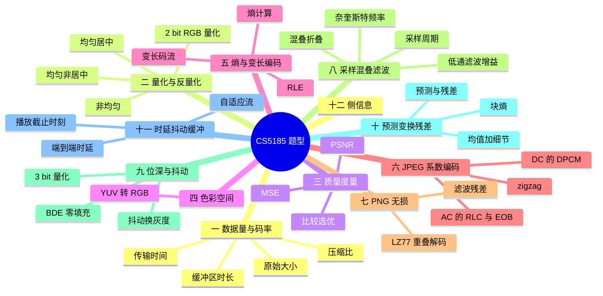

# CS5185 题型与答案

五次 tutorial 的题与答案，按**题型**重排，答案全部直接放出，不折叠。

五份 tutorial 覆盖 week2–week5，题型高度重复——**week2 的四问已经把所有计算类题型的模板都出全了**，后面三周只是换数字和换对象。所以这一篇的用法是：先认题型，再套套路。



## 零、题型总览

| # | 题型 | 核心公式 | 出处 |
|---|---|---|---|
| 一 | 数据量 / 压缩比 / 传输时间 | 四个数据量公式 | week2 Q1 Q2 |
| 二 | 量化与反量化 | $k=Q(x)$，$\hat x=Q^{-1}(k)$ | week3 Q1 Q2、week2 Q4 |
| 三 | MSE / PSNR | $\mathrm{PSNR}=10\log_{10}(L^2/\mathrm{MSE})$ | week2 Q3 |
| 四 | 色彩空间转换 | $R=Y+V$，$B=Y+U$，$G=(Y-0.299R-0.114B)/0.587$ | week2 Q4 |
| 五 | 熵与变长编码 | $H=-\sum p\log_2 p$ | week4 Q1 Q2 |
| 六 | JPEG 系数编码 | DPCM + zigzag + RLC | week5 Q1 |
| 七 | PNG 无损压缩 | $(\cdot)\bmod 256$ + LZ77 | week5 Q2 |

**以下五节是课件里的计算专题**（tutorial 没出过，但课件反复出现，且都在考纲内）：

| # | 专题 | 核心公式 / 判据 | 出处 |
|---|---|---|---|
| 八 | 采样、混叠与滤波 | $T_s=1/f_s$，$f_N=f_s/2$，$f_{\text{alias}}=\lvert kf_s-f\rvert$ | Week3 课件 |
| 九 | 位深、BDE 与抖动 | $\text{级数}=2^b$，零填充 vs 表映射 | Week2 课件 |
| 十 | 预测、变换与残差 | $\text{重建}=\text{预测}+\text{残差}$，$H=-\sum p\log_2p$ | Week4 课件 |
| 十一 | 时延、抖动与缓冲 | 逐段相加；缓冲变化率 = 链路速率 − 播放码率 | Week3 课件 |
| 十二 | 学习式压缩的侧信息 | 主码流减少量 > 侧码流开销 | Week5 课件 |

---

## 一、题型一 · 数据量与码率

### 通用套路

1. **先算原始数据量**：$\text{宽}\times\text{高}\times\dfrac{\text{bits/pixel}}{8}$（图像）；视频再 $\times$ fps。
2. **压缩比 = 原始 / 压缩后**；要百分比节省就用 $\dfrac{\text{orig}-\text{comp}}{\text{orig}}$。
3. **传输时间 = 总数据量 ÷ 传输速率**。⚠️ **bit 和 byte 差 8 倍**——速率通常是 bit/s，数据量通常是 byte。
4. **缓冲区时长 = 缓冲区大小 ÷ 播放码率**（用播放码率，不是链路速率）。

### Q1 · 上传活动照片（week2）

> 20 张照片，1600 × 1000，RGB 24 bpp，每张 JPEG 为 1.2 MB，上传速率 16 Mb/s。用十进制单位（1 MB = $10^6$ B）。

**(1) 一张原始照片多大？全部 20 张多大？**

$$\text{raw}=1600\times1000\times\frac{24}{8}=1600\times1000\times3=4{,}800{,}000\ \text{B}=\mathbf{4.8\ MB}$$

$$20\times4.8=\mathbf{96\ MB}$$

**(2) 一张照片的 JPEG 压缩比是多少？**

$$\frac{4.8}{1.2}=\mathbf{4:1}$$

**(3) 全部 JPEG 的总大小？**

$$20\times1.2=\mathbf{24\ MB}$$

**(4) 全部 JPEG 的理想上传时间？**

$$24\ \text{MB}\times8=192\ \text{Mbit},\qquad \frac{192}{16}=\mathbf{12\ s}$$

> **这一步最容易错**：16 Mb/s 里的 b 是 bit。24 MB 是 byte，必须先 ×8。

**(5) 把 `.jpg` 改名成 `.png` 能转换格式吗？**

**不能。** 扩展名只是文件名的一部分，**不改变文件内容**。文件里的字节仍然是 JPEG 编码的数据。改名后：
- 解码器靠内容嗅探（magic number）通常仍能正确识别为 JPEG，图照样显示；
- 但如果某个程序**只看扩展名**就会按 PNG 解析，得到错误结果或直接报错。

真正的格式转换必须**解码 + 重新编码**（JPEG → 像素 → PNG）。而且无损的 PNG 存同一张照片通常会**比 JPEG 大得多**，因为 PNG 不能丢掉人眼不敏感的高频。

### Q2 · 讲座能直播吗？（week2）

> 400 × 300，RGB 24 bpp，20 fps，目标码流 2.4 Mb/s，链路 4.8 Mb/s，缓冲区满时 3 MB。忽略音频与网络开销，速率恒定。

**(1) 未压缩视频的码率？**

$$\text{raw bitrate}=400\times300\times24\times20=57{,}600{,}000\ \text{bit/s}=\mathbf{57.6\ Mbit/s}$$

**(2) 要得到 2.4 Mb/s 的流，压缩比是多少？**

$$\frac{57.6}{2.4}=\mathbf{24:1}$$

**(3) 4.8 Mb/s 够稳定播放吗？为什么？**

**够，而且有 2 倍余量。** 播放只需要 2.4 Mb/s，链路给 4.8 Mb/s，是需求的两倍。多出来的余量可以吸收：
- 网络抖动（包到达时间波动）；
- 协议头、重传等开销（题目说忽略，但现实中存在）；
- 短时的速率下降。

所以在"速率恒定"的前提下，**能稳定播放**。

**(4) 如果链路断了，满的 3 MB 缓冲区能播多久？**

$$\text{buffer time}=\frac{3\ \text{MB}\times8}{2.4\ \text{Mb/s}}=\frac{24}{2.4}=\mathbf{10\ s}$$

> **注意用播放码率 2.4 而不是链路速率 4.8**。缓冲区是给**播放器**吃的，播放器消耗数据的速度就是码流速率。

**(5) 压缩和缓冲各帮了观众什么？**

- **压缩**：把 57.6 Mb/s 降到 2.4 Mb/s，让流**能装进链路**。没有压缩，4.8 Mb/s 的链路根本传不动原始视频（差 12 倍）。这是"能不能看"的问题。
- **缓冲**：把**到达时间的不确定性**换成了**固定的额外延迟**。链路有抖动甚至短暂中断时，播放器可以从缓冲里继续取数据，播放不中断。这是"看得顺不顺"的问题。

两者解决的是**不同层次**的困难：压缩解决带宽，缓冲解决时间。

### 补充练习 · 讲义原例逐个算（week3 讲义）

这部分是课件里的算例，**每一行都展开成可照着誊写的步骤**。统一约定：$1$ byte $=8$ bit，$1$ kB $=10^3$ B。

#### 例 1 · 16-bit PCM，采样 16 kHz

$$16{,}000\ \frac{\text{sample}}{\text{s}}\times16\ \frac{\text{bit}}{\text{sample}}=\mathbf{256{,}000\ bit/s=256\ kbit/s}$$

#### 例 2 · 先滤到 3 kHz 再降到 8 kHz 采样

$$8{,}000\times16=\mathbf{128\ kbit/s}$$

这两个正好是讲义 Design A / Design B 的对比：**采样率减半，码率就减半**。前提是**先低通滤波**把 3 kHz 以上的成分去掉，否则降采样会混叠（见「课件计算专题 · 采样与混叠」）。

#### 例 3 · CD 立体声 PCM

$$44{,}100\ \frac{\text{sample}}{\text{s}}\times16\ \frac{\text{bit}}{\text{sample}}\times2\ \text{ch}=\mathbf{1{,}411{,}200\ bit/s}$$

换成字节：$1{,}411{,}200\div8=\mathbf{176{,}400\ B/s}$。**注意先乘通道数再除 8**，两种顺序结果一样，但别漏掉那个 $\times2$。

#### 例 4 · 4 分钟的 CD

$$176{,}400\ \text{B/s}\times(4\times60)\ \text{s}=176{,}400\times240=\mathbf{42{,}336{,}000\ B}$$

$$=42.336\ \text{MB}\quad(\text{十进制})\qquad=\frac{42{,}336{,}000}{1{,}048{,}576}\approx\mathbf{40.38\ MiB}\quad(\text{二进制})$$

**这两个数不一样是正常的**：$1$ MB $=10^6$ B 而 $1$ MiB $=2^{20}=1{,}048{,}576$ B。**题目说用十进制就按十进制**，这是本课的统一约定。

#### 例 5 · 1920×1080 24-bit 25 fps

**一帧的原始大小**

$$1920\times1080\times3\ \text{B}=2{,}073{,}600\times3=\mathbf{6{,}220{,}800\ B}$$

**原始码率**（注意这里 $\times8$ 把 byte 换回 bit，因为码率是 bit/s）

$$6{,}220{,}800\times25\times8=\mathbf{1{,}244{,}160{,}000\ bit/s=1.24416\ Gbit/s}$$

**90 分钟的数据量**

$$6{,}220{,}800\times25\times5{,}400=155{,}520{,}000\times5{,}400=\mathbf{839{,}808{,}000{,}000\ B\approx839.808\ GB}$$

> **不要背这些数**，要背的是**为什么按这个顺序乘**：数据量用 byte（宽×高×字节数×帧数），码率用 bit（上面那个再 $\times8$）。**搞错这一步就是 8 倍的错**。

#### 例 6 · 4K 60 fps

$$3840\times2160\times24\times60=8{,}294{,}400\times24\times60=\mathbf{11{,}943{,}936{,}000\ bit/s\approx11.94\ Gbit/s}$$

| 时间粒度 | 计算 | 数据量 |
|---|---|---|
| 1 秒 | $11.9439\ \text{Gbit}/8$ | **1.49 GB** |
| 1 分钟 | $1.49\times60$ | **89.6 GB** |
| 2 小时 | $89.6\times120$ | **10.75 TB** |

**这一幕的意思是**：$3840\times2160$ 比 $1920\times1080$ 只大了 4 倍像素、60 fps 比 25 fps 大了 2.4 倍，但码率从 1.2 Gbit/s 涨到 11.94 Gbit/s —— **原始数据增长比直觉快得多**。所以「表示与压缩无法和系统设计分开考虑」。

#### 例 7 · 640×480 RGB 30 fps 10 秒

$$640\times480=307{,}200\ \text{pixel}\quad\times3\ \text{B}=921{,}600\ \text{B/frame}$$

帧数 $=30\times10=300$：

$$921{,}600\times300=\mathbf{276{,}480{,}000\ B=276.48\ MB}$$

**和例 5 对照看规模**：$1536\times480$ 的 VGA 视频 10 秒就要 276 MB，**一部长片根本不可能原始存储**——这就是压缩存在的全部理由。

#### 例 8 · 压缩比与节省比例（讲义原例）

原始 100 MB，压到 20 MB：

$$\text{压缩比}=\frac{100}{20}=\mathbf{5:1}\qquad\text{节省}=\frac{100-20}{100}=\mathbf{80\%}$$

> **两个数别混**：$5:1$ 是**比值**，$80\%$ 是**省下来的比例**。题目问哪个答哪个。若题目给的是"压到 1/5"，节省是 $80\%$ 不是 $20\%$。

---

## 二、题型二 · 量化与反量化

### 通用套路

1. **读清规则**：是就近取整（centered）还是取右端电平（non-centered）？是均匀还是非均匀？
2. **算码字** $k$：套题目给的 $k$ 公式（注意 $\lfloor\cdot\rfloor$、$\lceil\cdot\rceil$、$\max$）。
3. **反量化** $\hat x$：套 $Q(x)$ 公式。**这一步才是重建值**。
4. **误差** $e=\hat x - x$。注意定义方向——本课统一用 $e=Q(x)-x$。

> **三个符号别混**：$x$ 是输入原值，$k$ 是码字索引（整数，会被编码），$\hat x=Q(x)$ 是解码端重建出来的值。接收方**只知道 $k$**。

### Q1 · 6 级居中 vs 5 级非居中（week3）

> 像素强度 $0\le x\le255$。
> **Centered（6 级）**：电平 0, 51, 102, 153, 204, 255，每 bin 宽 51。
> $k=\lfloor x/51+1/2\rfloor\in\{0,\dots,5\}$，$Q(x)=51k$。
> **Non-centered（5 级）**：电平 51, 102, 153, 204, 255。
> $k=\max(1,\lceil x/51\rceil)\in\{1,\dots,5\}$，$Q(x)=51k$。

**(a) 补全输出表**

| 输入 $x$ | centered $k$ | centered $Q(x)$ | non-centered $k$ | non-centered $Q(x)$ |
|---|---|---|---|---|
| 0 | 0 | **0** | 1 | **51** |
| 60 | 1 | **51** | 2 | **102** |
| 120 | 2 | **102** | 3 | **153** |
| 230 | 5 | **255** | 5 | **255** |

逐步验算：

- $x=0$：centered $\lfloor0+0.5\rfloor=\lfloor0.5\rfloor=0$；non-centered $\lceil0/51\rceil=0$，被 $\max(1,\cdot)$ 抬到 1。
- $x=60$：centered $\lfloor1.176+0.5\rfloor=\lfloor1.676\rfloor=1$；non-centered $\lceil1.176\rceil=2$。
- $x=120$：centered $\lfloor2.353+0.5\rfloor=\lfloor2.853\rfloor=2$；non-centered $\lceil2.353\rceil=3$。
- $x=230$：centered $\lfloor4.510+0.5\rfloor=\lfloor5.010\rfloor=5$；non-centered $\lceil4.510\rceil=5$。

**(b) 在 $x=120$ 处，两种规则的误差 $e=Q(x)-x$**

| 规则 | $Q(120)$ | $e$ |
|---|---|---|
| Centered | 102 | $102-120=\mathbf{-18}$ |
| Non-centered | 153 | $153-120=\mathbf{+33}$ |

**结论**：两者标称步长同为 51，但行为完全不同——

- **Centered** 误差落在 $(-25.5,+25.5]$，**上下都有**，期望为 0（无偏）；
- **Non-centered** 因为用了 $\lceil\cdot\rceil$（向上取整），误差**恒非负**，平均约 $+\Delta/2$，**有偏**。

这就是均匀量化的默认规则选 centered 的理由。而且注意：$x=120$ 到 $x=230$ 之间，非居中的误差会一路涨到接近整个步长。

### Q2 · 均匀 vs 非均匀（5 级）（week3）

> **非均匀**：边界 0, 32, 64, 128, 192, 255；电平 32, 64, 128, 192, 255。
> $$k=\begin{cases}\max(1,\lceil x/32\rceil)&0\le x\le64\\ 1+\lceil x/64\rceil&64<x\le255\end{cases}\qquad Q(x)=\begin{cases}32k&1\le k\le2\\ \min(255,64(k-1))&3\le k\le5\end{cases}$$
> **均匀\***：$k=\max(1,\lceil x/51\rceil)$，$Q(x)=51k$。

**(a) 补全输出表**

| 输入 $x$ | 均匀\* $k$ / $Q$ | 非均匀 $k$ / $Q$ |
|---|---|---|
| 20 | 1 / **51** | 1 / **32** |
| 60 | 2 / **102** | 2 / **64** |
| 100 | 2 / **102** | 3 / **128** |
| 200 | 4 / **204** | 5 / **255** |

验算：$x=100$ 落进 $64<x\le255$，$k=1+\lceil100/64\rceil=1+2=3$，$Q=64\times2=128$。$x=200$：$k=1+\lceil200/64\rceil=1+4=5$，$Q=\min(255,64\times4)=\min(255,256)=255$（**注意这里被上限截断了**）。

**(b) 在 $x=30$ 和 $x=40$ 处算误差。近零更细是否意味着处处误差更小？**

| $x$ | 均匀 $Q$ / $e$ | 非均匀 $Q$ / $e$ |
|---|---|---|
| 30 | 51 / $\mathbf{+21}$ | 32 / $\mathbf{+2}$ |
| 40 | 51 / $\mathbf{+11}$ | 64 / $\mathbf{+24}$ |

**答案：不是。** 非均匀量化只在**它特意放细 bin 的那一段**占优：

- $x=30$ 在 0–32 这个细 bin 里，非均匀误差 +2，远好于均匀的 +21；
- 但 $x=40$ 落进了 32–64 的大 bin，非均匀误差反升到 **+24**，比均匀的 +11 差一倍多；
- 同理 $x=100$ 处非均匀误差 $128-100=+28$，均匀只有 $102-100=+2$。

**本质**：量化器是在**分配有限的电平预算**。给近零处两级、远处就只能少一级。非均匀量化对小值（图像/音频里出现频率高）更优，代价是大值变粗——**总误差取决于数据实际落在哪**。

### Q3 · YUV 像素的 2-bit RGB 量化（week2 Q4 的 b/c/d）

> 每个通道：$k=\operatorname{round}(3x/255)$，反量化 $x̂=85k$（$k=0,1,2,3$ 对应 0, 85, 170, 255）。误差 $e=x̂-x$。

先把 (a) 转出来的 RGB 拿来用（见题型四）：

| 像素 | RGB $(R,G,B)$ |
|---|---|
| 左上 $(100,0,0)$ | (100, 100, 100) |
| 右上 $(100,-41,-4)$ | (96, 110, 59) |
| 左下 $(170,0,0)$ | (170, 170, 170) |
| 右下 $(180,7,15)$ | (195, 171, 187) |

**(b) 每通道量化到 2 bit**

| 像素 | 通道值 | $3x/255$ | $k$ |
|---|---|---|---|
| 左上 | 100,100,100 | 1.176 | **1, 1, 1** |
| 右上 | 96 | 1.129 | **1** |
| | 110 | 1.294 | **1** |
| | 59 | 0.694 | **1** |
| 左下 | 170,170,170 | 2.000 | **2, 2, 2** |
| 右下 | 195 | 2.294 | **2** |
| | 171 | 2.012 | **2** |
| | 187 | 2.200 | **2** |

**(c) 反量化** $x̂=85k$

| 像素 | $k$ | $x̂$ |
|---|---|---|
| 左上 | 1,1,1 | **(85, 85, 85)** |
| 右上 | 1,1,1 | **(85, 85, 85)** |
| 左下 | 2,2,2 | **(170, 170, 170)** |
| 右下 | 2,2,2 | **(170, 170, 170)** |

**(d) 误差** $e=x̂-x$

| 像素 | $e_R$ | $e_G$ | $e_B$ |
|---|---|---|---|
| 左上 | −15 | −15 | −15 |
| 右上 | **−11** | **−25** | **+26** |
| 左下 | 0 | 0 | 0 |
| 右下 | **−25** | **−1** | **−17** |

**三个值得注意的地方**：

1. **左下完全无损**（$170$ 恰好是电平本身），误差为 0；
2. **右上误差最大的是 B 通道**：59 落到电平 85，误差 +26 —— 因为 59 距 0 和 85 差不多远，取整方向决定了误差符号；
3. **两个不同的原值可能映射到同一个码字**：左上 (100,100,100) 和右上 (96,110,59) 都变成 $(1,1,1)$。解码端拿到"1,1,1"**无法分辨是哪一个** —— 这就是量化不可逆的具体表现。

> **2-bit 为什么只有 4 级**：$2^2=4$。题目里的 $k=\operatorname{round}(3x/255)$ 里的 3 就是 $2^b-1$（最高码字），和 [[数字图像表示]] 里 3-bit 例子的 $k=\operatorname{round}(7x)$ 是同一个形式——**$k=\operatorname{round}((2^b-1)x/\text{max})$**。

---

## 三、题型三 · 质量度量 MSE / PSNR

### 通用套路

1. **逐像素求差**，再**平方**，写成平方误差矩阵。
2. $\mathrm{MSE}=\dfrac{1}{N}\sum(x_i-y_i)^2$，$N$ = **总像素数**（含所有通道）。
3. $\mathrm{PSNR}=10\log_{10}\dfrac{L^2}{\mathrm{MSE}}$ dB，$L$ = 最大可能强度（8-bit 灰度 = 255）。
4. **比大小**：MSE 小 / PSNR 大的更好。

### Q1 · 两个重建哪个更好（week2 Q3）

> 三个 2×2 的 8-bit 灰度图（0–255）。真值 X，两个重建 Y 和 Y′。

$$X=\begin{matrix}50&55\\60&70\end{matrix}\qquad Y=\begin{matrix}49&56\\62&68\end{matrix}\qquad Y'=\begin{matrix}48&58\\63&74\end{matrix}$$

$\mathrm{MSE}=\frac1N\sum(x-y)^2$，$\mathrm{PSNR}=10\log_{10}(255^2/\mathrm{MSE})$。

**(a) Y 的平方误差矩阵**

$$X-Y=\begin{matrix}1&-1\\-2&2\end{matrix}\qquad\Longrightarrow\qquad (X-Y)^2=\begin{matrix}1&1\\4&4\end{matrix}$$

**(b) Y 的 MSE 和 PSNR**

$$\mathrm{MSE}=\frac{1+1+4+4}{4}=\frac{10}{4}=\mathbf{2.5}$$

$$\mathrm{PSNR}=10\log_{10}\frac{255^2}{2.5}=10\log_{10}\frac{65025}{2.5}=10\log_{10}26010\approx\mathbf{44.15\ dB}$$

**(c) Y′ 的 MSE 和 PSNR**

$$X-Y'=\begin{matrix}2&-3\\-3&-4\end{matrix}\qquad\Longrightarrow\qquad (X-Y')^2=\begin{matrix}4&9\\9&16\end{matrix}$$

$$\mathrm{MSE}=\frac{4+9+9+16}{4}=\frac{38}{4}=\mathbf{9.5}$$

$$\mathrm{PSNR}=10\log_{10}\frac{65025}{9.5}=10\log_{10}6844.7\approx\mathbf{38.35\ dB}$$

**(d) 哪个重建更好？**

**Y 更好。** MSE 更低（2.5 < 9.5），PSNR 更高（44.15 dB > 38.35 dB）。两个指标同向，结论一致。

**它们其实都给出了同一个信息吗？** 是的——在 $L$ 固定的前提下 PSNR 是 MSE 的单调递减函数，所以**两个图比较好坏时看哪个都行**。PSNR 的价值只在于它把误差映射到分贝尺度，方便跨不同位深的图比较。

> **补充认识**：PSNR 差 6 dB 相当于 MSE 差 4 倍（因为 $10\log_{10}4\approx6$）。这里差 5.8 dB，接近 4 倍。所以"差几个 dB"可以直接翻译成"误差差几倍"。

### 补充练习 · 讲义原例逐个算（week4 与 week2 讲义）

#### 例 1 · 误差 $1,4,1,2$ 的那一组（week4 讲义）

四个像素的误差是 $+1,-4,+1,-2$（符号不重要，平方后一样）：

| 像素 | 误差 $x-y$ | 平方误差 $(x-y)^2$ |
|---|---|---|
| 1 | $+1$ | 1 |
| 2 | $-4$ | 16 |
| 3 | $+1$ | 1 |
| 4 | $-2$ | 4 |

$$\mathrm{MSE}=\frac{1+16+1+4}{4}=\frac{22}{4}=\mathbf{5.5}$$

$$\mathrm{PSNR}=10\log_{10}\frac{255^2}{5.5}=10\log_{10}\frac{65{,}025}{5.5}=10\log_{10}11{,}822.7\approx\mathbf{40.73\ dB}$$

**验算技巧**：$\log_{10}11822.7=4.0728$，$10\times4.0728=40.73$ ✓

#### 例 2 · 另一组 2×2（week2 讲义）

> 参考 $X=\begin{matrix}10&20\\30&40\end{matrix}$，重建 $Y=\begin{matrix}12&18\\33&37\end{matrix}$。

**第一步，逐像素求差再平方**：

$$X-Y=\begin{matrix}-2&2\\-3&3\end{matrix}\qquad\Longrightarrow\qquad(X-Y)^2=\begin{matrix}4&4\\9&9\end{matrix}$$

**第二步，求和取平均**：

$$\mathrm{MSE}=\frac{4+4+9+9}{4}=\frac{26}{4}=\mathbf{6.5}$$

**第三步，代入 PSNR**：

$$\mathrm{PSNR}=10\log_{10}\frac{255^2}{6.5}=10\log_{10}\frac{65{,}025}{6.5}=10\log_{10}10{,}003.8\approx\mathbf{40.00\ dB}$$

**第四步，极限检查**：如果 $Y=X$（完全一样），$\mathrm{MSE}=0$，则 $\mathrm{PSNR}=10\log_{10}(\infty)\to+\infty$。所以 **PSNR 越大越好，完全一致是无穷大**。

> **两道例题差在哪**：例 1 的 MSE $=5.5$ 得 40.73 dB，例 2 的 MSE $=6.5$ 得 40.00 dB。**MSE 差了 $18\%$，PSNR 只差 0.73 dB**——这就是对数尺度的作用：它把误差的**倍数关系压缩成分贝的加法关系**。$6$ dB 恰好对应 MSE 差 4 倍。

### 一道 2×2 的 SSIM（week2 讲义）

> 局部权重均匀，$\mu_x=\mu_y=25$；方差 $\sigma_x^2=125$、$\sigma_y^2=106.5$、协方差 $\sigma_{xy}=112.5$。

**第一步，算两个常数**（$L=255$）：

$$C_1=(0.01\times255)^2=2.55^2\approx\mathbf{6.5025}\qquad C_2=(0.03\times255)^2=7.65^2\approx\mathbf{58.5225}$$

**第二步，算三个分量**

- **亮度** $l=\dfrac{2\mu_x\mu_y+C_1}{\mu_x^2+\mu_y^2+C_1}=\dfrac{2\times25\times25+6.5025}{25^2+25^2+6.5025}=\dfrac{1256.5025}{1256.5025}=\mathbf{1}$

  均值相等时亮度分量**恰好为 1**，这就是讲义写成「$1\times\cdots$」的原因。

- **对比度 × 结构**（剩下的两项，因为 $\sigma_x$、$\sigma_y$ 不同所以不再是 1）：

$$c\cdot s=\frac{2\sigma_{xy}+C_2}{\sigma_x^2+\sigma_y^2+C_2}=\frac{2\times112.5+58.5225}{125+106.5+58.5225}=\frac{283.5225}{290.0225}\approx\mathbf{0.9776}$$

**答案：$\mathrm{SSIM}\approx0.9776$**

> **三个量分别是方差还是标准差**：$125$、$106.5$ 是**方差**（平方项），$112.5$ 是**协方差**——所以分母里直接加 $125+106.5$，**不要再平方**。这是最容易改错的一步。
>
> **自检**：$\sigma_{xy}$ 必须不超过 $\sqrt{\sigma_x^2\sigma_y^2}=\sqrt{125\times106.5}\approx115.4$（相关系数 $\le1$）。这里 $112.5<115.4$ ✓，相关系数 $112.5/115.4\approx0.975$，是个合理的强相关值。

**PSNR 与 SSIM 为什么会给出不同印象**：两者都是**代理指标**，都不等于主观画质。PSNR 逐像素、对平移极敏感；SSIM 看局部统计量，更接近人眼。**没有哪个能替代人去打分——那就是 QoE。**

---

## 四、题型四 · 色彩空间转换

### 通用套路

本课约定（**注意 U、V 的符号方向**）：

$$Y=0.299R+0.587G+0.114B,\qquad U=B-Y,\qquad V=R-Y$$

反变换（**先算 R 和 B，再解出 G**）：

$$R=Y+V,\qquad B=Y+U,\qquad G=\frac{Y-0.299R-0.114B}{0.587}$$

> **为什么 G 要绕一圈**：因为 U、V 里没有独立携带 G。Y 是三者加权和，已知 R、B 后剩下 G 一个未知量，解线性方程就得到上式。
>
> **特例**：$U=V=0$ 时 $R=G=B=Y$（灰色，无彩色）。

### Q1 · 四个 YUV 像素转 RGB（week2 Q4 的 a）

> 2×2 的 YUV 图像：

$$\begin{matrix}(100,0,0)&(100,-41,-4)\\(170,0,0)&(180,7,15)\end{matrix}$$

**(a) 每个 YUV 像素转 RGB**

**左上 $(Y,U,V)=(100,0,0)$** —— 灰色特例：

$$R=B=Y=100,\qquad G=100\qquad\Longrightarrow\quad \boxed{(100,100,100)}$$

**右上 $(100,-41,-4)$**：

$$R=Y+V=100+(-4)=96$$
$$B=Y+U=100+(-41)=59$$
$$G=\frac{100-0.299(96)-0.114(59)}{0.587}=\frac{100-28.704-6.726}{0.587}=\frac{64.570}{0.587}\approx110.0$$

$$\Longrightarrow\quad \boxed{(96,\,110,\,59)}$$

**左下 $(170,0,0)$** —— 灰色特例：

$$\Longrightarrow\quad \boxed{(170,\,170,\,170)}$$

**右下 $(180,7,15)$**：

$$R=180+15=195$$
$$B=180+7=187$$
$$G=\frac{180-0.299(195)-0.114(187)}{0.587}=\frac{180-58.305-21.318}{0.587}=\frac{100.377}{0.587}\approx171.0$$

$$\Longrightarrow\quad \boxed{(195,\,171,\,187)}$$

**结果汇总**

| 像素 | YUV | RGB |
|---|---|---|
| 左上 | (100, 0, 0) | **(100, 100, 100)** 灰 |
| 右上 | (100, −41, −4) | **(96, 110, 59)** 偏绿 |
| 左下 | (170, 0, 0) | **(170, 170, 170)** 灰 |
| 右下 | (180, 7, 15) | **(195, 171, 187)** 偏品红 |

**两个快速的合理性检查**（考试时用来自查）：

1. **$U$、$V$ 为 0 → 灰度**，三个通道相等，必须验；
2. **$R$ 最大且 $G$ 也大 → 偏暖/品红**。右下的 $R=195$ 最高、$B=187$ 次之、$G=171$ 最低 —— 红多绿少，所以偏品红。这和 $V=+15$（红多）大于 $U=+7$（蓝多）一致。✅

> **顺便理解"为什么要有 YUV"**：$Y$ 单独承载亮度，$U$、$V$ 只差一个色度偏移量。正因如此才能对它做**色度子采样**（4:2:0），也才能给亮度和色度分配**不同的带宽/量化步长**。RGB 三个通道平等，做不到这一点。

---

## 五、题型五 · 熵与变长编码

### 通用套路

1. **RLE**：数连续重复，写成（次数, 符号）。注意**重复少时反而变大**。
2. **变长编码**：按给定码表逐符号替换，**拼接成一条位流**。位数 = 各码字长度相加。
3. **固定长对比**：$\lceil\log_2(\text{符号种类数})\rceil\times\text{符号总数}$。
4. **熵**：$H=-\sum p_i\log_2 p_i$，$p_i=\dfrac{\text{该符号出现次数}}{\text{总符号数}}$。

> **码表什么时候合法**：必须是**前缀码**（prefix-free）——任何码字都不是另一个码字的前缀，否则位流无法无歧义地切分。题目给的码表一般都满足；如果你想自己构造，Huffman 的结果一定满足。

### Q1 · 游程编码（week4）

> 序列：`AAABBBBBCC`

**(a) 用 (run length, symbol) 形式编码**

$$(3,A)\;(5,B)\;(2,C)$$

**(b) 各符号 1 byte，求原始大小与 RLE 大小**

- 原始：$10$ 个符号 $\times1$ B $=\mathbf{10\ B}$
- RLE：$3$ 组 $\times2$ 个字段 $\times1$ B $=\mathbf{6\ B}$

**(c) 压缩比**

$$\frac{10}{6}\approx\mathbf{1.67:1}\qquad\text{（省 }40\%\text{）}$$

> **RLE 的适用范围**：只有**长游程**才划算。序列 `ABCABCABC` 做 RLE 会变成 `(1,A)(1,B)(1,C)(1,A)(1,B)(1,C)(1,A)(1,B)(1,C)` = 18 B，**比原始的 9 B 大一倍**。所以 RLE 必须和"先制造长游程"的手段配合使用 —— JPEG 里的 **zigzag 扫描**就是为了把量化后的长零尾聚到一起。

### Q2 · 变长编码（week4）

> 序列：`AAAABBCD`（8 个符号），码表 A=0, B=10, C=110, D=111。

**(a) 编码成位流**

```
A    A    A    A    B     B     C      D
0    0    0    0    10    10    110    111
```

拼接：`0000` + `10` + `10` + `110` + `111` = **`00001010110111`**

**(b) 需要多少位？**

$$4\times1+2\times2+1\times3+1\times3=4+4+3+3=\mathbf{14\ bit}$$

**(c) 若固定长编码每符号 2 bit，需要多少位？省了多少？**

$$2\times8=\mathbf{16\ bit}\qquad\text{省}\quad16-14=\mathbf{2\ bit}$$

> **为什么固定长是 2 bit**：4 种符号需要 $\lceil\log_2 4\rceil=2$ bit。如果只有 3 种符号，1 bit 不够，仍需 2 bit —— 固定长编码**不能利用频率差异**，这是它的根本弱点。

**(d) 用上面的概率算熵**

| 符号 | 次数 | 概率 $p$ | $-\log_2 p$ | 贡献 $p\log_2\frac1p$ |
|---|---|---|---|---|
| A | 4 | $\frac48=0.5$ | 1 | 0.5 |
| B | 2 | $\frac28=0.25$ | 2 | 0.5 |
| C | 1 | $\frac18=0.125$ | 3 | 0.375 |
| D | 1 | $\frac18=0.125$ | 3 | 0.375 |

$$H=0.5\times1+0.25\times2+0.125\times3+0.125\times3=\mathbf{1.75\ bit/symbol}$$

**关键对照**：$8$ 个符号的熵下界 $=8\times1.75=14$ bit，而上面 (b) 的变长编码**正好用了 14 bit** —— 这个码表是**最优**的（它就是 Huffman 的结果）。而固定长编码用了 16 bit，多出的 2 bit 就是"没有利用概率不均匀"的代价。

### 补充 · Huffman 构造（week4 讲义）

> `SEMESTER`：E×3, S×2, M×1, T×1, R×1。

反复**合并频率最低的两组**：

| 符号 | 次数 | 码字 | 码长 |
|---|---|---|---|
| E | 3 | `1` | 1 |
| S | 2 | `000` | 3 |
| M | 1 | `001` | 3 |
| T | 1 | `010` | 3 |
| R | 1 | `011` | 3 |

$$\text{总位数}=3+1+3+1+3+3+1+3=\mathbf{18\ bit}$$

固定长需要 $\lceil\log_2 5\rceil=3$ bit，$8\times3=24$ bit。**Huffman 省了 6 bit**。

**自查**：平均码长 $18/8=2.25$ bit/symbol，熵是 $-\left(\frac38\log_2\frac38+\frac28\log_2\frac28+3\times\frac18\log_2\frac18\right)\approx2.156$，$2.25$ 略高于熵 —— 合理，因为 Huffman 只能给整数码长。

> **Huffman 树不唯一**：频率相同时可以构造出不同的合法树和码字（比如 M、T、R 三者对称）。但它们通常给出**相同的平均码长**，所以答案不唯一是正常的。

### 补充 · 熵的两种极端

| 情形 | 熵 |
|---|---|
| A, B, C, D **等概率**（各 ¼） | $H=4\times\frac14\times2=\mathbf{2\ bit/symbol}$ |
| 上面 `AAAABBCD`（½, ¼, ⅛, ⅛） | $\mathbf{1.75\ bit/symbol}$ |

**均匀分布熵最大**——这正是"概率不均匀让源更容易编码"的定量说法。当所有符号等概率时，任何编码都不可能低于 $\log_2(\text{符号数})$ bit/symbol，压缩无从下手。

---

## 六、题型六 · JPEG 系数编码

### 通用套路

1. **DC 走 DPCM**：沿块扫描顺序做差，首块前值取 0。编码 $\text{DPCM}_k=\text{DC}_k-\text{DC}_{k-1}$；解码 $\text{DC}_k=\text{DC}_{k-1}+\text{DPCM}_k$。
2. **AC 先 zigzag**：按 zigzag 表把 8×8 矩阵拉成 64 元向量，索引 1–63 就是 AC 序。
3. **AC 再 RLC**：每对 $(\text{RUNLENGTH},\text{VALUE})$，RUNLENGTH 是**跳过的 0 的个数**。
4. **剩余全 0 就发 EOB $(0,0)$**，**不要**把零的个数写出来。

zigzag 索引表（矩阵中填的是**该位置在 zigzag 序里的编号**）：

$$\begin{matrix}
0&1&5&6&14&15&27&28\\
2&4&7&13&16&26&29&42\\
3&8&12&17&25&30&41&43\\
9&11&18&24&31&40&44&53\\
10&19&23&32&39&45&52&54\\
20&22&33&38&46&51&55&60\\
21&34&37&47&50&56&59&61\\
35&36&48&49&57&58&62&63
\end{matrix}$$

### Q1 · DC 与 AC 系数编码（week5，官方答案已对照）

**（a）DC DPCM 编码**（首块之前 DC 前值 = 0）

| 块 | DC | 前一个 DC | DPCM |
|---|---|---|---|
| 1 | 36 | 0 | **36** |
| 2 | 42 | 36 | **6** |
| 3 | 39 | 42 | **−3** |
| 4 | 45 | 39 | **6** |
| 5 | 43 | 45 | **−2** |

**答案：`[36, 6, -3, 6, -2]`**

**（b）DC DPCM 解码**（同样是前一 DC 从 0 起）

| 块 | DPCM | 前一个 DC | 恢复的 DC |
|---|---|---|---|
| 1 | 48 | 0 | **48** |
| 2 | −5 | 48 | **43** |
| 3 | 0 | 43 | **43** |
| 4 | 7 | 43 | **50** |

**答案：`[48, 43, 43, 50]`**

**（c）(d) 给定的 8×8 量化 DCT 块**

$$\begin{matrix}
\mathbf{36}&7&-2&0&0&0&0&0\\
0&0&0&0&0&0&0&0\\
-3&0&2&0&0&0&0&0\\
0&0&0&0&0&0&0&0\\
0&0&0&0&0&0&0&0\\
0&0&0&0&0&0&0&0\\
0&0&0&0&0&0&0&0\\
0&0&0&0&0&0&0&0
\end{matrix}$$

非零元位置：$(0,0)=36$（DC）；$(0,1)=7$、$(0,2)=-2$、$(2,0)=-3$、$(2,2)=2$ 是非零 AC。

**（c）前 15 个 AC 系数（zigzag 序）**

zigzag 序 1–15 对应的矩阵位置：$(0,1),(1,0),(2,0),(1,1),(0,2),(0,3),(1,2),(2,1),(3,0),(4,0),(3,1),(2,2),(1,3),(0,4),(0,5)$

| zigzag 序 | 位置 | 值 |
|---|---|---|
| 1 | (0,1) | **7** |
| 2 | (1,0) | 0 |
| 3 | (2,0) | **−3** |
| 4 | (1,1) | 0 |
| 5 | (0,2) | **−2** |
| 6 | (0,3) | 0 |
| 7 | (1,2) | 0 |
| 8 | (2,1) | 0 |
| 9 | (3,0) | 0 |
| 10 | (4,0) | 0 |
| 11 | (3,1) | 0 |
| 12 | (2,2) | **2** |
| 13 | (1,3) | 0 |
| 14 | (0,4) | 0 |
| 15 | (0,5) | 0 |

**答案：`[7, 0, -3, 0, -2, 0, 0, 0, 0, 0, 0, 2, 0, 0, 0]`**

**（d）全部 63 个 AC 系数的 RLC**

| zigzag 序 | 值 | 跳过几个 0 | RLC 对 |
|---|---|---|---|
| 1 | 7 | 0 | **(0, 7)** |
| 2 | 0 | — | （计入下一个的 run） |
| 3 | −3 | 1 | **(1, -3)** |
| 4 | 0 | — | — |
| 5 | −2 | 1 | **(1, -2)** |
| 6–11 | 全 0（6 个） | — | — |
| 12 | 2 | 6 | **(6, 2)** |
| 13–63 | 全 0（51 个） | — | **EOB** |

**答案：`(0, 7), (1, -3), (1, -2), (6, 2), (0, 0)`**

### 本题的三个易错点

1. **最后是 `(0, 0)` 不是 `(51, 0)`**。51 个零一直到块尾，EOB 本身就表达了"后面全是零"，不需要写出零的个数。写成 `(51, 0)` 虽然语义无误，但**多花了比特**，且不符合标准写法。

2. **zigzag 序 12 的那个 2 别漏**。它在矩阵里位于 $(2,2)$，看起来"在深处"，但 zigzag 路径经过它时只到第 12 位，还在前 15 个之内。**不要凭直觉按行列顺序找**——一定照着 zigzag 表走。

3. **DC 不参与 RLC**。$(0,0)$ 走 DPCM 那条线，RLC 只处理索引 1–63。所以 (c) 问"前 15 个 AC 系数"时，答案的**第一个值是 7**（索引 1），**不是 36**。

---

## 七、题型七 · PNG 无损压缩

### 通用套路

1. **滤波残差**：$\text{Residual}=(X-\text{prediction})\bmod 256$。Sub 滤波 prediction = 左邻居 A，**行首第一个像素的 A 取 0**。
2. **负数一定取模回 $[0,255]$**：$(-1)\bmod256=255$。**别写 −1**。
3. **LZ77 解码**：distance 决定从哪开始复制，length 决定复制几个；**复制可以重叠**（新拷出的字节立刻可用）。
4. **总长度 = 已输出的字面量 + 复制出的字节数**。

### Q2 · PNG 无损压缩（week5，官方答案已对照）

**（a）Sub 滤波残差**

> 一行 8-bit 灰度像素：`100 100 101 101 100 100`。第一个像素的左邻居取 0。

| i | X | A = 左邻居 | Residual $=(X-A)\bmod256$ |
|---|---|---|---|
| 1 | 100 | 0 | **100** |
| 2 | 100 | 100 | **0** |
| 3 | 101 | 100 | **1** |
| 4 | 101 | 101 | **0** |
| 5 | 100 | 101 | **255** |
| 6 | 100 | 100 | **0** |

**答案：`[100, 0, 1, 0, 255, 0]`**

**第 5 个是本题的关键**：$100-101=-1$，而 $-1\bmod256=255$。8 bit 存不下负数，取模把它搬到 255。解码时 $(101+255)\bmod256=356\bmod256=100$，**精确还原**。

**（b）LZ77 解码**

> 已输出四个字面量 `[5, 7, 2, 9]`，随后是一个匹配引用：**length = 6，distance = 2**。

distance = 2 → **从当前位置往回 2 字节**开始复制：

```text
位置:   0  1  2  3  │  4  5  6  7  8  9
值:     5  7  2  9  │  ?  ?  ?  ?  ?  ?
              └──┘
         distance = 2 的起点（位置 2）
```

| 复制步骤 | 拷出的字节 | 理由 |
|---|---|---|
| 1 | **2** | 往回 2 个字节（位置 2） |
| 2 | **9** | 往回 2 个字节（位置 3） |
| 3 | **2** | 重叠：用刚复制出的位置 4 |
| 4 | **9** | 重叠：用刚复制出的位置 5 |
| 5 | **2** | 重叠继续 |
| 6 | **9** | 重叠继续 |

**完整输出：`[5, 7, 2, 9, 2, 9, 2, 9, 2, 9]`**

**总长度：10 字节**（4 个字面量 + 6 个复制字节）。

### 本题的两个易错点

1. **别以为"只有 4 个字节可拷，拷不了 6 个"**。LZ77 的复制是**边拷边用**的：每拷出一个字节，它立刻成为可复制的历史数据。所以 `2 9` 这个周期能自己展开成 6 个字节。**这正是 LZ77 能压周期串的底层机制**——距离可以小于长度。

2. **distance 是从"当前输出位置"往回数**，不是从某个固定锚点。参照系会随着复制不断前移。

> **对照理解**：讲义里的 `ABCABCABCABC`（12 B）编码成 `(0,0,A) (0,0,B) (0,0,C) (3,9,EOF)` 用的是**同一个机制** —— distance=3、length=9，靠重叠复制把 3 字节的周期展开成 9 字节。两道题是同一个知识点的两种出法。

---

## 八、课件计算专题 · 采样、混叠与滤波（Week3）

tutorial 里没出，但**课件里全是计算**，考试完全可能从这里出。

### 8.1 采样周期

$$\boxed{T_s=\frac{1}{f_s}}$$

采样率 $f_s=8$ sample/s：

$$T_s=\frac{1}{8}=\mathbf{0.125\ s}$$

即**每 0.125 秒取一个新样本**。$f_s$ 越大，$T_s$ 越小，采样越密。

### 8.2 采样定理与奈奎斯特频率

$$f_s>2f_h\qquad\Longleftrightarrow\qquad f_h<\frac{f_s}{2}=f_N$$

$$f_N=\frac{f_s}{2}\ \text{叫 Nyquist 频率，是} f_s \text{能无失真表示的最高频率}$$

| 场景 | 采样率 $f_s$ | 奈奎斯特频率 $f_N$ |
|---|---|---|
| 窄带电话 | 8 kHz | **4 kHz** |
| Audio CD | 44.1 kHz | **22.05 kHz** |
| 48 kHz 音频工作流 | 48 kHz | **24 kHz** |

**读法**：CD 采样率 44.1 kHz，所以它只能忠实记录到 22.05 kHz——**恰好覆盖人耳上限（约 20 kHz）**，这就是 CD 选 44.1 kHz 的原因。

### 8.3 混叠：不同信号给出同样的样本

> 课件原例：$f_s=10$ Hz，**3 Hz 和 7 Hz 的余弦波给出完全相同的采样点**。

**为什么**：$f_s$ 下的频率是「模 $f_s$」的，$7$ 和 $10-7=3$ 落进同一个等价类：

$$\text{折叠公式：}\quad f_{\text{alias}}=\bigl|\,kf_s-f\,\bigr|,\quad\text{取落在}\bigl[0,\tfrac{f_s}{2}\bigr]\text{的那个}$$

$$|10-7|=\mathbf{3\ Hz}$$

**发生混叠的判定**：

```text
f_h = 7 Hz ; f_N = fs/2 = 10/2 = 5 Hz
7 > 5  →  超出奈奎斯特频率，必然混叠
混叠后的表观频率 = |10 - 7| = 3 Hz  （落在 0..5 内，合法）
```

**结论**：采样点**无法分辨**原来到底是 3 Hz 还是 7 Hz。重建时**默认取 3 Hz**（因为假定信号带宽没超过 $f_s/2$）——于是高频被永久误判成低频。

> **答题模板**：这类题的完整三步是 ① 算 $f_N=f_s/2$；② 比较 $f_h$ 与 $f_N$，判断是否混叠；③ 若混叠，用 $|kf_s-f|$ 算出**表观频率**。**第 ③ 步最容易漏**，题目往往就考这个数。

### 8.4 抗混叠：低通滤波在频域做什么

低通滤波器**逐频率乘一个增益**：

$$Y(f)=X(f)\cdot H(f)\qquad H(f)=\begin{cases}\text{增益}=1&|f|<f_c\quad\text{（原样通过）}\\[2pt]\text{增益}=0&|f|\ge f_c\quad\text{（完全去掉）}\end{cases}$$

**课件原例**（理想低通，截止 $f_c=3$ kHz，输入含 1 kHz 和 5 kHz 两个分量）：

| 分量 | 输入振幅 | 滤波器增益 | 输出振幅 |
|---|---|---|---|
| 1 kHz | 1.0 | 1 | $1.0\times1=\mathbf{1.0}$ |
| 5 kHz | 0.4 | 0 | $0.4\times0=\mathbf{0}$ |

**输出只剩 1 kHz**——5 kHz 那一项被乘成 0，彻底消失。

> **为什么必须先滤波再降采样**：降采样前信号里 3 kHz 以上的成分，降采样后全会折叠回来假装成低频（8.3 节的机制），**而且再也分不开**。**先滤掉，再降采样**，顺序不能反。

### 8.5 滤波 + 降采样的完整算例（课件 Design A / B）

16-bit PCM 的原始码率 $=\text{采样率}\times16$ bit/sample。

**Design A · 保留全带**

```text
信号含 0～6 kHz；先滤到 6 kHz 以内以保证无混叠
按 16 kHz 采样  →  16,000 × 16 bit = 256,000 bit/s = 256 kbit/s
```

**Design B · 只要低带**

```text
信号含 0～6 kHz；先滤掉 3 kHz 以上，只留 0～3 kHz
现在最高频 3 kHz  →  奈奎斯特要求 fs > 6 kHz，取 8 kHz 就够
8,000 × 16 bit = 128,000 bit/s = 128 kbit/s
```

**对比**：

| 方案 | 保留带宽 | 采样率 | 码率 | 相对 A |
|---|---|---|---|---|
| A | 0–6 kHz | 16 kHz | 256 kbit/s | 1× |
| B | 0–3 kHz | 8 kHz | 128 kbit/s | **½×** |

**这就是"用带宽换码率"的定量版本**：砍掉一半带宽，码率就减半。代价是高音细节永久丢失。

> **自检**：Design B 的 $f_s=8$ kHz，$f_N=4$ kHz，而信号上限 3 kHz $<4$ kHz ✓ **不混叠**。如果题目让你检查，就写这个不等式。

---

## 九、课件计算专题 · 位深、BDE 与抖动（Week2）

### 9.1 3-bit 均匀量化的完整算例

> 归一化强度 $x\in[0,1]$，$b=3$ bit，$2^3=8$ 级。
> $k=\operatorname{round}\bigl[(2^b-1)x\bigr]=\operatorname{round}[7x]$，重建 $\hat x=k/7$。

**输入 $x=0.63$，逐步算**：

```text
k  = round(7 × 0.63) = round(4.41) = 4          ← 量化：连续值 → 整数码字
码字 = 4 的 3-bit 二进制 = 100                   ← 编码：整数 → 位流
x̂  = k/7 = 4/7 ≈ 0.571                          ← 反量化：码字 → 重建值
e  = x̂ - x ≈ 0.571 - 0.63 = -0.059              ← 误差
```

**答案：$k=4$，码字 `100`，$\hat x\approx0.571$，误差 $\approx-0.059$。**

> **三件事分开写**：$k$、码字、$\hat x$。题目问"编码成什么"要答 `100`；问"重建值"要答 $0.571$；问"误差"要答 $-0.059$。**写混了就没分**。

### 9.2 位深与级数

$$\text{级数}=2^b$$

| 位深 | 级数 |
|---|---|
| 1 bit | 2 |
| 4 bit | 16 |
| 8 bit | 256 |

**每加 1 bit，级数翻倍**，步长减半，值的变化更不容易被看出来（banding 更少）。

### 9.3 位深扩展（BDE）：零填充 vs 表映射

把 3-bit 图像升到 8-bit 显示。**两种做法的结果完全不同**，这是本页的考点。

**做法 1 · 零填充（zero padding）**：把低位补 0

$$\text{码 5}=\texttt{101}\ \xrightarrow{\ \text{补 5 个 0}\ }\ \texttt{10100000}_2=\mathbf{160}$$

**做法 2 · 表映射（table mapping）**：查表映射到**正确**的 8-bit 值

$$\text{码 5}\ \longrightarrow\ \operatorname{round}\Bigl(\frac{5}{7}\times255\Bigr)=\operatorname{round}(182.14)=\mathbf{182}$$

**两者差在哪**：

| 做法 | 得到的 8-bit 值 | 归一化 | 真值 $5/7$ | 偏差 |
|---|---|---|---|---|
| 零填充 | 160 | $160/255=0.628$ | 0.714 | **偏低 0.086** |
| 表映射 | 182 | $182/255=0.714$ | 0.714 | **精确** |

**答案：零填充会系统性偏暗**，因为它把「8 级的第 5 级」当成了「256 级的第 160 格」，而正确的对应是第 182 格。

> **答题要点**：讲义的结论是「**BDE 只是估计，不是精确恢复**」——低位的变化在原来量化时就被合并掉了，任何方法都造不回来。所以这题的标准答法是**指出零填充有偏、表映射更准，但两者都无法恢复已丢失的信息**。

### 9.4 抖动（dithering）：用空间换灰度

> 一台只能印黑/白两色的打印机，怎么表现 5 种灰？

**做法**：把一个 8-bit 像素换成 **2×2 的点阵**，用**点的密度**模拟强度。2×2 共 4 个点，可以表现 0、1、2、3、4 个点亮的五种图案：

| 点亮的点数 | 表观灰度 | 对应的 $x$ 区间 |
|---|---|---|
| 0 | 全白 | 0–50 |
| 1 | 25% | 51–101 |
| 2 | 50% | 102–152 |
| 3 | 75% | 153–203 |
| 4 | 全黑 | 204–255 |

$$\text{5 种灰度}\quad\Longleftrightarrow\quad 2\times2=4\ \text{个二值点}$$

**代价**：打印出来的**采样分辨率降到一半**（每个原始像素占了 $2\times2$ 的格子）。

**结论**：**用空间分辨率换表观强度分辨率**。这是本页最该记的一句。

> **PPI 与 DPI 别混**：PPI 是**图像**的像素密度，DPI 是**打印机**的点密度。打印时两者相关，但**不是同一个量**——抖动正是靠"一个像素打成多个点"把 PPI 和 DPI 联系起来的。

---

## 十、课件计算专题 · 预测、变换与残差（Week4）

Week4 课件把「压缩 = 去冗余」拆成四类冗余，每一类都配了一个能算的小例子。

### 10.1 预测与残差

> 课件原例：从**前一个值**预测当前值。

**输入序列**：实际值 $102,\ 101,\ 103$。**规则**：用前一个值作预测（第一个值 $100$ 直接存）。

| 实际值 | 预测（前一个值） | 残差 = 实际 − 预测 |
|---|---|---|
| 102 | 100 | $102-100=\mathbf{+2}$ |
| 101 | 102 | $101-102=\mathbf{-1}$ |
| 103 | 101 | $103-101=\mathbf{+2}$ |

**存什么**：第一个值 $100$，加上残差 $+2,-1,+2$。

**解码（重建）**：$\text{重建}=\text{预测}+\text{残差}$

```text
102 = 100 + 2     ✓
101 = 102 + (-1)  ✓
103 = 101 + 2     ✓
```

**为什么这样更省**：原值 $102,101,103$ 都在 100 附近，**每个都要 7 bit**；残差只有 $2,-1,2$，**每个 2 bit 就够**。这就是「**统计冗余**」被去掉的样子——数值的**动态范围**变小了。

> **答题要点**：必须写出"**存第一个原值 + 一串残差**"这句话。只写残差是不够的——**没有起点就重建不出来**。

### 10.2 变换编码：均值 + 细节

> 课件原例：$100,\ 102$ 两个相近的值。

$$100,\ 102\quad\Longleftrightarrow\quad\text{均值}=101,\quad\text{细节}=(-1,\ +1)$$

**重建**：

$$101+(-1)=100\ \checkmark\qquad 101+(+1)=102\ \checkmark$$

**为什么更省**：两个原值各需 7 bit；换成「一个均值 + 两个小细节」后，**细节只有 $\pm1$，1–2 bit 就够**。这正是 DCT 的思路——**把能量集中到一个大系数上，剩下的都是小值**（对应 JPEG 里量化后大片为零的 AC 系数）。

### 10.3 量化索引表（含误差）

> 规则：$\text{index}=\operatorname{round}(v/10)$，重建 $=\text{index}\times10$。

| 原值 $v$ | index $=\operatorname{round}(v/10)$ | 重建 $\hat v$ | 误差 $\hat v-v$ |
|---|---|---|---|
| 101 | $\operatorname{round}(10.1)=10$ | 100 | $\mathbf{-1}$ |
| 104 | $\operatorname{round}(10.4)=10$ | 100 | $\mathbf{-4}$ |
| 109 | $\operatorname{round}(10.9)=11$ | 110 | $\mathbf{+1}$ |
| 112 | $\operatorname{round}(11.2)=11$ | 110 | $\mathbf{-2}$ |

**关键结论**：101 和 104 **重建成了同一个值 100**，它们原本的差 3 **永久丢失**。

> **这就是"量化不可逆"的实证**。答题时把这句话写出来（"不同原值映射到同一码字 → 信息在此丢失"），比只给表格更得分。

### 10.4 块熵（熵编码的下界）

> 课件原例：把两个符号合成一对（pair）再编码，pair 的分布是 $0.81,\ 0.09,\ 0.09,\ 0.01$。

**固定长编码**：4 种 pair 需 $\lceil\log_24\rceil=2$ bit/pair，即 $2/2=\mathbf{1\ bit/symbol}$。

**Huffman 编码**（给概率大的短码）：

$$2 = 0.81\times1+0.09\times2+0.09\times3+0.01\times3=0.81+0.18+0.27+0.03=\mathbf{1.29\ bit/pair}$$

$$\frac{1.29}{2}=\mathbf{0.645\ bit/symbol}$$

**对照**：

| 方法 | bit/pair | bit/symbol |
|---|---|---|
| 固定长 | 2 | 1 |
| Huffman | **1.29** | **0.645** |
| 熵（下界） | 0.93799 | **0.469** |

$$H_{\text{pair}}=-\sum p\log_2p=0.81\times0.304+0.09\times3.474+0.09\times3.474+0.01\times6.644\approx0.938\ \text{bit/pair}$$

**答案：Huffman 的 $0.645$ 比固定长的 $1$ 省了约 $35\%$，但仍高于熵下界 $0.469$。**

> **为什么 Huffman 达不到熵**：Huffman 只能给**整数码长**（1、2、3 bit），而最优的码长是 $-\log_2p$（不是整数）。差距就在这里。**块越大（联合编码的符号越多），算术编码越接近熵**——课件那张对比图的结论是：**块长 >10 时算术编码优于 Huffman**。

### 10.5 码率与文件大小

$$\text{Size (MB)}=\text{rate (Mbit/s)}\times\text{seconds}\div8$$

**课件原例：60 秒的压缩视频**

$$8\ \text{Mbit/s}\times60\ \text{s}\div8=\mathbf{60\ MB}$$

$$4\ \text{Mbit/s}\times60\ \text{s}\div8=\mathbf{30\ MB}$$

**码率减半 → 文件减半**。但课件同时强调：**量化越强，码率越低，失真越大**——所以好的压缩要**同时看码率和重建质量**，不能只比谁的文件小。

---

## 十一、课件计算专题 · 时延、抖动与缓冲（Week3 QoS）

Week3 的后半段全是 QoS 计算，**tutorial 没出过但课件反复出现**。

### 11.1 端到端时延（逐段相加）

> 课件原例的四段延迟。

| 环节 | 时延 |
|---|---|
| Capture / packetize | 20 ms |
| Encode | 15 ms |
| Network | 35 ms |
| Playout buffer | 40 ms |
| Decode / render | 10 ms |

$$\text{端到端时延}=20+15+35+40+10=\mathbf{120\ ms}$$

**答案：120 ms**

> **别漏任何一段**。这类题就是**加总**，但课件特意把"buffer"画在链路中间——**缓冲也是时延的一部分**，这一点常被忽略。

### 11.2 抖动（jitter）：发送均匀、到达不均

> 课件原例：发送时刻 $0,20,40,60,80$ ms，网络延迟分别是 $40,45,65,40,50$ ms。

**第一步，算到达时刻** $\text{arrival}=\text{send}+\text{delay}$：

| 包 | 发送 | 延迟 | 到达 |
|---|---|---|---|
| 1 | 0 | 40 | **40** |
| 2 | 20 | 45 | **65** |
| 3 | 40 | 65 | **105** |
| 4 | 60 | 40 | **100** |
| 5 | 80 | 50 | **130** |

**注意包 4（100）比包 3（105）先到**——这就是**乱序**，抖动的直接后果。

**第二步，用播放截止时刻判断**：$\text{deadline}=\text{send}+\text{播放延迟}$

**播放延迟取 50 ms**（截止 $50,70,90,110,130$）：

| 包 | 到达 | 截止 | 判定 |
|---|---|---|---|
| 1 | 40 | 50 | 准时 ✓ |
| 2 | 65 | 70 | 准时 ✓ |
| 3 | **105** | **90** | **迟到 ✗** |
| 4 | 100 | 110 | 准时 ✓ |
| 5 | 130 | 130 | 准时 ✓ |

**播放延迟取 70 ms**（截止 $70,90,110,130,150$）：

| 包 | 到达 | 截止 | 判定 |
|---|---|---|---|
| 1 | 40 | 70 | 准时 ✓ |
| 2 | 65 | 90 | 准时 ✓ |
| 3 | **105** | **110** | **准时 ✓** |
| 4 | 100 | 130 | 准时 ✓ |
| 5 | 130 | 150 | 准时 ✓ |

**答案：50 ms 缓冲不够（包 3 迟到会卡顿），70 ms 就全部及时。**

**本质**：**缓冲把"到达时间的抖动"换成了"固定的额外延迟"**。缓冲越大越不容易卡，但交互延迟越高——这就是课件列的四种应用的不同取舍。

### 11.3 自适应流：缓冲在涨还是在跌

> 课件原例：链路 **3 Mbit/s**，两个候选码率 **2 Mbit/s** 和 **5 Mbit/s**。

**核心判据**：比较**下载速率**（链路给的）和**消耗速率**（播放器按码率消耗的）。

| 码率 | 与链路比较 | 缓冲水位 | 播放效果 |
|---|---|---|---|
| 2 Mbit/s | $2<3$ **下载比播放快** | **越存越多** | 流畅 ✓ |
| 5 Mbit/s | $5>3$ **下载比播放慢** | **越用越少** | 卡顿 ✗ |

**答案：选 2 Mbit/s。**

$$\text{缓冲变化率}=\text{链路速率}-\text{播放码率}\qquad\begin{cases}>0&\text{缓冲增长，安全}\\<0&\text{缓冲消耗，迟早卡}\end{cases}$$

> **答题模板**：写出上面这个**不等式判据**，再代数字。只写结论不写判据容易丢分。**这题的机制和第一题型里的"缓冲区时长"是同一件事的两面**——那里算能播多久，这里算缓冲涨跌方向。

---

## 十二、课件计算专题 · 学习式压缩的信息量（Week5）

### 12.1 侧信息（side information）划不划算

> 课件原例（Ballé 2018 的思路）。

| 方案 | 码率构成 | 总计 |
|---|---|---|
| 无侧信息 | 主码流 100 kbit | **100 kbit** |
| 有侧信息 | 主码流 75 kbit + 侧码流 10 kbit | **85 kbit** |

$$75+10=85\ \text{kbit}<100\ \text{kbit}\qquad\text{省 }15\ \text{kbit}$$

**答案：划算。** 判据是

$$\underbrace{\text{主码流的减少量}}_{\text{收益}}>\underbrace{\text{侧码流的开销}}_{\text{成本}}\qquad 25\ \text{kbit}>10\ \text{kbit}\ \checkmark$$

**本质**：网络**自己付一点代价去描述一张"图"**，换来主码流压得更狠。**多出来的那一路数据必须比它省下来的更多**——否则不如不发。

> **答题要点**：这题考的是**净收益的判断方式**，不是算术。把「收益 > 成本」这个不等式写出来，再代数字，就完整了。

---

## 十三、公式速查表

### 数据量与码率

| 量 | 公式 |
|---|---|
| 图像原始大小 | $\text{宽}\times\text{高}\times(\text{bits/pixel}/8)$ |
| 视频原始码率 | $\text{宽}\times\text{高}\times\text{bits/pixel}\times\text{fps}$ |
| 音频 PCM 码率 | $\text{采样率}\times\text{bits/sample}\times\text{通道数}$ |
| 文件大小（按码率） | $\text{rate}\times\text{seconds}/8$ |
| 压缩比 | $\text{original}/\text{compressed}$ |
| 节省比例 | $(\text{orig}-\text{comp})/\text{orig}$ |
| 传输时间 | $\text{数据量}\div\text{速率}$（**bit 对 bit**） |
| 缓冲区时长 | $\text{缓冲大小}\div\text{播放码率}$ |

### 采样

| 量 | 公式 |
|---|---|
| 奈奎斯特频率 | $f_N=f_s/2$ |
| 采样定理 | $f_s>2f_h$ |
| 采样周期 | $T_s=1/f_s$ |
| 混叠 | $f_s$ 下，$f$ 与 $kf_s\pm f$ 给出相同样本 |
| 混叠表观频率 | $f_{\text{alias}}=\lvert kf_s-f\rvert$，取落在 $[0,f_s/2]$ 的那个 |
| 低通滤波 | $Y(f)=X(f)H(f)$，$H=1$（$|f|<f_c$）/ $H=0$（$|f|\ge f_c$） |
| 保带宽换码率 | 带宽减半 → 采样率可减半 → 码率减半 |

### 位深、BDE 与抖动

| 量 | 公式 |
|---|---|
| $b$ bit 级数 | $2^b$ |
| $b$ bit 均匀量化 | $k=\operatorname{round}[(2^b-1)x]$，$\hat x=k/(2^b-1)$ |
| BDE 零填充 | 码字左移，低位补 0 |
| BDE 表映射 | $\hat x=\operatorname{round}\bigl(k/(2^b-1)\times255\bigr)$ |
| 抖动 | $n\times n$ 点阵给 $n^2+1$ 级表观灰度，空间分辨率降为 $1/n$ |

### 预测、变换与残差

| 量 | 公式 |
|---|---|
| 预测编码 | 存首个原值 + 残差；$\text{残差}=\text{实际}-\text{预测}$ |
| 重建 | $\text{重建}=\text{预测}+\text{残差}$ |
| 变换编码（2 元） | 均值 $+\ (\text{细节})$，细节 = 各值 − 均值 |
| 块熵 | $H_{\text{block}}=-\sum p_{\text{pair}}\log_2 p_{\text{pair}}$ |
| 平均码长 | $\bar L=\sum p_i\ell_i$，$H\le\bar L$ |

### 时延、抖动与缓冲

| 量 | 公式 |
|---|---|
| 端到端时延 | 各段相加（**含 buffer 段**） |
| 到达时刻 | $\text{arrival}=\text{send}+\text{delay}$ |
| 播放截止 | $\text{deadline}=\text{send}+\text{播放延迟}$；$\text{arrival}\le\text{deadline}$ 才准时 |
| 缓冲变化率 | $\text{链路速率}-\text{播放码率}$（>0 增，<0 减） |
| 侧信息判据 | $\text{主码流减少量}>\text{侧码流开销}$ |

### 量化

| 量 | 公式 |
|---|---|
| Centered | $k=\lfloor x/\Delta+1/2\rfloor$，$\hat x=\Delta k$ |
| Non-centered | $k=\max(1,\lceil x/\Delta\rceil)$，$\hat x=\Delta k$ |
| $b$ bit 的步长 | $\Delta=R/2^b$（$R$ = 满量程） |
| $b$ bit 的级数 | $2^b$ |
| 误差 | $e=\hat x-x$ |
| 位深与级数 | 每 +1 bit，级数翻倍，误差功率约 ÷4 |

### 质量

| 量 | 公式 |
|---|---|
| MSE | $\frac1N\sum(x_i-y_i)^2$ |
| PSNR | $10\log_{10}(L^2/\mathrm{MSE})$ dB |
| $L$（8-bit） | 255 |
| SSIM | $\frac{(2\mu_x\mu_y+C_1)(2\sigma_{xy}+C_2)}{(\mu_x^2+\mu_y^2+C_1)(\sigma_x^2+\sigma_y^2+C_2)}$ |
| $C_1,C_2$ | $(0.01L)^2$，$(0.03L)^2$ |

### 色彩

| 量 | 公式 |
|---|---|
| 正向 | $Y=0.299R+0.587G+0.114B$，$U=B-Y$，$V=R-Y$ |
| 反向 | $R=Y+V$，$B=Y+U$，$G=(Y-0.299R-0.114B)/0.587$ |
| 灰色特例 | $U=V=0\Rightarrow R=G=B=Y$ |

### 熵与编码

| 量 | 公式 |
|---|---|
| 熵 | $H=-\sum p_i\log_2p_i$ |
| 信息量 | $-\log_2 p(x)$ |
| 固定长码长 | $\lceil\log_2(\text{符号种类数})\rceil$ |
| RLE | $(\text{run length},\text{symbol})$ |
| LZ77 元组 | $(\text{distance},\text{length},\text{next char})$ |
| JPEG AC 的 RLC | $(\text{RUNLENGTH},\text{VALUE})$，EOB $=(0,0)$ |

---

## 十四、易错点清单

1. **bit / byte 差 8 倍**。速率是 bit/s，文件是 byte。算传输时间、缓冲时长前先统一。
2. **缓冲区时长用播放码率，不是链路速率**。链路给 4.8 Mb/s，但播放器消耗的是 2.4 Mb/s。
3. **两种量化规则的误差符号**。Centered 无偏（上下都偏），Non-centered 恒偏正。题目若问"误差"要写对符号。
4. **量化误差用 $\hat x-x$ 还是 $x-\hat x$**？本课统一 $e=Q(x)-x$。**先确认题目定义**，符号反了整题反向。
5. **非均匀量化不是处处更优**。近零细 bin 赢，远处粗 bin 输。$x=40$ 就是反例。
6. **不同原值可能映射到同一码字**。这正是量化不可逆的原因，答题时要能指出"信息在这里丢失"。
7. **PSNR 比对 MSE 比对是同一件事**（$L$ 固定时单调）。别把两个指标的结论写成"互相印证"却没说它们同源。
8. **RLE 重复少时反而变大**。别默认 RLE 一定压缩。
9. **变长编码必须是前缀码**，否则位流无法无歧义切分。
10. **熵是下界，不是结果**。Huffman 是整数码长，可能略高于熵（如 `SEMESTER` 的 2.25 > 2.156）。
11. **JPEG 里 DC 不参与 RLC**。RLC 只处理 zigzag 索引 1–63。
12. **zigzag 序 ≠ 行列序**。$(2,2)$ 的系数在 zigzag 里排第 12 位，别按行念。
13. **AC 结尾用 EOB 而不是写出零的个数**。`(0,0)` 优于 `(51,0)`。
14. **PNG 残差负数要 mod 256**。$-1$ 写成 255，不是 −1。
15. **LZ77 复制可以重叠**。distance 可以小于 length，`2 9` 能自己展开。
16. **PNG 无损、JPEG 有损**——JPEG 里唯一丢信息的是**量化**那一步。
17. **改名不转换格式**。`.jpg` 改 `.png` 字节内容不变。
18. **4:2:0 是水平和垂直都减半**（数据量 ½），不是只减水平（那是 4:2:2，⅔）。
19. **混叠题必须算三步**：$f_N=f_s/2$ → 判断 $f_h>f_N$ → 用 $|kf_s-f|$ 求**表观频率**。只答"会混叠"往往拿不到分。
20. **降采样前一定要先低通滤波**，顺序反了就会把高频折叠成假低频，且无法恢复。
21. **BDE 零填充有偏**。3-bit 码 5 零填充得 160（偏暗），正确的表映射是 182。别默认零填充是对的。
22. **抖动是用空间分辨率换灰度**。2×2 点阵只有 5 级灰度，原始像素的解析度降到一半。
23. **预测编码必须存第一个原值**。只写残差没有起点，解码端重建不出来。
24. **不同原值可能量化到同一码字**（101 和 104 都变成 100），差 3 永久丢失 —— 要能说出"信息在此丢失"。
25. **Huffman 达不到熵**。整数码长 vs $-\log_2p$ 的差距，`SEMESTER` 是 2.25 > 2.156，块熵例是 0.645 > 0.469。
26. **缓冲涨跌看的是"链路速率 − 播放码率"**，不是缓冲里还剩多少。2 Mbit/s 流配 3 Mbit/s 链路是涨，5 Mbit/s 就跌。
27. **端到端时延要把 buffer 那段也算进去**。课件把 buffer 画在链路中间，很容易被当成"不算延迟"。
28. **侧信息看的是净收益**：主码流省下 25 kbit > 侧码流成本 10 kbit 才划算，不是只要"省了"就发。
29. **SSIM 分母加的是方差 $\sigma_x^2,\sigma_y^2$，不是标准差**。讲义的 $125$、$106.5$ 已经是方差，别再平方。

---

## 相关

- [[多媒体 知识地图]]
- [[数字图像表示]]
- [[量化]]
- [[采样与混叠]]
- [[服务质量 QoS]]
- [[视频压缩基础]]
- [[JPEG 图像压缩]]
- [[PNG 与 DEFLATE]]
- [[学习式图像压缩]]
- [[CS5185 Index]]
