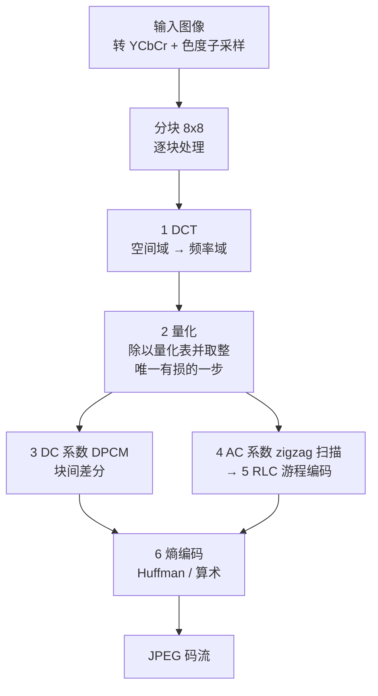
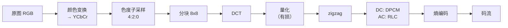

# JPEG 图像压缩

JPEG 是**专为静止图像**设计的压缩方法。它同时支持 lossy 和 lossless 两种模式，但实际几乎只用 lossy。lossy 模式的立足点是两条观察：

1. **空间相似性**：相邻像素颜色接近，可以用一个平均色近似一组像素；
2. **质量可调**：允许使用者在画质与压缩比之间选一个折中点。

整条流水线只有两个大动作——**空间近似**（8×8 块用一组 DCT 系数表示）和 **bit 量化**（24 bit 的颜色用更少的 bit 表示）。剩下五步全都是在给这两个动作收尾。

## 六步主流程

记住一句话：**整条链里只有「量化」丢信息**，DCT、DPCM、RLC、熵编码全部可逆。所以「JPEG 质量」这个旋钮，本质上就是量化表的刻度。

## 1 · DCT：把块换成频率

8×8 块从空间域变到频率域。二维 DCT-II 的标准定义（$C(0)=1/\sqrt2$，$u>0$ 时 $C(u)=1$）：

$$F(u,v)=\frac14 C(u)C(v)\sum_{i=0}^{7}\sum_{j=0}^{7}f(i,j)\cos\frac{(2i+1)u\pi}{16}\cos\frac{(2j+1)v\pi}{16}$$

系数分两类，名字来自电路：

| 系数 | 名称 | 含义 |
|---|---|---|
| $F(0,0)$ | **DC**（direct current，零频） | 与整块**平均亮度**成正比 |
| $F(u,v),\,u\ne0$ 或 $v\ne0$ | **AC**（alternating current） | 描述块内的**变化**：边缘、条纹、纹理 |

**一块纯色**的理想 AC 全为 0；只改这整块的整体明暗，**只有 DC 变**。这个直觉很重要——它解释了后面为什么 DC 单独处理。

### 为什么用 DCT

两个理由，一个来自图像、一个来自人眼：

- **空间冗余**：图像内容变化缓慢，8×8 这个小区域内很少反复剧烈起伏 → 能量集中到少数低频系数（*decorrelation* / *energy packing*）。
- **感知冗余**：心理物理实验表明，人眼对**极高频成分**的丢失远不如对低频成分敏感。所以可以放心把高频系数做粗量化。

DCT 不是唯一选择（也可以用小波等），它胜在**分块后能量集中度好、且是实数变换**。

## 2 · 量化：唯一有损的一步

逐元素做除法再取整：

$$\hat F(u,v)=\operatorname{round}\!\left(\frac{F(u,v)}{Q(u,v)}\right)$$

量化表 $Q$ 的**低频小、高频大**——即对高频用更粗的步长。JPEG 标准给了一张基准亮度表，再按 quality 因子整体缩放：

$$\begin{matrix}
16&11&10&16&24&40&51&61\\
12&12&14&19&26&58&60&55\\
14&13&16&24&40&57&69&56\\
14&17&22&29&51&87&80&62\\
18&22&37&56&68&109&103&77\\
24&35&55&64&81&104&113&92\\
49&64&78&87&103&121&120&101\\
72&92&95&98&112&100&103&99
\end{matrix}$$

左上角（DC）步长 16，右下角（最高频）步长 99——**相差 6 倍**。质量调低就是把整张表乘以更大的系数，让更多高频系数被压成 0。

## 3 · DC 系数用 DPCM

同一个 8×8 块内 DC 只有一个值，但**块与块之间的 DC 不会突变**（相邻块的平均亮度相近）。所以对块的扫描顺序（左→右、上→下）求差分：

$$\mathrm{DPCM}_k=\mathrm{DC}_k-\mathrm{DC}_{k-1},\qquad \text{首个块的前值取 }0$$

例：DC 序列 `150 155 149 152 144` → DPCM `150 5 -6 3 -8`。

差分后的数值**幅度小、方差小**，熵编码就能给它们更短的码字。这就是「用可预测性换比特」。

## 4–5 · AC 系数用 zigzag + RLC

AC 有 63 个。为了让末尾出现**长串的 0**（量化后高频大量归零），用 zigzag 扫描把 8×8 矩阵拉成 64 元向量：

$$\begin{matrix}
0&1&5&6&14&15&27&28\\
2&4&7&13&16&26&29&42\\
3&8&12&17&25&30&41&43\\
9&11&18&24&31&40&44&53\\
10&19&23&32&39&45&52&54\\
20&22&33&38&46&51&55&60\\
21&34&37&47&50&56&59&61\\
35&36&48&49&57&58&62&63
\end{matrix}$$

**zigzag 先走低频、后走高频**，所以「长 0 尾巴」被排到向量的最后。

然后对 $k=1..63$ 做**游程编码（RLC）**，每对写成 $(\text{RUNLENGTH},\text{VALUE})$：RUNLENGTH 是**跳过的 0 的个数**，VALUE 是**其后第一个非零值**。若剩余全是 0，直接发 **EOB = (0,0)** 收尾。

以讲义例子为例，zigzag 后为：

$$32\;\;6\;\;-1\;\;-1\;\;0\;\;-1\;\;0\;\;0\;\;0\;\;-1\;\;0\;\;0\;\;1\;\;0\;\;0\;\;0\;\;\underbrace{0\cdots0}_{\text{全 0}}$$

$$\Longrightarrow\;(0,6)\;(0,-1)\;(0,-1)\;(1,-1)\;(3,-1)\;(2,1)\;(0,0)$$

注意第一个 `32` 是 DC（走 DPCM 那条线），从 `6` 开始才是 AC。

**一个陷阱**：RUNLENGTH 同一个 15 是上限，`(15,0)` 表示「跳过 16 个 0 且后面还没非零值」（ZRL，Zero Run Length），可以连续发多个，用来穿过超长零区而不用浪费一个真实的值。

## 6 · 熵编码

最后把 DC 的 DPCM 值和 AC 的 RLC 对一起送进 Huffman 或算术编码器（JPEG 基准模式用 Huffman，可给每个分量四张表：DC/AC × 亮度/色度）。

还记得熵是**平均码长的下界**（Shannon）：$H=-\sum p\log_2 p$。JPEG 用 Huffman 是个实际折中——Huffman 给整数字长的码字，不能逼近到分数 bit；要更近就得上算术编码（JPEG 扩展模式有，但专利历史上劝退了很多人）。

## 色度子采样：动 Y 之前的先手

$$\mathrm{YCbCr}:\quad Y=0.299R+0.587G+0.114B$$

人眼分辨**颜色**的能力远不如分辨**灰度（亮度）**，所以把色度通道直接降分辨率：

| 方案 | 含义 | 数据量 |
|---|---|---|
| 4:4:4 | 不做子采样 | 100% |
| 4:2:2 | 水平方向色度减半 | ⅔ |
| **4:2:0** | 水平与垂直都减半 | **½** |

4:2:0 是 JPEG 和 MPEG 最常用的方案。它是**在 DCT 之前**做的——先去色度冗余，再做块变换，两步互不干扰。这样就省掉了整整一半的原始数据，而观感损失很小。

## 视觉伪影（artifact）

三个典型症状，成因各不相同：

| 伪影 | 表现 | 成因 |
|---|---|---|
| **Blocking** | 可见的 8×8 边界 | 块独立量化，相邻块 DC 不一致 → 边界不连续 |
| **Ringing** | 边缘附近出现波纹 | 高频被砍掉，相当于用不完整的频率成分重建一个锐利边缘 |
| **Blur** | 细节丢失、发糊 | 高频系数被量化归零 |

低质量（quality 10）时三者同时可见；quality 75 时基本看不出。视频编码器用 **deblocking 环内滤波**（边界附近做低通）专门治 blocking。

## 完整流水线

解码端把上面每一步逆过来：熵解码 → 反 RLC/DPCM → 反 zigzag → 反量化 → IDCT → 上采样色度 → 转回 RGB。**只有「反量化」这一步不可能真正逆转**——这就是 JPEG 的 lossy 所在。

## 参考题型

> 第五周 JPEG/PNG tutorial 的第一题，官方答案已放出，下面直接对照。

### Q1 · JPEG DC 与 AC 系数编码

**(a) DC DPCM 编码**（首个块之前的前值取 0）

原始 DC 序列：`36 42 39 45 43`

| 块 | DC | 前一个 DC | DPCM |
|---|---|---|---|
| 1 | 36 | 0 | **36** |
| 2 | 42 | 36 | **6** |
| 3 | 39 | 42 | **−3** |
| 4 | 45 | 39 | **6** |
| 5 | 43 | 45 | **−2** |

**答案：`[36, 6, -3, 6, -2]`**

**(b) DC DPCM 解码**（同样是前一 DC 从 0 起）

| 块 | DPCM | 前一个 DC | 恢复的 DC |
|---|---|---|---|
| 1 | 48 | 0 | **48** |
| 2 | −5 | 48 | **43** |
| 3 | 0 | 43 | **43** |
| 4 | 7 | 43 | **50** |

**答案：`[48, 43, 43, 50]`**，规则是 $\mathrm{DC}_k=\mathrm{DC}_{k-1}+\mathrm{DPCM}_k$。

**(c)(d) 给定的 8×8 量化 DCT 块**（DC 用粗体标出）

$$\begin{matrix}
\mathbf{36}&7&-2&0&0&0&0&0\\
0&0&0&0&0&0&0&0\\
-3&0&2&0&0&0&0&0\\
0&0&0&0&0&0&0&0\\
0&0&0&0&0&0&0&0\\
0&0&0&0&0&0&0&0\\
0&0&0&0&0&0&0&0\\
0&0&0&0&0&0&0&0
\end{matrix}$$

非零元位置：$(0,0)$=36（DC）、$(0,1)$=7、$(0,2)$=−2、$(2,0)$=−3、$(2,2)$=2。

**(c) 前 15 个 AC 系数（zigzag 序）**

按上面的 zigzag 表逐位取值，索引 1–15 对应 $(0,1),(1,0),(2,0),(1,1),(0,2),(0,3),(1,2),(2,1),(3,0),(4,0),(3,1),(2,2),(1,3),(0,4),(0,5)$：

$$7,\;0,\;-3,\;0,\;-2,\;0,\;0,\;0,\;0,\;0,\;0,\;2,\;0,\;0,\;0$$

**答案：`[7, 0, -3, 0, -2, 0, 0, 0, 0, 0, 0, 2, 0, 0, 0]`**

> 注意第 12 位的 `2` 来自 $(2,2)$——zigzag 让一个看似"深处"的非零值提前出现了。

**(d) 全部 63 个 AC 系数的 RLC**

| zigzag 位置 | 值 | 前面跳过的 0 数 | RLC 对 |
|---|---|---|---|
| 1 | 7 | 0 | **(0, 7)** |
| 2 | 0 | — | — |
| 3 | −3 | 1 | **(1, -3)** |
| 4 | 0 | — | — |
| 5 | −2 | 1 | **(1, -2)** |
| 6–11 | 全 0 | — | — |
| 12 | 2 | 6 | **(6, 2)** |
| 13–63 | 全 0（共 51 个） | — | **EOB** |

**答案：`(0, 7), (1, -3), (1, -2), (6, 2), (0, 0)`**

**易错点**：最后一对是 `(0, 0)` 而不是 `(51, 0)`。51 个零已经到块尾，直接发 EOB 即可——**EOB 的信息量包含"后面全零"这件事**，不需要把零的个数写出来。

## 相关

- [[PNG 与 DEFLATE]]
- [[学习式图像压缩]]
- [[量化]]
- [[视频压缩基础]]
- [[数字图像表示]]
- [[CS5185 题型与答案]]
- [[CS5185 Index]]
