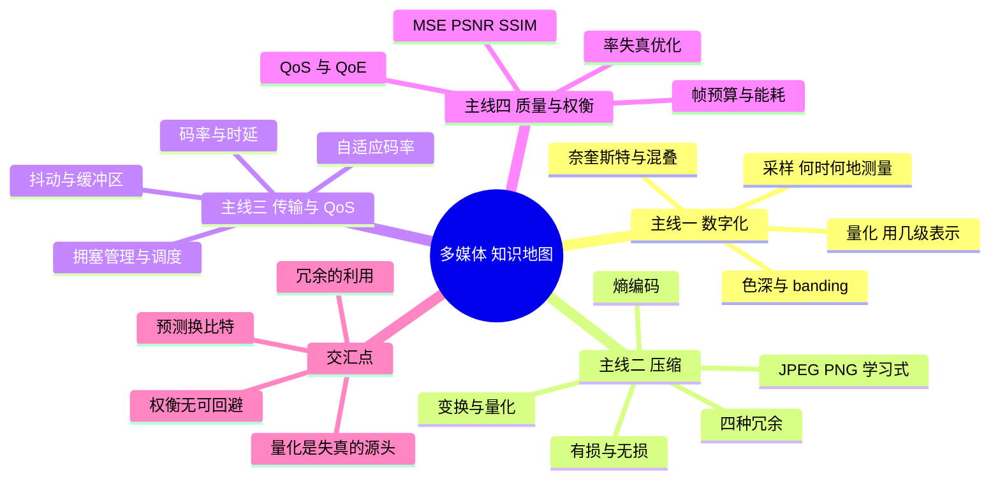
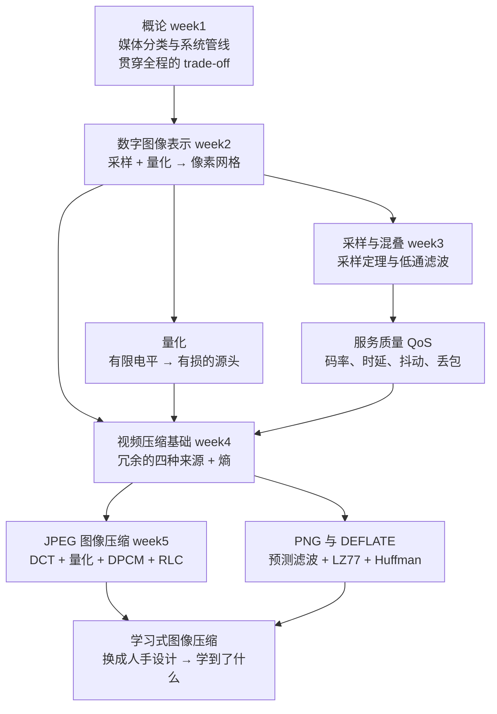
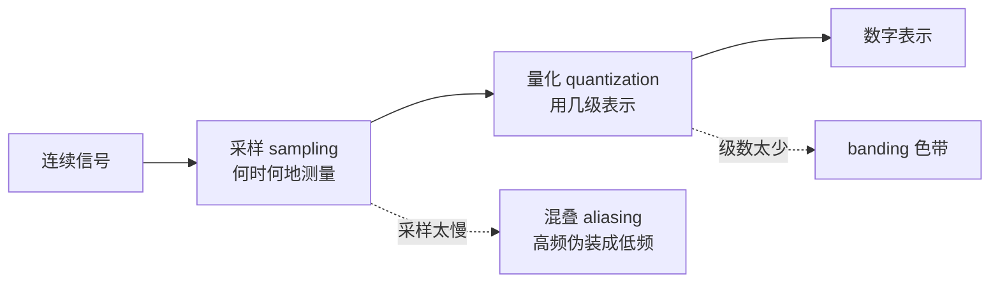
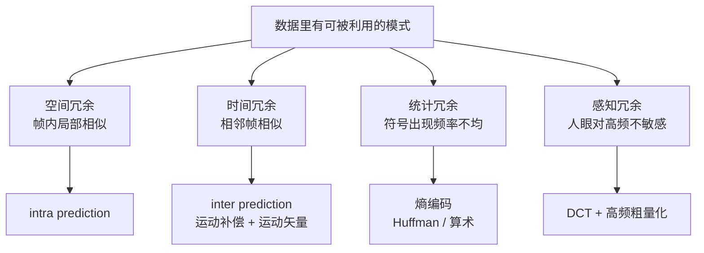
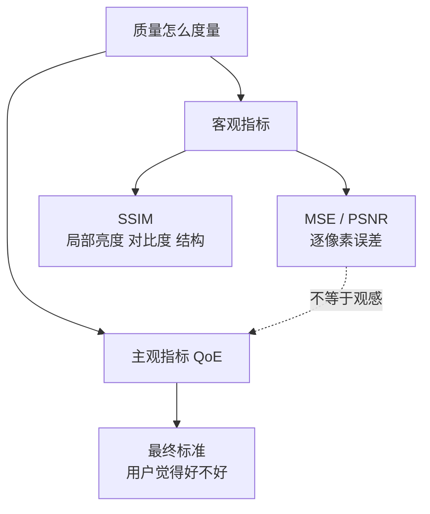

# 多媒体 知识地图

[CS5185 Index](CS5185%20Index.md) 里那些笔记的**总览**。这门课的主线是一句话：

> **media ↔ systems ↔ trade-offs** —— 媒体流之间协同一致，才有连贯的 QoE。

但它不是把「音频、图像、视频、图形」平铺开讲。真正的链条是：**先把连续世界变成数字（采样 + 量化），再想办法用更少的比特表示它（压缩），再想办法在不确定的网络上按时送到（QoS），最后用指标衡量还剩多少质量（PSNR/SSIM/QoE）**。四步都在同一个约束下做权衡：画质、延迟、码率、算力、能耗，**改善一个通常要花掉另一个**。

---

## 一、一条推下来的链条

**每一步在解决上一步的什么问题**：

| 笔记 | 它解决上一步的什么问题 | 它自己引入了什么新问题 |
|---|---|---|
| 概论（week1） | （起点）给出整门课的坐标系 | 只给了 trade-off 清单，没有定量工具 |
| [[数字图像表示]] | 把连续光强场变成有限数字 | 量化不可逆 → banding；数据量爆炸 |
| [[量化]] | 说清"失真从哪来" | 步长与位数的取舍、均匀 vs 非均匀 |
| [[采样与混叠]] | 说清"采样多快才够" | 采样过快 → 数据大；过慢 → 混叠 |
| [[视频压缩基础]] | 数据量必须压下去 | 压缩必然引入失真，需度量 |
| [[服务质量 QoS]] | 压缩后的流怎么按时送到 | 网络不确定 → 缓冲区、自适应 |
| [[JPEG 图像压缩]] | 静止图像的具体压缩方案 | 块效应、振铃、模糊 |
| [[PNG 与 DEFLATE]] | 需要无损时的另一条路 | 照片上几乎压不动 |
| [[学习式图像压缩]] | 手工设计的模块能否换成学出来的 | 生成式会"编造"细节 |

**注意箭头不是树**：量化同时喂给压缩和图像表示；熵既决定 JPEG 的 Huffman 表，又决定 PNG 的 DEFLATE 第二阶段。这是**网**。

---

## 二、四条主线

### 主线 1：数字化 —— 采样与量化

| 问题 | 谁决定 | 代价 |
|---|---|---|
| 空间/时间细节 | **采样率** | 采样率高 → 数据量大 |
| 强度层次 | **bit depth** $b$ | $2^b$ 级，每加 1 bit 级数翻倍 |

**采样定理**：$f_s > 2 f_h$ 才能无损重建；$f_s/2$ 叫**奈奎斯特频率**。采样不足时 3 Hz 和 7 Hz 在 $f_s=10$ Hz 下产生**完全相同的样本**——接收端无从分辨，只能按 $<f_s/2$ 的假设重建为 3 Hz。

**工程解法是在采样之前先低通滤波**：既然高频必然混叠，不如先把它滤掉，再降采样。这样损失的是已知的、可控的高频，而不是无法还原的伪低频。

### 主线 2：压缩 —— 四种冗余

**这四种冗余是整门课压缩部分的骨架**。任何一个具体的编解码器（JPEG、PNG、H.264、VVC）都只是在回答：这四种冗余各用什么手段吃。

**两类压缩的分野**：

| | 无损 | 有损 |
|---|---|---|
| 能否精确还原 | 能 | 不能 |
| 压缩比 | 低 | 高得多 |
| 手段 | 预测 + 字典 + 熵编码 | 上述**再加量化** |
| 例子 | PNG、ZIP | JPEG、MP3、H.26x |
| 适用 | 图形、文本、需要精确像素 | 照片、音频、视频 |

**关键认识：所有有损压缩的失真都来自量化。** DCT 无损、DPCM 无损、RLC 无损、熵编码无损——把它们全部逆过来能得到量化输入的精确值。一旦量化把两个不同的值映射到同一个重建值，那份差别就**永久消失**了。

### 主线 3：传输与 QoS

四个 QoS 度量 —— 各自对应一种**可感知的**症状：

| 度量 | 含义 | 用户看到什么 |
|---|---|---|
| Throughput | 每秒送达的数据量 | 加载慢、画质被迫降低 |
| One-way delay | 发送到接收的时间 | 对话感觉"慢半拍" |
| **Delay variation（jitter）** | 包与包的时延在变 | 卡顿、播放不平滑 |
| Packet loss | 包没到 | 画面出现空洞或损坏 |

**抖动这个点最容易被忽略**：平均时延很稳定也可以体验很差——只要它是**波动**的。讲义例子：时延分别是 40, 45, 65, 40, 50 ms，第 4 个包**比第 3 个先到**。发送是等间隔的，到达不是。

**播放缓冲区（playout buffer）** 是标准的应对：多等一会儿再开始播，用**固定的附加延迟换掉到达时间的抖动**。同一个包在 50 ms 和 70 ms 两种缓冲区设置下，是否"按时"的判定会完全不同。

**三种拥挤管理手段**（记住它们各自牺牲什么）：

| 手段 | 做什么 | 代价 |
|---|---|---|
| **Policing** | 检查是否超限，超了就丢/降优先级 | 丢包 |
| **Shaping** | 把包先存起来，均匀发出 | 时延增加 |
| **Scheduling** | 决定谁先发 | 需定义优先级规则 |

**不同应用要不同的折中**：VoD 允许**多缓冲**求平滑；直播要求**低延迟**宁可偶尔卡一下；实时通话要**快速响应**；文件传输只关心**数据正确**，可以重传。

### 主线 4：质量与权衡

**权衡的维度**：质量 · 延迟 · 码率 · 算力 · 能耗。

| 目标 | 典型代价 | 例子 |
|---|---|---|
| 更高质量 | 更多比特 + 更多算力 | 4K 60fps 比 720p 占大得多的带宽 |
| 更低延迟 | 少缓冲 + 更快的投递 | 视频通话宁可降画质 |
| 更低能耗 | 降分辨率 / 帧率 / 模型规模 | 手机降帧率或亮度省电 |
| 更低码率 | 更强的压缩，通常细节更少 | Wi-Fi 弱时画面变糊、出现伪影 |

**没有唯一最优设置**：正确选择取决于用户、设备、网络。

---

## 三、反复出现的数学工具

这几样在讲义里出现了一次又一次，单独拎出来比记每页细节更有用。

### 1. 数据量公式（三种形态）

$$\text{raw size}=\text{宽}\times\text{高}\times\frac{\text{bits/pixel}}{8}\quad\text{（图像/单帧）}$$

$$\text{raw bitrate}=\text{宽}\times\text{高}\times\text{bits/pixel}\times\text{fps}\quad\text{（视频）}$$

$$\text{PCM bitrate}=\text{采样率}\times\text{bits/sample}\times\text{通道数}\quad\text{（音频）}$$

$$\text{size(MB)}=\frac{\text{rate(Mbit/s)}\times\text{seconds}}{8}\quad\text{（按码率算文件大小）}$$

**压缩比** $=\dfrac{\text{original}}{\text{compressed}}$，**节省** $=\dfrac{\text{original}-\text{compressed}}{\text{original}}$。

> **单位陷阱**：网络速率是 **bit/s**，文件大小是 **byte**。两者之间差一个 ×8，而且题目常混用十进制（1 MB = $10^6$ B）和二进制（1 MiB = $2^{20}$ B）。看题先确认。

### 2. 失真度量

$$\mathrm{MSE}=\frac1N\sum_{i=1}^{N}(x_i-y_i)^2,\qquad \mathrm{PSNR}=10\log_{10}\frac{L^2}{\mathrm{MSE}}\ \text{dB}$$

8-bit 时 $L=255$。**完全相同**的图给 MSE=0 → PSNR=+∞。

**SSIM** 比较对齐小块上的亮度 / 对比度 / 结构三项，再相乘：

$$\mathrm{SSIM}(x,y)=l(x,y)\cdot c(x,y)\cdot s(x,y)=\frac{(2\mu_x\mu_y+C_1)(2\sigma_{xy}+C_2)}{(\mu_x^2+\mu_y^2+C_1)(\sigma_x^2+\sigma_y^2+C_2)}$$

$C_1=(0.01L)^2$，$C_2=(0.03L)^2$。完全相同给 1。

**为什么需要两个指标**：PSNR 是逐像素的，一个**局部位移**就能让它暴跌，但人眼几乎看不出；SSIM 看局部结构，更接近观感。两者都只是代理，**最终标准还是人**。

### 3. 熵 —— 压缩的理论下界

$$H=-\sum_i p_i\log_2 p_i\quad\text{bit/symbol}$$

**Shannon 无损编码定理**：熵率是平均码长的**下界**。所以「还能压多少」这个问题有确定的数学答案。

| 分布 | 熵 |
|---|---|
| 四符号等概率（各 ¼） | 2 bit/symbol |
| `AAAABBCD`（½, ¼, ⅛, ⅛） | $0.5+0.5+0.375+0.375=1.75$ bit/symbol |

**不均匀 = 更便宜**。这是全部统计压缩的立足点。

### 4. 量化与反量化

$$\text{编码}\quad k=Q(x)\qquad\qquad\text{重建}\quad \hat x=Q^{-1}(k)$$

误差 $e=\hat x-x$。**两种分配规则**：

| | 公式 | 误差范围 | 有偏？ |
|---|---|---|---|
| Centered（就近取整） | $k=\lfloor x/\Delta+\tfrac12\rfloor$ | $-\Delta/2<e\le\Delta/2$ | 无偏 |
| Non-centered（取右端） | $k=\max(1,\lceil x/\Delta\rceil)$ | $0\le e<\Delta$ | 有偏，平均 $+\Delta/2$ |

**"更细的量化"不一定"误差更小"**——非均匀量化在近零处放细 bin，那些区间赢，其它区间输。这是一个**分配有限电平预算**的问题。

---

## 四、易混对照

| 容易混的两组 | 关键区别 |
|---|---|
| **采样 vs 量化** | 采样决定**何时何地**测（时间/空间轴），量化决定**用几级**表示（幅度轴）|
| **PPI vs DPI** | PPI 是**图像**像素密度，DPI 是**打印机**墨点密度；单位像，测的不是一件事 |
| **MSE vs PSNR** | 反相关，PSNR 是对 MSE 取对数后的分贝值；都用 $L^2$ 归一 |
| **PSNR vs SSIM** | 逐像素误差 vs 局部结构相似；PSNR 高不代表看着好 |
| **QoS vs QoE** | 网络层面的量 vs 用户感受；**快网络不等于流畅视频** |
| **Delay vs Jitter** | 平均要多久 vs 这个时间稳不稳；抖动才是卡顿的元凶 |
| **均匀居中 vs 非居中量化** | 无偏 vs 恒偏正；默认用居中 |
| **空间 / 时间 / 统计 / 感知冗余** | 帧内相似 / 帧间相似 / 频率不均 / 人眼不敏感 |
| **I / P / B 帧** | 仅帧内 / 前向预测 / 双向预测（要重排序，有延迟）|
| **Huffman vs 算术编码** | 整数长码字 vs 可到分数比特；短块（5–10）Huffman 好，长块（>10）算术好 |
| **RLE vs LZ77** | 只压**单符号连续重复** vs 压**任意重复串**（含重叠复制）|
| **PNG vs JPEG** | 无损（预测+DEFLATE）vs 有损（DCT+量化）；图形 vs 照片 |
| **插值 vs 超分辨率** | 固定核、只用已有样本 vs 用训练数据学出来的统计先验 |
| **保真 vs 感知** | 和参考图像不像 vs 看起来自然；**真实 ≠ 相同** |
| **4:4:4 vs 4:2:0** | 色度不降采样 vs 水平和垂直都减半（数据量减半）|

---

## 五、复习顺序建议

**如果只有一天**：[[数字图像表示]] → [[量化]] → [[视频压缩基础]] → [[JPEG 图像压缩]]。这四篇是压缩主干的完整链条，且互链最密。

**如果有三天**：

1. 第一天：**数字化**（[[数字图像表示]] + [[量化]]）——采样与量化的分工、色深、banding、PSNR/SSIM
2. 第二天：**压缩**（[[视频压缩基础]] → [[JPEG 图像压缩]] → [[PNG 与 DEFLATE]]）——四种冗余 → 熵 → DCT/DPCM/RLC → 无损另一条路
3. 第三天：**系统**（[[采样与混叠]] + [[服务质量 QoS]] + [[学习式图像压缩]]）——采样定理、抖动与缓冲、现代方法

**如果按考试题型**：直接看 [[CS5185 题型与答案]]，七类题型都在那里，答案全部放出。

**做题入口**：[[CS5185 题型与答案]] 收录了全部五周的 tutorial 及详细解答。

---

## 六、题型索引

| 题型 | 考什么 | 出现在 |
|---|---|---|
| **一** 数据量 / 压缩比 / 传输时间 | 四个数据量公式 + 单位换算 | week2 Q1 Q2 |
| **二** 量化与反量化 | 编码规则 → 码字 → 重建 → 误差 | week2 Q4(b)(c)(d)、week3 Q1 Q2 |
| **三** 质量度量 MSE / PSNR / SSIM | 平方误差矩阵 → MSE → PSNR 比较 | week2 Q3、week4 讲义例 |
| **四** 色彩空间转换 | YUV ↔ RGB 反变换 | week2 Q4(a) |
| **五** 熵与变长编码 | 码流拼接、位数、熵计算 | week4 Q1 Q2 |
| **六** JPEG 系数编码 | DPCM、zigzag、RLC、EOB | week5 Q1 |
| **七** PNG 无损压缩 | 滤波残差、LZ77 重叠复制解码 | week5 Q2 |

---

## 七、材料清单

| 周 | 讲义 / 习题 | 对应笔记 |
|---|---|---|
| week1 | Week1.pdf（概论、图形动画、具身 AI）| 本篇 |
| week2 | CS5185_Image_Representation.pdf + Questions | [[数字图像表示]] |
| week3 | Sampling_and_QoS.pdf + CS5185_Quantization_tutorial.pdf | [[采样与混叠]]、[[量化]]、[[服务质量 QoS]] |
| week4 | VC_basic.pdf + VC_basic_Tutorial_Questions.pdf | [[视频压缩基础]] |
| week5 | Image_Compression.pdf + JPEG_PNG_Tutorial（题目与官方答案）| [[JPEG 图像压缩]]、[[PNG 与 DEFLATE]]、[[学习式图像压缩]] |
| 习题 | 五次 tutorial 合集 | [[CS5185 题型与答案]] |

原始文件在 `C:\Users\Lenovo\Desktop\研究生\多媒体\`，按周分五个子文件夹。全部 PDF 都可提取文字（无扫描件）。

---

## 相关

- [[数字图像表示]]
- [[量化]]
- [[采样与混叠]]
- [[服务质量 QoS]]
- [[视频压缩基础]]
- [[JPEG 图像压缩]]
- [[PNG 与 DEFLATE]]
- [[学习式图像压缩]]
- [[CS5185 题型与答案]]
- [[CS5185 Index]]
