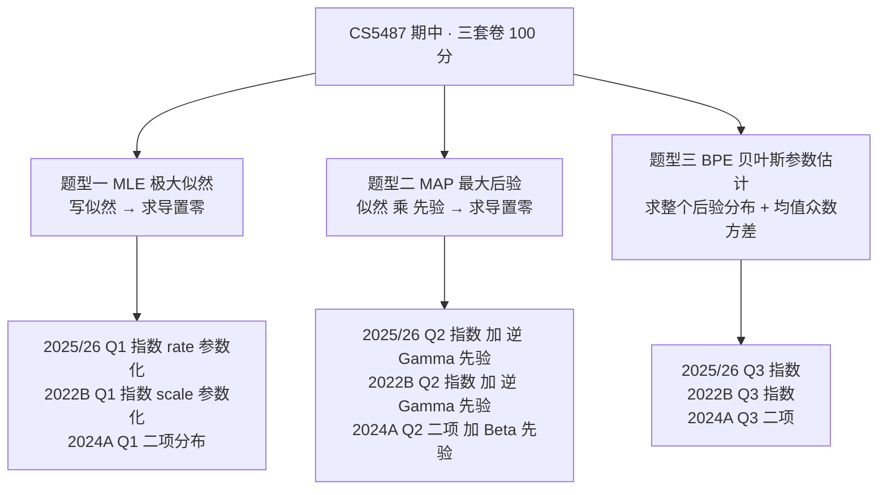

# CS5487 期中真题汇编

三套期中真题（2025/26 Sem A、2024/25 Sem A、2021/22 Sem B）的**题型分类**与**详细解题过程**。

读完最大的收获应该是一句话：**三套卷子是同一张卷子，只换了分布**。题型、小问结构、分值分布、甚至 (d) 问的答案句式都完全一致。所以复习的重点不是"押哪道题"，而是把下面那套模板练到能默写。

原始文件在 `C:\Users\Lenovo\Desktop\研究生\机器学习\`（`2022B-期中真题-解答.pdf`、`2024A-期中真题-官方解答(1).pdf`、`CS5487_Machine Learning_Sem A 2526(1).pdf`）。

---

## 零、三套卷的骨架

| | 2025/26 Sem A | 2024/25 Sem A | 2021/22 Sem B |
|---|---|---|---|
| Q1 MLE | 指数分布（rate）**30** | 二项分布 **35** | 指数分布（scale）**30** |
| Q2 MAP | 指数 + 逆 Gamma **35** | 二项 + Beta **35** | 指数 + 逆 Gamma **35** |
| Q3 BPE | 指数 **35** | 二项 **30** | 指数 **35** |
| 覆盖知识点 | 指数族、共轭先验、充分统计量 | 同左 + 二项似然 | 同左 |

**每个 Problem 内部都是四小问，而且分值分配也是固定的**：

| 小问 | 要求 | 分值 | 套路 |
|---|---|---|---|
| (a) | 写出对数似然 / 后验正比式 | 5 | 常数项全部丢掉，只留含参数的部分 |
| (b) | 写出优化问题（argmax） | 5 | 与 (a) 同一行，白送 |
| (c) | 求导置零，解出估计量 | **15–20** | 唯一有风险的一步，分值大头 |
| (d) | 解释 / $N\to\infty$ 行为 | 5–10 | 答法固定：**后验收敛到 MLE 的 delta 函数** |

**时间预算**：2 小时 3 题。(a)(b) 各 3 分钟写完，(c) 给 20 分钟推导，(d) 5 分钟。剩 20 分钟检查——(c) 的代数最容易出错。

---

## 一、题型一：MLE

### 通用套路（MLE）

1. **写对数似然**：$\log p(D|\theta)=\sum_i \log p(x_i|\theta)$。展开后**把所有不含 $\theta$ 的项扔掉**（组合数、归一化常数）。
2. **写成优化问题**：$\hat\theta_{\text{MLE}}=\arg\max_\theta \log p(D|\theta)$。
3. **求导置零**：$\dfrac{\partial}{\partial\theta}\log p(D|\theta)=0$，解出 $\hat\theta$。
4. **（加分项）验证是最大值**：二阶导 $<0$，或说明目标在参数域上凹。
5. **解释**：估计量对应数据的什么统计量。

**关键概念**：似然不是概率；取对数是单调变换所以不改变 argmax；**充分统计量**是理解后续一切的关键（见 [[最大似然估计 MLE]]）。

---

### 1.1 2025/26 Sem A · Q1：指数分布（rate 参数化）[30]

> 定义 $p(x|\lambda)=\lambda e^{-\lambda x},\ x\ge 0$，$\lambda>0$ 是 **rate（率）参数**，$E[x]=\lambda^{-1}$，$\mathrm{var}(x)=\lambda^{-2}$。给定 $N$ 个样本 $D=\{x_1,\dots,x_N\}$。

**(a) [5] 写出对数似然**

$$
\log p(D|\lambda)=\sum_{i=1}^{N}\log\!\left(\lambda e^{-\lambda x_i}\right)
=\sum_{i=1}^{N}\big(\log\lambda-\lambda x_i\big)
=N\log\lambda-\lambda\sum_{i=1}^{N}x_i
$$

**(b) [5] 写出优化问题**

$$
\hat\lambda_{\text{MLE}}=\arg\max_{\lambda>0}\ \Big[N\log\lambda-\lambda\textstyle\sum_i x_i\Big]
$$

**(c) [15] 求导置零**

$$
\frac{\partial}{\partial\lambda}\Big[N\log\lambda-\lambda\textstyle\sum_i x_i\Big]
=\frac{N}{\lambda}-\sum_i x_i=0
$$

$$
\boxed{\ \hat\lambda_{\text{MLE}}=\frac{N}{\sum_{i=1}^{N}x_i}=\frac{1}{\bar x}\ }
$$

二阶导 $=-\dfrac{N}{\lambda^2}<0$，故为唯一全局最大值（目标在 $\lambda>0$ 上严格凹）。

**(d) [5] 解释**

$\hat\lambda$ 是**样本均值的倒数**，即事件的平均发生速率。等价说法：MLE 把指数分布拟合到"分布的均值 $1/\lambda$ 等于样本均值 $\bar x$"——这是一阶矩匹配。

**知识点**：[[最大似然估计 MLE]] · 指数族 · 充分统计量 $\sum x_i$

---

### 1.2 2021/22 Sem B · Q1：指数分布（scale 参数化）[30]

> **同一道题，但换了一种参数化**：$p(x|\lambda)=\dfrac{1}{\lambda}e^{-x/\lambda},\ x\ge0$，这里 $\lambda$ 是 **scale（尺度）参数**，$E[x]=\lambda$，$\mathrm{var}(x)=\lambda^2$。

**(a) [5]**

$$
\log p(D|\lambda)=\sum_{i=1}^{N}\Big[-\log\lambda-\frac{x_i}{\lambda}\Big]
=-N\log\lambda-\frac{1}{\lambda}\sum_{i=1}^{N}x_i
$$

**(b) [5]**

$$
\hat\lambda_{\text{MLE}}=\arg\max_{\lambda>0}\ \Big[-N\log\lambda-\frac{1}{\lambda}\textstyle\sum_i x_i\Big]
$$

**(c) [15]**

$$
\frac{\partial}{\partial\lambda}\Big[-N\log\lambda-\frac{1}{\lambda}\sum_i x_i\Big]
=-\frac{N}{\lambda}+\frac{1}{\lambda^2}\sum_i x_i=0
$$

两边乘 $\lambda^2$：$-N\lambda+\sum_i x_i=0$，于是

$$
\boxed{\ \hat\lambda_{\text{MLE}}=\frac{1}{N}\sum_{i=1}^{N}x_i=\bar x\ }
$$

**(d) [5]**

$\hat\lambda$ 就是**样本均值**——因为 scale 参数本身等于分布的均值。MLE 让分布均值等于样本均值。

> [!warning] 两个记号陷阱，读这份解答时一定要知道
> 1. **这份 PDF 把 $\sum_i x_i$ 记作 $\bar x$**（原文："where we define $\bar x=\sum_{i=1}^N x_i$ for convenience"）。所以解答里出现 $\bar x$ 的地方是**和**，不是均值。算 $N\to\infty$ 极限时别读错。
> 2. **与 1.1 互为倒数**：同一批数据，rate 版答 $1/\bar x$，scale 版答 $\bar x$。做题第一步永远是看题目给的 $E[x]$ 公式（或 pdf 里指数上的符号），判断是哪一种。

![[midterm-param-trap.png]]

**知识点**：[[最大似然估计 MLE]] · 参数化不唯一（MLE 对一一变换不变：$\hat\lambda_{\text{rate}}=1/\hat\lambda_{\text{scale}}$ 恰好体现这一点）

---

### 1.3 2024/25 Sem A · Q1：二项分布 [35]

> $p(x|\pi)=\binom{n}{x}\pi^{x}(1-\pi)^{n-x}$，$N$ 组**独立**序列，每组 $n$ 次试验。记 $S=\sum_{i=1}^{N}x_i$。

**(a) [5]**

把常数拎出来：$\sum_i x_i=S$，$\sum_i(n-x_i)=Nn-S$，$C=\sum_i\log\binom{n}{x_i}$，得

$$
\log p(D|\pi)=S\log\pi+(Nn-S)\log(1-\pi)+C
$$

**(b) [5]**

$$
\hat\pi=\arg\max_{\pi\in(0,1)}\ \big[S\log\pi+(Nn-S)\log(1-\pi)\big]
$$

**(c) [20]**

$$
\frac{\partial}{\partial\pi}=S\cdot\frac{1}{\pi}+(Nn-S)\cdot\frac{-1}{1-\pi}=0
$$

两边乘 $\pi(1-\pi)$：

$$
S(1-\pi)-(Nn-S)\pi=0\ \Longrightarrow\ S-S\pi-Nn\pi+S\pi=0\ \Longrightarrow\ S=Nn\pi
$$

$$
\boxed{\ \hat\pi=\frac{S}{Nn}=\frac{1}{Nn}\sum_{i=1}^{N}x_i\ }
$$

**(d) [5]**

$\hat\pi$ 是**全部试验中的成功比例**：分子是 $N$ 组序列里的总成功次数，分母是总试验次数。

> [!caution] 本题唯一容易丢分的地方
> 分母是 $Nn$（**总试验数**），不是 $N$（序列数）。这一步错了 (c)(d) 全错。

**知识点**：[[最大似然估计 MLE]] · 充分统计量 $S$ · Bernoulli 是 $n=1$ 的特例（对照 PS3.8）

---

### 题型一汇总

| 卷子 | 分布 | 参数含义 | $\hat\theta_{\text{MLE}}$ |
|---|---|---|---|
| 2025/26 Q1 | 指数 | rate $\lambda$，$E[x]=1/\lambda$ | $N/\sum x_i=1/\bar x$ |
| 2022B Q1 | 指数 | scale $\lambda$，$E[x]=\lambda$ | $\bar x$ |
| 2024A Q1 | 二项 | 成功概率 $\pi$ | $S/(Nn)$ |

**共同点**：MLE 都等于某个"样本均值"意义上的量。这不是巧合——这三个分布都属于**指数族**，MLE 就是令样本充分统计量的均值等于其理论期望（矩匹配）。

---

## 二、题型二：MAP

### 通用套路（MAP）

1. **写出后验正比式**：$p(\theta|D)\propto p(D|\theta)p(\theta)$，分母 $p(D)$ 与 $\theta$ 无关，直接丢。
2. **取对数、合并同类项**：把 $\log\theta$ 的系数和 $\theta$ 的系数分别加起来。
3. **求导置零**：解出 $\hat\theta_{\text{MAP}}$。
4. **与 MLE 对比**：找出"多出来的项"，给出**虚拟样本（virtual samples）**解读。
5. **$N\to\infty$**：先验被数据冲淡，MAP $\to$ MLE，衰减速率 $O(1/N)$。

**核心恒等式**（[[贝叶斯估计与共轭先验]]、[[偏差方差与过拟合]]）：

$$\text{加先验}\ \equiv\ \text{加正则}\ \equiv\ \text{加虚拟样本}\ \equiv\ \text{收缩}$$

---

### 2.1 2025/26 Sem A · Q2：指数 + 逆 Gamma 先验 [35]

> 沿用 Q1 的指数分布（**rate 参数化**，$p(x|\lambda)=\lambda e^{-\lambda x}$）。令 $\gamma=\frac{1}{\lambda}$，给定 $\gamma$ 的先验为**逆 Gamma分布**
> $$p(\gamma)=\mathrm{InvGamma}(\gamma|\alpha,\beta)=\frac{\beta^{\alpha}}{\Gamma(\alpha)}\Big(\frac{1}{\gamma}\Big)^{\alpha+1}e^{-\beta/\gamma}$$
> 并给出 $E[\gamma]=\frac{\beta}{\alpha-1}$（$\alpha>1$）、$\mathrm{var}(\gamma)=\frac{\beta^2}{(\alpha-1)^2(\alpha-2)}$（$\alpha>2$）、$\mathrm{mode}(\gamma)=\frac{\beta}{\alpha+1}$。
>
> 题目特意注明：**"here is $\lambda$ not $\gamma$, it is no[[CS5487 期中真题汇编]]t an error. Move on!"** —— 出题人知道这个参数替换会让人卡住，特意提醒。

**(a) [5] 优化问题**

$$
\hat\lambda_{\text{MAP}}=\arg\max_{\lambda}\ \big[\log p(D|\lambda)+\log p(\lambda)\big]
$$

关键是把先验从 $\gamma$ 换到 $\lambda$。由 $\gamma=1/\lambda$，换元要带 **Jacobian** $\big|\frac{d\gamma}{d\lambda}\big|=\frac{1}{\lambda^2}$：

$$
p(\lambda)=p(\gamma)\Big|\frac{d\gamma}{d\lambda}\Big|
=\frac{\beta^{\alpha}}{\Gamma(\alpha)}\,\lambda^{\alpha+1}e^{-\beta\lambda}\cdot\frac{1}{\lambda^{2}}
=\frac{\beta^{\alpha}}{\Gamma(\alpha)}\,\lambda^{\alpha-1}e^{-\beta\lambda}
$$

即 **$\gamma$ 上的 $\mathrm{InvGamma}(\alpha,\beta)$ 换元到 $\lambda$ 上恰好是 $\mathrm{Gamma}(\alpha,\beta)$**（这是逆 Gamma 与 Gamma 的标准对偶）。

$$
\log p(\lambda)=(\alpha-1)\log\lambda-\beta\lambda+\text{const}
$$

于是

	log⁡p(λ|D)∝Nlog⁡λ−λ∑ixi⏟似然+(α−1)log⁡λ−βλ⏟先验=(N+α−1)log⁡λ−(∑ixi+β)λ

**(b) [15] 求导置零**

$$
\frac{\partial}{\partial\lambda}\Big[(N+\alpha-1)\log\lambda-(\textstyle\sum_i x_i+\beta)\lambda\Big]
=\frac{N+\alpha-1}{\lambda}-\Big(\sum_i x_i+\beta\Big)=0
$$

$$
\boxed{\ \hat\lambda_{\text{MAP}}=\frac{N+\alpha-1}{\sum_{i=1}^{N}x_i+\beta}\ }
$$

**(c) [10] 与 MLE 对比 · 虚拟样本解读**

| | 分子 | 分母 |
|---|---|---|
| MLE | $N$ | $\sum x_i$ |
| MAP | $N+(\alpha-1)$ | $\sum x_i+\beta$ |

分子多出 $(\alpha-1)$、分母多出 $\beta$，于是：**相当于在看真实数据之前，先往数据里塞了 $(\alpha-1)$ 个观测、总时长 $\beta$**。

注意这里的 $\lambda$ 是 rate（事件数 / 总时长），所以这组虚拟样本贡献的**速率**是 $\dfrac{\alpha-1}{\beta}$——而这恰好等于 $\mathrm{Gamma}(\alpha,\beta)$ 的**众数**（它的均值是 $\alpha/\beta$，MAP 用的是众数，不是均值）。

一句话：**MAP = 把先验的众数当成 $(\alpha-1)$ 份虚拟数据，然后做 MLE**。这个规律在 2.2 的 scale 版本里同样成立（那里先验众数是 $\beta/(\alpha+1)$，复制成 $(\alpha+1)$ 份）。

**(d) [5] $N\to\infty$**

$$
\hat\lambda_{\text{MAP}}=\frac{N+\alpha-1}{\sum_i x_i+\beta}\ \xrightarrow[N\to\infty]{}\ \frac{N}{\sum_i x_i}=\hat\lambda_{\text{MLE}}
$$

先验的影响以 $O(1/N)$ 衰减。

> [!warning] 本题的隐藏雷区：MAP **不是**参数不变换的
> 如果把 $\gamma$ 直接替换成 $1/\lambda$ 而**漏掉 Jacobian**，会得到
> $$\log p(\lambda|D)\propto (N+\alpha+1)\log\lambda-(\textstyle\sum x_i+\beta)\lambda
> \ \Longrightarrow\ \hat\lambda_{\text{MAP}}=\frac{N+\alpha+1}{\sum x_i+\beta}$$
> 与严格答案只差 $2$（$\alpha-1$ vs $\alpha+1$）。
>
> 原因是**后验众数不是参数无关的**：变换参数会移动密度的峰值位置。这与 [[贝叶斯估计与共轭先验]] 里 PS3.2 考的是同一件事（MLE 对任意单调变换不变，MAP 只对**线性**变换不变）。
>
> **建议的答题策略**：写出带 Jacobian 的严格推导，然后在末尾加一句"若将先验直接按 $\gamma\to1/\lambda$ 代入而不做变量替换，结果为 $\frac{N+\alpha+1}{\sum x_i+\beta}$"。两种都摆出来，无论评分标准认哪一种都不会失分。（2025/26 卷官方未公布解答，这一点值得找老师核对。）

**知识点**：[[贝叶斯估计与共轭先验]] · 共轭先验 · 逆 Gamma ↔ Gamma 对偶 · 虚拟样本 · **MAP 无参数不变性**

---

### 2.2 2021/22 Sem B · Q2：指数 + 逆 Gamma 先验 [35]

> **scale 参数化**：$p(x|\lambda)=\frac{1}{\lambda}e^{-x/\lambda}$，先验直接给在 $\lambda$ 上：
> $p(\lambda)=\frac{\beta^{\alpha}}{\Gamma(\alpha)}\lambda^{-(\alpha+1)}e^{-\beta/\lambda}=\mathrm{InvGamma}(\alpha,\beta)$

**(a) [5]**

$$
\log p(\lambda|D)\propto
\underbrace{-N\log\lambda-\frac{1}{\lambda}\textstyle\sum_i x_i}_{\text{似然}}
+\underbrace{-(\alpha+1)\log\lambda-\frac{\beta}{\lambda}}_{\log p(\lambda)}
=-(N+\alpha+1)\log\lambda-\frac{\sum_i x_i+\beta}{\lambda}
$$

**(b) [15]**

$$
\frac{\partial}{\partial\lambda}\Big[-(N+\alpha+1)\log\lambda-\frac{\sum_i x_i+\beta}{\lambda}\Big]
=-\frac{N+\alpha+1}{\lambda}+\frac{\sum_i x_i+\beta}{\lambda^2}=0
$$

乘 $\lambda^2$：$-(N+\alpha+1)\lambda+\big(\sum_i x_i+\beta\big)=0$，得

$$
\boxed{\ \hat\lambda_{\text{MAP}}=\frac{\sum_{i=1}^{N}x_i+\beta}{N+\alpha+1}\ }
$$

**(c) [10] 虚拟样本解读**

分子多 $\beta$、分母多 $(\alpha+1)$，即**增加 $(\alpha+1)$ 个虚拟样本，其总和为 $\beta$、平均值为 $\frac{\beta}{\alpha+1}$**。

注意 $\frac{\beta}{\alpha+1}$ 正是先验 $\mathrm{InvGamma}(\alpha,\beta)$ 的**众数**——先验信息被复制成 $(\alpha+1)$ 份虚拟观测。

**(d) [5]** $N\to\infty$ 时 $\hat\lambda_{\text{MAP}}\to\frac{1}{N}\sum_i x_i=\bar x=\hat\lambda_{\text{MLE}}$。

> [!note] 与 2.1 的对照
> 2.1 的答案 $\frac{N+\alpha-1}{\sum x_i+\beta}$ 与本题的 $\frac{\sum x_i+\beta}{N+\alpha+1}$ **互为倒数且 $\alpha$ 的符号相反**——这不是矛盾，而是因为两题的 $\lambda$ 是不同的参数（rate vs scale）。把 2.1 的 $\lambda$ 换成 $1/\lambda$、再按 MAP 的变换规则重算，就会跨越这个差别。

---

### 2.3 2024/25 Sem A · Q2：二项 + Beta 先验 [35]

> 沿用 Q1 的二项似然，先验 $\mathrm{Beta}(\alpha,\beta)$：$p(\pi)\propto\pi^{\alpha-1}(1-\pi)^{\beta-1}$。记 $S=\sum_i x_i$。

**(a) [5]**

$$
\log p(\pi|D)\propto
\underbrace{S\log\pi+(Nn-S)\log(1-\pi)+C}_{\text{似然}}
+\underbrace{(\alpha-1)\log\pi+(\beta-1)\log(1-\pi)+D}_{\log p(\pi)}
$$

$$
=(S+\alpha-1)\log\pi+(Nn-S+\beta-1)\log(1-\pi)+\text{const}
$$

**(b) [15]**

$$
\frac{\partial}{\partial\pi}=\frac{S+\alpha-1}{\pi}-\frac{Nn-S+\beta-1}{1-\pi}=0
$$

两边乘 $\pi(1-\pi)$：

$$
(S+\alpha-1)(1-\pi)-(Nn-S+\beta-1)\pi=0
$$

$$
\boxed{\ \hat\pi_{\text{MAP}}=\frac{S+\alpha-1}{Nn+\alpha+\beta-2}\ }
$$

（这正是 $\mathrm{Beta}(S+\alpha,\ Nn-S+\beta)$ 的众数公式。）

**(c) [10] 虚拟序列解读**

- $(\alpha-1)$ = 虚拟序列里"成功"的试验次数
- $(\beta-1)$ = 虚拟序列里"失败"的试验次数
- $(\alpha+\beta-2)$ = 虚拟试验的总次数

**(d) [5]** $N\to\infty$ 时 $S$ 也增大，虚拟样本被压过去，$\hat\pi_{\text{MAP}}\to S/(Nn)=\hat\pi_{\text{MLE}}$。

> [!tip] 与 PS3.8 的联系
> $\mathrm{Beta}(\alpha,\beta)$ 先验下，Bernoulli 的 MAP（众数）用 $\alpha-1,\beta-1$，而后验**均值**用 $\alpha,\beta$。这个"众数 vs 均值"的差别在 Q3(c) 会再出现一次。

**知识点**：[[贝叶斯估计与共轭先验]] · Beta–Bernoulli 共轭 · 拉普拉斯平滑 · 虚拟样本

---

### 题型二汇总

| 卷子 | 分布 / 参数 | 先验 | $\hat\theta_{\text{MAP}}$ | 虚拟样本 |
|---|---|---|---|---|
| 2025/26 Q2 | 指数 rate $\lambda$ | $\gamma=1/\lambda\sim\mathrm{InvGamma}(\alpha,\beta)$ | $\dfrac{N+\alpha-1}{\sum x_i+\beta}$ | $(\alpha-1)$ 个观测，总时长 $\beta$ |
| 2022B Q2 | 指数 scale $\lambda$ | $\mathrm{InvGamma}(\alpha,\beta)$ | $\dfrac{\sum x_i+\beta}{N+\alpha+1}$ | $(\alpha+1)$ 个观测，总和 $\beta$ |
| 2024A Q2 | 二项 $\pi$ | $\mathrm{Beta}(\alpha,\beta)$ | $\dfrac{S+\alpha-1}{Nn+\alpha+\beta-2}$ | $(\alpha-1)$ 成功、$(\beta-1)$ 失败 |

**读数规律**：MAP 的分子分母 = **数据的充分统计量 + 先验的"伪计数"**。伪计数取多少，由**先验的众数公式**决定（Beta 是 $\alpha-1,\beta-1$；逆 Gamma 是 $\alpha+1$）。别把"后验均值用的计数"和"众数用的计数"搞混。

---

## 三、题型三：BPE（贝叶斯参数估计）

### 通用套路（BPE）

和 MAP 只差一步：**MAP 只要众数，BPE 要整个后验分布**。

1. **(a) [5]** 写 $p(\theta|D)=\dfrac{p(D|\theta)p(\theta)}{\int p(D|\theta)p(\theta)\,d\theta}\propto p(D|\theta)p(\theta)$。**强调分母与 $\theta$ 无关**，所以正比号成立。
2. **(b) [15]** 把 $\theta$ 的幂次和指数合并，与已知分布族的密度形式**对号入座**，读出后验参数。这一步就是要证明"共轭"。
3. **(c) [5]** 报后验统计量（均值 / 众数 / 方差），给出虚拟样本解读。
4. **(d) [10]** $N\to\infty$：均值、众数 $\to$ MLE；方差 $\to0$，速度 $O(1/N)$；**后验收敛到 MLE 上的 delta 函数**。

**记住三条后验统计量公式**（$\mathrm{Beta}(a,b)$ 与 $\mathrm{Gamma}(a,b)$）：

$$
\mathrm{Beta}(a,b):\quad E=\frac{a}{a+b},\quad \mathrm{mode}=\frac{a-1}{a+b-2},\quad \mathrm{var}=\frac{ab}{(a+b)^2(a+b+1)}
$$

$$
\mathrm{Gamma}(a,b):\quad E=\frac{a}{b},\quad \mathrm{mode}=\frac{a-1}{b},\quad \mathrm{var}=\frac{a}{b^2}
$$

![[midterm-posterior-concentration.png]]

---

### 3.1 2025/26 Sem A · Q3：指数 + 逆 Gamma 先验 [35]

> 与 Q2 同一套设定（$\lambda$ 是 rate，$\gamma=1/\lambda\sim\mathrm{InvGamma}(\alpha,\beta)$）。

**(a) [5] 写出后验**

$$
p(\lambda|D)=\frac{p(D|\lambda)p(\lambda)}{\displaystyle\int p(D|\lambda)p(\lambda)\,d\lambda}\ \propto\ p(D|\lambda)p(\lambda)
$$

代入似然 $\lambda^{N}e^{-\lambda\sum x_i}$ 与换元后的先验 $\lambda^{\alpha-1}e^{-\beta\lambda}$：

$$
p(\lambda|D)\ \propto\ \lambda^{N}e^{-\lambda\sum_i x_i}\cdot\lambda^{\alpha-1}e^{-\beta\lambda}
=\lambda^{N+\alpha-1}e^{-\lambda(\sum_i x_i+\beta)}
$$

（分母是归一化常数，与 $\lambda$ 无关，不用算。）

**(b) [15] 求后验的具体分布**

与 $\mathrm{Gamma}(a,b)$ 的密度 $\propto\lambda^{a-1}e^{-b\lambda}$ 的形式对号入座：

$$
a=N+\alpha,\qquad b=\sum_{i=1}^{N}x_i+\beta
$$

$$
\boxed{\ p(\lambda|D)=\mathrm{Gamma}\big(\lambda\ \big|\ N+\alpha,\ \textstyle\sum_i x_i+\beta\big)\ }
$$

在 $\gamma$ 的语言下，同一个后验写成

$$
p(\gamma|D)=\mathrm{InvGamma}\big(\gamma\ \big|\ \alpha+N,\ \beta+\textstyle\sum_i x_i\big)
$$

**与 2022B Q3(b) 完全相同**——这印证了两套卷的"同题换名"关系。

**(c) [5] 后验均值的解读**

$$
E[\lambda|D]=\frac{a}{b}=\frac{N+\alpha}{\sum_{i=1}^{N}x_i+\beta}
$$

解读：同样是虚拟样本——**相当于补充了 $\alpha$ 个观测、总时长 $\beta$**。

> [!note] 为什么这里用 $\alpha$，而 MAP 用 $\alpha-1$？
> 因为**后验均值用 $\mathrm{Gamma}(a,b)$ 的 $a$，后验众数用 $a-1$**。所以在同一个后验上：
> - 众数（= MAP）$=\dfrac{N+\alpha-1}{\sum x_i+\beta}$
> - 均值（= BPE）$=\dfrac{N+\alpha}{\sum x_i+\beta}$
>
> 两题问的是同一个后验的**不同统计量**，虚拟样本的"份数"自然差 1。这是 2022B Q3(c) 里"加 $\alpha-1$ 个虚拟样本"与这里"加 $\alpha$ 个"的唯一区别。

**(d) [10] $N\to\infty$ 会发生什么**

后验 $\mathrm{Gamma}(N+\alpha,\ \sum x_i+\beta)$ 的三个统计量：

$$
E[\lambda|D]=\frac{N+\alpha}{\sum_i x_i+\beta}\ \xrightarrow[N\to\infty]{}\ \frac{N}{\sum_i x_i}=\hat\lambda_{\text{MLE}}
$$

$$
\mathrm{mode}=\frac{N+\alpha-1}{\sum_i x_i+\beta}\ \xrightarrow[N\to\infty]{}\ \frac{N}{\sum_i x_i}=\hat\lambda_{\text{MLE}}
$$

$$
\mathrm{var}(\lambda|D)=\frac{N+\alpha}{(\sum_i x_i+\beta)^2}\ \approx\ \frac{N}{(N\bar x)^2}=\frac{1}{N\bar x^{2}}\ \longrightarrow\ 0\quad\text{（速率 }O(1/N)\text{）}
$$

**结论**：均值与众数都奔向 MLE，方差以 $O(1/N)$ 衰减到 0，因此**后验收敛为集中在 MLE 上的 delta 函数**——这就是"数据足够多时，贝叶斯估计与频率派 MLE 合一"。

**验算（可写进答案当加分项）**：指数分布 rate 参数的 Fisher 信息 $\mathcal I(\lambda)=1/\lambda^2$，渐近后验方差 $\approx\frac{1}{N\mathcal I(\lambda)}=\frac{\lambda^2}{N}=\frac{1}{N\bar x^2}$，与上式一致。这就是 **Bernstein–von Mises** 现象。

**知识点**：[[贝叶斯估计与共轭先验]] · 共轭先验 · 后验一致性 · [[最大似然估计 MLE]] 的渐近有效性

---

### 3.2 2021/22 Sem B · Q3：指数 + 逆 Gamma 先验 [35]

**(a) [5]**

$$
p(\gamma|D)\propto p(D|\gamma)p(\gamma)
=\prod_{i=1}^{N}\Big[\frac{1}{\gamma}e^{-x_i/\gamma}\Big]\cdot\frac{\beta^{\alpha}}{\Gamma(\alpha)}\Big(\frac{1}{\gamma}\Big)^{\alpha+1}e^{-\beta/\gamma}
$$

$$
\propto\frac{1}{\gamma^{N}}e^{-\frac{1}{\gamma}\sum_i x_i}\cdot\Big(\frac{1}{\gamma}\Big)^{\alpha+1}e^{-\beta/\gamma}
$$

**(b) [15]**

合并 $\gamma$ 的幂次与指数部分：

$$
p(\gamma|D)\propto\Big(\frac{1}{\gamma}\Big)^{N+\alpha+1}e^{-\frac{1}{\gamma}(\sum_i x_i+\beta)}
$$

与 $\mathrm{InvGamma}(a,b)\propto(1/\gamma)^{a+1}e^{-b/\gamma}$ 对号入座，得 $a=\alpha+N$，$b=\beta+\sum_i x_i$：

$$
\boxed{\ p(\gamma|D)=\mathrm{InvGamma}\big(\gamma\ \big|\ \alpha+N,\ \beta+\textstyle\sum_i x_i\big)\ }
$$

**(c) [5]** 后验均值 $=\dfrac{\beta+\sum_i x_i}{\alpha+N-1}$（需 $\alpha>1$），相当于**增加 $\alpha-1$ 个虚拟样本、总和为 $\beta$**。

**(d) [10]**

$$
E[\gamma|D]=\frac{\beta+\sum x_i}{\alpha+N-1}\xrightarrow{}\frac{\sum x_i}{N},\qquad
\mathrm{mode}(\gamma|D)=\frac{\beta+\sum x_i}{\alpha+N+1}\xrightarrow{}\frac{\sum x_i}{N}
$$

$$
\mathrm{var}(\gamma|D)=\frac{(\beta+\sum x_i)^2}{(\alpha+N-1)^2(\alpha+N-2)}\approx\frac{(N\gamma)^2}{N^2\cdot N}=\frac{\gamma^2}{N}=O(1/N)\longrightarrow0
$$

于是后验收敛为 MLE 上的 delta 函数。

> [!warning] 标题与内容不符
> 本题标题写的是 **"Bayesian estimation for Geometric distribution"**，但似然用的是**指数分布** $\frac{1}{\gamma}e^{-x/\gamma}$（我已核对原 PDF 图像，标题确实如此）。**照似然做，别被标题带偏。** 2024A Q3 有同样的问题（见 3.3）。

---

### 3.3 2024/25 Sem A · Q3：二项 + Beta 先验 [30]

**(a) [5]**

$$
p(\pi|D)\propto p(D|\pi)p(\pi)=\Big[\prod_{i=1}^{N}\pi^{x_i}(1-\pi)^{n-x_i}\Big]\pi^{\alpha-1}(1-\pi)^{\beta-1}
$$

**(b) [15]**

$$
p(\pi|D)\propto\pi^{\sum_i x_i}(1-\pi)^{Nn-\sum_i x_i}\,\pi^{\alpha-1}(1-\pi)^{\beta-1}
=\pi^{S+\alpha-1}(1-\pi)^{Nn-S+\beta-1}
$$

与 $\mathrm{Beta}(a,b)\propto\pi^{a-1}(1-\pi)^{b-1}$ 对号入座：

$$
\boxed{\ p(\pi|D)=\mathrm{Beta}\big(\pi\ \big|\ S+\alpha,\ Nn-S+\beta\big)\ }
$$

**(c) [5]** 后验参数的虚拟试验解读：

- $\hat\alpha=S+\alpha$ = 成功试验数（$S$ 实测 + $\alpha$ 虚拟）
- $\hat\beta=Nn-S+\beta$ = 失败试验数（$Nn-S$ 实测 + $\beta$ 虚拟）

（注意这里用 $\alpha,\beta$，因为 (c) 问的是**后验均值**；MAP 用 $\alpha-1,\beta-1$。）

**(d) [10]**

$$
E[\hat\pi]=\frac{S+\alpha}{Nn+\alpha+\beta}\xrightarrow{}\frac{S}{Nn},\qquad
\mathrm{mode}=\frac{S+\alpha-1}{Nn+\alpha+\beta-2}\xrightarrow{}\frac{S-1}{Nn-2}\approx\frac{S}{Nn}
$$

$$
\mathrm{var}(\hat\pi)=\frac{\hat\alpha\hat\beta}{(\hat\alpha+\hat\beta)^2(\hat\alpha+\hat\beta+1)}
=\frac{(S+\alpha)(Nn-S+\beta)}{(Nn+\alpha+\beta)^2(Nn+\alpha+\beta+1)}
\approx\frac{\pi(1-\pi)}{Nn}\longrightarrow0
$$

后验方差以 $1/(Nn)$ 衰减，后验收敛为 MLE 上的 delta 函数。

**验算**：Binomial/Bernoulli 的 Fisher 信息 $\mathcal I(\pi)=\frac{1}{\pi(1-\pi)}$，渐近后验方差 $\approx\frac{1}{Nn\,\mathcal I(\pi)}=\frac{\pi(1-\pi)}{Nn}$。✓ 与上式一致。

> [!warning] 这份官方解答里有一处笔误
> 原文写 "the variance decays as $\mathrm{var}(\hat\pi)=1/O(N^2)$"，但它自己给出的表达式是 $\dfrac{O(NnS)}{O((Nn)^3)}$，代入 $S\approx Nn\pi$ 得到的是 $O\!\big(\frac{1}{Nn}\big)$，即 **$1/(总试验数)$、也就是 $O(1/N)$**，不是 $O(1/N^2)$。
>
> **正确的口径是：后验方差 $\propto 1/(\text{总观测数})$。** 单参数情况下后验标准差 $\propto1/\sqrt{N}$、方差 $\propto1/N$，这是普遍规律，不要背成 $1/N^2$。

> [!warning] 标题与内容不符（同 3.2）
> 标题写 **"Negative Binomial distribution"**，但似然用的是**二项分布**。

---

### 题型三汇总

| 卷子 | 后验分布 | 后验均值 | 后验众数（= MAP） | 方差速率 |
|---|---|---|---|---|
| 2025/26 Q3 | $\mathrm{Gamma}(N+\alpha,\ \sum x_i+\beta)$ | $\dfrac{N+\alpha}{\sum x_i+\beta}$ | $\dfrac{N+\alpha-1}{\sum x_i+\beta}$ | $O(1/N)$ |
| 2022B Q3 | $\mathrm{InvGamma}(\alpha+N,\ \beta+\sum x_i)$ | $\dfrac{\beta+\sum x_i}{\alpha+N-1}$ | $\dfrac{\beta+\sum x_i}{\alpha+N+1}$ | $O(1/N)$ |
| 2024A Q3 | $\mathrm{Beta}(S+\alpha,\ Nn-S+\beta)$ | $\dfrac{S+\alpha}{Nn+\alpha+\beta}$ | $\dfrac{S+\alpha-1}{Nn+\alpha+\beta-2}$ | $O(1/(Nn))$ |

**注意 2025/26 与 2022B 的后验是同一个分布**（$\lambda$ 与 $\gamma$ 互为倒数）。但两者给出的"MAP"分母差 2：$N+\alpha-1$（rate 版）vs $N+\alpha+1$（scale 版）。这**不是**笔误，正是 2.1 里讲的那件事——**后验众数在换参下会移动**，所以"取倒数"和"重新求众数"得到的是两个不同的值。考试时按题目要求的那个参数认真推。

---

## 四、公式速查表

### 似然与 MLE

| 分布 | 密度 | MLE | 充分统计量 |
|---|---|---|---|
| 指数（**rate** $\lambda$） | $\lambda e^{-\lambda x}$ | $\hat\lambda=\dfrac{N}{\sum x_i}=\dfrac1{\bar x}$ | $\sum x_i$ |
| 指数（**scale** $\lambda$） | $\frac1\lambda e^{-x/\lambda}$ | $\hat\lambda=\bar x=\dfrac{\sum x_i}{N}$ | $\sum x_i$ |
| 二项（$N$ 组各 $n$ 次） | $\binom{n}{x}\pi^x(1-\pi)^{n-x}$ | $\hat\pi=\dfrac{S}{Nn}$ | $S=\sum x_i$ |
| Bernoulli | $\theta^x(1-\theta)^{1-x}$ | $\hat\theta=\dfrac1N\sum x_i$ | $\sum x_i$ |
| Poisson | $\dfrac{\lambda^x e^{-\lambda}}{x!}$ | $\hat\lambda=\bar x$ | $\sum x_i$ |
| Gaussian（$\mu$ 未知、$\sigma^2$ 已知） | $\mathcal N(\mu,\sigma^2)$ | $\hat\mu=\bar x$ | $\sum x_i$ |

### 共轭对与后验

| 似然 | 共轭先验 | 后验 | MAP |
|---|---|---|---|
| 指数（scale） | $\mathrm{InvGamma}(\alpha,\beta)$ | $\mathrm{InvGamma}(\alpha{+}N,\ \beta{+}\sum x_i)$ | $\dfrac{\sum x_i+\beta}{N+\alpha+1}$ |
| 指数（rate） | $\mathrm{Gamma}(\alpha,\beta)$ | $\mathrm{Gamma}(N{+}\alpha,\ \sum x_i{+}\beta)$ | $\dfrac{N+\alpha-1}{\sum x_i+\beta}$ |
| Binomial / Bernoulli | $\mathrm{Beta}(\alpha,\beta)$ | $\mathrm{Beta}(S{+}\alpha,\ Nn{-}S{+}\beta)$ | $\dfrac{S+\alpha-1}{Nn+\alpha+\beta-2}$ |
| Poisson | $\mathrm{Gamma}(\alpha,\beta)$ | $\mathrm{Gamma}(\alpha{+}\sum x_i,\ \beta{+}N)$ | $\dfrac{\sum x_i+\alpha-1}{N+\beta}$ |
| Multinomial | $\mathrm{Dirichlet}(\boldsymbol\alpha)$ | $\mathrm{Dirichlet}(\boldsymbol\alpha+\mathbf c)$ | — |

### 后验统计量

| | 均值 | 众数（MAP） | 方差 |
|---|---|---|---|
| $\mathrm{Beta}(a,b)$ | $\frac{a}{a+b}$ | $\frac{a-1}{a+b-2}$ | $\frac{ab}{(a+b)^2(a+b+1)}$ |
| $\mathrm{Gamma}(a,b)$ | $\frac{a}{b}$ | $\frac{a-1}{b}$ | $\frac{a}{b^2}$ |
| $\mathrm{InvGamma}(a,b)$ | $\frac{b}{a-1}$ | $\frac{b}{a+1}$ | $\frac{b^2}{(a-1)^2(a-2)}$ |

---

## 五、易错点清单

1. **指数分布有两种参数化，答案互为倒数。**
   - rate：$p=\lambda e^{-\lambda x}$，$E[x]=1/\lambda$ ⟹ $\hat\lambda=1/\bar x$
   - scale：$p=\frac1\lambda e^{-x/\lambda}$，$E[x]=\lambda$ ⟹ $\hat\lambda=\bar x$
   - **第一步永远是看题目给的 $E[x]$ 或 pdf 里指数上的符号。** 25/26 用 rate，2022B 用 scale。

2. **MAP 没有参数不变性。** 后验众数不能直接取倒数。2.1 里 $\alpha-1$ 与 $\alpha+1$ 的差别就是这么来的。MLE 对任意一一变换不变，MAP 只对线性变换不变。

3. **虚拟样本的"个数"要用对。** 后验**均值**用 $\alpha$（Beta 里是 $\alpha,\beta$），后验**众数（=MAP）**用 $\alpha-1$（Beta 里是 $\alpha-1,\beta-1$）。同一个后验的两个不同统计量，别混。

4. **二项题的分母是 $Nn$ 不是 $N$。** 总试验数 = 序列数 × 每条序列的试验次数。

5. **后验方差 $\propto 1/(\text{总观测数})$，不是 $1/N^2$。** 2024A Q3 官方解答此处写错了（见 3.3 的警告框）。

6. **2022B 解答把 $\sum_i x_i$ 记成了 $\bar x$。** 读的时候当"和"处理。

7. **标题可能与似然不符。** 2022B Q3 标题写 Geometric、2024A Q3 标题写 Negative Binomial，但两者的似然分别是指数和二项。**照似然做。**

8. **别漏掉 (d) 问的"后验变成 delta 函数"这句话。** 每题 10 分，(d) 的标准答案就是"均值与众数 $\to$ MLE、方差 $\to0$、后验收敛为集中在 MLE 上的 delta 函数"。写全三句。

---

## 六、26/27 期中备考预测

**结构不变**：3 题 = MLE / MAP / BPE，每题四小问，共 100 分。**唯一会变的是分布。**

已验证考过的（三套卷）：
- 指数 × MLE / MAP / BPE（22B 用 scale，25/26 用 rate）—— **考了两次**
- 二项 × MLE / MAP / BPE（24A）

还没考过、但结构完全一样的，属于高风险候选：

| 分布 | 共轭先验 | 后验 | $\hat\lambda_{\text{MAP}}$ | 备注 |
|---|---|---|---|---|
| **Poisson** | $\mathrm{Gamma}(\alpha,\beta)$ | $\mathrm{Gamma}(\alpha+\sum x_i,\ \beta+N)$ | $\dfrac{\sum x_i+\alpha-1}{N+\beta}$ | 最可能的候选。与指数的似然只差 $x!$ 的常数 |
| **Geometric** | $\mathrm{Beta}(\alpha,\beta)$ | $\mathrm{Beta}(\alpha+N,\ \beta+\sum(x_i-1))$ | $\dfrac{N+\alpha-1}{N+\alpha+\beta+\sum x_i-3}$ | 22B Q3 标题里出现过这个名字，值得准备 |
| **Gaussian**（$\mu$ 未知，$\sigma^2$ 固定） | $\mathcal N(\mu_0,\sigma_0^2)$ | $\mathcal N\!\Big(\dfrac{\sigma_0^2\sum x_i+\sigma^2\mu_0}{N\sigma_0^2+\sigma^2},\ \frac{\sigma^2\sigma_0^2}{N\sigma_0^2+\sigma^2}\Big)$ | 后验均值 | 精度相加；对照 PS3.6/3.11 |
| **Uniform / Laplace** | 无共轭 | 数值或解析 | — | 22B Q1 之外的 PS 题考过 |

**复习动作**：

1. 把 **Poisson + Gamma** 完整手推一遍（MLE / MAP / BPE 三问、四小问全写），这是当前最可能的新题。
2. 把 **Geometric + Beta** 推一遍（对应 22B 那个"标题写 Geometric"的暗示）。
3. 三套卷每道题的 **(c) 问默写一遍**——包括求导、乘分母化简那一步的代数。分全在这里。
4. (d) 问准备一句百搭答案：**"后验均值与众数 $\to$ MLE，方差以 $O(1/N)$ 衰减到 0，后验收敛为集中在 MLE 上的 delta 函数。"**

---

## 相关

- [[CS5487 Index]]
- [[机器学习 知识地图]]
- [[最大似然估计 MLE]] —— 题型一的知识点源头
- [[贝叶斯估计与共轭先验]] —— 题型二、三的全部知识点（共轭先验、虚拟样本、MAP 非不变性）
- [[偏差方差与过拟合]] —— 方差衰减、收缩、样本量的作用
