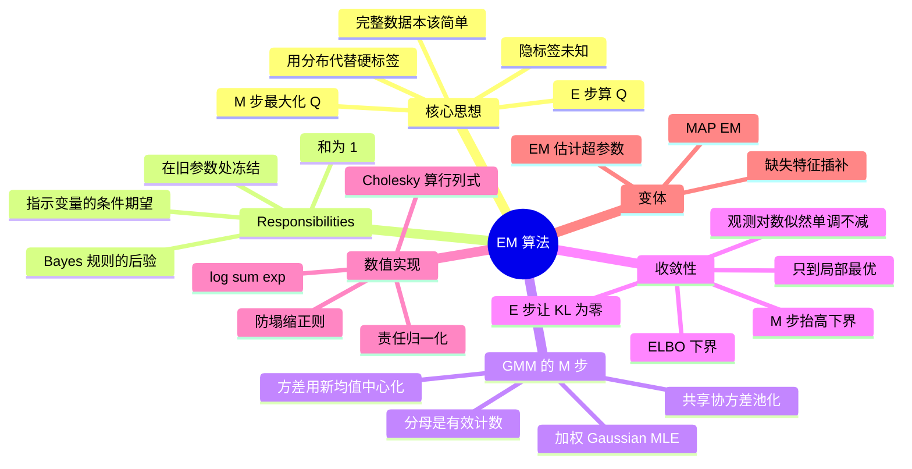

# EM 算法

GMM 的真正目标是边缘似然 $\log p(X\mid\theta)=\sum_i\log\sum_k\pi_k N(x_i\mid\mu_k,\sigma_k^2)$——求和套在 log 里面，没有闭式解。EM（Expectation–Maximization）是**带隐变量的最大似然**的通用迭代框架，把「已知标签时的简单问题」交替地用到未知标签上。

![[em-iterations.png]]

> 图：EM 在一维二分量 GMM 上的前三轮迭代（第 0、1、12 轮）。注意两个分量的**移动方向**：它们不是直接跳到各自的簇中心，而是先「分开一点、收窄一点」，逐步逼近。第 12 轮已经收敛到稳定解。

---

## 核心思想

若知道完整数据 $(X,Z)$，优化很简单：

$$\log p(X,Z\mid\theta)=\sum_i\sum_k z_{ik}\big[\log\pi_k+\log N(x_i\mid\mu_k,\sigma_k^2)\big]$$

但 $Z$ 未知。EM 用**隐标签的一个分布**代替硬标签：

- **E-step**：用当前参数算出每个缺失标签的条件期望，得

$$Q(\theta;\theta^{old})=\mathbb E_{Z\mid X,\theta^{old}}\big[\log p(X,Z\mid\theta)\big]$$

- **M-step**：$\theta^{new}=\arg\max_\theta Q(\theta;\theta^{old})$。

然后 $\theta^{old}\leftarrow\theta^{new}$，重复直到收敛。

> [!tip] 一句话记住 EM
> **「假装隐变量已知，做一次简单估计；再用估计出的参数，重新猜隐变量」。**
>
> 这里的「猜隐变量」不是猜一个硬标签，而是猜一个**分布**（responsibility）。用分布而不是硬标签，正是 EM 与「硬分配聚类」的全部区别，也正是 EM 不会丢失信息、不会陷入震荡的原因。

---

## Responsibilities 的推导

E-step 里对指示变量取期望，得到 **responsibility**（软分配）：

$$r_{ij}=\mathbb E[z_{ij}]=\;P(z_i=j\mid x_i,\theta^{old})=\frac{\pi_j^{old}N(x_i\mid\mu_j^{old},\sigma_j^{old\,2})}{\sum_{k}\pi_k^{old}N(x_i\mid\mu_k^{old},\sigma_k^{old\,2})}$$

这是 Bayes 规则：分量 $j$ 对观测 $i$ 的**后验概率**。性质 $0\le r_{ij}\le1$、$\sum_j r_{ij}=1$：每个样本对每个分量都贡献一个权重（软分配）。把 $Q$ 里的硬指示 $z_{ij}$ 换成 $r_{ij}$ 即可。

（一个容易误解的点：$r_{ij}$ 是在**旧参数**处算出的固定数，M-step 里当常数处理。它出现在 $\nabla_\theta\log p(x_i\mid\theta)$ 的链式法则里，不是「假设 $r$ 与 $\theta$ 无关」推出来的。）

> [!warning] 三个常见误解
> 1. **「E 步在算 $Q(\theta)$」**——严格说，E 步只算**足够的统计量**（对 GMM 就是 $r_{ij}$、$N_j$、$\sum_i r_{ij}x_i$、$\sum_i r_{ij}x_ix_i^\top$），不必真的写出 $Q$ 的函数表达式。PS4.10(b) 特意强调了这点：**枚举所有隐变量配置是不必要的**。
> 2. **「EM 是梯度上升」**——不完全是。EM 每一步是**精确最大化下界**，不是沿梯度走一小步。所以它的收敛速度是线性的（不是超线性的），但每步**保证**不降低似然（梯度法需要调学习率才能保证）。
> 3. **「$r$ 是模型参数」**——不是。$r$ 是**隐变量的后验**，由当前参数**导出**。把它当成参数去优化（即 PS4 里说的「硬分配 hack」）得到的是另一个目标函数。

---

## GMM 的 M-step

把 $Q$ 对参数求导（responsibilities 固定），得到的其实是**加权的 Gaussian MLE**。记 $N_j=\sum_i r_{ij}$（簇 $j$ 的总权重）：

$$\mu_j^{new}=\frac{1}{N_j}\sum_i r_{ij}x_i,\qquad (\sigma_j^2)^{new}=\frac{1}{N_j}\sum_i r_{ij}(x_i-\mu_j^{new})^2,\qquad \pi_j^{new}=\frac{N_j}{n}$$

方差用**新均值**中心化（同一步里一起优化）。分母是**同一分量**的有效计数 $N_j$。协方差情形的更新里用 trace 恒等式 $a^\top Ba=\mathrm{tr}(Baa^\top)$ 更简洁；共享协方差时把各分量的散度池化、分母换成总样本数 $n$。

**多元版本**（PS4.3）：

$$\mu_j^{new}=\frac{\sum_i r_{ij}x_i}{N_j},\qquad \Sigma_j^{new}=\frac{1}{N_j}\sum_i r_{ij}(x_i-\mu_j^{new})(x_i-\mu_j^{new})^\top$$

推导的关键一步是把二次型换成 trace：$Q_{\Sigma_j}=-\frac{N_j}{2}\log|\Sigma_j|-\frac12\mathrm{tr}(\Sigma_j^{-1}S_j)$，然后

$$\nabla_{\Sigma_j}Q=-\frac{N_j}{2}\Sigma_j^{-1}+\frac12\Sigma_j^{-1}S_j\Sigma_j^{-1}=0\;\xrightarrow{\text{左右乘}\Sigma_j}\; -N_j\Sigma_j+S_j=0$$

**注意 $N_j$ 的两种来源**：$\pi_j=N_j/n$ 里的 $n$ 是**总样本数**（因为 $\sum_j N_j=n$），而 $\Sigma_j$ 的分母是**该分量的** $N_j$。这个区分是 M-step 里最容易抄错的地方。

**为什么方差用新均值中心化**：$\mu_j$ 和 $\Sigma_j$ 是在**同一步**里联合优化的，所以 M-step 的解必须满足「均值处的驻点条件」，即中心化用 $\mu_j^{new}$ 而不是 $\mu_j^{old}$。用旧均值也收敛（有些人这么实现），但严格说那不是 M-step 的精确解，不保证单调性。

对应 E/M 交替就是：E 步用旧参数算 $r$，M 步用 $r$ 算加权均值/方差/权重。

![[em-convergence.png]]

> 图：EM 的收敛曲线。左：观测对数似然**单调不减**（这是 EM 的招牌性质）；右：参数轨迹在参数空间里盘旋逼近驻点。注意似然曲线在后期**越来越平**——线性收敛，接近驻点时改进越来越小，所以实际代码用「改进量 < 容差」而不是「梯度 = 0」做停止条件。

---

## 收敛性

**每次精确的 EM 迭代都不降低观测数据的 log-likelihood**：

$$\log p(X\mid\theta^{old})\le\log p(X\mid\theta^{new})$$

**下界解释**：对任意隐分布 $q(Z)$，

$$\log p(X\mid\theta)=\mathcal L(q,\theta)+\mathrm{KL}\big(q(Z)\,\|\,p(Z\mid X,\theta)\big)\ge\mathcal L(q,\theta)$$

其中 $\mathcal L=\mathbb E_q[\log p(X,Z\mid\theta)]-\mathbb E_q[\log q]$。E-step 选 $q=p(Z\mid X,\theta^{old})$ 让 KL=0（下界与真实 log-likelihood 相切）；M-step 固定 $q$ 抬高下界。$H(q)$ 与 $\theta$ 无关，离散标签下 $H(q)\ge0$，于是 $\mathcal F$ 与 $Q$ 关系明确。

![[em-elbo.png]]

> 图：ELBO 与 log-likelihood 的关系。实线是真实 $\log p(X\mid\theta)$，虚线是 $\mathcal L(q,\theta)$。E 步（$q$ 更新）把虚线**抬到与实线相切**（在 $\theta^{old}$ 处 $\mathrm{KL}=0$）；M 步（$\theta$ 更新）沿虚线爬到它的最高点。因为虚线处处在实线**下方**，所以在虚线最高点处的实线值 $\ge$ 虚线最高点 $\ge$ 起点实线值——**单调性就是这样被夹出来的**。

**收敛证明的核心结构**（用 KL 的非负性）：

$$\log p(X\mid\theta^{new})\overset{(1)}{\ge}\mathcal L(q^{old},\theta^{new})\overset{(2)}{\ge}\mathcal L(q^{old},\theta^{old})\overset{(3)}{=}\log p(X\mid\theta^{old})$$

- $(1)$：$\mathcal L\le\log p$ 对任意 $q,\theta$ 成立（KL 非负）；
- $(2)$：M-step 定义就是最大化 $\mathcal L(q^{old},\cdot)$；
- $(3)$：$q^{old}$ 是 $\theta^{old}$ 处的精确后验，故 KL $=0$，$\mathcal L=\log p$。

**注意**：
- 收敛可能很慢；
- 极限可能是**局部最优或驻点**（stationary point），不保证全局最优；
- **对初始化敏感**——多试几组初值，比较最终 log-likelihood。

**数值细节**：算 responsibilities 时用 log-sum-exp 避免下溢——先算 $a_{ij}=\log\pi_j+\log N(x_i\mid\mu_j,\sigma_j^2)$，则 $\log r_{ij}=a_{ij}-\mathrm{logsumexp}_k a_{ik}$。协方差的行列式用 Cholesky $\Sigma=LL^\top$，$\log|\Sigma|=2\sum_i\log L_{ii}$ 更稳。

---

## 其他要点

EM 是通用框架，HMM、线性动态系统、图模型都用它。GMM 里要防**方差塌缩**与**零有效成员的分量**（$N_j=0$ 需删除或重初始化）。**MAP-EM**：目标改成 $Q(\theta;\theta^{old})+\log p(\theta)$，E-step 不变（先验与 $Z$ 无关），只在 M-step 多一项先验——均值的更新变成

$$\mu_j^{new}=\frac{\sum_i r_{ij}x_i+(\sigma_j^2/\sigma_0^2)\mu_0}{N_j+\sigma_j^2/\sigma_0^2}$$

即先验相当于 $(\sigma_j^2/\sigma_0^2)$ 个位于 $\mu_0$ 的虚拟观测；$N_j$ 小时收缩最强，$\sigma_0^2\to\infty$ 退化为普通加权均值。

> [!warning] MAP-EM 为什么只改 M 步
> 因为先验 $p(\theta)$ **不依赖隐变量 $Z$**，所以在 E 步里
> $$\mathbb E_{Z\mid X,\theta^{old}}\big[\log p(X,Z\mid\theta)+\log p(\theta)\big]=\mathbb E[\log p(X,Z\mid\theta)]+\log p(\theta)$$
> 第二项是常数，可以提出期望外。因此 E 步完全不变，只有 M 步的目标多了一项。
>
> **这个结构让 MAP-EM 几乎免费**：任何 EM 实现，只要在 M-step 的目标里加一个 $\log p(\theta)$，就变成 MAP-EM。它同时解决了 GMM 的**似然无界**问题——方差有了先验，塌缩不再给出无穷似然，算法自动避免退化解。这是实践中最常用的防塌缩手段（scikit-learn 的 `GaussianMixture` 里的 `reg_covar` 就是它的简化版：给协方差硬加下限）。

**EM 的变体地图**：

| 隐变量是什么 | 应用 |
|---|---|
| 混合分量标签 $z$ | GMM 聚类、混合专家 |
| 缺失的观测值 | 缺失数据插补（PS4.7） |
| 状态序列 | HMM（Baum-Welch）|
| 隐变量 $\theta$ 本身 | 超参数估计 / empirical Bayes（PS4.9）|

---

## 习题

> 来源：**PS-4 Mixture Models and the EM Algorithm**（原题号保留）。4.1–4.6 在 [[高斯混合模型 GMM]]。解答折叠。

### PS4.3 多元 GMM 的 EM

**题目.** (a) 写完整数据对数似然 $\ell_c$。(b) 写出 E-step 与 $Q(\theta;\theta^{old})$。(c) 求 $\mu_j$、$\Sigma_j$、$\pi_j$ 的 M-step。

> [!success]- 解答（先自己做，再点开）
> **(a)** 每个观测只有一个指示为 1：
> $$p(X,Z\mid\theta)=\prod_i\prod_j\big[\pi_j N(x_i\mid\mu_j,\Sigma_j)\big]^{z_{ij}}$$
> 取对数：
> $$\ell_c=\sum_{i,j}z_{ij}\Big[\log\pi_j-\frac d2\log(2\pi)-\frac12\log|\Sigma_j|-\frac12(x_i-\mu_j)^\top\Sigma_j^{-1}(x_i-\mu_j)\Big]$$
> **关键**：指示变量把「log 里套着分量求和」这个麻烦的结构**去掉了**——变成分量内可加的简单形式。
>
> **(b)** E-step 用 Bayes 规则：
> $$r_{ij}=\frac{\pi_j^{old}N(x_i\mid\mu_j^{old},\Sigma_j^{old})}{\sum_k\pi_k^{old}N(x_i\mid\mu_k^{old},\Sigma_k^{old})}$$
> 由期望的线性性，把 $\ell_c$ 里每个 $z_{ij}$ 换成 $r_{ij}$ 即得
> $$Q=\sum_{i,j}r_{ij}\Big[\log\pi_j-\frac d2\log(2\pi)-\frac12\log|\Sigma_j|-\frac12(x_i-\mu_j)^\top\Sigma_j^{-1}(x_i-\mu_j)\Big]$$
> 右边的所有 $r_{ij}$ 在 M-step 里都是**固定数**。
>
> **(c) 均值**：$\nabla_{\mu_j}Q=\Sigma_j^{-1}\sum_i r_{ij}(x_i-\mu_j)=0\Rightarrow\sum_i r_{ij}x_i=N_j\mu_j\Rightarrow\mu_j^{new}=\frac{\sum_i r_{ij}x_i}{N_j}$。
>
> **协方差**：代入新均值，记 $S_j=\sum_i r_{ij}(x_i-\mu_j^{new})(x_i-\mu_j^{new})^\top$。用 trace 恒等式，
> $$Q_{\Sigma_j}=-\frac{N_j}{2}\log|\Sigma_j|-\frac12\mathrm{tr}(\Sigma_j^{-1}S_j)$$
> 求导：$-\frac{N_j}{2}\Sigma_j^{-1}+\frac12\Sigma_j^{-1}S_j\Sigma_j^{-1}=0$，左右乘 $\Sigma_j$ 得 $-N_j\Sigma_j+S_j=0$，故
> $$\Sigma_j^{new}=\frac{1}{N_j}\sum_i r_{ij}(x_i-\mu_j^{new})(x_i-\mu_j^{new})^\top$$
>
> **权重**：$Q$ 中含 $\pi_j$ 的项是 $\sum_j N_j\log\pi_j$，带 $\sum\pi_j=1$ 约束，Lagrange 得 $N_j/\pi_j-\eta=0$，两边乘 $\pi_j$ 求和得 $\eta=n$，故 $\pi_j^{new}=N_j/n$。
>
> **三个实践警告**（PS-4 解答明确指出）：
> 1. 更新要求 $N_j>0$；**空分量必须删除或重新初始化**；
> 2. $S_j$ 奇异时 $\Sigma_j$ 落在正定域的边界上，实际代码需要**正则化**（加 $\epsilon I$）；
> 3. 所有这些只给出**局部**最优解。

### PS4.7 缺失特征下的 EM

**题目.** 数据 $\{z_i=(x_i,y_i)^\top\}_{i=1}^n$，其中**只有 $y_1$ 缺失**，$x_1,\dots,x_n$ 和 $y_2,\dots,y_n$ 都观测到。(a) 对角协方差时写 $\ell_c$。(b) 写出 E-step 算出的 $Q$。(c) 求 M-step。(d) 求不动点，解释结果。(e)–(h) 一般协方差的情形。

> [!success]- 解答（先自己做，再点开）
> 记 $v_x=\sigma_x^2$、$v_y=\sigma_y^2$。
>
> **(a) 对角协方差**：每对独立，$p(x_i,y_i)=N(x_i\mid\mu_x,v_x)N(y_i\mid\mu_y,v_y)$，故
> $$\ell_c=-n\log(2\pi)-\frac n2\log v_x-\frac{1}{2v_x}\sum_{i=1}^n(x_i-\mu_x)^2-\frac n2\log v_y-\frac{1}{2v_y}\sum_{i=1}^n(y_i-\mu_y)^2$$
>
> **(b) E-step。** 由独立性，$y_1\mid X,Y_I,\hat\theta\sim N(\hat\mu_y,\hat v_y)$（老的固定参数）。展开缺失项的平方：
> $$\mathbb E[(y_1-\mu_y)^2]=\mathbb E[y_1^2]-2\mu_y\mathbb E[y_1]+\mu_y^2=(\hat v_y+\hat\mu_y^2)-2\mu_y\hat\mu_y+\mu_y^2=\hat v_y+(\hat\mu_y-\mu_y)^2$$
> （用了 $\mathbb E[y_1^2]=\mathrm{Var}+\text{mean}^2$。）$y_1$ 是唯一随机的，所以
> $$Q=-\frac n2\log v_x-\frac{1}{2v_x}\sum_{i=1}^n(x_i-\mu_x)^2-\frac n2\log v_y-\frac{1}{2v_y}\Big[\sum_{i=2}^n(y_i-\mu_y)^2+\hat v_y+(\hat\mu_y-\mu_y)^2\Big]+\text{const}$$
> 这正是题目要的 (4.13)。
>
> **(c) M-step。** 对均值求导：
> $$\frac{\partial Q}{\partial\mu_x}=\frac{1}{v_x}\sum_{i=1}^n(x_i-\mu_x)=0,\qquad \frac{\partial Q}{\partial\mu_y}=\frac{1}{v_y}\Big[\sum_{i=2}^n(y_i-\mu_y)+\hat\mu_y-\mu_y\Big]=0$$
> 第二个式子统计的是**多少个 $y$**：$\sum_{i=2}^n(y_i-\mu_y)$ 有 $n-1$ 项，加上 $(\hat\mu_y-\mu_y)$ 一项，共 $n$ 项。于是
> $$\mu_x^{new}=\frac1n\sum_{i=1}^n x_i,\qquad \mu_y^{new}=\frac{\hat\mu_y+\sum_{i=2}^n y_i}{n}$$
> **注意**：缺失值被它的**条件期望** $\hat\mu_y$ **填补**（imputation），然后当作一个真实观测点一起平均。这就是 EM 插补的核心思想。
>
> 方差：目标形如 $-\frac n2\log v-\frac{A}{2v}$，导数为 $-\frac{n}{2v}+\frac{A}{2v^2}=0\Rightarrow v=A/n$。所以
> $$v_x^{new}=\frac1n\sum_{i=1}^n(x_i-\mu_x^{new})^2,\qquad v_y^{new}=\frac{\hat v_y+(\hat\mu_y-\mu_y^{new})^2+\sum_{i=2}^n(y_i-\mu_y^{new})^2}{n}$$
> **关键**：$\hat v_y$ 这一项**必须保留**。它代表「我们对 $y_1$ 的估计本身有多不确定」。只填 $\hat\mu_y$ 而丢掉 $\hat v_y$ 会**低估**方差——这是很多「简单插补」实现犯的错。
>
> **(d) 不动点。** 令新旧参数相等：
> $$n\mu_y=\mu_y+\sum_{i=2}^n y_i\;\Longrightarrow\;\mu_y=\frac{1}{n-1}\sum_{i=2}^n y_i$$
> $$nv_y=v_y+0+\sum_{i=2}^n(y_i-\mu_y)^2\;\Longrightarrow\;v_y=\frac{1}{n-1}\sum_{i=2}^n(y_i-\mu_y)^2$$
>
> **解读**：这就是**只用那 $n-1$ 个观测到的 $y$** 算出来的 ML 估计。分母的 $n-1$ 是「观测样本数」，**不是**无偏性修正（这里分母是 $n-1$ 只是因为观测到的 $y$ 有 $n-1$ 个）。
>
> **为什么 $x_1$ 帮不上忙**：对角协方差下 $x$ 与 $y$ **独立**，所以知道 $x_1$ 对预测 $y_1$ 没有任何信息量。EM 最终给出了「诚实」的答案——它没有凭空制造信息。
>
> **(e)–(h) 一般协方差。** 记 $z_i=(x_i,y_i)^\top\in\mathbb R^2$。
> - **(f)** 用 trace 与期望的线性性：
> $$\mathbb E[(z_1-\mu)^\top\Sigma^{-1}(z_1-\mu)]=\mathbb E\,\mathrm{tr}[\Sigma^{-1}(z_1-\mu)(z_1-\mu)^\top]=\mathrm{tr}\big[\Sigma^{-1}\mathbb E[(z_1-\mu)(z_1-\mu)^\top]\big]$$
> - **(g) 条件期望。** 由老模型的高斯条件公式：
> $$\hat\mu_{y\mid x_1}=\hat\mu_y+\frac{\hat\Sigma_{yx}}{\hat\Sigma_{xx}}(x_1-\hat\mu_x),\qquad \hat v_{y\mid x_1}=\hat\Sigma_{yy}-\frac{\hat\Sigma_{yx}^2}{\hat\Sigma_{xx}}$$
> 记 $\hat z_1=(x_1,\hat\mu_{y\mid x_1})^\top$、$\hat\Sigma_1=\mathrm{diag}(0,\hat v_{y\mid x_1})$，则
> $$\mathbb E[(z_1-\mu)(z_1-\mu)^\top]=(\hat z_1-\mu)(\hat z_1-\mu)^\top+\hat\Sigma_1$$
> - **(h) M-step**：$\mu^{new}=\frac{\hat z_1+\sum_{i=2}^n z_i}{n}$，
> $$\Sigma^{new}=\frac{1}{n}\Big[\hat\Sigma_1+(\hat z_1-\mu^{new})(\hat z_1-\mu^{new})^\top+\sum_{i=2}^n(z_i-\mu^{new})(z_i-\mu^{new})^\top\Big]$$
>
> **与对角情形的差别**：现在**相关性让 $x_1$ 能帮助预测 $y_1$**（通过 $\hat\Sigma_{yx}/\hat\Sigma_{xx}$ 这个回归系数）。而且 $\hat\Sigma_1$ 是一个**非对角**结构（这里因为 $x_1$ 已知所以只有第二对角元非零），把它丢掉会低估不确定性。
>
> **这个题的一般教训**：EM 处理缺失数据的模板就是「**用条件期望填补 + 把条件方差加进散度**」。这两步缺一不可。

### PS4.8 多项分布的 EM（经典题）

**题目.** 观测到 $n$ 个样本落在四类中，计数为 $x_1,x_2,x_3,x_4$（$n=x_1+x_2+x_3+x_4$），四类的概率分别是 $\frac{2+\theta}{4},\ \frac{1-\theta}{4},\ \frac{1-\theta}{4},\ \frac{\theta}{4}$。(a) 写出 $\ell(\theta)$ 并求 MLE。(b) 如果知道**第一类可以再分成**两类（概率 $\frac12,\frac\theta4$ 不归一化地记作「x11: 概率 $1/2$」与「x12: 概率 $\theta/4$」），写完整数据的 MLE。(c) 用 EM 迭代。

> [!success]- 解答（先自己做，再点开）
> 记 $a=x_1$、$b=x_2+x_3$、$c=x_4$、$n=a+b+c$。
>
> **(a) 观测 MLE。** 四项概率乘 $4^{-n}$ 与多项式系数都是常数，所以
> $$\ell(\theta)=a\log(2+\theta)+b\log(1-\theta)+c\log\theta+\text{const}$$
> 求导置零：
> $$\frac{a}{2+\theta}-\frac{b}{1-\theta}+\frac{c}{\theta}=0$$
> 通分（乘 $\theta(1-\theta)(2+\theta)>0$）整理得
> $$a\theta(1-\theta)-b\theta(2+\theta)+c(2+\theta)(1-\theta)=0\;\Longrightarrow\;-n\theta^2+(a-2b-c)\theta+2c=0$$
> 解一元二次方程，取 $[0,1]$ 内的根：
> $$\hat\theta=\frac{a-2b-c+\sqrt{(a-2b-c)^2+8nc}}{2n}$$
> （另一根非正，舍去。）且 $\ell''(\theta)=-\frac{a}{(2+\theta)^2}-\frac{b}{(1-\theta)^2}-\frac{c}{\theta^2}<0$（$n>0$ 时严格凹），所以这个驻点确实是唯一极大。**如果某个计数为 0**，端点要按连续性理解，上面的根会自动给出正确的边界极大。
>
> **(b) 完整数据的 MLE。** 若第一类的细分已知，$x_{11}$ 的概率 $1/2$ 不含 $\theta$，只有 $x_{12}$（概率 $\theta/4$）和 $x_2,x_3$（概率 $(1-\theta)/4$）含 $\theta$。所以
> $$\ell_c=(x_{12}+c)\log\theta+b\log(1-\theta)+\text{const}\;\Longrightarrow\;\frac{x_{12}+c}{\theta}-\frac{b}{1-\theta}=0\;\Longrightarrow\;\hat\theta_c=\frac{x_{12}+c}{x_{12}+c+b}$$
> **注意这是简单的比值，不是二次根**——隐变量一旦「已知」，问题就变简单了。这正是 EM 能work的原因：它反复把难问题替换成这个简单问题。
>
> **(c) EM 迭代。**
> **E-step**：第一类内部，「是第二小类」的条件概率是
> $$P(\text{motorcycle}\mid\text{category 1},\theta^{old})=\frac{\theta^{old}/4}{1/2+\theta^{old}/4}=\frac{\theta^{old}}{2+\theta^{old}}$$
> 于是 $x_{12}\mid x_1,\theta^{old}$ 服从二项分布（$x_1$ 次试验、成功概率 $\frac{\theta}{2+\theta}$）：
> $$m=\mathbb E[x_{12}\mid D,\theta^{old}]=\frac{a\theta^{old}}{2+\theta^{old}},\qquad \mathbb E[x_{11}]=a-m$$
> 把缺失的计数换成期望，$Q=(m+c)\log\theta+b\log(1-\theta)+\text{const}$。
>
> **M-step**：由 (b) 的形式，
> $$\theta^{new}=\frac{m+c}{m+c+b}$$
>
> **两个量都是一次代数运算**——E 步算 $m$，M 步算比值。这正是「EM 把复杂问题拆成两个简单问题」的具体样子。
>
> **(d) 不动点验证。** 令 $\theta^{new}=\theta^{old}=\theta$，即 $m=\frac{a\theta}{2+\theta}$：
> $$\theta(m+c+b)=m+c\;\Longrightarrow\;(1-\theta)\Big(\frac{a\theta}{2+\theta}+c\Big)=b\theta$$
> 展开：$a\theta(1-\theta)+c(2+\theta)(1-\theta)-b\theta(2+\theta)=0$——这正是 (a) 里 score 方程的分子，**produces the same quadratic**。所以 EM 的不动点与观测 MLE 完全一致。
>
> **一个实践提醒（PS-4 解答特别强调）**：**初始化要在内部**。如果一开始 $\theta=0$（即 $m=0$），那么 $\theta^{new}=\frac{c}{c+b}$ 一般 $\ne0$，看起来能走出去；但如果**潜在类别的概率为 0**，某些边界可能变成**吸收态**——即从边界出发 EM 会永远停在边界，即使往内部走能改善观测似然。所以不要用 $m=0$ 或 $m=x_1$ 做初值。

### PS4.9 用 EM 估回归的超参数

**题目.** 贝叶斯线性回归 $p(y\mid\theta,X,\sigma^2)=N(y\mid\Phi^\top\theta,\sigma^2 I)$、$p(\theta\mid\alpha)=N(\theta\mid0,\alpha I)$。把 $\theta$ 当成**隐变量**，用 EM 估超参数 $\alpha,\sigma^2$。(a) 写完整数据对数似然。(b) 写 E-step。(c) 写 M-step。

> [!success]- 解答（先自己做，再点开）
> **(a)** 观测输入固定，隐数据是**一个共享的** $\theta\in\mathbb R^D$（不是每个观测一个）。所以
> $$p(D,\theta\mid\alpha,\sigma^2)=p(y\mid X,\theta,\sigma^2)p(\theta\mid\alpha)$$
> 取对数：
> $$\ell_c=-\frac D2\log\alpha-\frac{\theta^\top\theta}{2\alpha}-\frac n2\log\sigma^2-\frac{\|y-\Phi^\top\theta\|^2}{2\sigma^2}-\frac{n+D}{2}\log(2\pi)$$
> **重点**：先验因子只有**一个**（$D$ 维的 $\theta$），不是 $n$ 个独立的权重向量。这是这道题最容易搞错的地方。
>
> **(b) E-step。** 用旧的超参数算 $\theta$ 的后验 $\theta\mid D\sim N(m,V)$：
> $$V=\big[(\alpha^{old})^{-1}I+(\sigma^2_{old})^{-1}\Phi\Phi^\top\big]^{-1},\qquad m=V(\sigma^2_{old})^{-1}\Phi y$$
> 写 $\theta=m+\delta$，$\mathbb E[\delta]=0$、$\mathbb E[\delta\delta^\top]=V$。展开：
> $$A=\mathbb E[\theta^\top\theta]=m^\top m+\mathrm{tr}\,V$$
> （交叉项 $2m^\top\mathbb E[\delta]=0$，而 $\mathbb E[\delta^\top\delta]=\mathrm{tr}\,\mathbb E[\delta\delta^\top]=\mathrm{tr}\,V$。）
> 对残差，令 $r=y-\Phi^\top m$，则 $y-\Phi^\top\theta=r-\Phi^\top\delta$：
> $$B=\mathbb E\big[\|y-\Phi^\top\theta\|^2\big]=r^\top r+\mathrm{tr}(\Phi\Phi^\top V)=\|y-\Phi^\top m\|^2+\mathrm{tr}(\Phi^\top V\Phi)$$
> （用了 $\mathbb E[\delta^\top\Phi\Phi^\top\delta]=\mathrm{tr}(\Phi\Phi^\top V)$ 和 trace 的循环不变性。）于是
> $$Q=-\frac D2\log\alpha-\frac{A}{2\alpha}-\frac n2\log\sigma^2-\frac{B}{2\sigma^2}+\text{const}$$
>
> **(c) M-step。** $A,B$ 在 M-step 里当常数，分别求导：
> $$\frac{\partial Q}{\partial\alpha}=-\frac{D}{2\alpha}+\frac{A}{2\alpha^2}=0\;\Longrightarrow\;\alpha^{new}=\frac AD$$
> $$\frac{\partial Q}{\partial\sigma^2}=-\frac{n}{2\sigma^2}+\frac{B}{2(\sigma^2)^2}=0\;\Longrightarrow\;(\sigma^2)^{new}=\frac Bn$$
>
> **解读**：
> - $\alpha^{new}=A/D$ 是**每个参数维度上权重平方的均值**（含 $\mathrm{tr}\,V$ 这个不确定性修正）；
> - $(\sigma^2)^{new}=B/n$ 是**每个观测上残差平方的均值**（含 $\mathrm{tr}(\Phi^\top V\Phi)$）。
>
> **为什么 trace 项重要**：它们把「$\theta$ 的不确定性」也计入。如果只用 $m$ 处的点估计 $\|m\|^2$ 和 $\|y-\Phi^\top m\|^2$ 当 $A,B$，会系统性地**低估**两个方差——因为忽略了「$\theta$ 可能偏离 $m$」这一事实。这和 PS4.7 里「必须保留 $\hat v_y$」是同一个道理。
>
> **整个算法的意义**：这是一个**完全自动**的岭回归——$\lambda=\sigma^2/\alpha$ 不需要人调，EM 自己估出来。这就是 PS3.12 的 evidence maximization 的迭代版本（两者在凸问题下会收敛到同一个答案）。

### PS4.10 MAP-EM

**题目.** (a) 证明 $\log p(\theta\mid X,Z)=\log p(X,Z\mid\theta)+\log p(\theta)-\log p(X,Z)$，从而 $Q_{MAP}(\theta;\theta^{old})=Q(\theta;\theta^{old})+\log p(\theta)+\text{const}$。(b) 写出 MAP-EM 的迭代。(c) 说明 E-step 为什么不变。(d) 对二分量 GMM 求带先验的 $\mu_j$ 更新。

> [!success]- 解答（先自己做，再点开）
> **(a)** 由 Bayes 规则对**完整数据**：$p(\theta\mid X,Z)\propto p(X,Z\mid\theta)p(\theta)$，取对数得等式。对 $q(Z)=p(Z\mid X,\theta^{old})$ 取期望：
> $$Q_{MAP}=\mathbb E_q[\log p(X,Z\mid\theta)]+\underbrace{\log p(\theta)}_{\text{不依赖}Z}-\underbrace{\mathbb E_q[\log p(X,Z)]}_{\text{不依赖}\theta}$$
> 第三项对候选 $\theta$ 是常数，M-step 里可以丢掉。**注意是「加性等式 up to 常数」，不是比例关系**——因为这里全是 log 量，比例在取对数后变成加法。
>
> **(b)**
> $$\text{E-step: }q(Z)=p(Z\mid X,\theta^{old}),\quad Q=\mathbb E_q[\log p(X,Z\mid\theta)]$$
> $$\text{M-step: }\theta^{new}=\arg\max_\theta\{Q(\theta;\theta^{old})+\log p(\theta)\}$$
>
> **(c)** 先验 $p(\theta)$ **不依赖 $Z$**，所以提出期望外成为加性常数。在 E-step 里条件分布 $q$ 归一化时 $p(\theta^{old})$ 这个因子会抵消（因为 $q\propto p(X,Z\mid\theta^{old})p(\theta^{old})$，$p(\theta^{old})$ 是常数），所以 $q$ 的形式与普通 EM 完全一样。**结论：E 步不变，先验只进 M 步。**
>
> **(d) 二分量 GMM（$v_j=\sigma_j^2$ 已知，先验方差 $v_0=\sigma_0^2$）。**
> E-step：$r_{i1}=\frac{\pi_1^{old}N(x_i\mid\mu_1^{old},v_1)}{\pi_1^{old}N(x_i\mid\mu_1^{old},v_1)+(1-\pi_1^{old})N(x_i\mid\mu_2^{old},v_2)}$，$r_{i2}=1-r_{i1}$。
> $\pi_1$ 用均匀先验不贡献罚项，$N_1\log\pi_1+N_2\log(1-\pi_1)$ 求导得 $\pi_1^{new}=N_1/n$。
> 均值：目标
> $$Q_{MAP,j}=-\frac{1}{2v_j}\sum_i r_{ij}(x_i-\mu_j)^2-\frac{1}{2v_0}(\mu_j-\mu_0)^2+\text{const}$$
> 求导并收集 $\mu_j$：
> $$0=\frac{1}{v_j}\Big(\sum_i r_{ij}x_i-N_j\mu_j\Big)-\frac{\mu_j-\mu_0}{v_0}\;\Longrightarrow\;\Big(\frac{N_j}{v_j}+\frac1{v_0}\Big)\mu_j=\frac1{v_j}\sum_i r_{ij}x_i+\frac{\mu_0}{v_0}$$
> $$\mu_j^{new}=\frac{\sum_i r_{ij}x_i+(v_j/v_0)\mu_0}{N_j+v_j/v_0}$$
> 二阶导 $-N_j/v_j-1/v_0<0$ 证明唯一性。
>
> **解读**：先验相当于 $v_j/v_0$ 个位于 $\mu_0$ 的虚拟观测。$N_j$ 小时收缩最强（这正是需要的——成员少的簇最不可靠）；$v_0\to\infty$ 时退化为普通加权均值。

### PS4.13 log-sum-exp

**题目.** (a) 设 $\ell^\*=\max_j\ell_j$ 有限，证明 $\log\sum_j e^{\ell_j}=\ell^\*+\log\sum_j e^{\ell_j-\ell^\*}$。(b) 证明这个形式不会下溢或上溢。用于 responsibility 时怎么写？

> [!success]- 解答（先自己做，再点开）
> **(a)** 提出 $e^{\ell^\*}$：
> $$\log\sum_j e^{\ell_j}=\log\Big[e^{\ell^\*}\sum_j e^{\ell_j-\ell^\*}\Big]=\log e^{\ell^\*}+\log\sum_j e^{\ell_j-\ell^\*}=\ell^\*+\log\sum_j e^{\ell_j-\ell^\*}$$
>
> **(b) 稳定性。** 每个 $\ell_j-\ell^\*\le0$，所以每个 $e^{\ell_j-\ell^\*}\in[0,1]$——**不会上溢**。而且至少有一个 $j$ 使 $\ell_j-\ell^\*=0$，所以那个指数等于 1，于是
> $$1\le\sum_j e^{\ell_j-\ell^\*}\le K$$
> log 的自变量**不可能下溢到 0**。个别项仍可能下溢（如 $\ell_j-\ell^\*=-1000$），但它们本来就该被忽略——不影响结果。
>
> **例子**：$\ell_1=-1000$、$\ell_2=-1001$。直接算 $e^{-1000}$ 会下溢到 0，结果是 $\log 0=-\infty$。用 log-sum-exp：$-1000+\log(1+e^{-1})=-1000+0.3133$，**没有形成 $e^{-1000}$**。
>
> **用于 responsibility**：先算 $a_{ij}=\log\pi_j+\log p(x_i\mid j)$（这是一个 log 域的量，避免了先求密度再相乘的下溢），然后
> $$\log r_{ij}=a_{ij}-\mathrm{logsumexp}_k(a_{ik}),\qquad r_{ij}=e^{\log r_{ij}}$$
>
> **边界情形**：如果**所有** $a_{ik}=-\infty$（所有分量的密度都是 0），那 $\mathrm{logsumexp}$ 也是 $-\infty$，$-\infty-(-\infty)$ 是**未定义的**。此时 responsibility 本身就没有意义，必须显式返回 $-\infty$ 或抛错，不能靠朴素实现。
>
> **这个技巧的普适性**：log-sum-exp 出现在所有「混合模型 + 对数似然」的场景里——HMM 的前向算法、CRF 的配分函数、变分推断的 ELBO、softmax 的实现。它不是 GMM 的专属技巧，而是**对数域计算的通用基础设施**。

### PS4.14 对数行列式

**题目.** 对正定 $\Sigma$，证明 $\log|\Sigma|=2\sum_i\log L_{ii}$，其中 $\Sigma=LL^\top$ 是 Cholesky 分解。

> [!success]- 解答（先自己做，再点开）
> Cholesky 给出 $\Sigma=LL^\top$，$L$ 下三角且对角元 $L_{ii}>0$。用行列式的乘性和转置不变性：
> $$|\Sigma|=|LL^\top|=|L|\,|L^\top|=|L|^2=\Big(\prod_i L_{ii}\Big)^2$$
> （下三角矩阵的行列式就是对角元之积。）取对数：
> $$\log|\Sigma|=2\log\Big(\prod_i L_{ii}\Big)=2\sum_i\log L_{ii}$$
>
> **为什么这样做更好**：
> - $L_{ii}>0$ 保证对数合法（如果是用特征值算 $|Σ|=\prod\lambda_i$，数值误差可能给出**负的特征值**，log 就崩了）；
> - 求和代替了求积，$d=1000$ 时 $\prod L_{ii}$ 极易下溢或上溢，而 $\sum\log L_{ii}$ 稳如泰山；
> - Cholesky 在 GMM 里是**一石多鸟**：它同时给出 $|\Sigma|$（用于密度计算）、$\Sigma^{-1}$ 的三角求解方式（用于 Mahalanobis 距离）、以及**正定性检查**（分解失败即非正定）；
> - 奇异协方差对应某个 $L_{ii}=0$，于是 $\log|\Sigma|=-\infty$ —— 正是「该方向方差为 0」的信号，自然地被检测出来。
>
> **在 EM 里的用法**：每个分量每轮迭代只需做**一次** Cholesky，然后：
> - 用三角回代解 $\Sigma_k^{-1}(x_i-\mu_k)$（$O(d^2)$，而不是求逆的 $O(d^3)$）；
> - 用 $\sum\log L_{ii}$ 算 $\log|\Sigma_k|$；
> - 这两个量填进 $a_{ik}=\log\pi_k-\frac d2\log(2\pi)-\sum_i\log L_{ii}-\frac12\|\cdot\|^2$，再送进 PS4.13 的 log-sum-exp。

---

## 相关

- [[高斯混合模型 GMM]]
- [[贝叶斯估计与共轭先验]]
- [[机器学习 知识地图]]
- [[CS5487 Index]]
