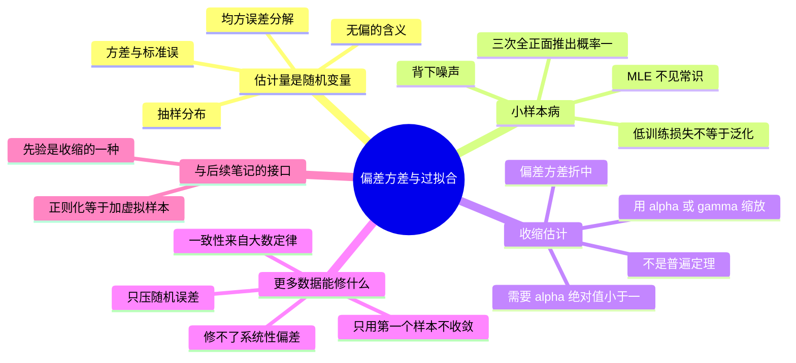

# 偏差方差与过拟合

MLE 只优化 likelihood，不管小样本下会发生什么。这一篇讲清「为什么低训练损失不够」——把估计量当成随机变量，用 bias 与 variance 拆解它的误差。

![[biasvar-sampling-dist.png]]

> 图：同一个真值 $\theta^*=0$ 下三个估计量的**抽样分布**。无偏且方差小（蓝）是理想；无偏但方差大（橙）说明换个数据集就飘；有偏但方差小（绿）可能**总的 MSE 反而更低**——这就是收缩估计存在的理由。

---

## 估计量是随机变量

$\hat\theta=\hat\theta(x_1,\dots,x_N)$ 本身是随机的：换一批样本就得到一个新数值。它的**抽样分布**（sampling distribution）描述「重复抽同样大小的数据集时 $\hat\theta$ 如何波动」。评判一个估计量的两个核心量：

$$\mathrm{Bias}(\hat\theta)=\mathbb E[\hat\theta]-\theta,\qquad \mathrm{Var}(\hat\theta)=\mathbb E\big[(\hat\theta-\mathbb E\hat\theta)^2\big]$$

- 无偏：跨无限次重复，平均命中真参数；
- 方差大：不同样本间抖动大（随机噪声大）。

**均方误差分解**（把估计误差绕其均值的展开）：

$$\mathbb E\big[(\hat\theta-\theta)^2\big]=\underbrace{\mathrm{Var}(\hat\theta)}_{\text{抖动}}+\underbrace{\mathrm{Bias}(\hat\theta)^2}_{\text{系统性偏移}}$$

> [!warning] 三个记号别混
> - **Bias** 是一次线性量 $\mathbb E[\hat\theta]-\theta$，有正负；
> - **Bias²** 是它平方，永远非负；
> - **MSE** $=$ Bias² $+$ Var，是二次量。
>
> 所以「偏差大但方差小」的估计量**可能**赢过「无偏但方差大」的（图里绿 vs 橙）。但注意：这个折中**不是普遍定理**（见下文 PS2.13 的提醒），只是在具体族里成立。

---

## 三次投掷全正面 → 推断正面概率 = 1

Bernoulli 的 MLE $\hat\theta=m/N$：若三次投掷全正面（$N=3,m=3$），得 $\hat\theta=1$，于是预测下一次正面概率 100%，反面 0%。数学上正确，但**过拟合**：它完美吻合这 3 次观测，却把未来反面的可能性判了死刑。

原因：MLE **把参数当作固定的未知常数，只用观测数据，没有任何「常识」约束**。小样本时观测的偶然性被当成真理。缓解方法（下一周）：加先验做 MAP / 正则化，把估计往合理取值拉。

> [!tip] 这不是「MLE 有 bug」
> $\hat\theta=1$ 恰好是「这 3 个样本出现的概率最大」的那个 $\theta$——MLE 忠实完成了它的定义。问题在于**我们要的从来不是「让观测最可能」，而是「对新数据预测最准」**。这两个目标在 $N$ 小时分道扬镳。Bayes 的做法是把这个 gap 显式地写进模型（先验），正则化的做法是加一个罚项，两者其实是同一件事（见 [[贝叶斯估计与共轭先验]]）。
>
> **数值上的补救**：工程里常用的 Laplace 平滑 $\hat\theta=(m+1)/(N+2)$ 正是 Beta(1,1) 先验下的后验均值——不是随手加 1，而是有贝叶斯依据的。

---

## 为什么低训练损失不充分

训练损失只衡量模型在**已见数据**上的拟合。样本小或模型灵活时，模型可以「背下」噪声，训练损失很低甚至为 0，但对新数据毫无泛化能力。这正是过拟合的本质：高 variance 成分压倒了真实结构。

**用采样分布的语言翻译一遍**：训练损失低 $\Rightarrow$ **这一次抽到的样本**拟合好，即「在 $\hat\theta$ 处 loss 小」。但泛化风险是 $\mathbb E_{D\sim p}[\text{loss}(\hat\theta(D))]$——对**所有**可能数据集求期望。$\hat\theta(D)$ 随 $D$ 变，所以泛化风险里的方差项 $\mathrm{Var}_{D}(\hat\theta)$ 是训练损失看不到的。模型越灵活，$\hat\theta(D)$ 对 $D$ 越敏感，方差越大，训练损失与泛化风险的缺口越大。

---

## 偏差–方差权衡的一个具体例子（PS2.13）

考虑收缩估计量 $\tilde\mu=\gamma\bar x$（$0\le\gamma<1$）：

$$\mathrm{Bias}(\tilde\mu)=(1-\gamma)\mu,\qquad \mathrm{Var}(\tilde\mu)=\frac{\gamma^2\sigma^2}{N}$$

$$\mathbb E\big[(\tilde\mu-\mu)^2\big]=\frac{\gamma^2\sigma^2}{N}+(1-\gamma)^2\mu^2$$

$\gamma$ 越小，方差越小，但引入平方偏差。提醒：**这不是「任意估计量都无法同时改善 bias 与 variance」的普遍定理**；并且只有 $|\gamma|<1$ 才真正降方差，$\gamma$ 取大负数反而更糟。

**最优 $\gamma$**：对 $\gamma$ 求导

$$\frac{2\gamma\sigma^2}{N}-2(1-\gamma)\mu^2=0\;\Longrightarrow\;\gamma^*=\frac{\mu^2}{\mu^2+\sigma^2/N}=\frac{N\mu^2}{N\mu^2+\sigma^2}$$

读法：**信噪比决定收缩多少**。$\sigma^2/N$ 小（数据多或噪声小）时 $\gamma^*\to1$，不必收缩；$\mu$ 小（真值本来就在 0 附近）时 $\gamma^*$ 小，收缩收益大。但 $\gamma^*$ 含未知的 $\mu,\sigma^2$——这就是 James–Stein 式估计量「用数据估收缩量，反而更准」的起点。

![[biasvar-shrinkage.png]]

> 图：横轴 $\gamma$，三条线是 Var、Bias²、MSE。$\gamma=1$ 是 MLE（无偏、方差最大）；$\gamma<1$ 用一点偏差换回更多方差。最优点在两条曲线的斜率相等处。

---

## 更多数据能修什么

样本均值无偏（$\mathrm{Bias}=0$），方差 $\sigma^2/N$，标准误 $\sigma/\sqrt N$。$N$ 增大只压低随机误差，**修不了偏差**（这里本来就没有）。样本均值一致性来自大数定律：$N\to\infty$ 时收敛到真 $\mu$。反之，像「只用第一个样本 $\hat\mu=X_1$」这种估计量，$N$ 再大也不收敛——它不 consistently。

而方差 MLE $\hat\sigma^2=\frac1N\sum(x_i-\bar x)^2$ 的偏差本身就是一个典型：向下偏 $\frac{1}{N}\sigma^2$，乘 $N/(N-1)$ 即得无偏。

> [!warning] 「加数据」与「改正则」修的是不同的东西
> - **偏差**（系统性错向）只能靠**改模型**修：加先验、加正则、换估计量。加数据没用。
> - **方差**（随机抖动）靠**加数据**修，速率 $1/\sqrt N$。
>
> 所以看到一个估计量不准，先分清是「偏」还是「抖」——对策完全不同。Bias 通常来自模型假设错了（如把非线性数据强行拟合成直线），这时再多数据只会更确信地收敛到错误答案。

---

## 习题

> 来源：**PS-2 Parameter Estimation – Maximum Likelihood**（题目 2.11–2.14，原编号保留）。这四题是小样本统计的核心练习。解答折叠。

### PS2.11 一个「简单」估计量

**题目.** 设 $D=\{x_1,\dots,x_N\}$ 是高斯 r.v. 的 i.i.d. 样本。定义均值估计量为集合里的第一个点：$\hat\mu=x_1$。(a) 证明它无偏。(b) 求其方差。(c) 为什么这是个糟糕的估计量？

> [!success]- 解答（先自己做，再点开）
> **(a)** $\mathbb E[\hat\mu]=\mathbb E[x_1]=\mu$，Bias $=0$。
>
> **(b)** $\mathrm{Var}(\hat\mu)=\mathbb E[(x_1-\mu)^2]=\sigma^2$。
>
> **(c) 它不 consistent。** 这个估计量完全**丢弃了** $x_2,\dots,x_N$。无论 $N$ 多大，$P(|\hat\mu-\mu|>\epsilon)$ 都是同一个正的尾部概率，不随 $N\to\infty$ 趋于 0。对比样本均值 $\mathrm{Var}=\sigma^2/N\to0$，由 Chebyshev 得 $P(|\bar x-\mu|>\epsilon)\le\frac{\sigma^2}{N\epsilon^2}\to0$。
>
> **要点**：**无偏 ≠ 好**。无偏只保证「重复很多次取平均能命中」，不保证「一次实验够准」。$\hat\mu=x_1$ 无偏但不一致，$\bar x$ 又无偏又一致。评价估计量至少要同时看 bias 和 variance（方差还必须是随 $N$ 收缩的）。

### PS2.12 高斯方差 MLE 的偏差

**题目.** $\hat\sigma^2=\frac1N\sum_i(x_i-\hat\mu)^2$，$\hat\mu$ 是均值的 ML 估计。(a) 设真分布均值 $\mu$、方差 $\sigma^2$，证明 $\mathbb E[\hat\sigma^2]=\big(1-\frac1N\big)\sigma^2$，故有偏。(b) 据此提出无偏的方差估计量。

> [!success]- 解答（先自己做，再点开）
> **(a)** 关键恒等式：把 $x_i-\bar x$ 拆成 $(x_i-\mu)-(\bar x-\mu)$，
> $$\sum_i(x_i-\bar x)^2=\sum_i(x_i-\mu)^2-2(\bar x-\mu)\underbrace{\sum_i(x_i-\mu)}_{=N(\bar x-\mu)}+N(\bar x-\mu)^2=\sum_i(x_i-\mu)^2-N(\bar x-\mu)^2$$
> 取期望：
> $$\mathbb E\Big[\sum_i(x_i-\bar x)^2\Big]=N\sigma^2-N\cdot\frac{\sigma^2}{N}=(N-1)\sigma^2$$
> （用了 $\mathbb E[(x_i-\mu)^2]=\sigma^2$ 与 $\mathrm{Var}(\bar x)=\sigma^2/N$。）于是
> $$\mathbb E[\hat\sigma^2]=\frac{1}{N}(N-1)\sigma^2=\Big(1-\frac1N\Big)\sigma^2$$
> 偏差为 $-\sigma^2/N<0$，**向下偏**。
>
> **(b) 无偏估计量：**
> $$\tilde\sigma^2=\frac{N}{N-1}\hat\sigma^2=\frac{1}{N-1}\sum_i(x_i-\bar x)^2$$
> 这就是教科书里的样本方差。
>
> **为什么必须用 $\bar x$ 而不是 $\mu$ 来算**：如果真 $\mu$ 已知，$\frac1N\sum(x_i-\mu)^2$ **是**无偏的（因为不再需要估均值，没有自由度损失）；偏差完全来自「用同一批数据估计了 $\bar x$」。这就是「$N-1$ 个自由度」的准确含义——**不是约定，是推导出来的**。

### PS2.13 偏差–方差折中

**题目.** 想要均值估计量的方差衰减更快，于是缩放原估计量，得 $\tilde\mu=\gamma\bar x$（$\gamma$ 为固定标量）。(a) 证明 $\mathbb E[\tilde\mu]=\gamma\mu$，从而 $\mathrm{Bias}(\tilde\mu)=(1-\gamma)\mu$、$\mathrm{Var}(\tilde\mu)=\frac{\gamma^2}{N}\sigma^2$。所以你选 $\gamma<1$ 能降方差，但也引入了偏差。

> [!success]- 解答（先自己做，再点开）
> **(a)**
> $$\mathbb E[\tilde\mu]=\gamma\,\mathbb E[\bar x]=\gamma\mu\;\Longrightarrow\;\mathrm{Bias}(\tilde\mu)=\mu-\mathbb E[\tilde\mu]=(1-\gamma)\mu$$
> $$\mathrm{Var}(\tilde\mu)=\gamma^2\mathrm{Var}(\bar x)=\frac{\gamma^2\sigma^2}{N}$$
> 绕其均值展开得
> $$\mathbb E[(\tilde\mu-\mu)^2]=\mathrm{Var}(\tilde\mu)+\mathrm{Bias}^2=\frac{\gamma^2\sigma^2}{N}+(1-\gamma)^2\mu^2$$
> 这就是折中的显式表达。$\gamma<1$ 降方差；$\mu\ne0$ 时引入平方偏差。
>
> **两个必须说的限定**（PS 官方解答也强调了）：
> 1. 这**不是**「任何估计量都无法同时改善 bias 与 variance」的普遍定理——它只是这个特定族 $\{\gamma\bar x\}$ 里的现象。别把它当定理用。
> 2. 「$\gamma<1$ 就能降方差」只在 **$|\gamma|<1$** 时正确。若 $\gamma=-5$，$\mathrm{Var}=\frac{25\sigma^2}{N}$，方差反而更大，同时偏差也更大——**两败俱伤**。所以收缩必须是「往 0 收缩」，不是任意缩放。
>
> **注意记号**：PS 原题把估计量写成 $\tilde\mu=\alpha\sum_i X_i$（$\alpha$ 同时吃掉了 $1/N$ 的规一化），解答里写成 $\tilde\mu=\alpha\bar X$，两者差一个 $N$ 的常数因子，结论形状相同。本篇统一用 $\gamma\bar x$。

### PS2.14 弱大数定律

**题目.** $\{x_1,\dots,x_n\}$ i.i.d.，均值 $\mu_x$、方差 $\sigma_x^2$，$M_n=\frac1n\sum_i x_i$。(a) 证明 $\mathbb E[M_n]=\mu_x$、$\mathrm{var}(M_n)=\frac{\sigma_x^2}{n}$。(b) 用 Chebyshev 不等式 $P(|x-\mu|\ge c)\le\frac{\sigma^2}{c^2}$ 证明：对任意 $\epsilon>0$，$P(|M_n-\mu_x|\ge\epsilon)\to0$。

> [!success]- 解答（先自己做，再点开）
> **(a)** 线性性：$\mathbb E[M_n]=\frac1n\sum_i\mu_x=\mu_x$。独立性使交叉协方差全为 0：
> $$\mathrm{var}(M_n)=\frac{1}{n^2}\Big(\sum_i\mathrm{var}(x_i)+\underbrace{\sum_{i\ne j}\mathrm{cov}(x_i,x_j)}_{=0}\Big)=\frac{n\sigma_x^2}{n^2}=\frac{\sigma_x^2}{n}$$
>
> **(b)** 对 r.v. $M_n$（均值 $\mu_x$、方差 $\sigma_x^2/n$）应用 Chebyshev，取 $c=\epsilon$：
> $$0\le P(|M_n-\mu_x|\ge\epsilon)\le\frac{\mathrm{var}(M_n)}{\epsilon^2}=\frac{\sigma_x^2}{n\epsilon^2}\;\xrightarrow[n\to\infty]{}\;0$$
> 夹逼得收敛于 0，即 $M_n\xrightarrow{P}\mu_x$（依概率收敛）。
>
> **定量版本**：要让这个概率 $\le\delta$，只需
> $$n\ge\frac{\sigma_x^2}{\delta\epsilon^2}$$
> **不需要高斯假设**——只用了 i.i.d. 和有限方差。
>
> **为什么这是「弱」大数定律**：它只说「$n$ 大时 $M_n$ 落在 $\mu_x$ 附近 $\epsilon$ 内的概率趋于 1」（对每个固定 $n$ 的分布说事），而**强大数定律**说「$M_n\to\mu_x$ 几乎必然」，是对整条样本路径说事。前者弱于后者。
>
> **另一条路**：用特征函数或矩母函数可以证明更强的结论，而且不需要有限方差。Chebyshev 这条路的好处是只用到方差，代价是需要 $\sigma_x^2<\infty$。

---

## 相关

- [[最大似然估计 MLE]]
- [[贝叶斯估计与共轭先验]]
- [[机器学习 知识地图]]
- [[CS5487 Index]]
