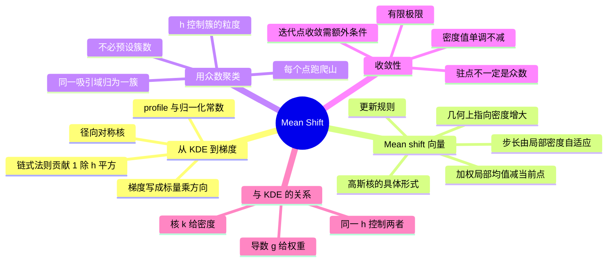

# 均值漂移 Mean Shift

寻找 KDE 密度的**众数（mode）**的迭代算法，进而用「哪些点收敛到同一个峰」来做聚类。核心是一个反复出现的经验：**梯度的方向指向加权局部均值**，所以往加权均值走就是往密度高处爬。

![[ms-gradient.png]]

> 图：KDE 密度的梯度的几何。蓝箭头是梯度 $\nabla\hat p_h$（方向正确但长度随局部密度暴涨暴跌），橙箭头的方向与蓝箭头**完全相同**，长度是 mean shift 向量的长度。两者只差一个非负标量——这正是「沿线爬山」和「直接跳到加权均值」的等价性。

---

## 从 KDE 到梯度

用**径向对称核** $K(x)=c\,k(\|x\|^2)$（$c$ 是归一化常数，$k$ 是 profile）写 KDE：

$$\hat p(x)=\frac{1}{N}\sum_{i=1}^N\frac{1}{h^d}\,k\!\Big(\Big\|\frac{x-x_i}{h}\Big\|^2\Big)$$

设 $g(u)=-k'(u)$（profile 的负导数，通常仍是一个合法核）。对 $\hat p$ 关于 $x$ 求梯度，链式法则贡献因子 $1/h^2$：

$$\nabla\hat p(x)=\frac{2}{Nh^{d+2}}\sum_{i=1}^N(x_i-x)\,g\!\Big(\Big\|\frac{x-x_i}{h}\Big\|^2\Big)$$

**推导（Lecture 5 的步骤）**：记 $r_i(x)=\big\|\frac{x-x_i}{h}\big\|^2$，则

$$\hat p_h(x)=\frac{\alpha}{Nh^d}\sum_i \bar k(r_i(x)),\qquad \nabla r_i(x)=\frac{2(x-x_i)}{h^2}$$

由链式法则（注意 $\bar g=-\bar k'$）：

$$\nabla\hat p_h(x)=\frac{\alpha}{Nh^d}\sum_i\bar k'(r_i(x))\cdot\frac{2(x-x_i)}{h^2}=\frac{2\alpha}{Nh^{d+2}}\sum_i\bar g(r_i(x))\,(x_i-x)$$

> [!warning] 三个容易写错的地方
> 1. **因子 $1/h^2$ 漏掉**：$\nabla r_i$ 里的 $1/h^2$ 来自 $r_i$ 的定义（$x$ 出现一次除以 $h$，平方后 $h^2$）。加上前面已有的 $1/h^d$，指数变成 $h^{d+2}$——**比密度本身多两个 $h$**。
> 2. **符号**：$\nabla r_i=\frac{2(x-x_i)}{h^2}$，但 $\bar k'=-\bar g$，两个负号抵消后得到 $+(x_i-x)$。这一步的符号直接决定 mean shift 是**爬向**还是**远离**高密度区。
> 3. **把 $\bar k$ 和 $k$ 搞混**：Lecture 5 用 $\bar k$ 记**径向 profile**（$\bar k:\mathbb R_{\ge0}\to\mathbb R$），$k$ 记核本身（$k(u)=\alpha\bar k(\|u\|^2)$）。本笔记沿用这个记号，看到 $\bar g=-\bar k'$ 时要知道它作用在**标量 $r_i$** 上。

---

## Mean shift 向量与更新规则

把梯度整理成「一个标量 × 方向」的形式，定义 **mean shift 向量**：

$$m(x)=\frac{\sum_i x_i\,g\!\big(\|\tfrac{x-x_i}{h}\|^2\big)}{\sum_i g\!\big(\|\tfrac{x-x_i}{h}\|^2\big)}-x$$

即 **加权局部均值 − 当前点**。它在几何上指向密度增大的方向：

$$\nabla\hat p(x)=\underbrace{\Big[\frac{2}{Nh^{d+2}}\sum_i g(\cdot)\Big]}_{\text{非负标量}}\cdot\, m(x)$$

**更新规则**（沿该方向走，步长由局部密度自适应给出）：

$$x^{(t+1)}=x^{(t)}+m\big(x^{(t)}\big)=\frac{\sum_i x_i\,g\!\big(\|\tfrac{x^{(t)}-x_i}{h}\|^2\big)}{\sum_i g\!\big(\|\tfrac{x^{(t)}-x_i}{h}\|^2\big)}$$

三步循环：**量距离 → 转成非负权重 → 移到固定样本的加权均值**。当 mean shift 向量小于容差即停。

**步长为什么可以取 $1/(C\hat p_{g,h})$**：把 $g$ 归一化成一个合法核 $g(u)=\beta\bar g(\|u\|^2)$、$\int g=1$，则对应的 KDE 是

$$\hat p_{g,h}(x)=\frac{\beta}{Nh^d}\sum_i\bar g(r_i(x))$$

于是

$$\nabla\hat p_h(x)=\frac{2\alpha}{Nh^{d+2}}\sum_i\bar g(\cdot)(x_i-x)=\frac{2\alpha}{\beta h^2}\,\hat p_{g,h}(x)\cdot m(x)=C\,\hat p_{g,h}(x)\,m(x)$$

**关键**：梯度**正比于局部密度**乘 mean shift 向量。所以在密度低的地方梯度小、在密度的**峰上**梯度也是 0（因为 $m=0$）。若用固定步长 $\lambda_t$ 走梯度，密度高处会冲过头；若取**自适应步长**

$$\lambda_t=\frac{1}{C\hat p_{g,h}(x^{(t)})},$$

则

$$x^{(t+1)}=x^{(t)}+\frac{1}{C\hat p_{g,h}}\cdot C\hat p_{g,h}\,m=x^{(t)}+m(x^{(t)})$$

——**恰好一步跳到加权均值**。这就是 mean shift 不需要调学习率的原因：步长由局部密度自动给出。

> [!tip] 为什么 mean shift 不会发散
> 梯度上升的标准危险是「步长过大 → 越过山峰 → 震荡或发散」。mean shift 的自适应步长排除了这一点：
> - 在**平坦**区域（$\hat p_{g,h}$ 小），$\lambda_t$ 大，大胆走——那里离峰还远，走得快是对的；
> - 在**峰附近**（$\hat p_{g,h}$ 大），$\lambda_t$ 小，小心走——避免越过峰。
>
> 而且更新后的点**恰好落在数据点的加权均值上**，所以它始终是一个凸组合 $\sum_i w_i x_i/\sum_iw_i$（$w_i\ge0$），必然落在数据点的**凸包**内。因此迭代**永远不会跑到数据范围之外**——这是一个很强的稳定性保证。

**Gaussian 核的具体化**：$k(u)=e^{-u/2}$（核 $=(2\pi)^{-1/2}e^{-x^2/2}$），则 $g(u)=k(u)/2$，权重就是方差为 $h^2$ 的 Gaussian：

$$x^{(t+1)}=\frac{\sum_i x_i\exp\!\big(-\tfrac{\|x^{(t)}-x_i\|^2}{2h^2}\big)}{\sum_i\exp\!\big(-\tfrac{\|x^{(t)}-x_i\|^2}{2h^2}\big)}$$

> [!warning] 高斯核下的一个误解
> 有人看到这个式子会说「这不就是一次**核回归**吗？」——形式上确实是 Nadaraya–Watson 核回归。但要注意：
> - 这里回归的**目标变量就是 $x$ 自己**（不是某个 $y$），所以它是在做**自平滑**，不是拟合一条曲线；
> - 每一步的权重都用**当前位置** $x^{(t)}$ 算（权重随迭代变），而核回归里权重由固定的查询点给出；
> - 停止在 $m=0$ 处，即 $x=\sum_iw_ix_i/\sum_iw_i$——一个**自洽**点。所有满足「我等于我的加权局部均值」的点都是不动点，其中**只有极大值点才是 mode**（极小值点和鞍点也是不动点）。

---

## 用众数做聚类

1. 从每个（或每个代表）样本点出发跑爬山；
2. 收敛到**同一个 mode** 的起点归为一簇——这些点的「吸引域（basin of attraction）」构成一个 cluster；
3. 峰的个数由数据与 $h$ 自动决定，**不必预设 $K$**（这点不同于 K-means/GMM）。

![[ms-trajectories.png]]

> 图：二维三簇数据上的 mean shift 轨迹。每个起点（浅色点）沿折线爬向所属的峰（星号）。三簇的**吸引域**由数据与 $h$ 自然划出，峰的数量 3 是「算出来的」不是「指定的」。注意轨迹在靠近峰时**步子变小**（自适应步长的效果），并且所有轨迹都是直线段拼接的折线——因为每一步都跳到加权均值，中间没有连续路径。

> [!tip] 「不用预设 $K$」的代价
> | | 谁决定簇数 | 怎么决定 |
> |---|---|---|
> | K-means / GMM | **人** | 预先指定 $K$（或靠 BIC/轮廓系数选）|
> | Mean Shift | **数据 + $h$** | 峰的数量 |
>
> 看起来 mean shift 更高级，但代价是**把选择 $K$ 换成了选择 $h$**，而 $h$ 对簇数的影响可能比 $K$ 更敏感（见下文）。而且：
> - 数据里本来没有清晰峰时（如均匀分布），mean shift 会给出**一堆碎片化的簇**或**一个大簇**，两种都不理想；
> - 计算量是「每个起点跑一条轨迹」，最坏情况 $O(N^2)$ 每次迭代（要算所有点对的距离）——比 K-means 的 $O(NK)$ 重得多。工程实现会用 KD-tree 或只从**高密度点**起步来加速。
>
> **实践建议**：先用 mean shift 快速看一眼数据里**有几个自然的峰**，再用那个数作为 K-means / GMM 的 $K$。这是把 mean shift 当**探索工具**而不是最终聚类器，往往比直接用它更稳。

---

## 收敛性

若 profile $k$ 光滑、有界、凸且单调递减，则迭代中**密度值单调不减并收敛到有限极限**。注意：密度值收敛是标准结论，但**迭代点本身**收敛需要额外条件——并且收敛到的**驻点不一定就是 mode**。步子别太大、$h$ 选得合理很重要。

**为什么凸 + 递减能保证单调**（直觉版）：mean shift 一步更新的方向是 $m$，而 $m\propto\nabla\hat p$（梯度上升方向），理论上 $\hat p$ 应该增加。但普通梯度上升要小步长才保证增加；这里之所以**无论步长多大都增加**，靠的是 $k$ 的凸性——凸 profile 对应的核把「跳到加权均值」和「沿梯度走一小步」连起来，使得每一步都是**精确的下界最大化**（类似 EM 的结构）。

> [!warning] 「收敛到的点不一定是 mode」在实践中的含义
> 标准的收敛结论只说
> $$\hat p_h(x^{(1)})\le\hat p_h(x^{(2)})\le\cdots\to L<\infty$$
> 即**密度值**单调上升有上界。但从「密度值收敛」到「$x^{(t)}$ 收敛到某个点」还需要额外条件（本质上要求迭代不会在**等密度曲线**上无限滑动，即不能有连续的等高点连成环）。
>
> 所以可能出现的情形：
> - 收敛到**局部极大**（真正的 mode）——最常见；
> - 收敛到**鞍点**（$m=0$ 但非极值）——在高维和 $h$ 不当时会发生；
> - 迭代点在有限步内进入一个**循环**（理论上在退化情形下可能）——实际实现用「最大迭代次数」兜底。
>
> **实际对策**：设最大迭代数（如 100）、设容差（如 $\|m\|<10^{-3}h$）、**对结果做合并**（两个 mode 距离小于 $h/2$ 就认为同一个簇）。这三条是任何 mean shift 实现里都有的工程护栏。

---

## 与 KDE 的关系

Mean shift 是 KDE 的梯度上升：核 $k$ 给出密度估计，其导数对应的 $g$ 给出爬山权重。所以 $h$ 同时控制**密度的平滑程度**和**簇的粒度**——$h$ 大则峰少而粗，$h$ 小则峰多而碎。

**一张总结表**：

| 部件 | 作用 | 出现位置 |
|---|---|---|
| $\bar k$（profile） | 定义密度的形状 | $\hat p_h$ |
| $\bar g=-\bar k'$ | 定义局部权重 | $m(x)$ 与更新规则 |
| $h$ | 同时决定平滑尺度与簇粒度 | 两处都用同一个 |
| $m(x)$ | 加权均值 − 当前点 | 更新规则 |

**这正是这道方法优雅的地方**：同一个 $h$，既控制密度的分辨率，又控制聚类的粒度。代价是**两者不能分开调**——你可能想要较平滑的密度但较细的簇（或反过来），而 mean shift 不允许。

---

## 习题

> [!warning] 关于本节的题目来源
> 与 [[核密度估计 KDE]] 一样：**mean shift 没有配套的 PS 习题**，只在 **Lecture 5** 里讲，week5 tutorial 是纯图片幻灯片。
>
> 下面几题是我按 Lecture 5 的推导步骤自己编的（**非真题**），每题标注了对应讲义页。

### 自编 5.6 径向对称核与 profile（Lecture 5, p.28–29）

**题目.** 设 $k(u)=\alpha\bar k(\|u\|^2)$ 是径向对称核。(a) 对 $d$ 维高斯核 $k(u)=(2\pi)^{-d/2}e^{-\|u\|^2/2}$，写出 $\alpha$ 与 $\bar k$。(b) 求 $\bar g(r)=-\bar k'(r)$。(c) $\bar g$ 是否仍是一个合法的 profile（对应一个积分为 1 的核）？

> [!success]- 解答（先自己做，再点开）
> **(a)** 比较 $k(u)=\alpha\bar k(\|u\|^2)$ 与 $(2\pi)^{-d/2}e^{-\|u\|^2/2}$：
> $$\alpha=(2\pi)^{-d/2},\qquad \bar k(r)=e^{-r/2}$$
>
> **(b)**
> $$\bar g(r)=-\frac{d}{dr}e^{-r/2}=-\Big(-\frac12e^{-r/2}\Big)=\frac12e^{-r/2}=\frac{\bar k(r)}{2}$$
> **$\bar g$ 与 $\bar k$ 只差一个因子 $1/2$**——这是高斯核的特有性质（其他的核一般不是这样）。
>
> **(c)** 把 $\bar g$ 写回核的形式：$g(u)=\beta\bar g(\|u\|^2)$，要 $\int g=1$ 得 $\beta=(2\pi)^{-d/2}\cdot2$。于是
> $$g(u)=2\cdot(2\pi)^{-d/2}e^{-\|u\|^2/2}=2k(u)$$
> 是**合法核**（非负、积分为 1）。
>
> **这个结果直接给出高斯 mean shift 的简洁形式**：因为 $g=2k$，权重 $g(\cdot)\propto k(\cdot)$，所以更新规则里的权重就是「以当前位置为中心、方差 $h^2$ 的高斯」——这正是笔记正文里那个公式的来源。

### 自编 5.7 推导 mean shift 向量（Lecture 5, p.30–31）

**题目.** 从 $\hat p_h(x)=\frac{\alpha}{Nh^d}\sum_i\bar k(r_i(x))$、$r_i(x)=\big\|\frac{x-x_i}{h}\big\|^2$ 出发。(a) 求 $\nabla r_i(x)$。(b) 证明 $\nabla\hat p_h(x)=\frac{2\alpha}{Nh^{d+2}}\sum_i\bar g(r_i(x))(x_i-x)$，其中 $\bar g=-\bar k'$。(c) 定义 $S(x)=\sum_i\bar g(r_i(x))$，把梯度写成 $S(x)\cdot m(x)$ 的形式，写出 $m(x)$。

> [!success]- 解答（先自己做，再点开）
> **(a)** $r_i(x)=\frac{(x-x_i)^\top(x-x_i)}{h^2}$，对 $x$ 求导：
> $$\nabla r_i(x)=\frac{2(x-x_i)}{h^2}$$
> （标量对向量的梯度；分子是 $\|x-x_i\|^2$，其梯度是 $2(x-x_i)$。）
>
> **(b)** 链式法则，注意 $\bar k'(r)=\frac{d\bar k}{dr}$：
> $$\nabla\hat p_h(x)=\frac{\alpha}{Nh^d}\sum_i\bar k'(r_i(x))\nabla r_i(x)=\frac{\alpha}{Nh^d}\sum_i\bar k'(r_i(x))\cdot\frac{2(x-x_i)}{h^2}$$
> 用 $\bar k'=-\bar g$：
> $$=-\frac{2\alpha}{Nh^{d+2}}\sum_i\bar g(r_i(x))(x-x_i)=\frac{2\alpha}{Nh^{d+2}}\sum_i\bar g(r_i(x))(x_i-x)\quad\blacksquare$$
> **注意最后一步的符号**：$-（x-x_i)=+(x_i-x)$。两个负号——一个来自 $\bar k'=-\bar g$，一个来自 $(x-x_i)$ 取反——合起来是正的。
>
> **(c)** 令 $S(x)=\sum_i\bar g(r_i(x))\ge0$（$\bar g\ge0$ 因为 $\bar k$ 单调递减）。把 (b) 的式子写成「标量 ×（加权均值 − 当前点）」：
> $$\nabla\hat p_h(x)=\frac{2\alpha}{Nh^{d+2}}S(x)\Big[\underbrace{\frac{\sum_i x_i\bar g(r_i(x))}{S(x)}}_{x\text{ 的加权局部均值}}-x\Big]$$
> 故
> $$m(x)=\frac{\sum_i x_i\,\bar g\big(\|(x-x_i)/h\|^2\big)}{\sum_i\bar g\big(\|(x-x_i)/h\|^2\big)}-x$$
>
> **要点**：$\frac{2\alpha}{Nh^{d+2}}S(x)\ge0$，所以 $\nabla\hat p_h$ 与 $m$ **方向完全相同**（或 $m=0$ 时梯度为 0）。这证明了「沿梯度爬山 = 跳到加权均值」。
>
> **一个提醒**：$S(x)$ 可正可零。$S(x)=0$ 意味着所有 $\bar g(r_i)=0$，即没有点在窗内——此时 $m$ 是 $0/0$，未定义。实际实现要检测并停止（或返回当前点）。

### 自编 5.8 自适应步长与高斯特例（Lecture 5, p.32–35）

**题目.** (a) 把 $\bar g$ 归一化成核 $g(u)=\beta\bar g(\|u\|^2)$，证明 $\nabla\hat p_h(x)=C\hat p_{g,h}(x)m(x)$，给出 $C$。(b) 由此说明取 $\lambda_t=1/(C\hat p_{g,h}(x^{(t)}))$ 时梯度上升 $x^{(t+1)}=x^{(t)}+\lambda_t\nabla\hat p_h$ 就是 mean shift 更新。(c) 对高斯核证明 $\nabla\hat p_h(x)=\frac{\hat p_h(x)}{h^2}m(x)$，即 $m(x)=h^2\nabla\log\hat p_h(x)$。

> [!success]- 解答（先自己做，再点开）
> **(a)** 由 (b) 段，
> $$\nabla\hat p_h(x)=\frac{2\alpha}{Nh^{d+2}}S(x)m(x),\qquad S(x)=\sum_i\bar g(r_i(x))$$
> 而 $\hat p_{g,h}(x)=\frac{\beta}{Nh^d}\sum_i\bar g(r_i(x))=\frac{\beta}{Nh^d}S(x)$，即 $S(x)=\frac{Nh^d}{\beta}\hat p_{g,h}(x)$。代入：
> $$\nabla\hat p_h(x)=\frac{2\alpha}{Nh^{d+2}}\cdot\frac{Nh^d}{\beta}\hat p_{g,h}(x)m(x)=\frac{2\alpha}{\beta h^2}\hat p_{g,h}(x)m(x)$$
> 故
> $$C=\frac{2\alpha}{\beta h^2}$$
>
> **(b)** 取 $\lambda_t=1/(C\hat p_{g,h}(x^{(t)}))$：
> $$x^{(t+1)}=x^{(t)}+\lambda_t\nabla\hat p_h(x^{(t)})=x^{(t)}+\frac{C\hat p_{g,h}m(x^{(t)})}{C\hat p_{g,h}}=x^{(t)}+m(x^{(t)})$$
> 正是 mean shift 更新。$\blacksquare$
>
> **解读**：这个步长不是随便凑的，它**恰好**是「把梯度上升的步长取成让 $x^{(t+1)}$ 落在加权均值上」的那个值。所以 mean shift 可以理解为「**一个自动调步长的梯度上升**」，而且这个步长规则在每一处都是最优的（一步到位）。
>
> **(c) 高斯特例。** 对 Gaussian：$\alpha=(2\pi)^{-d/2}$、$\bar k(r)=e^{-r/2}$、$\bar g=\bar k/2$。归一化：$\int g=1$ 要求 $\beta=2\alpha$（见自编 5.6）。代入 (a)：
> $$C=\frac{2\alpha}{\beta h^2}=\frac{2\alpha}{2\alpha h^2}=\frac{1}{h^2}$$
> 于是 $\nabla\hat p_h(x)=\frac{1}{h^2}\hat p_h(x)m(x)$，即
> $$m(x)=h^2\frac{\nabla\hat p_h(x)}{\hat p_h(x)}=h^2\nabla\log\hat p_h(x)$$
>
> **这是 mean shift 最漂亮的公式**：mean shift 向量**就是对数似然的梯度乘以 $h^2$**。
>
> **三个直接推论**：
> 1. **尺度不变性**：$m$ 只依赖 $\log\hat p$ 的梯度，所以如果对数据做平移，$m$ 不变；如果做缩放 $x\to ax$，$\nabla\log\hat p$ 按 $1/a$ 缩放，配合 $h\to ah$ 则 $m$ 同样按 $a$ 缩放——整个算法是**尺度等变**的。
> 2. **停止条件有明确含义**：$\|m\|<\epsilon$ 等价于 $\|\nabla\log\hat p\|<\epsilon/h^2$，即「对数似然的梯度足够平」。
> 3. **与 EM 的联系**：对高斯混合，EM 的 M-step 也给出加权均值的形式（responsibility 加权），但 EM 的权重要**对所有分量加权再合并**，而 mean shift 的权重只依赖**距离**（不依赖分量参数）。所以 mean shift 可以看作「把每个数据点当成一个固定分量、权重由核给出」的**非参数 EM**。

### 自编 5.9 用众数聚类与 $h$ 的影响（Lecture 5, p.26–27, 38）

**题目.** 讨论题（讲义结语的原问题）：改变 $h$ 会如何影响密度估计与聚类结果？分别讨论 $h$ 很小、$h$ 适中、$h$ 很大三种情况，并说明 mean shift 与 K-means 在「簇数来源」上的本质差别。

> [!success]- 解答（先自己做，再点开）
> $h$ 同时控制**密度分辨率**和**簇粒度**（因为两者用同一个 $h$）：
>
> | $h$ | 密度估计 | 峰的数量 | 聚类结果 |
> |---|---|---|---|
> | **很小** | 尖刺，几乎每个点一个峰 | $\approx N$ | 每点自成一簇（**过分割**）|
> | **适中** | 保留真实的峰结构 | $=$ 真实的簇数 | 与直觉一致的聚类 |
> | **很大** | 过度平滑，所有细节消失 | $\to1$（可能单峰）| **全部并成一簇** |
>
> **定量的说法**：由 [[核密度估计 KDE]] 的偏差方差分析，$h$ 大时 $\mathrm{Bias}\propto h^2|\hat p''|$ 把曲率抹平——峰和谷被「平均」掉，所以峰数单调（非严格）随 $h$ 减少。存在若干**临界 $h$**，每跨过一个就会有两个峰合并。这就是 mean shift 的「尺度空间」性质：$h$ 从小到大扫过，可以看到聚类结构**从细到粗逐层合并**。
>
> **簇数来源的本质差别**：
> - **K-means / GMM**：簇数 $K$ 是**模型参数**，由外部指定。给定 $K$，算法把数据**划分**成 $K$ 份——即使数据里其实没有 $K$ 个簇，它也会硬分出 $K$ 个（把本来连续的分布切开）。$K$ 的语义是「我要这么多簇」。
> - **Mean Shift**：簇数是**密度的性质**，由数据与 $h$ 决定。它对应「数据里真的有这么多峰」。$h$ 的语义是「我把多近的点算作同一个峰」。
>
> **哪个更好取决于问题**：
> - 任务上**必须**输出固定数量的簇（如把用户分成 5 组）→ 用 K-means，直接指定；
> - 任务是**探索**数据里到底有几个自然分组 → 用 mean shift，或者用 mean shift 探出峰数再喂给 K-means。
>
> **一个必须承认的局限**：mean shift 假设「簇 = 密度峰」。如果簇的形状不是「围绕一个中心的高密度团」（例如**环形**、**月牙形**、**两个互相嵌套的螺旋**），KDE 在这些形状上根本不会出现对应的峰，mean shift 必然失败。这类数据要用基于连通性/图的方法（谱聚类、DBSCAN 的密度可达定义）——它们把「密度高」定义在**局部**（相对邻居）而不是**全局**（相对 KDE 的绝对高度）。这一点是 mean shift 和 DBSCAN 的关键分水岭：**DBSCAN 用局部密度阈值，mean shift 用全局密度的梯度**。

---

## 相关

- [[核密度估计 KDE]]
- [[高斯混合模型 GMM]]
- [[EM 算法]]
- [[机器学习 知识地图]]
- [[CS5487 Index]]
