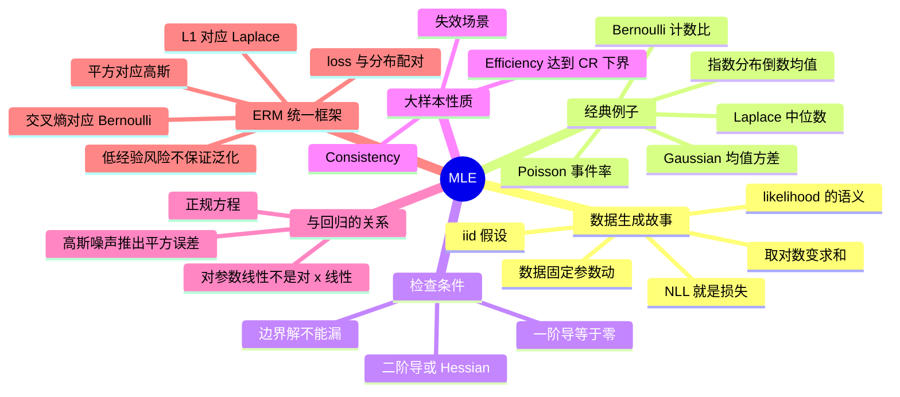

# 最大似然估计 MLE

参数估计的起手式：假设数据来自某个由未知参数 $\theta$ 控制的已知分布族，反过来问「哪个 $\theta$ 最可能产生了我观测到的这套数据」。MLE 把统计假设直接翻译成一个优化问题。

---

## 数据生成故事与 likelihood

想象一个假想的**数据生成过程**：数据服从已知分布族（Bernoulli、Gaussian…），由未知 $\theta$ 控制。likelihood 是

$$p(D\mid\theta),\quad D=\{x_1,\dots,x_N\}$$

关键观念：**数据固定，让 $\theta$ 动**，看哪个 $\theta$ 让这套数据最合理。$p(D\mid\theta)$ **不是**参数 $\theta$ 的概率，别当成 $\theta$ 的分布。

> [!warning] 最容易错的一句话
> 「$p(D\mid\theta)$ 是 $\theta$ 的概率」——错。$\theta$ 是固定的未知常数，对它谈概率没有意义；只有把 $\theta$ 当成随机变量（[[贝叶斯估计与共轭先验]]）时才有 $p(\theta)$。likelihood 只是「给定 $\theta$ 时这套数据的可解释程度」，把 $\theta$ 读成自变量。

**i.i.d. 假设**：样本 independent（互不影响）且 identically distributed（同分布），于是 joint likelihood 是乘积 $p(D\mid\theta)=\prod_i p(x_i\mid\theta)$。取对数（严格单调，$\arg\max$ 不变）把乘积变成和：

$$\ell(\theta)=\sum_{i=1}^N\log p(x_i\mid\theta),\qquad \hat\theta_{ML}=\arg\max_\theta\ell(\theta)=\arg\min_\theta-\ell(\theta)$$

负对数似然（NLL）就是损失函数。

**为什么必须取对数**，而不是直接优化乘积？三个理由叠在一起：

1. **数值**：$N$ 个小于 1 的数相乘会在 $N\approx 700$ 时下溢到 0（双精度最小正数约 $10^{-308}$），梯度全变 0；对数是把 $\prod$ 变成 $\sum$，尺度从「指数的指数」降回线性。
2. **代数**：指数族 $p(x\mid\theta)=f(x)g(\theta)\exp(\theta^\top u(x))$ 里 $f(x)$ 只依赖数据，取对数后它变成常数项，剩下的关于 $\theta$ 的部分是线性的——直接求导就出闭式解。
3. **信息**：$\ell$ 的曲率（二阶导）就是 Fisher 信息，第 4 节要用的东西全在 $\ell''$ 里。

**likelihood 不是密度**：$\int p(D\mid\theta)\,d\theta$ 一般不等于 1，也不需要等于 1。它是 $\theta$ 的函数而不是数据的分布，所以 $\hat\theta$ 的方差、无偏性这些性质**不能**从 $p(D\mid\theta)$ 的形状直接读出来，必须回到抽样分布上去算（见 [[偏差方差与过拟合]]）。

![[mle-likelihood-sharpening.png]]

> 图：同一个真值 $\theta^*=0.7$（Bernoulli），样本量 $N=5,20,100,1000$。$N$ 越大，似然曲线越窄——不是因为真值变了，而是「数据能提供的关于 $\theta$ 的信息」按 $\sqrt N$ 增长，峰宽 $\propto 1/\sqrt N$。

---

## Bernoulli 与 Gaussian 的 MLE

**Bernoulli**：$p(x\mid\theta)=\theta^x(1-\theta)^{1-x}$，$x\in\{0,1\}$。设 $m=\sum_i x_i$（成功数），

$$\ell=m\log\theta+(N-m)\log(1-\theta)\;\Rightarrow\;\hat\theta=\frac{m}{N}$$

二阶 $-\frac{m}{\theta^2}-\frac{N-m}{(1-\theta)^2}<0$，确为极大。边界：$m=0\Rightarrow\hat\theta=0$。**所有关于 $\theta$ 的信息都被计数 $m$ 汇总了**——这是 sufficient statistic 的雏形。

> [!tip] 为什么 $m$ 就够了
> 顺序信息（第几次成功）对 $\theta$ 毫无用处：01101 和 11010 的似然完全一样。$m$ 把 $N$ 个 0/1 压缩成一个整数，且**不损失任何关于 $\theta$ 的信息**——这就是「充分」。PS2.7 的多项分布里，充分统计量是整个直方图 $c=[c_1,\dots,c_K]$。

**Gaussian**：设 $\hat\mu=\bar x$，则 $\hat\sigma^2=\frac1N\sum_i(x_i-\hat\mu)^2$。分母是 $N$ 时**有偏**（期望 $\frac{N-1}{N}\sigma^2$），因为估计均值吃掉一个自由度；无偏版分母 $N-1$。这正是「MLE 优化 likelihood，但不保证每个估计量无偏」的例子。

> [!warning] 一个自由度是怎么被吃掉的
> 残差 $x_i-\bar x$ 满足**一个线性约束** $\sum_i(x_i-\bar x)=0$：知道前 $N-1$ 个残差，第 $N$ 个就被迫确定。所以 $N$ 个残差只张成 $N-1$ 维空间，$\sum(x_i-\bar x)^2$ 的期望因此是 $(N-1)\sigma^2$ 而不是 $N\sigma^2$。这不是数学缺陷，而是「用同一批数据既估均值又估方差」的必然代价。MLE 的大样本理论只保证 $N\to\infty$ 时 $\frac{N-1}{N}\to1$，偏差 vanish——**有限样本下无偏不是 MLE 的承诺**。

推导（PS2.12 的做法）：设真均值 $\mu$，则

$$\mathbb E\Big[\sum_i(x_i-\bar x)^2\Big]=\sum_i\mathbb E\big[(x_i-\mu)^2\big]-N\,\mathbb E\big[(\bar x-\mu)^2\big]=N\sigma^2-N\cdot\frac{\sigma^2}{N}=(N-1)\sigma^2$$

第一个等号用 $\sum_i(x_i-\bar x)^2=\sum_i(x_i-\mu)^2-N(\bar x-\mu)^2$（这是 $\sum_i (x_i-\bar x)(\bar x-\mu)=0$ 的直接结果）。

---

## 三个必须检查的条件

1. 一阶导 $\nabla_\theta\ell=0$（标量）或 $\nabla_\theta\ell=\mathbf 0$（向量）只给出 **stationary point**——可能是极大、极小或鞍点；
2. 二阶条件：标量看 $\ell''<0$；向量看 Hessian 负定；
3. 边界条件：优化域端点（如 $\theta\in[0,1]$）往往才是最优解，别只看内点。

**第 1 条为什么不够**：$\ell''=0$ 的驻点也可能出现。Gaussian 的 $\sigma\to0$ 极限、GMM 的方差塌缩（见 [[高斯混合模型 GMM]]）都发生在边界而不是内点，只解 $\nabla\ell=0$ 会得到「无解」或「负方差」这种荒谬答案。

**共轭先验 / 指数族的便利**：对指数族，$\ell(\theta)=\theta^\top s+\text{const}$ 是**凹函数**（这正是指数族被称为「对数凹」的原因），此时 $\nabla\ell=0$ 就是全局最大，三条件退化成一条。一旦离开指数族（如 GMM 的 marginal likelihood、L1 回归的 Laplace 参数），凸性就没了，必须回头做完整检查。

**一个常见的边界陷阱（PS2.4 Laplace）**：$p(x\mid\mu,b)=\frac{1}{2b}e^{-|x-\mu|/b}$ 对 $\mu$ 求导时 $|x_i-\mu|$ 在 $x_i=\mu$ 处**不可导**，不能用「求导=0」。正确做法是用绝对值不等式 $\sum_i|x_i-\mu|$ 在 $\mu$ 取**中位数**时最小——这就是「L1 的最优估计是中位数」的来源，也是它比 L2 抗离群点的原因。

---

## 大样本性质

- **Consistency**：$N\to\infty$ 时 $\hat\theta$ 依概率收敛到真值 $\theta$（大数定律）。只管无穷样本，小样本不保证；模型设定错误（misspecified）会收敛到错误目标。
- **Efficiency**：MLE 可达到 Cramér–Rao 下界，即 $N$ 很大时方差达到无偏估计量

$$\mathrm{Var}(\hat\theta)\ge\frac{1}{N\,\mathcal I(\theta)},\qquad \mathcal I(\theta)=\mathbb E\Big[-\frac{\partial^2\log p(x\mid\theta)}{\partial\theta^2}\Big]$$

的理论下限。但真参数位于参数空间边界时，这套大样本理论失效。

> [!warning] Consistency ≠ 好估计
> 「对第一个样本取平均」（PS2.11 的 $\hat\mu=x_1$）是**无偏**的，但方差恒为 $\sigma^2$ 而**不随 $N$ 缩小**——它不 consistent。而 MLE 的 $\bar x$ 方差是 $\sigma^2/N$。这说明无偏性和一致性是两件独立的事：一个管「平均命中」，一个管「样本多了会收敛」。选估计量时后者通常更重要。

---

## 为什么高斯噪声下 MLE = 最小二乘

模型 $y=f(x;\theta)+\epsilon,\ \epsilon\sim N(0,\sigma^2)$。条件对数似然里含 $\theta$ 的项是

$$-\frac{1}{2\sigma^2}\sum_i\big(y_i-f(x_i;\theta)\big)^2+\text{const}$$

最大化它 = 最小化平方误差和。**二次指数就是平方误差拟合的来源**。对线性模型 $y=\phi(x)^\top\theta+\epsilon$，令梯度为 0 得正规方程

$$\Phi\Phi^\top\hat\theta=\Phi y\quad\Longleftrightarrow\quad \hat\theta=(\Phi\Phi^\top)^{-1}\Phi y$$

（$\Phi=[\phi(x_1),\dots,\phi(x_n)]$ 是 $D\times n$ 的特征矩阵。注意 CS5487 的记号把样本放成**列**，所以是 $\Phi\Phi^\top$ 而不是 $\Phi^\top\Phi$。）

> [!warning] 讲义与 tutorial 的 $\Phi$ 转置了，两套公式都对
> - **PS2.8 / 本篇**：$\Phi=[\phi(x_1),\dots,\phi(x_n)]$ 是 $D\times n$，模型 $\|y-\Phi^\top\theta\|^2$，正规方程 $\Phi\Phi^\top\hat\theta=\Phi y$。
> - **Week 2 tutorial / 大多数教科书**：$\Phi$ 是 $n\times D$（样本为行），模型 $\|y-\Phi\theta\|^2$，正规方程 $(\Phi^\top\Phi)\hat\theta=\Phi^\top y$。
>
> 两者是同一条方程的两种排列方式（把 $\Phi$ 转置即可互换），**不要**把两套混着抄。考试时看清题目里 $\Phi$ 的维度定义再写。

注意「线性模型」指**对参数 $\theta$ 线性**，不是对原始输入 $x$ 线性。$f(x,\theta)=\sum_{k=0}^K x^k\theta_k$ 里 $x^2,\dots,x^K$ 是**固定的基函数**，至于 $\theta_k$ 仍然是线性的。

**$\sigma^2$ 从解里消失了**：$\hat\theta$ 不含 $\sigma^2$，因为常数 $1/\sigma^2$ 乘在整个平方和上，不改变 argmin。这正是「最小二乘不需要知道噪声大小」的原因。反过来，若要报告参数不确定性，$\sigma^2$ 会重新出现（见 [[贝叶斯估计与共轭先验]] 的 $V$）。

![[mle-loss-forms.png]]

> 图：同一个拟合问题，不同 loss ↔ 不同噪声分布。平方损失（高斯噪声）对离群点给出**二次**惩罚，L1（Laplace 噪声）给出**线性**惩罚，所以 L1 的拟合线被离群点拉得少得多——这就是 PS2.10 的「L1 更 robust」。

---

## ERM：统一框架

经验风险最小化 $J(\theta)=\sum_i L(y_i,f(x_i;\theta))$ 用任意 loss 都能套，不同 loss 对应不同模型：

| loss | 等价 MLE | 任务 |
|---|---|---|
| 平方损失 | Gaussian 噪声 | 回归 |
| 交叉熵 | Bernoulli | logistic / 分类 |
| hinge | — | SVM |
| L1 / 绝对损失 | Laplace 噪声 | 稳健回归 |

**这张表的读法**：不是「loss 的名字对应分布」，而是「把 NLL 写出来，看 $-\log p(y\mid f)$ 长什么样」。$y-f\sim N(0,\sigma^2)$ 给出 $(y-f)^2$；$y-f\sim\mathrm{Laplace}$ 给出 $|y-f|$；$y\in\{0,1\}$ 的 Bernoulli 给出 $-y\log\hat y-(1-y)\log(1-\hat y)$。**Hinge 是例外**：它不对应任何一个归一化 likelihood，是纯粹的 margin 损失。

低经验风险**不**保证低泛化风险；下一步靠 MAP / 正则加「对参数的先验偏好」。

![[mle-poisson-bomb.png]]

> 图：Clarke 的 V-1 飞弹数据（PS2.1）。左：观测格数与 $\mathrm{Poisson}(0.929)$ 预测格数几乎重合；右：单分量 Poisson 与二分量 Poisson 混合的拟合对比。这正是习题 PS2.1 要算的东西。

---

## 习题

> 来源：**PS-2 Parameter Estimation – Maximum Likelihood**（原题号保留）。解答折叠，先自己做再点开。
> MLE 相关的全部题目在 PS2.1–2.14；本篇放 2.1 / 2.2 / 2.4 / 2.5 / 2.6 / 2.8 / 2.10，偏差方差那几题（2.11–2.14）放 [[偏差方差与过拟合]]。

### PS2.1 Poisson 分布与 V-1 飞弹

**题目.** 二战中德军向伦敦发射 V-1/V-2 飞弹。英国统计学家 R.D. Clarke 把伦敦 144 km² 区域划成 576 个规则网格。假设飞弹完全随机落下，则每格命中数的机会相同，格子的命中计数 $k$ 是 i.i.d. 样本，服从 Poisson 分布

$$p(x=k\mid\lambda)=\frac{\lambda^k}{k!}e^{-\lambda},\qquad \mathbb E[x]=\mathrm{var}(x)=\lambda$$

**(a)** 对 i.i.d. 样本 $\{k_1,\dots,k_N\}$ 推导 $\lambda$ 的 ML 估计。
**(b)** 证明该估计无偏，且估计方差为 $\lambda/N$。
**(c)** 用下表（Clarke 的真实数据）算出 $\hat\lambda$。

| 命中数 $k$ | 0 | 1 | 2 | 3 | 4 | 5+ |
|---|---|---|---|---|---|---|
| 格子数 | 229 | 211 | 93 | 35 | 7 | 1 |

**(d)** 用 $\hat\lambda$ 预测各 $k$ 的期望格子数，与观测比较，能得出什么结论？

> [!success]- 解答（先自己做，再点开）
> **(a) 推导。** 对数似然
> $$\ell(\lambda)=\sum_i\big(k_i\log\lambda-\lambda-\log k_i!\big)=\Big(\sum_i k_i\Big)\log\lambda-N\lambda+\text{const}$$
> 对 $\lambda$ 求导：
> $$\ell'(\lambda)=\frac{\sum_i k_i}{\lambda}-N=0\;\Longrightarrow\;\boxed{\hat\lambda_{ML}=\frac{1}{N}\sum_i k_i=\bar k}$$
> 只要 $\sum_i k_i>0$，$\ell''(\lambda)=-\sum_i k_i/\lambda^2<0$，是极大。若全为 0，则 $\ell=-N\lambda$ 在边界 $\hat\lambda=0$ 取最大。充分统计量是总命中数 $\sum_i k_i$。
>
> **(b) 无偏与方差。**
> $$\mathbb E[\hat\lambda]=\frac{1}{N}\sum_i\mathbb E[k_i]=\frac{N\lambda}{N}=\lambda\quad(\text{无偏})$$
> $$\mathrm{var}(\hat\lambda)=\frac{1}{N^2}\sum_i\mathrm{var}(k_i)=\frac{N\lambda}{N^2}=\frac{\lambda}{N}$$
> （用了 i.i.d. 使协方差项为 0，以及 Poisson 的 $\mathrm{var}=\lambda$。）
>
> **(c) 数值。** 总命中数 $=0\cdot229+1\cdot211+2\cdot93+3\cdot35+4\cdot7+5\cdot1=535$，格子总数 $=576$，所以
> $$\hat\lambda=\frac{535}{576}=0.9288$$
> （注：末档「5 及以上」按 $k=5$ 编码，与 PS2 官方解答口径一致。若严格处理删失档，需把末档概率换成 $P_\lambda(X\ge5)$，$\hat\lambda$ 会略有变化但结论不变。$\mathrm{var}(\hat\lambda)=\lambda/N=0.0016$，标准误约 $0.040$。）
>
> **(d) 与观测比较。** 用 $\lambda=0.9288$ 算 $576\cdot p(k)$：
>
> | $k$ | 观测 | 期望 | 差 |
> |---|---|---|---|
> | 0 | 229 | 227.53 | +1.47 |
> | 1 | 211 | 211.34 | −0.34 |
> | 2 | 93 | 98.15 | −5.15 |
> | 3 | 35 | 30.39 | +4.61 |
> | 4 | 7 | 7.06 | −0.06 |
> | 5+ | 1 | 1.54 | −0.54 |
>
> 拟合好得惊人。$\chi^2=\sum (O-E)^2/E=1.17$，自由度 $6-1-1=4$，$\chi^2_{0.95,4}=9.49$，$p\approx0.88$ —— **完全无法拒绝「飞弹随机落下」**。
> **结论**：命中数完全符合纯偶然的 Poisson 模型，没有证据表明德国人在瞄准特定区域（Clarke 1946 的原始结论）。这也说明「看起来有的区域被打得更密」不代表有系统性差异——稀疏计数本来就会有自然的团簇。
>
> **外延**：PS4.5 把这个问题推广成 **Poisson 混合**（$\lambda_j$ 多个分量），在**安特卫普**的数据上确实需要两个分量（单分量对数似然 $-830.7$，两分量 $-748.0$），说明有真实的异质性；而伦敦只要一个分量（$-728.713\to-728.685$，几乎没改善）。

### PS2.2 指数分布的 MLE

**题目.** $p(x\mid\theta)=\theta e^{-\theta x}\,(x\ge0)$，否则 0。(a) 画 $p(x\mid\theta)$ 对 $x$（$\theta=1$）与对 $\theta$（$x=2$）。(b) 对 i.i.d. 样本证明 $\hat\theta=1/\big(\frac1N\sum_i x_i\big)$。(c) 重新参数化 $\alpha=1/\theta$，即 $p(x\mid\alpha)=\frac1\alpha e^{-x/\alpha}$，求 $\hat\alpha$，它与 $\hat\theta$ 什么关系？

> [!success]- 解答（先自己做，再点开）
> **(a)** $p(x\mid1)=e^{-x}$ 是关于 $x$ 的单调衰减曲线，在 $x=0$ 取 $1$，面积 1。对 $\theta$ 的图 $p(2\mid\theta)=\theta e^{-2\theta}$ 是**单峰**的（不是单调的！），峰在 $\theta=1/2$（求导 $\frac{d}{d\theta}[\theta e^{-2\theta}]=e^{-2\theta}(1-2\theta)=0$）。这一点很重要：likelihood 作为 $\theta$ 的函数，峰位置就是 ML 解，与「密度随 $x$ 单调」毫无关系。
>
> **(b)** $\ell(\theta)=N\log\theta-\theta\sum_i x_i$，$\ell'=\frac{N}{\theta}-\sum_i x_i=0\Rightarrow\hat\theta=\frac{N}{\sum_i x_i}=\frac{1}{\bar x}$。$\ell''=-N/\theta^2<0$，是极大。
>
> **(c)** 直接对 $\alpha$ 做 MLE：$\ell(\alpha)=-N\log\alpha-\frac{1}{\alpha}\sum_i x_i$，$\ell'=-\frac N\alpha+\frac{\sum x_i}{\alpha^2}=0\Rightarrow\hat\alpha=\bar x=\frac1{\hat\theta}$。
> 这里**恰好**满足 $\hat\alpha=g(\hat\theta)$，因为 $\alpha=1/\theta$ 的变换是单调的——这就是 PS2.3 的 **MLE 不变性**。但它**不是**普遍成立的：如果参数空间被截断（如 $\theta>1$ 映射到 $\alpha<1$），或目标函数在变换后非单调，不变性只能在「取 argmax 后再变换」的意义下用，而不能指望「对 $\alpha$ 求导」和「对 $\theta$ 求导」等价。对比 PS3.2：**MAP 连单调变换都不保持**，因为先验的 Jacobian 会跑进来。

### PS2.4 Laplace 分布的 MLE

**题目.** $p(x\mid\mu,b)=\frac{1}{2b}e^{-|x-\mu|/b}$。(a) 对 i.i.d. 样本 $\{x_1,\dots,x_n\}$ 求 $\mu,b$ 的 ML 估计。提示：$a\le\mu\le b$ 时 $|a-\mu|+|b-\mu|=b-a$；不妨设 $x_1\le x_2\le\cdots\le x_n$。

> [!success]- 解答（先自己做，再点开）
> **$\mu$ 的估计：中位数，不是均值。**
> $$\ell(\mu,b)=-n\log(2b)-\frac1b\sum_i|x_i-\mu|$$
> 固定 $b$，最大化 $\ell$ 等价于最小化 $f(\mu)=\sum_i|x_i-\mu|$。$f$ 在 $\mu=x_i$ 处不可导，不能直接求导。
> 用提示：把样本排序，取**中位数** $\hat\mu$。方法是对 $f$ 求次梯度：$f'(\mu)=\#\{i:x_i<\mu\}-\#\{i:x_i>\mu\}$（左侧点贡献 $-1$，右侧贡献 $+1$）。设 $\mu$ 落在第 $k$ 与 $k+1$ 个次序统计量之间，则 $f'(\mu)=k-(n-k)=2k-n$。当 $n$ 为奇数，$k=(n-1)/2$ 时 $f'$ 由负变正，零点在 $x_{(n+1)/2}$；当 $n$ 为偶数，$k=n/2$ 时 $f'\equiv0$，整个区间 $[x_{n/2},x_{n/2+1}]$ 都是最小点。所以
> $$\hat\mu_{ML}=\mathrm{median}(x_1,\dots,x_n)$$
> （这就是「L1 拟合的最优解是中位数」。）
>
> **$b$ 的估计：绝对偏差的平均。** 固定 $\hat\mu$，对 $b$ 求导：
> $$\frac{\partial\ell}{\partial b}=-\frac nb+\frac{1}{b^2}\sum_i|x_i-\hat\mu|=0\;\Longrightarrow\;\hat b=\frac1n\sum_i|x_i-\hat\mu|$$
> 二阶导 $\frac{n}{b^2}-\frac{2\sum|x_i-\hat\mu|}{b^3}\big|_{b=\hat b}=\frac{n}{b^2}-\frac{2n\hat b}{b^3}=\frac{n}{b^2}\big(-1\big)<0$，是极大。
>
> **为什么中位数比均值抗离群点**：把某一个 $x_i$ 推向 $\pm\infty$，$\bar x$ 会被拉走，而中位数完全不动。统计上，Laplace 的尾部是 $e^{-|x|}$（比高斯的 $e^{-x^2}$ 厚得多），它「预期」会有大偏差的样本，所以不愿意为了迁就一个极端值而牺牲其余所有点。

### PS2.5 单变量高斯

**题目.** 对样本 $\{x_1,\dots,x_N\}$，(a) 证明 $\hat\mu=\frac1N\sum_i x_i$；(b) 证明 $\hat\sigma^2=\frac1N\sum_i(x_i-\hat\mu)^2$。

> [!success]- 解答（先自己做，再点开）
> $$\ell(\mu,\sigma^2)=-\frac N2\log(2\pi)-\frac N2\log\sigma^2-\frac{1}{2\sigma^2}\sum_i(x_i-\mu)^2$$
>
> **(a) 均值。** $\dfrac{\partial\ell}{\partial\mu}=\dfrac{1}{\sigma^2}\sum_i(x_i-\mu)=0\Rightarrow\hat\mu=\bar x$。注意 $\sigma^2$ 作为正常数可以从等式两边约掉，所以 $\hat\mu$ 不依赖 $\sigma^2$。
>
> **(b) 方差。** 由 (a) 知 $\hat\mu$ 与 $\sigma^2$ 的最优值**无关**（$\hat\mu$ 的表达式中不含 $\sigma^2$），所以可以先把 $\mu$ 代成 $\bar x$ 再对 $\sigma^2$ 求导。记 $v=\sigma^2$：
> $$\frac{\partial\ell}{\partial v}=-\frac{N}{2v}+\frac{1}{2v^2}\sum_i(x_i-\bar x)^2=0\;\Longrightarrow\;v=\frac1N\sum_i(x_i-\bar x)^2$$
> 二阶导 $-\dfrac{N}{2v^2}+\dfrac{\sum(x_i-\bar x)^2}{v^3}\big|_{v=\hat v}=-\dfrac{N}{2\hat v^2}<0$，是极大。
>
> **关键细节**：$\hat\mu$ 与 $\hat\sigma^2$ 的这个「可以分开优化」的性质叫**正交性**，它对高斯（指数族）成立，对一般分布不成立。这也是为什么 PS2.6 的多元版本里 $\hat\mu$ 和 $\hat\Sigma$ 也能分开求。
>
> 已知 $\mathbb E[\hat\sigma^2]=\frac{N-1}{N}\sigma^2$（见 [[偏差方差与过拟合]] 与 PS2.12），所以无偏版是 $\frac{1}{N-1}\sum(x_i-\bar x)^2$。

### PS2.6 多元高斯

**题目.** 对样本 $\{x_1,\dots,x_N\}\subset\mathbb R^d$，(a) 求均值 $\mu$ 的 ML 估计；(b) 求协方差 $\Sigma$ 的 ML 估计。提示（向量/矩阵求导）：
$\frac{\partial}{\partial x}a^\top x=a$；$\frac{\partial}{\partial x}x^\top Ax=Ax+A^\top x$；$\frac{\partial}{\partial X}\log|X|=X^{-\top}$；$\frac{\partial}{\partial X}\mathrm{tr}(AX^{-1})=-(X^{-\top}A^\top X^{-\top})$。

> [!success]- 解答（先自己做，再点开）
> $$\ell(\mu,\Sigma)=-\frac{N}{2}\log|\Sigma|-\frac12\sum_i(x_i-\mu)^\top\Sigma^{-1}(x_i-\mu)+\text{const}$$
>
> **(a) 均值。**
> $$\nabla_\mu\ell=\Sigma^{-1}\sum_i(x_i-\mu)=0\;\Longrightarrow\;\boxed{\hat\mu=\frac1N\sum_i x_i}$$
> （对对称正定的 $\Sigma^{-1}$，$x^\top\Sigma^{-1}x$ 的梯度是 $2\Sigma^{-1}x$，而 $\mu^\top\Sigma^{-1}\mu$ 是 $2\Sigma^{-1}\mu$，所以求导得 $-\Sigma^{-1}\sum(x_i-\mu)$。因为 $\Sigma^{-1}$ 可逆，等式等价于 $\sum_i(x_i-\mu)=0$。）
>
> **(b) 协方差。** 记 $S=\sum_i(x_i-\hat\mu)(x_i-\hat\mu)^\top$。把 $\mu$ 换成 $\hat\mu$，剩下的目标变成
> $$\ell(\Sigma)=-\frac N2\log|\Sigma|-\frac12\mathrm{tr}\big(\Sigma^{-1}S\big)$$
> （用恒等式 $a^\top Ba=\mathrm{tr}(Baa^\top)$ 把二次型换成 trace 更好求导。）
> $$\nabla_\Sigma\ell=-\frac N2\Sigma^{-\top}+\frac12\Sigma^{-\top}S^\top\Sigma^{-\top}=0$$
> $\Sigma$ 对称，$\Sigma^{-\top}=\Sigma^{-1}$，两边左右乘 $\Sigma$ 得 $\boxed{\hat\Sigma=\frac1N\sum_i(x_i-\hat\mu)(x_i-\hat\mu)^\top}$。
>
> **注意三件事**：
> 1. **$\Sigma$ 对称这件事在求导里必须用**。不假设对称时 $\nabla_\Sigma\log|\Sigma|=\Sigma^{-\top}$ 与 $\Sigma^{-1}$ 不等，会得到不一致的方程（$\hat\Sigma$ 非对称的荒唐解）。
> 2. **分母是 $N$ 不是 $N-1$**，所以 $\hat\Sigma$ 有偏（$d$ 个参数方向各吃掉一点），这就是 [[贝叶斯估计与共轭先验]] 里 Wishart 先验要做无偏修正的来源。
> 3. 一维特例 $d=1$ 时矩阵求导全退化成标量，回到 PS2.5。

### PS2.8 最小二乘与 MLE

**题目.** $f(x,\theta)=\sum_{k=0}^K x^k\theta_k=\phi(x)^\top\theta$，$\phi(x)=[1,x,\dots,x^K]^\top\in\mathbb R^D$，$D=K+1$。观测 $y=f(x,\theta)+\epsilon$，$\epsilon\sim N(0,\sigma^2)$。数据 $D=\{(x_1,y_1),\dots,(x_n,y_n)\}$。(a) 写成最小二乘 $\min_\theta\|y-\Phi^\top\theta\|^2$ 并求解。(b) 写成 ML 估计，证明与原问题等价。

> [!success]- 解答（先自己做，再点开）
> **(a) 最小二乘。** 平方误差 $E(\theta)=\sum_i(y_i-\phi(x_i)^\top\theta)^2=\|y-\Phi^\top\theta\|^2$，$\Phi=[\phi(x_1),\dots,\phi(x_n)]$（$D\times n$）。
> $$\nabla_\theta E=-2\Phi(y-\Phi^\top\theta)=0\;\Longrightarrow\;\Phi\Phi^\top\hat\theta=\Phi y$$
> 若 $\Phi\Phi^\top$ 可逆（$n\ge D$ 且特征不共线）：
> $$\hat\theta=(\Phi\Phi^\top)^{-1}\Phi y$$
>
> **(b) ML。** 由 $\epsilon\sim N(0,\sigma^2)$ 与 i.i.d.，$p(y_i\mid x_i,\theta)=N(y_i\mid\phi(x_i)^\top\theta,\sigma^2)$，所以
> $$\ell(\theta)=-\frac{1}{2\sigma^2}\sum_i(y_i-\phi(x_i)^\top\theta)^2-\frac n2\log(2\pi\sigma^2)$$
> $\sigma^2$ 是正常数，不参与 argmax，所以
> $$\hat\theta_{ML}=\arg\max_\theta\ell=\arg\min_\theta\|y-\Phi^\top\theta\|^2=\hat\theta_{LS}$$
> 两者**完全等价**。
>
> **要看清这个等价的条件**：i.i.d. **同方差**高斯噪声。换掉任意一条，等价就破了——异方差给出 PS2.9 的加权最小二乘，非高斯给出 PS2.10 的 L1 回归。
>
> **$\Phi\Phi^\top$ 奇异时怎么办**：用伪逆 $\Phi^\dagger=\Phi(\Phi\Phi^\top)^{-1}$ 的 SVD 版本（PS1.17），或者加正则 $\lambda I$（这就是 [[贝叶斯估计与共轭先验]] 的 ridge）。

### PS2.10 稳健回归与 MLE

**题目.** L2 范数对离群点极敏感，单个离群点就能毁掉最小二乘解。**L1 范数** $L_1=\sum_i|y_i-\phi(x_i)^\top\theta|$ 更稳健。(a) 在最大似然框架下，L1 对应什么统计假设？为什么更 robust？(b) 引入辅助变量 $t\in\mathbb R^n$ 验证 $\min_\theta\sum_i|y_i-\phi(x_i)^\top\theta|$ 等价于 $\min_{\theta,t}\sum_i t_i$ s.t. $|y_i-\phi(x_i)^\top\theta|\le t_i$。(c) 定义 $x=[\theta;t]$，把它写成标准线性规划 $\min_x f^\top x$ s.t. $Ax\le b$。

> [!success]- 解答（先自己做，再点开）
> **(a) 统计假设 = Laplace 噪声。** 把模型改成 $y_i=\phi(x_i)^\top\theta+\epsilon_i$，$\epsilon_i\sim\mathrm{Laplace}(0,b)$ i.i.d.。则
> $$\ell(\theta)=-n\log(2b)-\frac1b\sum_i|y_i-\phi(x_i)^\top\theta|$$
> 最大化 $\ell$ 等价于最小化 $\sum_i|y_i-\phi(x_i)^\top\theta|$。
>
> **为什么 robust（两层理由）**：
> - **损失层面**：平方损失给残差 $r$ 的惩罚是 $r^2$，一个残差 10 的离群点贡献 100，比 100 个残差 1 的干净点（共 100）一样重；L1 的惩罚是 $|r|$，同样的离群点只贡献 10。所以 L1 的**影响函数有界**。
> - **分布层面**：Laplace 的尾部 $\propto e^{-|r|/b}$ 比高斯 $\propto e^{-r^2/2\sigma^2}$ **厚得多**，所以在 Laplace 模型下「出现一个大残差」本身的概率不低，likelihood 不会为了压低它而大幅挪动 $\theta$。而高斯模型把大残差视作「几乎不可能」，于是不惜代价去拟合它。
>
> **(b) 辅助变量。** $t_i$ 是第 $i$ 个残差的**上界代理**。约束 $|y_i-\phi(x_i)^\top\theta|\le t_i$ 等价于两条线性不等式 $t_i\ge y_i-\phi(x_i)^\top\theta$ 与 $t_i\ge\phi(x_i)^\top\theta-y_i$。目标 $\min\sum t_i$ 会把每个 $t_i$ 压到**恰好等于** $|残差_i|$（因为 $t_i$ 不出现在别处，压小总是更好）。于是最优值与原问题相同。所以 $t_i$ 的最优值就是 $|r_i|$，它把非线性目标「转嫁」到线性约束里。
>
> **(c) 线性规划形式。** 取 $x=[\theta;t]\in\mathbb R^{D+n}$，目标 $f=[0_D;1_n]$（$\theta$ 不进目标，$t$ 线性求和）。约束
> $$(y-\Phi^\top\theta)\le t\;\Longleftrightarrow\;-\Phi^\top\theta-t\le -y \quad\Longrightarrow\;\text{第 1 行块: }[-\Phi^\top,\,-I_n]\,x\le -y$$
> $$(\Phi^\top\theta-y)\le t\;\Longleftrightarrow\;\Phi^\top\theta-t\le y \quad\Longrightarrow\;\text{第 2 行块: }[\Phi^\top,\,-I_n]\,x\le y$$
> 合起来正是题目给的
> $$A=\begin{bmatrix}-\Phi^\top&-I_n\\ \Phi^\top&-I_n\end{bmatrix}\in\mathbb R^{2n\times(D+n)},\qquad b=\begin{bmatrix}-y\\ y\end{bmatrix}\in\mathbb R^{2n}$$
> 这就是可以用 `linprog` 直接喂进去的标准形式。**对比**：L2 有闭式解（解一个线性方程组），L1 没有，只能靠 LP 或专门的迭代算法——稳健性换来了求解代价。

### PS2.3 MLE 的不变性（附加）

**题目.** 设 $\phi=g(\theta)$ 是可微重参数化。证明若 $\hat\theta$ 是 $\theta$ 的 ML 估计，则 $\hat\phi=g(\hat\theta)$ 是 $\phi$ 的 ML 估计。

> [!success]- 解答（先自己做，再点开）
> 把 likelihood 用 $\phi$ 写出来。因为 $\theta$ 与 $\phi$ 是一一映射（$g$ 可微且单调，否则要对每个分支分开取 argmax），$\{\theta\}$ 与 $\{\phi\}$ 之间是双射，故
> $$p(D\mid\phi)=p\big(D\mid\theta=g^{-1}(\phi)\big)$$
> **没有 Jacobian**——Jacobian 只会出现在对随机变量做变量替换求**密度**时，这里是 likelihood（$\theta$ 的函数），不是 $\theta$ 的密度。于是
> $$\hat\phi=\arg\max_\phi p(D\mid\phi)=\arg\max_\phi p\big(D\mid g^{-1}(\phi)\big)=g\Big(\arg\max_\theta p(D\mid\theta)\Big)=g(\hat\theta)$$
> 关键一步：因为 $g$ 是双射，对 $\phi$ 取 max 等价于对 $\theta=g^{-1}(\phi)$ 取 max，最优值点随之映射。
>
> **对比 PS3.2（MAP 不变性失效）**：MAP 的目标是 $p(D\mid\theta)p(\theta)$。换到 $\phi$ 时先验要按 Jacobian 变换 $p(\phi)=|\partial\theta/\partial\phi|\,p_\theta(\theta)$，多出来的因子会移动众数。所以
> - **MLE 对任意（单调）重参数化不变**；
> - **MAP 只对线性变换不变**（PS3.3），因为线性变换的 Jacobian 是常数，不随 $\phi$ 变，乘上去不改变 argmax。

---

## 相关

- [[偏差方差与过拟合]]
- [[贝叶斯估计与共轭先验]]
- [[机器学习 知识地图]]
- [[CS5487 Index]]
