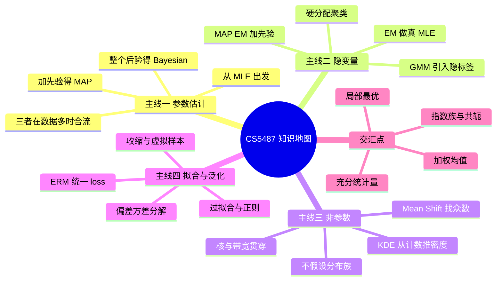
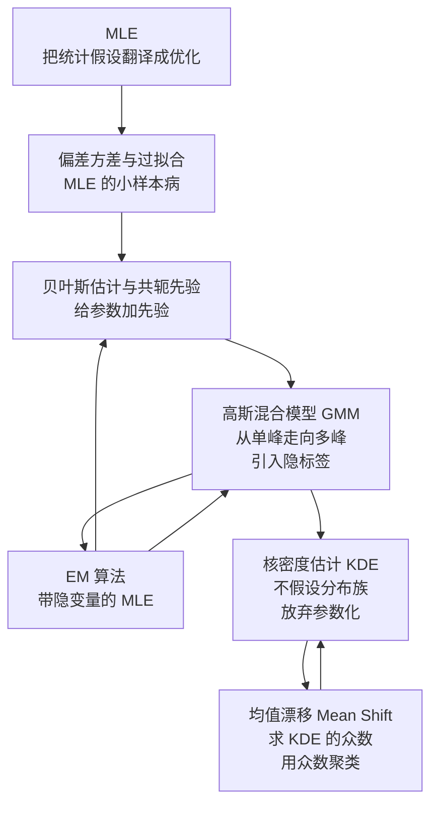
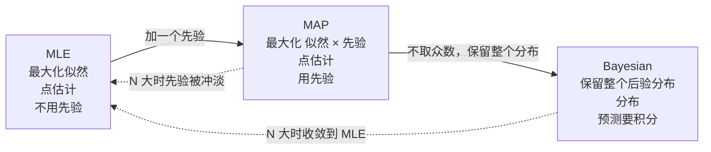
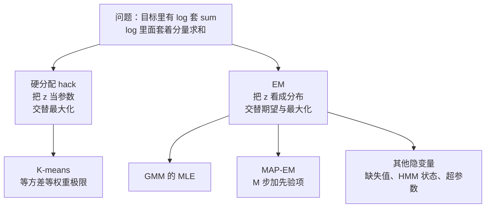
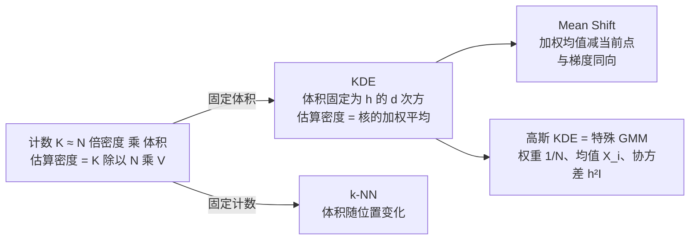
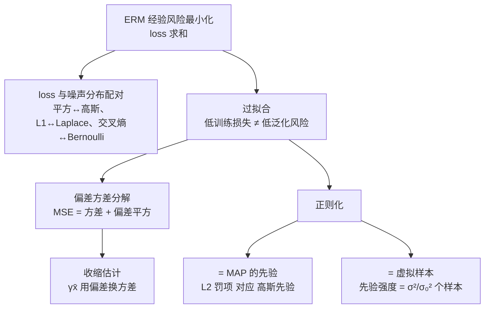

# 机器学习 知识地图

[CS5487 Index](CS5487%20Index.md) 里七篇笔记的**总览**：它们不是七个独立话题，而是**一条推下来的链条**——每一步都在解决上一步暴露出的问题。这一篇给出全局视图、依赖关系、以及贯穿整门课的几条主线。

---

## 一、一条推下来的链条

**每一步在解决什么**：

| 笔记 | 它解决上一步的什么问题 | 它自己引入了什么新问题 |
|---|---|---|
| [[最大似然估计 MLE]] | （起点）把「估参数」变成优化问题 | 小样本过拟合（三次全正面 → $\hat\theta=1$）|
| [[偏差方差与过拟合]] | 诊断 MLE 的病因：偏差与方差 | 知道病但还没药 |
| [[贝叶斯估计与共轭先验]] | 加先验，把估计往合理处拉 | 先验怎么选？积分怎么算？ |
| [[高斯混合模型 GMM]] | 单高斯表达不了多峰 | 目标里有「log 套 sum」，无闭式解 |
| [[EM 算法]] | 给 GMM 一个可用的算法 | 只到局部最优、数值不稳、可能塌缩 |
| [[核密度估计 KDE]] | 干脆不假设分布族 | 带宽 $h$ 难选、需要更多数据 |
| [[均值漂移 Mean Shift]] | 用 KDE 的众数来聚类，不用预设 $K$ | 全部聚类粒度绑在同一个 $h$ 上 |

**注意箭头是双向的**：贝叶斯回到 GMM（MAP-EM）、EM 回到 GMM（responsibility 就是后验）。这不是树，是**网**。

---

## 二、四条主线

### 主线 1：参数估计的三级台阶

**三者的选择标准**（不是「哪个更高级」）：

| 你的处境 | 用哪个 | 理由 |
|---|---|---|
| 数据多、只想要一个点估计 | **MLE** | 渐近有效，最简单 |
| 数据少、有领域知识可编码 | **MAP** | 先验 = 正则，避免极端解 |
| 需要报告不确定性、需要置信区间 | **Bayesian** | 唯一能给出「模型有多不确定」的 |
| 要在深度网络里加正则 | **MAP** 的形式 | 权重衰减 $=$ 高斯先验 |

**一句话总结**：MLE → MAP → Bayesian 是**逐步把「先验知识」和「不确定性」纳入模型**的过程，代价是计算越来越重（无积分 → 优化 → 积分）。

### 主线 2：隐变量与迭代

**EM 的核心不变式**：完整数据简单 + 隐变量未知 → 用**期望**代替隐变量 + **精确最大化**下界。

**为什么它这么通用**：任何「有缺失信息 + 补上后问题变简单」的场景都能套。GMM 的隐变量是分量标签，HMM 是状态序列，缺失数据问题里是缺失值本身，超参数估计里是参数 $\theta$。

### 主线 3：非参数路线

**与非参数的分水岭**：参数方法**固定参数个数**、让参数适应数据；非参数方法**让参数个数随 $N$ 增长**。前者的风险是欠拟合（模型太刚），后者是过拟合（模型太柔）和维度灾难。

**维度灾难的具体速率**：

| | 最优 MSE 衰减 | $d=1$ | $d=10$ |
|---|---|---|---|
| 参数方法（正确模型） | $N^{-1}$ | 1.00 | 1.00 |
| KDE | $N^{-4/(d+4)}$ | 0.80 | 0.29 |
| 最优带宽 $h^\*$ | $N^{-1/(d+4)}$ | 0.20 | 0.071 |

**读法**：$d=10$ 时非参数估计的收敛指数从 0.8 掉到 0.29，意味着要达到同样的精度需要**多几个数量级的数据**。这就是「高维不要用 KDE」的定量依据。

### 主线 4：拟合、泛化与正则

**一个必须记住的等式链**：

$$\text{加先验}\;\equiv\;\text{加正则}\;\equiv\;\text{加虚拟样本}\;\equiv\;\text{收缩}$$

四种说法，同一件事。先验的紧度 $\sigma_0^2$、正则系数 $\lambda$、虚拟样本数 $\sigma^2/\sigma_0^2$，三者之间是有确定换算关系的——不是类比，是恒等。

---

## 三、四个反复出现的数学工具

这四样东西在七篇里出现了一次又一次。**把它们单独拎出来记**，比记住每篇的细节更有用。

### 1. 充分统计量（sufficient statistic）

| 分布 | 充分统计量 $u(x)$ |
|---|---|
| Bernoulli | $x$ |
| Poisson | $x$ |
| Exponential | $x$ |
| Gaussian（$\mu,\sigma^2$ 都未知）| $(x, x^2)$ |
| Multinomial | one-hot $x$ |

**为什么重要**：$N$ 个样本关于 $\theta$ 的全部信息被压缩成 $s=\sum_iu(x_i)$。由此得出**三件事**：
1. MLE 只依赖 $s$（数据可以压缩）；
2. 共轭更新是 $s$ 加到先验参数上（记账本）；
3. EM 的 E 步只需要算 $s$ 的期望，不需要枚举隐变量。

### 2. 指数族与共轭

$$p(x\mid\theta)=f(x)g(\theta)e^{\theta^\top u(x)}$$

- 对数后凹 → MLE 有唯一全局解；
- 有共轭先验 → 后验有闭式解；
- 矩由 log-partition 的导数给出。

**记住**：指数族是「所有好性质同时成立」的那个特权小圈。一旦离开（GMM 的边际似然、Laplace 参数、混合模型），凸性和闭式解都消失，才轮到 EM 和数值方法出场。

### 3. 加权均值

| 出现的地方 | 权重是什么 |
|---|---|
| GMM 硬分配的 M-step | one-hot $z_{ij}$ |
| EM 的 M-step | responsibility $r_{ij}$ |
| KDE | $k((x-x_i)/h)$ |
| Mean shift 的更新 | $\bar g(\|(x-x_i)/h\|^2)$ |
| MAP-EM 的均值 | 加上 $(\sigma_j^2/\sigma_0^2)$ 个虚拟点 $\mu_0$ |
| 贝叶斯高斯均值 | 按精度加权：$\lambda\bar x+(1-\lambda)\mu_0$ |

**模式**：「新估计 = 数据的加权平均（权重反映可信度）」。K-means、EM、mean shift 的更新规则长得像，是因为它们都在做同一件事——**按某种可信度加权平均**。区别只在权重怎么来（硬标签 / 软后验 / 核距离）。

### 4. 局部最优与初始化

| 方法 | 目标是否凸 | 会不会卡局部最优 |
|---|---|---|
| 单高斯 MLE | 凸（指数族）| 不会，唯一解 |
| 贝叶斯高斯（已知 $\sigma^2$）| 凸 | 不会，闭式解 |
| 岭回归 | 凸 | 不会，闭式解 |
| **GMM 的边际似然** | **非凸** | **会**，且似然无界 |
| **GMM 的 EM** | 非凸 | 会，依赖初始化 |
| Mean shift | 非凸 | 会（到哪个峰取决于起点）|

**实践含义**：非凸问题必须**多次随机初始化取最优**（GMM）、或**从多个起点跑**（mean shift）、或用**较好的启发式起点**（K-means++ 之于 K-means）。这不是实现细节，而是数学上的必然——算法能给的只有**驻点**。

---

## 四、易混对照

| 容易混的两个概念 | 关键区别 |
|---|---|
| $p(D\mid\theta)$ vs $p(\theta\mid D)$ | 前者是 $\theta$ 的函数（无归一化），后者是 $\theta$ 的**概率密度** |
| MLE 不变性 vs MAP 不变性 | MLE 对**任意**单调变换不变；MAP 只对**线性**变换不变 |
| 无偏 vs 一致 | 无偏管「平均命中」，一致管「$N\to\infty$ 收敛」。$\hat\mu=x_1$ 无偏但不一致 |
| K-means vs GMM | K-means 是等方差等权重 GMM 的**硬分配极限** |
| GMM vs KDE | 高斯 KDE 是**参数全钉死**的 GMM。KDE 在优化；GMM 不优化 |
| KDE vs Mean Shift | KDE **估密度**，mean shift **找密度的峰**；共用同一个 $h$ |
| Mean Shift vs DBSCAN | Mean shift 找 KDE 的**全局峰**；DBSCAN 用**局部**密度阈值 |
| 完整数据似然 vs 边缘似然 | $\log p(X,Z\mid\theta)$ 有闭式解；$\log p(X\mid\theta)$ 有 log-sum，要靠 EM |
| 岭 vs LASSO | 高斯先验（光滑，不产生 0）vs Laplace 先验（尖角，产生稀疏）|
| 参数不确定性 vs 观测噪声 | 预测方差 $=v_n+\sigma^2$，前者是「不知道 $\theta$」，后者是「数据的随机性」 |

---

## 五、复习顺序建议

**如果只有一天**：[[最大似然估计 MLE]] → [[EM 算法]] → [[高斯混合模型 GMM]]（这三篇是考点核心，且互链最密）。

**如果有三天**：
1. 第一天：MLE → 偏差方差 → 贝叶斯（**参数估计主线**，一条线读完）
2. 第二天：GMM → EM（**隐变量主线**，重点是 responsibility 的推导与 M 步的加权 MLE 形式）
3. 第三天：KDE → Mean Shift（**非参数主线**，重点是梯度与加权均值的对应关系）

**如果按考试题型**：
- **推导题**（占大头）：MLE 的三个例子（Bernoulli/Gaussian/Poisson）、PS 里的所有 (a)(b) 小问、EM 的 M 步推导、KDE 的梯度推导
- **计算题**：PS2.1 的飞弹表、PS4.8 的多项分布 EM、PS2.13 的最优 $\gamma$
- **概念题**：无偏 vs 一致、MAP 不变性失效、K-means 与 GMM 的关系、带宽的作用

**做题入口**：每篇笔记底部的 `## 习题` 都塞了对应的 PS 真题（解答折叠）。按 `先自己做 → 再点开` 的顺序刷一遍，比读笔记有效得多。

---

## 六、材料清单

| 周 | 讲义 / 习题 | 对应笔记 |
|---|---|---|
| 期中 | 三套期中真题 | [[CS5487 期中真题汇编]] |
| week1 | PS-1 概率与线代复习 | （基础，散落各篇）|
| week2 | PS-2 MLE；lec2；tut2 | [[最大似然估计 MLE]]、[[偏差方差与过拟合]] |
| week3 | PS-3 贝叶斯估计；lec3 | [[贝叶斯估计与共轭先验]] |
| week4 | Lecture4 Mixture Models；PS-4 混合模型与 EM | [[高斯混合模型 GMM]]、[[EM 算法]] |
| week5 | Lecture5 Density Estimation & Mean Shift | [[核密度估计 KDE]]、[[均值漂移 Mean Shift]] |
| 编程1 | PA-1 Regression | （与 PS2.8/2.9 对应）|

原始文件在 `C:\Users\Lenovo\Desktop\研究生\机器学习\`。**注意** week1/week3/week5 的 tutorial PDF 是纯图片幻灯片，无法提取文字。

---

## 相关

- [[最大似然估计 MLE]]
- [[偏差方差与过拟合]]
- [[贝叶斯估计与共轭先验]]
- [[高斯混合模型 GMM]]
- [[EM 算法]]
- [[核密度估计 KDE]]
- [[均值漂移 Mean Shift]]
- [[CS5487 Index]]
