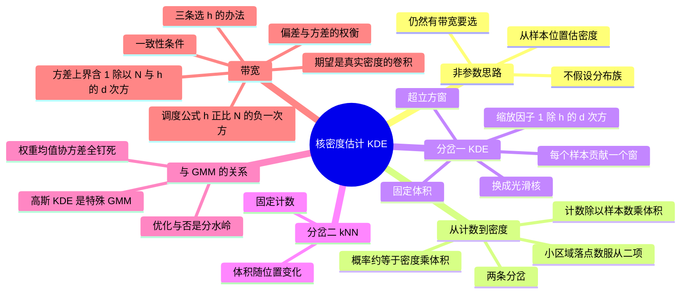

# 核密度估计 KDE

前面所有方法都先假设一个参数族（Gaussian、GMM…），再估参数。**非参数**方法反过来：不假设固定分布族，直接从样本**位置**估密度。代价是要选带宽 $h$，且需要更多数据。

![[kde-kernels.png]]

> 图：三种核（box、Epanechnikov、Gaussian）在**同一个 $h$** 下的形状。横轴是 $u/h$，但三条曲线的面积都是 1——**换核只改变局部形状，不改变总质量**。实践上核的选择远不如 $h$ 重要（见下文）。

---

## 从局部计数推密度

iid 样本 $x_1,\dots,x_N\sim p$，取包含 $x$ 的小区域 $R$。落进 $R$ 的样本数 $K=\sum_i\mathbb 1[x_i\in R]$ 服从 $\mathrm{Binomial}(N,P)$，其中 $P=\int_R p(x)\,dx$。

若 $R$ 足够小、$p$ 在其中近似常数，则 $P\approx p(x)V$（$V$ 是体积）。于是

$$K\approx Np(x)V\quad\Longrightarrow\quad \hat p(x)=\frac{K}{NV}$$

**计数 → 除以「样本数 × 体积」** 即得密度。稳定条件：$V\to0$、$K\to\infty$、$K/N\to0$。

> [!warning] 三条稳定条件必须同时满足，缺一不可
> - $V\to0$：保证 $p$ 在 $R$ 内近似常数（否则 $P\approx pV$ 不成立）。
> - $K\to\infty$：保证 $\hat\pi=K/N$ 这个比例估计的**方差**小（$K$ 是二项计数，相对标准差 $\propto1/\sqrt K$）。
> - $K/N\to0$：保证 $K\approx NpV$ 里 $K$ 不会饱和到 $N$（否则 $K/N\to1$ 也不再反映 $p$）。
>
> 这三条要同时对，就只能让 $N\to\infty$ **配合** $V$ 以恰当速率缩小。单看某一条会得出错误结论：只让 $V\to0$ 而 $N$ 固定，$\hat p$ 会退化成一个 $\delta$ 之和（每个点一个尖峰），根本没估出密度。

两条分岔：

1. **固定体积**，让计数变化 → Parzen 窗 / KDE；
2. **固定计数** $K$，让体积变化 → k-近邻（k-NN）密度估计，$V(x)=$ 到第 $k$ 近邻的距离所含体积。

> [!tip] 两条分岔的对偶性
> | | 固定什么 | 变什么 | 名字 |
> |---|---|---|---|
> | KDE / Parzen | 体积 $V=h^d$ | 计数 $K(x)$ | 带宽 $h$ 是超参数 |
> | k-NN | 计数 $K=k$ | 体积 $V(x)$ | 近邻数 $k$ 是超参数 |
>
> **两者的优缺点正好互补**：KDE 的密度**处处可微**（核光滑），但要在稀疏区域也放同样宽度的窗，导致那里估计很抖；k-NN 的窗在稀疏区域自动变宽（自适应），但 $V(x)$ 作为 $x$ 的函数**不连续**（第 $k$ 近邻跳变时体积突变），所以 k-NN 密度估计**不是光滑函数**，$k$ 越大越光滑。

---

## KDE 的构造

先把 $R$ 取成中心在 $x$、边长为 $h$ 的 $d$ 维超立方体，则计数是

$$K=\sum_i \phi\!\Big(\frac{x-x_i}{h}\Big),\qquad \phi(u)=\begin{cases}1,&\|u_j\|<\tfrac12\ \forall j\\0,&\text{otherwise}\end{cases}$$

$\hat p(x)=\frac{K}{Nh^d}$。换个视角——**每个样本贡献一个以自己为中心的窗口**，把重叠的窗口平均：

$$\hat p(x)=\frac{1}{N}\sum_{i=1}^N\frac{1}{h^d}\,\phi\!\Big(\frac{x-x_i}{h}\Big)$$

把 box 换成更光滑的 **kernel** $K$（非负、积分为 1），即得一般 KDE：

$$\hat p(x)=\frac{1}{N}\sum_{i=1}^N\frac{1}{h^d}K\!\Big(\frac{x-x_i}{h}\Big)$$

**因子 1/h 的作用**：缩放核的宽度，同时调高度使积分恒为 1（概率质量守恒）。常见核：box（$\|u\|<1/2$）、球（$1/V_d$，$V_d$ 是 $d$ 维单位球体积）、Gaussian $K(u)=(2\pi)^{-1/2}e^{-u^2/2}$。

**质量守恒的证明**（Lecture 5 的做法）：令 $u=(x-x_i)/h$，则 $dx=h^d du$，

$$\int\hat p_h(x)dx=\frac1N\sum_i\int\frac{1}{h^d}K\Big(\frac{x-x_i}{h}\Big)dx=\frac1N\sum_i\int K(u)du=\frac1N\sum_i 1=1$$

**关键**：分子里的 $1/h^d$ **恰好**是为了抵消换元时 $dx=h^ddu$ 带来的 $h^d$。少写这个因子，$h$ 一变总质量就变了。

**Gaussian KDE = GMM 的特殊情形**：权重全为 $1/N$、均值在各数据点 $x_i$、**所有协方差固定为 $h^2I$** 的 GMM。区别只在 GMM 会去优化这些参数，KDE 把它们钉死在样本上。

> [!warning] 「非参数」不等于「没有参数」
> KDE 里仍然有 $h$ 要选，而且这个选择对结果的影响**可能比 GMM 选 $K$ 还大**。非参数的准确含义是「**参数个数随 $N$ 增长**」（实际上是每个样本一个参数位置），而不是「不用做选择」。
>
> 更进一步：把 KDE 看成「$N$ 个分量的 GMM」很危险——$N$ 个分量的 GMM 参数量是 $O(Nd^2)$，若不加以约束，最大似然会退化成「每个分量塌缩到一个数据点、方差 →0」的无穷似然解（见 [[高斯混合模型 GMM]] 的无界性）。KDE 用**钉死参数**的方式绕开了这个问题：它根本不去优化，所以不会塌缩。代价是**无法通过优化来适应数据**——$h$ 只能靠外部规则选。

---

## 带宽：bias 与 variance 的权衡

$\hat p$ 是随机变量（样本随机），$\mathrm{MSE}=\mathrm{Bias}^2+\mathrm{Var}$。**期望**上，KDE 是真实密度与核的卷积（平滑）：

$$\mathbb E[\hat p(x)]=(K_h * p)(x)$$

对连续点，当 $h\to0$ 时核趋向 delta，$\mathbb E[\hat p(x)]\to p(x)$，**偏差消失**。方差方面，假设核有界（上界 $M$）：

$$\mathrm{Var}[\hat p(x)]\le\frac{1}{Nh^d}\mathbb E[\hat p(x)]$$

$N$ 增大降方差；固定 $N$ 时窄 $h$ 会抬高方差。

- **小 $h$**：平滑少，偏差小，但邻域内样本少 → 方差大、尖刺；
- **大 $h$**：平滑多，方差小，但细节与独立峰被抹平。

![[kde-bandwidth.png]]

> 图：同一批样本、不同带宽的 KDE。$h$ 很小时曲线尖刺、每个点一个峰；$h$ 大时三个真实的簇被抹成一个宽包。**中间那一档**才同时保留了「三个峰」这个真实结构又不显得抖——这就是「选带宽」要挑的东西。

**统计推导（期望是卷积）**：

$$\mathbb E[\hat p_h(x)]=\frac1N\sum_i\mathbb E[\tilde k_h(x-x_i)]=\int p(u)\tilde k_h(x-u)du=(p*\tilde k_h)(x)$$

（用了 $x_i$ 同分布，以及 $\tilde k_h(x-u)=\frac1{h^d}k(\frac{x-u}{h})$。）

**方差上界**：记 $Y_i=\tilde k_h(x-x_i)$，则 $\hat p_h(x)=\frac1N\sum_iY_i$ 是独立同分布的平均，故 $\mathrm{Var}=\frac1N\mathrm{Var}(Y_1)$。若核有上界 $M$，则 $0\le Y_1\le M/h^d$，于是 $Y_1^2\le\frac{M}{h^d}Y_1$，取期望：

$$\mathrm{Var}(Y_1)\le\frac{M}{h^d}\mathbb E[Y_1]=\frac{M}{h^d}\mathbb E[\hat p_h(x)]\;\Longrightarrow\;\mathrm{Var}[\hat p_h(x)]\le\frac{M}{Nh^d}\mathbb E[\hat p_h(x)]$$

**这个不等式解释了两件事**：$N$ 增大降方差（合理）；$h$ 减小**升**方差（因为 $h^d$ 在分母），与「小 $h$ 更尖刺」的直觉一致。

![[kde-mse-vs-h.png]]

> 图：拿高斯混合当真值做 Monte Carlo，直接量 MSE 的两个分量。左：偏差² 随 $h$ **单调上升**，方差随 $h$ **单调下降**——两者方向相反，所以 MSE 出现 U 形谷底。右：不同 $N$ 下的 MSE 曲线，$N$ 越大整条曲线越低、最优 $h$ **越小**（数据多时可以承担更细的分辨率）。

**取一致性的带宽**：$h\to0$ 但 $Nh^d\to\infty$（邻域缩小、有效样本数仍增长）。一个典型调度 $h\propto N^{-1/(d+4)}$。

**Lecture 5 给的另一种调度**：$h_N^{-1}\propto\log N$ 即 $h_N\propto(\log N)^{-1}$。检查一致性：$h_N\to0$ ✓；$Nh_N^d\propto N(\log N)^{-d}\to\infty$ ✓。**这个调度更慢**（对数速率），对应更强的平滑。

> [!warning] 为什么是 $N^{-1/(d+4)}$，不是 $N^{-1/2}$
> 标准结果（在 $p$ 二阶可导、核对二阶矩有限的条件下）是
> $$\mathrm{MSE}\approx\underbrace{\frac{h^4}{4}\Big(\int u^2K(u)du\Big)^2\!\!\int p''(x)^2dx}_{\text{Bias}^2\propto h^4}+\underbrace{\frac{1}{Nh^d}\int K^2(u)du}_{{\rm Var}\propto\frac{1}{Nh^d}}$$
> 对 $h$ 求导置零：$h^5\propto\frac1N$，即 $h^\*\propto N^{-1/5}$（这里 $d=1$，一般式 $N^{-1/(d+4)}$）。此时 $\mathrm{MSE}\propto N^{-4/5}$。
>
> **两个后果**：
> 1. **维度灾难**：$d$ 增大时 $h^\*$ 的衰减速率 $N^{-1/(d+4)}$ 变慢，而 MSE 的最优速率 $N^{-4/(d+4)}$ 也变慢。$d=10$ 时 MSE 只能以 $N^{-2/7}\approx N^{-0.29}$ 衰减——**比参数方法的 $N^{-1}$ 差得多**。这就是非参数方法在高维失效（curse of dimensionality）的具体速率。
> 2. **$h^\*$ 里的常数依赖未知的 $\int p''(x)^2dx$**——要估这个量就得先知道 $p$，循环依赖。这就是为什么实践上要用交叉验证或经验规则（如 Silverman 规则 $h\approx1.06\hat\sigma N^{-1/5}$），而不是解析地算 $h^\*$。

**选 $h$ 的办法**：1) 用测量尺度/噪声的先验知识；2) 用留出数据的验证对数似然 $h=\arg\max_h\sum_{x\in\text{val}}\log\hat p(x;\text{train})$；3) 用依赖样本量的调度公式。注意 $h$ 不是「没有参数」——非参数方法仍然要选平滑尺度。

---

## 习题

> [!warning] 关于本节的题目来源
> **KDE 这一章没有配套的 PS 习题。** CS5487 的 PS-1 到 PS-4 分别覆盖概率与线代复习、MLE、贝叶斯估计、混合模型与 EM；密度估计只在 **Lecture 5** 里讲，week5 的 tutorial5.pdf 是纯图片幻灯片（无法提取出题目）。
>
> 下面几题是我按 Lecture 5 的**知识点与推导步骤**自己编的（**非真题**），每题都在括号里标了对应的讲义页，方便你回去对照。它们的难度和风格贴近 PS 的基础题。

### 自编 5.1 从计数推密度（Lecture 5, p.5–6）

**题目.** 设 $x_1,\dots,x_N\overset{iid}{\sim}p$，$R$ 是一个包含 $x$ 的小区域，体积 $V$。记 $K_R=\sum_{i=1}^N\mathbb 1[x_i\in R]$，$\pi=P(X\in R)$。(a) $K_R$ 服从什么分布？(b) 写出 $\hat p(x)$ 的估计式。(c) 说明为什么 $V\to0$、$K\to\infty$、$K/N\to0$ 必须同时成立。

> [!success]- 解答（先自己做，再点开）
> **(a)** 每次试验「落在 $R$ 内」是成功概率 $\pi$ 的 Bernoulli，$N$ 次独立，所以
> $$K_R\sim\mathrm{Binomial}(N,\pi),\qquad \mathbb E[K_R]=N\pi,\qquad \mathrm{Var}(K_R)=N\pi(1-\pi)$$
>
> **(b)** 由 $\pi=\int_Rp(u)du\approx p(x)V$（$p$ 在 $R$ 内近似常数），且 $\hat\pi=K_R/N$：
> $$\hat p(x)=\frac{\hat\pi}{V}=\frac{K_R}{NV}$$
> 读作「**计数 ÷（样本数 × 体积）**」。
>
> **(c) 三条条件对应三个不同的失效模式**：
> - **$V\to0$**：若不成立，$R$ 太大时 $p$ 在其中不是常数，$P\approx pV$ 这一步直接错（这引入**偏差**）。
> - **$K\to\infty$**：$K_R$ 是随机的，$\hat\pi=K_R/N$ 的相对标准差是 $\sqrt{(1-\pi)/(N\pi)}\approx1/\sqrt K$。$K$ 小则 $\hat p$ 抖得厉害（这对应**方差**）。
> - **$K/N\to0$**：若 $K/N\to1$（区域几乎覆盖整个支撑），则 $K/N$ 饱和、不再随 $p$ 变化，$\hat p$ 变成常数（失去分辨能力）。
>
> **一起看**：$K\approx Np(x)V$。要让 $K\to\infty$ 而 $V\to0$，必须 $N\to\infty$ 且 $V$ 缩小得比 $1/N$ 慢（即 $NV\to\infty$）。这正是 KDE 一致性条件 $Nh^d\to\infty$ 的来源。

### 自编 5.2 box 核 KDE 的归一化（Lecture 5, p.10–11）

**题目.** 设 $k(u)=\mathbb 1[\|u_j\|<1/2\ \forall j]$（$d$ 维单位超立方体的指示函数）。(a) 验证 $k$ 是一个合法的核（非负、积分为 1）。(b) 证明 $\hat p_h(x)=\frac{1}{Nh^d}\sum_i k\big(\frac{x-x_i}{h}\big)$ 满足 $\int\hat p_h(x)dx=1$。(c) 这一维里，$\hat p_h(x)$ 的值能取哪些？相邻两个取值之间差多少？

> [!success]- 解答（先自己做，再点开）
> **(a)** 显然 $k\ge0$。关于积分：
> $$\int_{\mathbb R^d}k(u)du=\int_{-1/2}^{1/2}\cdots\int_{-1/2}^{1/2}du_1\cdots du_d=1^d=1$$
> ✓（每个维度贡献长度 1。）
>
> **(b)** 令 $u=(x-x_i)/h$，则 $dx=h^ddu$：
> $$\int\hat p_h(x)dx=\frac1N\sum_i\int\frac1{h^d}k\Big(\frac{x-x_i}{h}\Big)dx=\frac1N\sum_i\int k(u)du=\frac1N\cdot N=1$$
> 注意**每一步都用到 $h^d$ 这个因子**：$1/h^d$ 恰好抵消换元的 $h^d$。若把 $1/h^d$ 写成 $1/h$，总积分会变成 $h^{d-1}\ne1$。
>
> **(c)** 分子 $K_R(x)=\sum_i k(\cdot)$ 是**整数**（$x$ 落进几个以样本为中心的超立方体），所以 $\hat p_h(x)$ 只能取
> $$0,\ \frac{1}{Nh^d},\ \frac{2}{Nh^d},\ \dots,\ \frac{N}{Nh^d}=\frac{1}{h^d}$$
> **相邻取值差 $\frac{1}{Nh^d}$**。
>
> **这就是为什么 box 核在实践中不好用**：估计出的密度是**阶梯状**的，$N$ 小时明显可见台阶；$N$ 大时台阶变细但仍然处处不连续。此外 $h\to0$ 时 $\frac1{Nh^d}\to\infty$，值域无限分裂。换成光滑核（Gaussian）就没有这个问题——这是 Lecture 5 把 box 推广到一般核 $K$ 的实际动机之一。

### 自编 5.3 Gaussian KDE 与 GMM 的关系（Lecture 5, p.13）

**题目.** 设 $k(u)=(2\pi)^{-d/2}\exp(-\frac12\|u\|^2)$。(a) 证明 $\frac{1}{h^d}k\big(\frac{x-x_i}{h}\big)=N(x\mid x_i, h^2I)$。(b) 由此把 $\hat p_h(x)$ 写成一个 GMM，指出它的权重、均值、协方差各是什么。(c) 这个 GMM 有 $N$ 个分量，为什么不直接用 EM 去优化它？

> [!success]- 解答（先自己做，再点开）
> **(a)** 直接代入：令 $u=(x-x_i)/h$，则 $\|u\|^2=\frac{\|x-x_i\|^2}{h^2}$，
> $$\frac{1}{h^d}(2\pi)^{-d/2}\exp\Big(-\frac{\|x-x_i\|^2}{2h^2}\Big)=\frac{1}{(2\pi)^{d/2}|h^2I|^{1/2}}\exp\Big(-\frac12(x-x_i)^\top(h^2I)^{-1}(x-x_i)\Big)$$
> （$|h^2I|^{1/2}=h^d$。）这正是 $N(x\mid x_i,h^2I)$。
>
> **(b)**
> $$\hat p_h(x)=\frac1N\sum_{i=1}^N N(x\mid x_i,h^2I)$$
> 即一个 $K=N$ 分量的 GMM，其中
> - **权重**：$\pi_i=1/N$（全部相等，且**固定**）；
> - **均值**：$\mu_i=x_i$（钉死在样本上，**不优化**）；
> - **协方差**：$\Sigma_i=h^2I$（全部相同且**固定**，各向同性，只由一个标量 $h$ 控制）。
>
> **(c) 不能直接用 EM 优化的两个理由**：
>
> **理由 1（统计）**：这个 GMM 的参数量是 $O(Nd)$（如果把 $\mu_i$ 当参数），而数据只有 $N$ 个点——**参数比数据还多**（对 $d\ge2$）。最大似然会退化成「每个分量塌缩到自己的数据点、方差 →0」，似然无界（见 [[高斯混合模型 GMM]]）。
>
> **理由 2（计算）**：即使固定 $\Sigma=h^2I$ 只优化 $\mu_i$，$N$ 个分量的 EM 每轮要算 $N\times N$ 的 responsibility 矩阵，复杂度 $O(N^2d)$。$N=10^5$ 时就完全不可行了。而 KDE 只是**求和**，$O(Nd)$。
>
> **所以 KDE 的选择很清楚**：牺牲「适应数据的能力」换取「无优化、无塌缩、线性复杂度」。它是一个**固定的、无参数的密度估计器**（只差一个 $h$），这正是它在高维大数据场景下仍然常用的原因。
>
> **反过来看 GMM**：GMM 用 $K\ll N$ 个自适应分量换来了「能表达数据里的簇结构」和「能给出聚类标签」。两种方法的取舍是**表达能力 vs 稳定性**。

### 自编 5.4 带宽与一致性（Lecture 5, p.22–23）

**题目.** (a) 说明「小 $h$」和「大 $h$」各自的偏差与方差表现。(b) 证明 $h_N\propto(\log N)^{-1}$ 是一个一致性带宽调度。(c) 为什么 $N$ 越大最优 $h$ 越小？

> [!success]- 解答（先自己做，再点开）
> **(a)**
> | | 平滑程度 | 偏差 | 方差 | 后果 |
> |---|---|---|---|---|
> | **小 $h$** | 少 | 小（连续点处） | **大** | 曲线尖刺、出现伪峰 |
> | **大 $h$** | 多 | **大** | 小 | 抹平细节、真实峰被合并 |
>
> 理论上：$\mathrm{Bias}^2\approx\frac{h^4}{4}p''(x)^2(\int u^2K)^2$（$\propto h^4$），$\mathrm{Var}\le\frac{M}{Nh^d}\mathbb E[\hat p_h(x)]$（$\propto\frac1{Nh^d}$）。
>
> **(b)** 一致性要求 $h_N\to0$ 且 $Nh_N^d\to\infty$。
> - $h_N=(\log N)^{-1}\to0$ ✓。
> - $Nh_N^d=N(\log N)^{-d}\to\infty$ ✓（$N$ 的增长远快于 $(\log N)^d$ 的增长）。
>
> 所以这是一个合法的一致性调度。**注意**：它比最优速率 $N^{-1/(d+4)}$ **慢得多**（对数 vs 幂），意味着它取偏大的 $h$——用更多偏差换更小方差，收敛慢但**稳**。在只知道「要一致」而不知道真密度的光滑程度时，这种保守调度是安全的选择。
>
> **(c)** 由 $\mathrm{MSE}\approx C_1h^4+\frac{C_2}{Nh^d}$，对 $h$ 求导置零：
> $$4C_1h^3-\frac{d\,C_2}{Nh^{d+1}}=0\;\Longrightarrow\;h^{d+4}=\frac{d\,C_2}{4C_1N}\;\Longrightarrow\;h^\*\propto N^{-1/(d+4)}$$
> **直观**：$N$ 大时可以承担更细的分辨率（更小的 $h$），因为即使窗很窄，里面仍然有足够多的点把方差压住。反过来，$N$ 小时必须开大窗（借用远处的点）才能让估计稳定，代价是偏差。**「数据多就能看细节」在非参数估计里是定量的：分辨率以 $N^{1/(d+4)}$ 的速率提升。**

### 自编 5.5 用验证对数似然选 $h$（Lecture 5, p.24）

**题目.** 给定训练集 $D_{\text{train}}$ 与验证集 $D_{\text{val}}$，说明为什么
$$\hat h=\arg\max_h\sum_{x\in D_{\text{val}}}\log\hat p_h(x;D_{\text{train}})$$
是一个合理的带宽选择准则。它和最大似然估计有什么不同？

> [!success]- 解答（先自己做，再点开）
> **准则的含义**：$\hat p_h(\cdot;D_{\text{train}})$ 是用**训练集**建出来的密度估计。把它当成一个概率模型，在**验证集**上算平均对数似然，就是「这个密度模型对**没见过的数据**预测得多好」。
>
> **为什么不能在训练集上最大化**：$\sum_{x\in D_{\text{train}}}\log\hat p_h(x;D_{\text{train}})$ 当 $h\to0$ 时会**发散到 $+\infty$**。因为每个训练点 $x_i$ 自己贡献一个峰，$\hat p_h(x_i)$ 里含一项 $\frac{1}{Nh^d}K(0)$，$h\to0$ 时 $\to\infty$。所以训练似然**永远偏爱 $h\to0$**——这是纯粹的过拟合。
>
> **和 MLE 的差别**：
> - MLE 在**同一批数据**上既训练又评估 → 「自己评自己」，$h\to0$ 是最优但毫无用处；
> - 验证似然用**留出集**评估 → 只有真正泛化的 $h$ 才会得分高，$h\to0$ 时验证点的似然会变差（因为验证点不在训练集里，附近的训练点少）。
>
> **这正是 KDE 版的「留一法交叉验证」**。更极端的做法是**留一交叉验证** $\hat h=\arg\max_h\sum_i\log\hat p_h^{(-i)}(x_i)$（每次去掉 $x_i$ 建密度再算它的似然），不需要单独留验证集，代价是要算 $N$ 次。
>
> **和 [[偏差方差与过拟合]] 的联系**：训练似然只看「拟合」，验证似然看「泛化」。这两者在小 $h$ 处的分歧，和 MLE 在三次全正面数据上给出 $\hat\theta=1$ 是**同一类错误**——都是把「对已见数据拟合好」误当成「模型好」。

---

## 相关

- [[均值漂移 Mean Shift]]
- [[高斯混合模型 GMM]]
- [[偏差方差与过拟合]]
- [[机器学习 知识地图]]
- [[CS5487 Index]]
