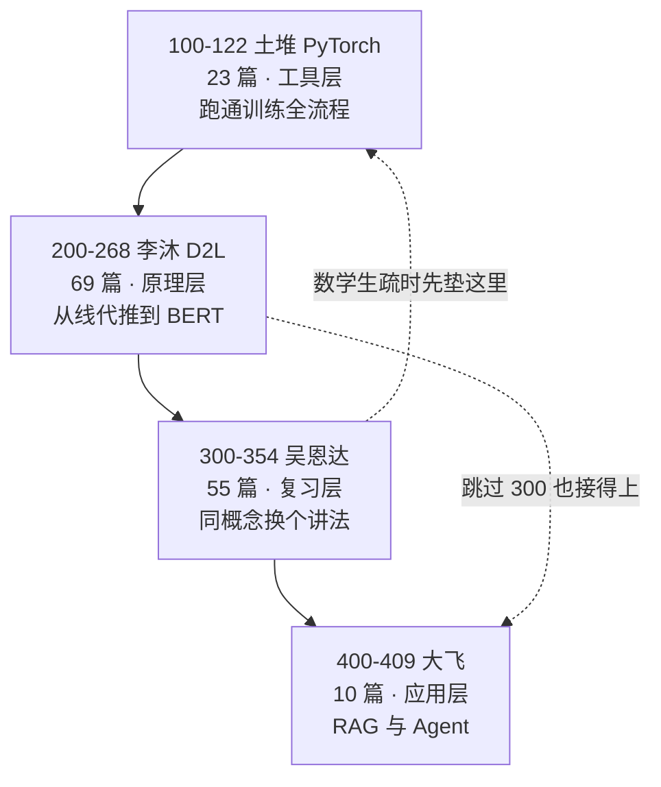
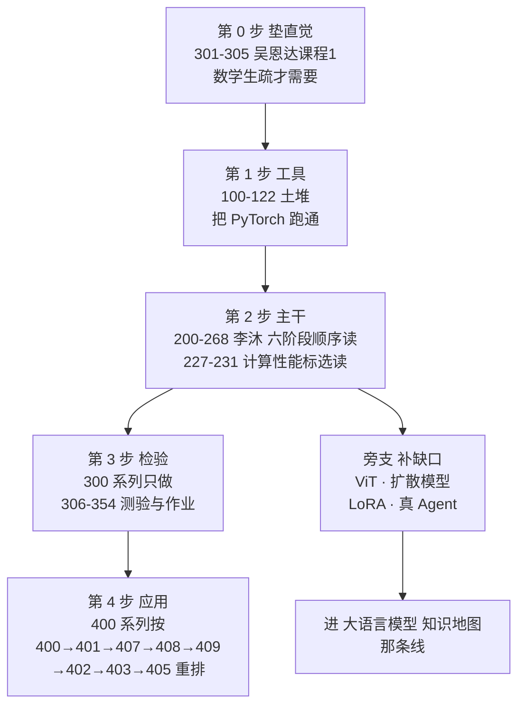

# 深度学习 知识地图

2026-10-14 把 GitHub 上 20K star 的 **AccumulateMore/CV**（AccumulateMore/CV）整个拉下来看了一遍 —— 158 篇 Jupyter 笔记，自称"超级全面的深度学习笔记（包含 CV、NLP、大模型、Agent）"。这一篇不是它的摘要，是它的**路线评估**：四个系列怎么串、哪一步的顺序是对的、哪些地方会把人绊住、如果重排会怎么排。

**为什么值得记**：手上正在往深度学习走（[[PyTorch CPU 环境搭建]] 的底座已经搭好），需要一个「从哪开始、读到哪算过关」的外部骨架。这个仓库是目前中文圈最完整的免费骨架，但它的结构里埋着几处真会劝退人的坑 —— 先把它拆开看清楚，再决定用什么姿势进入，比闷头从 100 顺序读下去划算。

## 一、仓库是什么

四个系列，**全部平铺在根目录**，靠三位数字前缀分块。编号即顺序，没有子目录，没有 Index。

| 系列 | 编号 | 篇数 | 主讲人 | 定位 |
|---|---|---|---|---|
| PyTorch 入门 | 100–122 | 23 | 土堆（B站） | 框架 API 全流程：装环境 → 加载数据 → 搭网络 → 训练/验证套路 |
| 动手学深度学习 | 200–268 | 69 | 李沐（D2L） | **主干**：线代/微积分 → 线性回归 → MLP → CNN → 检测分割 → RNN → Transformer → BERT |
| 深度学习专项 | 300–354 | 55 | 吴恩达 | 同一批概念的**第二遍**，配测验题 + 编程作业 |
| 大模型与 Agent | 400–409 | 10 | 大飞 | 向量库、RAG、LangChain、API 调用 |
| *（占位）* | 500–5XX | 0 | — | README 自注"预计明年上线" |

**一句话读法**：100 教你"先跑起来"，200 让你"真懂原理"，300 是"换个老师再讲一遍"，400 是"接上大模型应用"。

---

## 二、全局路线图

骨架是 **工具 → 原理 → 复习 → 应用**。方向没问题（第四节），问题都出在细节（第五节）。

---

## 三、主干拆解：200 系列的六个阶段

真正承载"学会深度学习"的是 200 系列。69 篇可以切成六段：

| 阶段 | 编号 | 内容 | 解决上一段的什么问题 |
|---|---|---|---|
| 1 数学地基 | 200–205 | 介绍 · 数据操作 · 线代 · 矩阵计算 · 自动求导 | （起点）把微积分/线代翻译成张量运算 |
| 2 从回归到 MLP | 206–215 | 线性回归 · Softmax · MLP · 模型选择 · 权重衰退 · 丢弃法 · 数值稳定性 · 房价预测 · PyTorch 基础 · 买 GPU | 单层不够 → 加隐层；加隐层就过拟合 → 加正则 |
| 3 卷积与经典网络 | 216–226 | 卷积层 · 填充步幅 · 多通道 · 池化 · LeNet → AlexNet → VGG → NiN → GoogLeNet → BN → ResNet | 全连接吃不下图像 → 卷积；网络深了就退化 → 残差 |
| 4 计算性能 | 227–231 | CPU/GPU · TPU · 单机多卡 · 多 GPU · 分布式 | 单卡不够快 → 并行 |
| 5 视觉实战 | 232–245 | 数据增广 · 微调 · CIFAR10 · ImageNetDogs · 物体检测 · 锚框 · R-CNN/SSD/YOLO · 语义分割 · 转置卷积 · FCN · 样式迁移 | 论文里的层怎么拼成能打的模型 |
| 6 序列到大模型 | 246–268 | 序列模型 · 文本预处理 · 语言模型 · RNN · GRU · LSTM · seq2seq · 束搜索 · 注意力 · 自注意力 · Transformer · BERT 预训练/微调 | 图像那套处理不了变长序列 → 循环；循环不能并行 → 注意力 |

**这条线的质量很高。** 经典网络那段（LeNet → AlexNet → VGG → NiN → GoogLeNet → ResNet）每一步都在补上一步的短板，是教科书级的递进；RNN → 注意力 → Transformer 同理。这是 D2L 原书的顺序，本来就是成熟骨架。

---

## 四、顺序评估：骨架对的四点

1. **工具先行。** 100 系列（土堆）先把 PyTorch 的 API 面铺开，再进 200 系列的原理。顺序正确 —— 框架是脚手架，先会用再懂为什么，比反过来劝退率低。
2. **200 内部梯度严格。** 数学 → 回归 → MLP → 正则 → CNN → 经典网络 → 检测分割 → 序列 → 注意力 → Transformer → BERT。没有跳步，每一步都有"上一步的短板"当动机。
3. **BERT 接在 Transformer 之后。** 263 讲完 Transformer，264/265 立刻用它做预训练和微调，是自然延伸。
4. **400 放在最后。** 从"懂模型"走到"用模型"，合理。

---

## 五、顺序评估：五个会绊住人的地方

### 1. 三遍重复，且没人告诉你

这是最大的问题。100（土堆）已经讲过卷积原理、卷积层、池化、损失函数、优化器、完整训练套路；200（李沐）从头再讲一遍；300（吴恩达）讲第三遍。

**卷积一共讲三次，反向传播三次，优化器三次。** 158 篇里大概有三分之一是重复内容。

这不算错 —— 不同老师、不同深度，重复本身有巩固价值。错在**没有任何指引告诉你该怎么取舍**：README 默认你从 100 顺序读到 409，按这个读法要连着看三遍同一个概念，很容易在第二遍就疲劳放弃。

### 2. 四处局部错位

| 错位 | 现状 | 应该 |
|---|---|---|
| 266_目标检测竞赛总结 | 夹在 265_BERT微调 和 267_优化算法 之间 | 目标检测内容在 236–240，总结却跑到 60 篇之外。移回 240 后面 |
| 238_树叶分类竞赛总结 | 夹在 237_锚框 和 239_检测算法 之间 | 打断"检测基础 → 检测算法"，整块移出 |
| **407–409 API 系列** | 排在 401–406 之后 | **最硬的一处倒置**：不装环境（407）、不懂 API 参数（408）、不会多轮对话（409），401 的核心概念和 403 的 RAG 根本跑不起来 |
| 227–231 计算性能 | 夹在 226_ResNet 和 232_数据增广 之间 | 学 ResNet 时不需要分布式训练。整块挪到视觉实战之后，或标为选读 |

400 系列的正确顺序应该是：

> 400 配置 → 401 核心概念 → **407 API 环境 → 408 API 参数 → 409 多轮对话** → 402 向量数据库 → 403 向量检索 RAG → 405 LangChain RAG → 404 代码分析 → 406 手写大模型

### 3. 断层：从土堆跳到李沐

100 系列是纯 API 教学（102 甚至讲 `dir()` / `help()` 怎么看），完全不碰数学。200 系列开篇就是线性代数、矩阵计算、自动求导，206 直接推线性回归的解析解。

中间缺一个"从调包到推公式"的过渡。**线代/微积分生疏的话，这是第一个劝退点。** 缓解办法：先用 300 系列课程 1（301–305）垫一下 —— 吴恩达讲神经网络基础几乎不用矩阵推导，直觉先行 —— 再回 200。

### 4. 内容缺口

仓库叫 CV，但 CV 部分停在 2022 年：

- **没有 ViT。** 263 已经讲了 Transformer，从 Transformer 推到 ViT 是极自然的一步，却断了。而现在 CV 的主流 backbone 就是 ViT / Swin。
- **没有自监督预训练**（MAE、SimCLR、对比学习）。有数据增广、有微调，但"预训练范式"整条没讲。
- **没有扩散模型。** 生成模型这条线到 245_样式迁移（2015 年的东西）就停了。
- **没有参数高效微调**（LoRA / QLoRA）、量化、蒸馏。265_BERT微调 是全量微调。
- **没有 RLHF / DPO / 对齐。** 这正好是 [[大语言模型 知识地图]] 里"训练三台阶"的最高一级。
- **400 名为 Agent，实为 RAG。** 401–405 全部围绕 RAG（向量库、语义检索、LangChain），真正的 Agent 要素 —— 工具调用、ReAct、规划、记忆 —— 基本没有。500 系列是占位符，README 自己承认还没写。

### 5. 时效

李沐 D2L 与吴恩达专项都是 2021–2022 年的录制内容（吴恩达专项本身是 2017）。用 PyTorch 讲的部分没过时，但"大模型"部分停在 RAG 入门，和 2026 年的实际差距明显。

---

## 六、同一个概念，三个系列各在哪

不想读三遍的话，拿这张表挑一个系列看就够：

| 概念 | 土堆 100 | 李沐 200 | 吴恩达 300 |
|---|---|---|---|
| 卷积层 | 109–110 | 216–218 | 329–330 |
| 池化 | 111 | 219 | 329 |
| 损失函数 / 反向传播 | 115 | 205 · 207 | 311 · 320 |
| 优化器 | 116 | 206 · 267 | 315 · 321 |
| 过拟合与正则 | — | 209–211 | 314 · 320 |
| 批量归一化 | — | 225 | 316 |
| 残差网络 ResNet | — | 226 | 338 |
| RNN / LSTM | — | 249–252 | 342 · 348–350 |
| 注意力机制 | — | 259–262 | 344 · 353 |
| Transformer | — | 263 | （只到注意力） |

**读法**：想快 → 只看 200；想稳 → 200 打底，用 300 的测验题和作业做检验。

300 系列的独有价值**不在讲课**（和 200 高度重叠），**在 306–354 那批测验题和编程作业** —— 那是整个仓库里唯一的"练习题"，也是它唯一不可替代的部分。

---

## 七、如果我来排

三条原则：

1. **三选一，别都读。** 有基础直接从 200 开始；没基础用 300 课程 1 垫底再进 200；100 系列降级为"PyTorch 速查手册"，需要哪个 API 翻哪篇。
2. **300 系列降级为习题册。** 讲课部分跳过，只做测验和作业。
3. **补缺口再进大模型。** 200 系列读完时，缺的正好是 ViT、扩散模型、LoRA、真 Agent 这几块 —— 补完再进 [[大语言模型 知识地图]] 那条线（LoRA → RAG → Agent，都不吃算力，本机可跑，呼应 [[无独显的算力方案]]）。

---

## 八、和本库已有笔记的接口

| 本库笔记 | 和这个仓库的关系 |
|---|---|
| [[机器学习 知识地图]] | 上游。仓库 200 系列的"过拟合 / 正则"那部分，本库讲得更细 |
| [[大语言模型 知识地图]] | 下游。仓库 400 系列对应它的"主线 4 效率"和"接下该学什么" |
| [[PyTorch CPU 环境搭建]] | 仓库 100 系列的前提。本机已按那篇搭好，无需重装 |
| [[无独显的算力方案]] | 仓库 227–231（多卡 / 分布式）本机跑不了，训练必须上云 |
| [[Transformer 注意力机制]] | 仓库 259–263 的对照精读；那篇补了"当今大模型改了哪五处" |
| [[对比学习 InfoNCE]]（待写） | 仓库缺口之一：自监督预训练 |
| [[扩散模型的前向与反向过程]]（待写） | 仓库缺口之一：生成模型这条线断了 |
| [[梯度消失与残差连接]]（待写） | 仓库 226_ResNet 的数学细节 |

---

## 相关

- [[机器学习 知识地图]]
- [[大语言模型 知识地图]]
- [[Transformer 注意力机制]]
- [[AI Research Index]]
- [[PyTorch CPU 环境搭建]]
- [[无独显的算力方案]]
- [[对比学习 InfoNCE]]（待写）
- [[扩散模型的前向与反向过程]]（待写）
- [[梯度消失与残差连接]]（待写）
