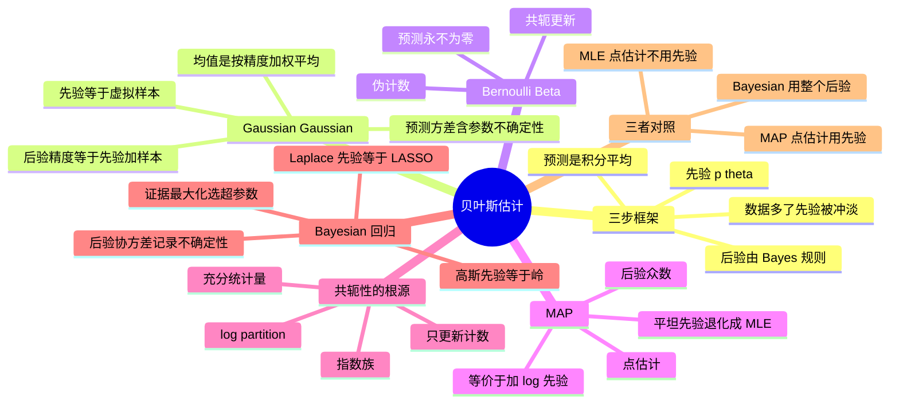

# 贝叶斯估计与共轭先验

MLE 的三次全正面例子暴露了「把参数当固定常数」的毛病。贝叶斯把参数当成**随机变量**，给它一个先验分布，用数据更新成后验——先验就是为防止极端过拟合而加的「常识」。

![[bayes-gaussian-update.png]]

> 图：Gaussian–Gaussian 的更新。先验（虚线）观测 5 个样本后变成后验（实线），后验落在先验均值与样本均值之间，且比两者都窄——精度相加意味着**信息只会累积，不会丢失**。

---

## 三步框架

1. **先验** $p(\theta)$：看数据前对 $\theta$ 的信念。
2. **后验**（Bayes 规则）：$p(\theta\mid D)=\dfrac{p(D\mid\theta)p(\theta)}{p(D)}$。分母 $p(D)$ 与 $\theta$ 无关，是归一化常数，最大化时可丢。
3. **预测**：$p(x\mid D)=\int p(x\mid\theta)p(\theta\mid D)\,d\theta$，对所有合理的 $\theta$ 积分平均，而不是插一个点值。

数据少时先验起正则作用；数据多时似然压倒先验，后验收敛到 MLE。积分难算时用近似方法。

> [!warning] $p(D\mid\theta)$ 和 $p(\theta\mid D)$ 长得像，含义完全相反
> - $p(D\mid\theta)$ 是 **likelihood**：$\theta$ 的函数（数据已固定）。
> - $p(\theta\mid D)$ 是 **posterior**：$\theta$ 的**概率密度**（积分等于 1）。
>
> 它们是同一条 Bayes 规则的两端，差一个 $p(\theta)$ 和一个归一化常数。把这两个混起来，后面所有「为什么共轭」「为什么先验等于虚拟样本」的直觉都会错位。

---

## Gaussian–Gaussian：精度相加

已知噪声方差 $\sigma^2$，prior $\mu\sim N(\mu_0,\sigma_0^2)$，$N$ 个 iid 样本。配方法得到后验仍是 Gaussian：

$$v_n=\Big(\tfrac{1}{\sigma_0^2}+\tfrac{N}{\sigma^2}\Big)^{-1}=\frac{\sigma^2\sigma_0^2}{\sigma^2+N\sigma_0^2},\qquad m_n=\frac{N\sigma_0^2\,\bar x+\sigma^2\mu_0}{\sigma^2+N\sigma_0^2}$$

**后验精度 = 先验精度 + 样本精度**（$1/v_n=1/\sigma_0^2+N/\sigma^2$）；$m_n$ 是两者按精度的加权平均。写 $m_n=\lambda\bar x+(1-\lambda)\mu_0$，$\lambda=\frac{N\sigma_0^2}{\sigma^2+N\sigma_0^2}$。

> [!tip] 用「信息」的语言理解
> 精度 $=1/$方差 $=$ **信息量**。先验贡献信息 $1/\sigma_0^2$，$N$ 个样本各贡献 $1/\sigma^2$，后验的信息就是它们的和。因此：
> - 后验**永远**比先验和似然各自都窄（信息单调增加）；
> - $N$ 个样本的权重恰好是「先验虚拟样本数」的 $N$ 倍——$\lambda$ 随 $N$ 线性上升，$\to1$。
>
> 这个「相加」结构是高斯特有的（因为高斯在精度坐标下是指数族），换成 Bernoulli 就是「计数相加」（见下节）。

**先验 = 虚拟样本**：当 $\sigma_0^2=\sigma^2$ 时，$m_n=\frac{1}{N+1}\big(\sum_i x_i+\mu_0\big)$，等价于在数据集里加了**一个值为 $\mu_0$ 的虚拟样本**。一般地先验贡献「强度」为 $\sigma^2/\sigma_0^2$ 个虚拟样本：先验越紧（$\sigma_0^2$ 越小），虚拟样本越多，收缩越强。这就是正则化（shrinkage）的贝叶斯解释。

**预测分布** $p(x\mid D)=N\!\big(x\,|\,m_n,\,v_n+\sigma^2\big)$：方差 $v_n$ 是**参数不确定性**，$\sigma^2$ 是观测噪声。插值预测（plug-in）会漏掉 $v_n$ 这一项。

![[bayes-predictive-vs-plugin.png]]

> 图：预测分布的两种做法。插值预测（只代 $m_n$）给出的是**过窄**的区间；正确的预测分布要把**参数不确定性** $v_n$ 也加进方差。$N$ 小时差距最明显——这正是「数据少时不该装得很有把握」的数学表达。

---

## Bernoulli–Beta：共轭更新

Uniform prior $p(\theta)=1$（即 Beta(1,1)），$N$ 次中 $s$ 次成功，$n-s$ 次失败：

$$p(\theta\mid D)\propto\theta^s(1-\theta)^{n-s}\;\Rightarrow\;\theta\mid D\sim\mathrm{Beta}(s+1,\,n-s+1)$$

**预测成功概率**是后验均值 $\dfrac{s+1}{n+2}$——相当于加了「1 个虚拟成功 + 1 个虚拟失败」，即使 $s=0$ 也永远不会预测出概率 0。一般 Beta$(\alpha,\beta)$ 先验下后验为 Beta$(\alpha+s,\beta+n-s)$：先验的 $\alpha,\beta$ 就是**伪计数**。

![[bayes-beta-update.png]]

> 图：Bernoulli 的后验随数据演化（$n=1,5,20,100$，观测成功率 $0.7$）。$n$ 小时后验被先验形状拉着；$n$ 大时后验收紧到 $0.7$，先验只剩一条几乎看不见的尾巴。注意后验**始终**在 $(0,1)$ 内部，永远不给 0 或 1 赋概率。

> [!warning] 「伪计数」是个比喻，别当成真的加了数据
> $\mathrm{Beta}(\alpha,\beta)$ 先验下的后验是 $\mathrm{Beta}(\alpha+s,\beta+n-s)$，形式上等于「$\alpha-1$ 次虚拟成功、$\beta-1$ 次虚拟失败」。但要注意：
> - Uniform prior 是 $\mathrm{Beta}(1,1)$，对应 **0 个**虚拟样本（$\alpha-1=\beta-1=0$），不是 1 个。有些教材写「加 1 个虚拟成功」指的是 $\mathrm{Beta}(1,1)$ 下后验均值 $(s+1)/(n+2)$ 的**效果**，不是计数本身。
> - 伪计数只是**形式**上的类比。真正的差别在于：数据是真实的整数计数，先验的 $\alpha,\beta$ 可以是任意正实数。$\alpha=0.5$ 的 Jeffreys 先验对应「半个虚拟样本」，这在真实数据里没有对应物，但在数学上完全合法。

---

## MAP

$$\hat\theta_{MAP}=\arg\max_\theta p(\theta\mid D)=\arg\max_\theta\big[\log p(D\mid\theta)+\log p(\theta)\big]$$

MAP 是**点估计**（后验众数），预测时插这个点：$p(x\mid\hat\theta_{MAP})$。对 Gaussian 后验（对称），MAP 恰等于后验均值。「让数据说话」极限：$\sigma_0^2\to\infty$（平坦先验）时 MAP → MLE。

> [!warning] MAP 保持 MLE 的什么、丢掉什么
> **保住**：MAP 仍然是**优化问题**（不用积分），大样本下趋于 MLE，加先验等于加正则——这是它能落地到深度学习权重衰减的原因。
>
> **丢掉**：**重参数化不变性**。MLE 在任意单调变换下不变（PS2.3），MAP **不是**：换 $\theta\to\alpha=g(\theta)$ 时先验要乘 Jacobian，众数会移位。PS3.2 就是反例——对 $\theta=1/\alpha$，$\hat\theta_{MAP}$ 的倒数**不等于** $\hat\alpha_{MAP}$。只有**线性**变换的 Jacobian 是常数，才不会移动 argmax（PS3.3）。
>
> 这个区别在**参数尺度有物理意义**时很重要：如果 $\theta$ 是速率、$\alpha$ 是期望间隔，先验该加在哪个尺度上不是无关紧要的装饰。

---

## 共轭性为什么保持分布族

**定义**：若先验族与 likelihood 共轭，则后验与先验属于**同一概率族**。好处：1) 有闭式解，不用数值积分（配方法即可）；2) **顺序更新**——今天的后验直接当明天的先验，不必重算旧数据。

**指数族是共轭的根源**。把分布写成指数族模板 $p(x\mid\theta)=f(x)g(\theta)\exp(\theta^\top u(x))$：

- $u(x)$：**sufficient statistic**（充分统计量），对数据 $x$ 的压缩摘要，含关于 $\theta$ 的全部信息。Bernoulli：$u=x$；Gaussian：$u=(x,x^2)$。
- $g(\theta)$：log-partition（归一化项）；$f(x)$：base measure，只依赖数据不依赖 $\theta$。

$N$ 个样本的 joint 中，依赖 $\theta$ 的数据部分只通过 $s=\sum_i u(x_i)$ 汇总。取一般共轭先验 $\propto g(\theta)^{\nu}e^{\theta^\top\chi}$，后验形如 $g(\theta)^{\nu+n}e^{\theta^\top(\chi+s)}$——**形式不变**，更新规则只是 $\nu\mapsto\nu+n,\ \chi\mapsto\chi+s$，把计数与充分统计量加到先验上（像一个记账本的 running total）。

**一张对照表**（PS3.10 那张表的读法）：

| likelihood | 共轭先验 | 充分统计量 $u(x)$ | 更新 |
|---|---|---|---|
| Bernoulli | Beta | $x$ | $\alpha+s,\ \beta+n-s$ |
| Poisson | Gamma | $x$ | $\alpha+s,\ \beta+n$ |
| Exponential | Gamma | $x$ | $\alpha+n,\ \beta+s$ |
| Normal（$\theta$=精度）| Gamma | $x,\ x^2$ | $a+\tfrac n2,\ b+\tfrac n2\sigma^2_{ML}$ |
| Multinomial | Dirichlet | one-hot $x$ | $u_j+c_j$ |

**读法**：右列都是 $\theta^\top u(x)$ 的形式，左列都是 $g(\theta)^{\nu}e^{\theta^\top\chi}$ 的形式，所以「后验 = 形状参数加 $n$、自然参数加 $s$」是同一个规律在五行上的不同化身。

---

## Bayesian ridge：高斯先验 = 岭正则

线性回归 $y=\Phi^\top\theta+\epsilon$，$\epsilon\sim N(0,\sigma^2)$，prior $\theta\sim N(0,\tau^2 I)$。后验仍为 Gaussian：

$$\theta\mid D\sim N(m,V),\quad V=(\tau^{-2}I+\sigma^{-2}\Phi^\top\Phi)^{-1},\quad m=V\sigma^{-2}\Phi^\top y$$

等价于岭回归 $m=(\Phi^\top\Phi+\lambda I)^{-1}\Phi^\top y$，$\lambda=\sigma^2/\tau^2$。或用损失的写法：$\|\ y-\Phi^\top\theta\|^2+\lambda\|\theta\|^2$ 的第 2 项就是先验罚项。**后验协方差 $V$ 记录了参数不确定性**：数据在某方向无信息（$\Phi^\top$ 的零空间方向）时方差保持 $\tau^2$ 不收敛；观测越多/噪声越小，相应方向方差 $\to0$。

**LASSO**：把高斯先验换成 Laplace 先验（$\propto e^{-|\theta|/b}$），log 先验是 $L_1$ 罚，零点处的尖角产生稀疏解。

![[bayes-ridge-path.png]]

> 图：岭回归的系数路径。横轴 $\lambda$（等价于先验方差 $\tau^2$ 的倒数），不同颜色是不同分量。$\lambda$ 增大时所有系数**连续**收缩到 0，但一般**不会恰好等于 0**——高斯先验在 0 处的密度是光滑的，没有理由把系数精确钉在 0。这正是它和 LASSO（能在 0 处真的截断）的区别。

> [!warning] 为什么 Laplace 先验产生稀疏、高斯先验不产生
> 看 0 附近的先验密度形状：
> - 高斯 $\propto e^{-\theta^2/2\tau^2}$ 在 $\theta=0$ 处**平滑**，导数 $=0$。要把系数从很小的正值推到恰好 0，代价是二阶小量，收益也是一阶小量——最优点不会刚好落在 0。
> - Laplace $\propto e^{-|\theta|/b}$ 在 $\theta=0$ 处**有尖角**，左导数 $-1/b$、右导数 $+1/b$。这意味着存在一个**阈值**：只要数据给的「拉力」小于 $1/b$，最优解就是**精确的 0**。
>
> 几何版本：$\|\theta\|_1\le t$ 的约束区域是**菱形**，顶点在坐标轴上，等高线与它相切时容易正好切在顶点（某个坐标为 0）；$\|\theta\|_2\le t$ 是**圆**，切点一般不在坐标轴上。

---

## MLE / MAP / Bayesian 对照

| 维度 | MLE | MAP | Bayesian |
|---|---|---|---|
| 参数 | 点估计 | 后验众数 | 整个后验分布 |
| 用先验 | 否 | 是 | 是 |
| 预测 | 插值 $p(x\mid\hat\theta)$ | 插值 | 积分平均 |
| 小数据 | 过拟合（$\hat\theta=1$） | 被先验拉住 | 正则 + 报告不确定性 |
| 大数据 | 渐近有效 | → MLE | → MLE（先验冲淡） |
| 积分 | 无 | 无（优化） | 有，难算时近似 |
| 重参数化 | 不变 | 只对线性不变 | 需 Jacobian 修正 |

**超参数（$\tau^2,\sigma^2$ 之类）怎么选**：这是贝叶斯方法里最容易被忽略的一环。三条路：

1. **交叉验证**——最常用，但要留验证集；
2. **证据最大化（empirical Bayes / type-II ML）**——对 $\theta$ 积分掉，直接优化 $p(y\mid X,\alpha,\sigma^2)$（PS3.12）。优点是自动权衡拟合与复杂度，不需要验证集；缺点是积分可能算不动；
3. **分层先验（hyperprior）**——给 $\alpha$ 自己再设先验，完全不手调，代价是推断更重。

---

## 习题

> 来源：**PS-3 Bayesian Parameter Estimation**（原题号保留）。解答折叠。

### PS3.2 指数分布的 MAP 与「MAP 对重参数化不不变」

**题目.** $p(x\mid\theta)=\theta e^{-\theta x}\,(x\ge0)$，先验也是指数分布 $p(\theta)=\lambda e^{-\lambda\theta}\,(\theta\ge0)$。(a) 证明 $\hat\theta_{MAP}=\dfrac{1}{\bar x+\lambda/N}$。现把参数换成 $\alpha=1/\theta$，$p(x\mid\alpha)=\frac1\alpha e^{-x/\alpha}$。若天真地以为 $\hat\alpha=1/\hat\theta_{MAP}$，那就错了。(b) 用变量变换规则 $p(\alpha)=\big|\frac{\partial\alpha}{\partial\theta}\big|^{-1}p_\theta(g^{-1}(\alpha))$ 求 $\alpha$ 的先验，得 $p(\alpha)=\frac{\lambda}{\alpha^2}e^{-\lambda/\alpha}$。(c) 证明 $\hat\alpha_{MAP}=\dfrac{N\bar x+\lambda}{N+2}$，说明 MAP 不是对一切变换不变的。

> [!success]- 解答（先自己做，再点开）
> **(a)** 似然 $\prod_i\theta e^{-\theta x_i}=\theta^N e^{-\theta\sum x_i}$，后验
> $$p(\theta\mid D)\propto\theta^N e^{-\theta(\sum_i x_i+\lambda)}$$
> 即 $\mathrm{Gamma}(N+1,\ \sum x_i+\lambda)$ 的形状。对数后验 $N\log\theta-\theta(\sum x_i+\lambda)$，求导：
> $$\frac{N}{\theta}-(\textstyle\sum_i x_i+\lambda)=0\;\Longrightarrow\;\hat\theta_{MAP}=\frac{N}{\sum_i x_i+\lambda}=\frac{1}{\bar x+\lambda/N}$$
> （二阶导 $-N/\theta^2<0$，是极大。）
>
> **(b)** $\alpha=g(\theta)=1/\theta$，$g^{-1}(\alpha)=1/\alpha$，$\big|\frac{\partial\alpha}{\partial\theta}\big|=\frac{1}{\theta^2}=\alpha^2$。代规则：
> $$p(\alpha)=\frac{1}{\alpha^2}\,p_\theta(1/\alpha)=\frac{\lambda}{\alpha^2}e^{-\lambda/\alpha}$$
> ——**乘的是 $1/\alpha^2$ 而不是 $\alpha^2$**，因为规则里是 $|\partial\alpha/\partial\theta|^{-1}$。这是最容易写反的一步。
>
> **(c)** 似然 $\prod_i\frac1\alpha e^{-x_i/\alpha}=\alpha^{-N}e^{-\sum x_i/\alpha}$，乘先验：
> $$p(\alpha\mid D)\propto\alpha^{-N-2}e^{-(\sum x_i+\lambda)/\alpha}$$
> 对数 $-(N+2)\log\alpha-\frac{\sum x_i+\lambda}{\alpha}$，求导：
> $$-\frac{N+2}{\alpha}+\frac{\sum_i x_i+\lambda}{\alpha^2}=0\;\Longrightarrow\;\hat\alpha_{MAP}=\frac{\sum_i x_i+\lambda}{N+2}=\frac{N\bar x+\lambda}{N+2}$$
>
> **对比**：$1/\hat\theta_{MAP}=\bar x+\lambda/N$，而 $\hat\alpha_{MAP}=(N\bar x+\lambda)/(N+2)$。两者**不等**（把 $N=2,\bar x=1,\lambda=0$ 代入：$1/\hat\theta=1$，$\hat\alpha=2/4=0.5$）。
>
> **为什么 MLE 不变而 MAP 变**：MLE 的目标 $p(D\mid\theta)$ 在换元时**不需要** Jacobian（$\theta$ 是自变量不是随机变量），所以 argmax 随双射自然映射。MAP 的目标含 $p(\theta)$，而 $p(\theta)$ 是概率密度，换元**必须**乘 Jacobian，这个因子依赖 $\alpha$，于是众数移位。**结论**：MAP 只在**线性**变换下不变（常数 Jacobian），这正好是 PS3.3 的内容。

### PS3.3 MAP 对线性变换不变（附加）

**题目.** (a) 标量情形：$\lambda=a\theta+b$（$a\ne0$），证明 $\hat\lambda_{MAP}=a\hat\theta_{MAP}+b$。(b) 向量情形：$\lambda=A\theta+b$（$A$ 可逆），证明 $\hat\lambda_{MAP}=A\hat\theta_{MAP}+b$。

> [!success]- 解答（先自己做，再点开）
> **(a)** 换元的 Jacobian 是 $|\partial\lambda/\partial\theta|=|a|$，是**常数**，不依赖 $\theta$。所以
> $$p_\lambda(\lambda)\propto p_\theta\Big(\frac{\lambda-b}{a}\Big),\qquad p(D\mid\lambda)=p\Big(D\mid\theta=\frac{\lambda-b}{a}\Big)$$
> 后验 $p(\lambda\mid D)\propto p(D\mid\lambda)p_\lambda(\lambda)\propto p\big(D\mid\frac{\lambda-b}{a}\big)p_\theta\big(\frac{\lambda-b}{a}\big)$。于是
> $$\hat\lambda_{MAP}=\arg\max_\lambda(\cdots)=\arg\max_\theta(\cdots)\ \text{经}\ \lambda=a\theta+b\ \text{映射}=a\hat\theta_{MAP}+b$$
> **关键**：常数 Jacobian 乘上去对所有 $\theta$ 一视同仁，不改变 argmax 的位置。
>
> **(b)** 向量情形 Jacobian 是 $|\det A|$（常数），论证完全一样。$\blacksquare$
>
> **反面**：PS3.2 的 $\alpha=1/\theta$ **不是**线性变换，Jacobian $1/\alpha^2$ 随 $\alpha$ 变，所以不变性失效。

### PS3.4 高斯均值的贝叶斯估计

**题目.** $p(x\mid\mu)=N(x\mid\mu,\sigma^2)$（$\sigma^2$ 已知），先验 $p(\mu)=N(\mu\mid\mu_0,\sigma_0^2)$。证明后验 $p(\mu\mid D)=N(\mu\mid\hat\mu_n,\hat\sigma_n^2)$，其中
$$\hat\mu_n=\frac{n\sigma_0^2\hat\mu_{ML}+\sigma^2\mu_0}{\sigma^2+n\sigma_0^2},\qquad \hat\sigma_n^2=\frac{\sigma^2\sigma_0^2}{\sigma^2+n\sigma_0^2}$$
$\hat\mu_{ML}=\frac1n\sum_i x_i$。

> [!success]- 解答（先自己做，再点开）
> **只保留指数部分**（归一化常数最后处理）。后验 $\propto$ 似然 $\times$ 先验：
> $$-\frac{1}{2\sigma^2}\sum_i(x_i-\mu)^2-\frac{1}{2\sigma_0^2}(\mu-\mu_0)^2$$
> 把 $\mu$ 的系数收集起来（$x_i$ 相关的项归入常数）：
> $$-\frac{1}{2}\Big[\Big(\frac{n}{\sigma^2}+\frac{1}{\sigma_0^2}\Big)\mu^2-2\Big(\frac{\sum_i x_i}{\sigma^2}+\frac{\mu_0}{\sigma_0^2}\Big)\mu\Big]+\text{const}$$
> 这是 $\mu$ 的二次式 $-\frac12 A\mu^2+B\mu$，配方得高斯 $N(\mu\mid B/A,\,1/A)$。而 $B/A$ 展开：
> $$\frac{B}{A}=\frac{\frac{n\bar x}{\sigma^2}+\frac{\mu_0}{\sigma_0^2}}{\frac{n}{\sigma^2}+\frac{1}{\sigma_0^2}}=\frac{n\sigma_0^2\bar x+\sigma^2\mu_0}{\sigma^2+n\sigma_0^2},\qquad \frac{1}{A}=\frac{\sigma^2\sigma_0^2}{\sigma^2+n\sigma_0^2}$$
> 与题目一致。$\blacksquare$
>
> **解读**：
> - 后验精度 $A=\frac{n}{\sigma^2}+\frac{1}{\sigma_0^2}$：**样本精度 + 先验精度**。
> - $\hat\mu_n=\lambda\bar x+(1-\lambda)\mu_0$，$\lambda=\frac{n\sigma_0^2}{\sigma^2+n\sigma_0^2}$。$\lambda$ 是「数据占的比重」。
> - $\sigma^2=n\sigma_0^2$ 时 $\lambda=1/2$：数据与先验等权。一般地先验等价于 $\sigma^2/\sigma_0^2$ 个虚拟样本。
> - $n\to\infty$ 时 $\hat\mu_n\to\bar x$、$\hat\sigma_n^2\to0$：数据淹没先验，后验是一个尖峰在 MLE 上。

### PS3.6 高斯精度的贝叶斯估计与 Student-t 预测

**题目.** $p(x\mid\lambda)=N(x\mid\mu,\lambda^{-1})$（$\mu$ 已知，$\lambda=1/\sigma^2$ 是精度），先验 $\mathrm{Gam}(\lambda\mid a_0,b_0)=\frac{1}{\Gamma(a)b^a}\lambda^{a-1}e^{-b\lambda}$。(a) 证明后验仍是 Gamma：$\hat a_n=a_0+\frac n2$、$\hat b_n=b_0+\frac n2\sigma^2_{ML}$，其中 $\sigma^2_{ML}=\frac1n\sum_i(x_i-\mu)^2$。后验均值怎样对应「虚拟样本」？(b) 求 MAP $\hat\lambda_{MAP}=\frac{2(a_0-1)+n}{2b_0+n\sigma^2_{ML}}$。(c) 用无信息先验 $p(\lambda)\propto1/\lambda$，证明后验 $\mathrm{Gam}(n/2,\ \frac n2\sigma^2_{ML})$，MAP 为 $\tilde\lambda_{MAP}=\frac{n-2}{n\sigma^2_{ML}}$。(e) 证明预测分布是 Student-t。

> [!success]- 解答（先自己做，再点开）
> **(a)** 似然 $\prod_i N(x_i\mid\mu,\lambda^{-1})\propto\lambda^{n/2}\exp\big(-\frac{\lambda}{2}\sum_i(x_i-\mu)^2\big)=\lambda^{n/2}e^{-\frac{\lambda n}{2}\sigma^2_{ML}}$。乘先验 $\lambda^{a_0-1}e^{-b_0\lambda}$：
> $$p(\lambda\mid D)\propto\lambda^{(a_0+\frac n2)-1}e^{-(b_0+\frac n2\sigma^2_{ML})\lambda}$$
> 正是 $\mathrm{Gam}(\hat a_n,\hat b_n)$，$\hat a_n=a_0+\frac n2$，$\hat b_n=b_0+\frac n2\sigma^2_{ML}$。
>
> **虚拟样本解读**：后验均值 $\mathbb E[\lambda\mid D]=\frac{\hat a_n}{\hat b_n}=\frac{a_0+n/2}{b_0+n\sigma^2_{ML}/2}$。若无先验（$a_0=b_0=0$）则是 $\frac{n/2}{n\sigma^2_{ML}/2}=1/\sigma^2_{ML}$。先验的作用相当于把 $a_0$ 与 $b_0$ 当作 $2a_0$ 个虚拟样本带来的计数/散度——注意这里是**两项分别**加，不是简单加样本数。
>
> **(b)** 对数后验 $(\hat a_n-1)\log\lambda-\hat b_n\lambda$，求导 $\frac{\hat a_n-1}{\lambda}-\hat b_n=0$：
> $$\hat\lambda_{MAP}=\frac{\hat a_n-1}{\hat b_n}=\frac{a_0+\frac n2-1}{b_0+\frac n2\sigma^2_{ML}}=\frac{2(a_0-1)+n}{2b_0+n\sigma^2_{ML}}$$
> - $n$ 小时，$2b_0$ 与 $2(a_0-1)$ 主导，估计被先验拉住；
> - $n\to\infty$ 时 $\hat\lambda_{MAP}\to\frac{n}{n\sigma^2_{ML}}=1/\sigma^2_{ML}$，回到 MLE。
>
> **(c)** $p(\lambda)\propto1/\lambda$ 对应 $\mathrm{Gam}(a_0=0,b_0=0)$ 的形状。代入：$\tilde a_n=\frac n2$、$\tilde b_n=\frac n2\sigma^2_{ML}$，MAP $=\frac{n/2-1}{n\sigma^2_{ML}/2}=\frac{n-2}{n\sigma^2_{ML}}$。
>
> **注意**：这个无信息先验是**不正常的**（improper，积分发散），当 $n<2$ 时 MAP 还会变成**负数**——数学上很荒唐。这提醒「不提供信息」在无界参数空间上不是免费的。
>
> **(e) 预测分布。** 要算 $\int N(x\mid\mu,\lambda^{-1})\,\mathrm{Gam}(\lambda\mid a,b)\,d\lambda$。核心积分是
> $$\int_0^\infty\lambda^{1/2}e^{-\frac{\lambda}{2}(x-\mu)^2}\lambda^{a-1}e^{-b\lambda}d\lambda=\int_0^\infty\lambda^{a-\frac12}e^{-\lambda[b+\frac{(x-\mu)^2}{2}]}d\lambda=\Gamma\Big(a+\frac12\Big)\Big[b+\frac{(x-\mu)^2}{2}\Big]^{-(a+\frac12)}$$
> 乘上前面的 $\frac{b^a}{\Gamma(a)\sqrt{2\pi}}$，整理成
> $$p(x\mid D)=\frac{\Gamma(a+\frac12)}{\Gamma(a)\sqrt{2\pi b}}\Big(1+\frac{(x-\mu)^2}{2b}\Big)^{-(a+\frac12)}$$
> 这正是 Student-t 分布（自由度为 $2a$）的密度。
>
> **为什么这个结果重要**：Student-t 比高斯**尾部厚**。物理意义是——我们**不知道**方差，所以对「离均值很远」的观测要比「方差已知」时给更高的概率。用方差的后验均值 $\hat b/(\hat a-1)$ 代入高斯是一个常见的做法，但它**低估了尾部概率**。这也是「稳健统计」的一个自然来源：只要把方差的先验积分掉，模型自动变得抗离群点。

### PS3.8 Bernoulli 的贝叶斯估计

**题目.** $p(x\mid\pi)=\pi^x(1-\pi)^{1-x}$。(a) 证明 $p(D\mid\pi)=\pi^s(1-\pi)^{n-s}$（$s=\sum x_i$ 是充分统计量）。(b) 用均匀先验与 $\int_0^1\pi^m(1-\pi)^nd\pi=\frac{m!n!}{(m+n+1)!}$ 证明 $p(\pi\mid D)=\frac{(n+1)!}{s!(n-s)!}\pi^s(1-\pi)^{n-s}$。(c) 证明预测分布 $p(x\mid D)=\big(\frac{s+1}{n+2}\big)^x\big(1-\frac{s+1}{n+2}\big)^{1-x}$，并解释「虚拟样本」。(d) 比较 ML、MAP、贝叶斯三个估计。(e) 用先验 $p_1(\pi)=2\pi$ 与 $p_0(\pi)=2-2\pi$ 分别求 MAP。

> [!success]- 解答（先自己做，再点开）
> **(a)** 似然 $=\prod_i\pi^{x_i}(1-\pi)^{1-x_i}=\pi^{\sum x_i}(1-\pi)^{n-\sum x_i}=\pi^s(1-\pi)^{n-s}$。所有样本只通过 $s$ 影响似然——$s$ 是充分统计量。
>
> **(b)** 均匀先验 $p(\pi)=1$，后验 $\propto\pi^s(1-\pi)^{n-s}$。归一化：
> $$\int_0^1\pi^s(1-\pi)^{n-s}d\pi=\frac{s!(n-s)!}{(n+1)!}\;\Longrightarrow\;p(\pi\mid D)=\frac{(n+1)!}{s!(n-s)!}\pi^s(1-\pi)^{n-s}$$
> 这正是 $\mathrm{Beta}(s+1,n-s+1)$。
>
> **(c) 预测。** 用 $\int_0^1\pi^{s+x}(1-\pi)^{n-s+1-x}d\pi$（多一个 $\pi^x(1-\pi)^{1-x}$）：
> - $x=1$：$\frac{(s+1)!(n-s)!}{(n+2)!}$；
> - $x=0$：$\frac{s!(n-s+1)!}{(n+2)!}$。
>
> 相除并注意分子分母公共因子约掉后，得 $p(x=1\mid D)=\frac{s+1}{n+2}$、$p(x=0\mid D)=\frac{n-s+1}{n+2}$，即参数为 $\pi^\*=\frac{s+1}{n+2}$ 的 Bernoulli。**有效的贝叶斯估计就是后验均值**。
>
> **虚拟样本**：$\frac{s+1}{n+2}$ 形如「$s$ 次成功 + 1 次虚拟成功，$n$ 次试验 + 2 次虚拟试验」——均匀先验等价于 1 次虚拟成功 + 1 次虚拟失败。**即使 $s=0$ 也预测 $\frac{1}{n+2}>0$**，永远不会把某个结果判死。
>
> **(d) 三个估计对比。**
> $$\hat\pi_{ML}=\frac sn,\qquad \hat\pi_{MAP}=\frac sn\ (\text{均匀先验}\Rightarrow\text{与 MLE 同}),\qquad \hat\pi_{Bayes}=\frac{s+1}{n+2}$$
> **MAP 和 MLE 在这里重合**，因为均匀先验的 log 是常数，加进目标不改变 argmax。但**贝叶斯估计（后验均值）与它们不同**：后验均值是 $\frac{s+1}{n+2}$，偏向 0.5。
>
> **这不是矛盾**：MAP 取的是**众数**，贝叶斯估计用的是**均值**。Beta 分布不对称（除非 $s+1=n-s+1$），所以众数 $\ne$ 均值。$s=0,n=3$ 时众数是 0、均值是 $1/5$。**当你想避免「概率为 0」这种灾难性预测时，后验均值比众数更合适**。
>
> **(e)** $p_1(\pi)=2\pi$（偏向 1）：后验 $\propto\pi^{s+1}(1-\pi)^{n-s}$，MAP $=\frac{s+1}{n+1}$（求导 $\frac{s+1}{\pi}-\frac{n-s}{1-\pi}=0$）。
> $p_0(\pi)=2-2\pi$（偏向 0）：后验 $\propto\pi^s(1-\pi)^{n-s+1}$，MAP $=\frac{s}{n+1}$。
> **虚拟样本解读**：$p_1$ 相当于「先见 1 次成功、0 次失败」，把估计往 1 推；$p_0$ 相当于「先见 0 次成功、1 次失败」，往 0 推。**先验不是抽象数学，它有明确的计数解释**——这是选择先验时最有用的直觉。

### PS3.10 指数族与共轭先验

**题目.** 指数族 $p(x\mid\theta)=f(x)g(\theta)e^{\phi(\theta)^\top u(x)}$。(a) 证明 $p(D\mid\theta)\propto\prod_i f(x_i)\exp\{\phi(\theta)^\top s\}$，$s=\sum_i u(x_i)$。(b) 证明 $p(\theta\mid\eta,\nu)=\frac{g(\theta)^\eta e^{\phi(\theta)^\top\nu}}{\int g(\theta)^\eta e^{\phi(\theta)^\top\nu}d\theta}$ 是共轭先验，并求后验。(c) 对表中每一行（Bernoulli–Beta、Poisson–Gamma、Exponential–Gamma、Normal(精度)–Gamma）验证。

> [!success]- 解答（先自己做，再点开）
> **(a)** 直接乘：
> $$p(D\mid\theta)=\prod_i f(x_i)g(\theta)e^{\phi(\theta)^\top u(x_i)}=\Big(\prod_i f(x_i)\Big)g(\theta)^n\exp\Big\{\phi(\theta)^\top\sum_i u(x_i)\Big\}$$
> 归一化常数是 $\big(\int p(D\mid\theta)dD\big)^{-1}$，对 $\theta$ 而言是常数。数据只通过 $s=\sum_i u(x_i)$ 进入——这就是**充分性**的来源。
>
> **(b)** 后验 $\propto p(D\mid\theta)p(\theta\mid\eta,\nu)$：
> $$p(\theta\mid D)\propto g(\theta)^n e^{\phi(\theta)^\top s}\cdot g(\theta)^\eta e^{\phi(\theta)^\top\nu}=g(\theta)^{\eta+n}e^{\phi(\theta)^\top(\nu+s)}$$
> **形式与先验完全相同**，只是 $\eta\mapsto\eta+n$、$\nu\mapsto\nu+s$。这就是共轭性的全部内容：**把 $n$ 和 $s$ 加到先验的记账本上**。
>
> **(c) 逐行验证。**
> - **Bernoulli–Beta**：$u(x)=x$，$s=$ 成功数，$g(\theta)=1-\theta$... 更直接地用表格形式：先验 $\mathrm{Beta}(\alpha,\beta)$，后验 $\mathrm{Beta}(\alpha+s,\beta+n-s)$。对应 $\eta=\alpha+\beta-2$、$\nu=\log\frac{\alpha-1}{\beta-1}$ 之类的换算（细节取决于参数化），但**更新规则**是清楚的：成功数加到 $\alpha$，失败数加到 $\beta$。
> - **Poisson–Gamma**：$u(x)=x$，$s=$ 总事件数，$\mathrm{Gam}(\alpha,\beta)\to\mathrm{Gam}(\alpha+s,\beta+n)$。
> - **Exponential–Gamma**：$u(x)=x$，$s=$ 总 x，$\mathrm{Gam}(\alpha,\beta)\to\mathrm{Gam}(\alpha+n,\beta+s)$（因为似然是 $\theta^n e^{-\theta s}$，$\theta$ 的幂次加 $n$）。
> - **Normal(精度)–Gamma**：$u=(x,x^2)$，但 $\mu$ 已知时 $s$ 归纳为 $\sigma^2_{ML}$，$\mathrm{Gam}(a,b)\to\mathrm{Gam}(a+\frac n2,b+\frac n2\sigma^2_{ML})$（见 PS3.6）。
>
> **总结**：所有共轭更新都是「形状参数 $+n$、自然参数 $+s$」。这个统一视角的用处是：**遇到一个新分布，只要能写成指数族，就能立刻写出共轭先验和后验更新**，不用一题一题重推。

### PS3.11 贝叶斯回归（高斯先验 = 岭）

**题目.** $y=\Phi^\top\theta+\epsilon$，$\epsilon\sim N(0,\Sigma)$，先验 $p(\theta)=N(\theta\mid0,\Gamma)$。(a) 证明后验 $p(\theta\mid D)=N(\theta\mid\hat\mu_\theta,\hat\Sigma_\theta)$，
$$\hat\mu_\theta=(\Gamma^{-1}+\Phi\Sigma^{-1}\Phi^\top)^{-1}\Phi\Sigma^{-1}y,\qquad \hat\Sigma_\theta=(\Gamma^{-1}+\Phi\Sigma^{-1}\Phi^\top)^{-1}$$
(c) 当 $\Gamma=\alpha I$、$\Sigma=\sigma^2 I$ 时，证明 MAP 是 $\hat\theta=(\Phi\Phi^\top+\lambda I)^{-1}\Phi y$，且它是正则化最小二乘 $\min_\theta\|y-\Phi^\top\theta\|^2+\lambda\|\theta\|^2$ 的解。(d) 讨论 $\alpha=0,\alpha\to\infty,\sigma^2=0$ 的极限。(e) 求预测分布。

> [!success]- 解答（先自己做，再点开）
> **(a)** 后验 $p(\theta\mid D)\propto\exp\big(-\frac12(y-\Phi^\top\theta)^\top\Sigma^{-1}(y-\Phi^\top\theta)-\frac12\theta^\top\Gamma^{-1}\theta\big)$。展开指数里的 $\theta$ 二次项：
> $$\theta^\top(\Phi\Sigma^{-1}\Phi^\top+\Gamma^{-1})\theta-2\theta^\top\Phi\Sigma^{-1}y+\text{const}$$
> 配方（PS1.10）得 $(\theta-\hat\mu_\theta)^\top A(\theta-\hat\mu_\theta)$，$A=\Phi\Sigma^{-1}\Phi^\top+\Gamma^{-1}$，于是
> $$\hat\Sigma_\theta=A^{-1},\qquad \hat\mu_\theta=A^{-1}\Phi\Sigma^{-1}y$$
> 与题目一致。
>
> **(c) 岭回归。** 取 $\Gamma=\alpha I$、$\Sigma=\sigma^2 I$：
> $$\hat\mu_\theta=\Big(\frac{1}{\alpha}I+\frac{1}{\sigma^2}\Phi\Phi^\top\Big)^{-1}\frac{1}{\sigma^2}\Phi y=\Big(\Phi\Phi^\top+\frac{\sigma^2}{\alpha}I\Big)^{-1}\Phi y$$
> （第二个等号：把矩阵逆的标量因子提出来——两边同乘 $\sigma^2\alpha$。）所以 $\lambda=\sigma^2/\alpha$，正是**岭回归**。
>
> **损失形式**：$-\log$ 后验 $=\frac{1}{2\sigma^2}\|y-\Phi^\top\theta\|^2+\frac{1}{2\alpha}\|\theta\|^2+\text{const}$，同乘 $2\sigma^2$ 得 $\|y-\Phi^\top\theta\|^2+\frac{\sigma^2}{\alpha}\|\theta\|^2=\|y-\Phi^\top\theta\|^2+\lambda\|\theta\|^2$。$\blacksquare$
>
> **对比最小二乘（PS2.8）**：最小二乘只有第一项。多出来的 $\lambda\|\theta\|^2$ 把解往 0 拉，作用是**在 $\Phi\Phi^\top$ 接近奇异时保证数值可解**（加 $\lambda I$ 使条件数有下界），以及**降低方差**（代价是引入偏差，见 [[偏差方差与过拟合]]）。这正是「加先验 $\leftrightarrow$ 加正则 $\leftrightarrow$ 加虚拟样本」三位一体。
>
> **(d) 极限讨论。**
> - $\alpha\to\infty$（先验极宽 / 无信息）：$\lambda=\sigma^2/\alpha\to0$，退化到**普通最小二乘**。先验不出力。
> - $\alpha\to0$（先验极紧在 0）：$\lambda\to\infty$，$\hat\theta\to0$。模型完全不信数据，输出恒为 0。
> - $\sigma^2\to0$（无噪声）：$\lambda\to0$，且 $\hat\Sigma_\theta\to0$。数据完美确定参数，后验变成 δ 函数。此时普通最小二乘若不可解（$\Phi\Phi^\top$ 奇异），ridge 也救不了——因为 $\lambda$ 也同时趋 0。
>
> **(e) 预测。** $f_\*=f(x_\*,\theta)=\phi(x_\*)^\top\theta$ 是 $\theta$ 的线性函数，高斯随机变量的线性变换仍是高斯（PS1.1）：
> $$\mathbb E[f_\*]=\phi(x_\*)^\top\hat\mu_\theta,\qquad \mathrm{Var}(f_\*)=\phi(x_\*)^\top\hat\Sigma_\theta\,\phi(x_\*)$$
> 再叠加观测噪声：$y_\*=f_\*+\epsilon_\*$，故 $\mathrm{Var}(y_\*)=\sigma^2+\phi(x_\*)^\top\hat\Sigma_\theta\phi(x_\*)$。
> 这就是「线性高斯过程回归」。第二项 $\phi^\top\hat\Sigma_\theta\phi$ 是**参数不确定性**，$x_\*$ 落在训练数据稀疏的区域时它变大——模型自己知道哪里不可靠。

### PS3.12 用边缘似然估超参数（附加）

**题目.** 超参数 $\alpha,\sigma^2$ 通过最大化边缘似然 $p(y\mid X,\sigma^2,\alpha)=\int p(y\mid\theta,X,\sigma^2)p(\theta\mid\alpha)d\theta$ 来选。(a) 证明其对数形式（3.58）。(b) 逐项解释每项的作用：哪一项是拟合项，哪些是复杂度惩罚？

> [!success]- 解答（先自己做，再点开）
> **(a)** $p(y\mid\theta)\sim N(\Phi^\top\theta,\sigma^2 I)$、$p(\theta)\sim N(0,\alpha I)$ 都是高斯，它们的乘积（对 $\theta$ 的积分）是高斯卷积，积分后有闭式解。整理后即
> $$\log p(y\mid X,\sigma^2,\alpha)=-\frac{1}{2\sigma^2}\|y-\Phi^\top\hat\mu_\theta\|^2-\frac{1}{2\alpha}\|\hat\mu_\theta\|^2-\frac12\log\Big|\frac1\alpha I+\frac1{\sigma^2}\Phi\Phi^\top\Big|-\frac n2\log\sigma^2-\frac D2\log\alpha-\frac n2\log(2\pi)$$
>
> **(b) 逐项作用**：
> - $-\frac{1}{2\sigma^2}\|y-\Phi^\top\hat\mu_\theta\|^2$：**拟合项**。$\sigma^2$ 小则权重大，逼模型贴数据。
> - $-\frac{1}{2\alpha}\|\hat\mu_\theta\|^2$：**权重大小的惩罚**。$\alpha$ 小则惩罚强，把 $\|\theta\|$ 压小。
> - $-\frac12\log\big|\frac1\alpha I+\frac1{\sigma^2}\Phi\Phi^\top\big|$：**复杂度惩罚（最关键的一项）**。凸性分析中，$\log\det$ 项随有效参数个数增加而**降低** log 证据。它的作用是：即使拟合完美，模型太复杂（有效维数高）也会被扣分。
> - $-\frac n2\log\sigma^2-\frac D2\log\alpha$：对超参数本身的**Occam 惩罚**——$\sigma$ 或 $\alpha$ 越大，惩罚越重。
>
> **这一项的直觉**：边缘似然自动实现了「奥卡姆剃刀」。因为要对**所有可能的 $\theta$** 平均（而不是只看最好的 $\theta$），一个宽大的先验会把大量「坏的 $\theta$」的概率也平均进来，稀释了证据。所以边缘似然天然惩罚过宽的模型，无需额外正则。
>
> **这就是 empirical Bayes / type-II maximum likelihood**：先验不是人定的，而是从数据里估出来的。代价是积分可能算不动（这里能算是因为全是高斯）。

### PS3.13 L1 正则最小二乘（LASSO）（附加）

**题目.** $\hat\theta=\arg\min_\theta\frac12\|y-\Phi^\top\theta\|^2+\lambda\|\theta\|_1$。(a) 把它写成 MAP 问题，LASSO 假设的先验是什么？画出来解释为什么它偏好 0。(b) 用 $\theta=\theta^+-\theta^-$（$\theta^\pm\ge0$）改写，说明 (3.63) 与 (3.62) 等价。(c) 定义 $x=[\theta^+;\theta^-]$，写成标准二次规划。

> [!success]- 解答（先自己做，再点开）
> **(a)** 设 $y=\Phi^\top\theta+\epsilon$，$\epsilon\sim N(0,\sigma^2 I)$，则 $-\log p(y\mid\theta)\propto\frac{1}{2\sigma^2}\|y-\Phi^\top\theta\|^2$。要让 MAP（$=\arg\max[\log p(y\mid\theta)+\log p(\theta)]$）变成 LASSO，需要
> $$-\log p(\theta)\propto\lambda\|\theta\|_1\;\Longrightarrow\;p(\theta)\propto e^{-\lambda\|\theta\|_1}=\prod_i e^{-\lambda|\theta_i|}$$
> 即**独立同分布的 Laplace 先验**（尺度 $b=1/\lambda$）。
>
> **为什么偏好 0**：把 $-\log p$ 在 $\theta_i=0$ 附近画出来，高斯先验是**抛物线**（$\theta_i^2$，在 0 处导数为 0，平坦）；Laplace 先验是 **V 形**（$|\theta_i|$，在 0 处有**尖角**，左右导数 $\mp1/b$）。V 形意味着**在原点存在一个次梯度区间** $[-1/b,1/b]$：只要数据的「拉力」落在这个区间内，最优解就精确取 $\theta_i=0$。而抛物线的次梯度在 0 处只有一个值 0，任何非零拉力都会把解推离 0。**几何上**：$\|\theta\|_1\le t$ 的可行域是菱形（顶点在轴上），等高线容易在顶点相切；$\|\theta\|_2\le t$ 是圆，切点一般不在轴上。
>
> **(b)** 约束 $\theta^\pm\ge0$、$\theta=\theta^+-\theta^-$。**关键观察**：对任意 $\theta_i$ 的分解，在**最优解处**必有 $\min(\theta_i^+,\theta_i^-)=0$——否则可以把两者同时减小同一个量，$\theta_i$ 不变而 $\sum(\theta_i^++\theta_i^-)$ 减小。在这个规范下 $|\theta_i^+-\theta_i^-|=\theta_i^++\theta_i^-$，于是 (3.62) 与 (3.63) 的目标函数**逐点相等**，问题等价。
>
> **(c)** 目标展开：
> $$\frac12\|y-\Phi^\top(\theta^+-\theta^-)\|^2+\lambda\mathbf 1^\top(\theta^++\theta^-)$$
> 写成 $\frac12x^\top Hx+f^\top x$，其中 $H=\begin{bmatrix}\Phi\Phi^\top&-\Phi\Phi^\top\\-\Phi\Phi^\top&\Phi\Phi^\top\end{bmatrix}$（来自 $\frac12\|y-\Phi^\top M x\|^2$ 的二次项，$M=[I,-I]$，$M^\top\Phi\Phi^\top M$ 展开即得），$f=\lambda\mathbf 1-\begin{bmatrix}\Phi y\\-\Phi y\end{bmatrix}$（常数项 $\frac12 y^\top y$ 可丢，线性项来自交叉项与 $\lambda$ 罚项），约束 $x\ge0$。
> 这是标准 QP，可以直接喂 `quadprog`。
>
> **注意 $H$ 必奇异**：$H$ 的零空间包含 $[\mathbf v;\mathbf v]$ 形式的方向（$\theta^+$ 与 $\theta^-$ 同增同减时 $\theta$ 不变），所以 QP 是非严格凸的，解可能不唯一。这不是 bug，而是这种「差分参数化」的固有结构——它正是 $\min(\theta^+,\theta^-)=0$ 那条规范要处理的东西。

---

## 相关

- [[最大似然估计 MLE]]
- [[偏差方差与过拟合]]
- [[EM 算法]]
- [[机器学习 知识地图]]
- [[CS5487 Index]]
