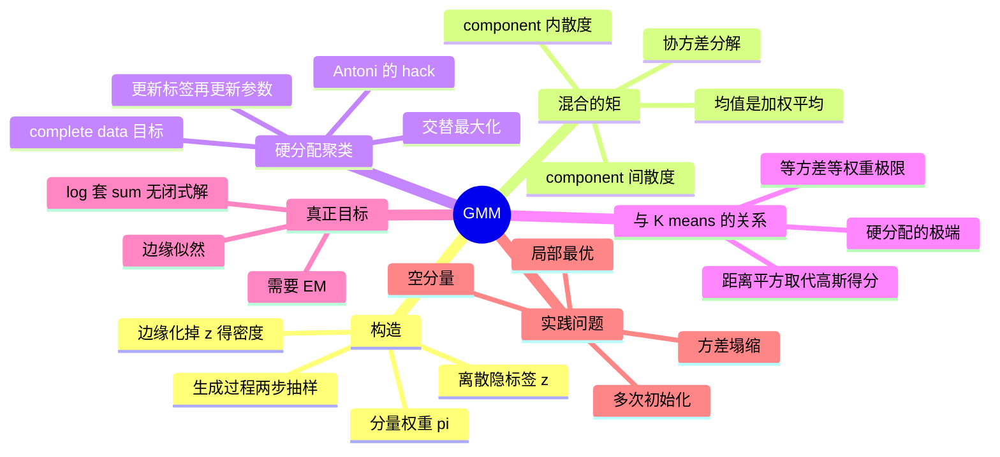

# 高斯混合模型 GMM

单个 Gaussian 只有一个峰（mode），而真实数据（如车辆重量、鸢尾花尺寸）常常有多个分群。GMM 用**带隐标签**的多个 Gaussian 叠加来刻画多峰密度，是参数化聚类的基础模型。

![[gmm-density.png]]

> 图：$K=3$ 的一维 GMM。细线是三个分量，粗线是它们的加权和。**注意混合密度可以有比 $K$ 少的峰**——两个靠得很近的分量可能只形成一个可见的峰。「分量数」和「峰数」不是一回事。

---

## 构造：带隐标签的混合

引入离散隐变量 $z\in\{1,\dots,K\}$ 标记样本属于哪个分量：

$$P(z=k)=\pi_k,\quad \sum_{k=1}^K\pi_k=1;\qquad p(x\mid z=k)=N(x\mid\mu_k,\sigma_k^2)$$

每个分量有自己的均值与方差。**生成过程**：先按 $\pi$ 抽分量 $z$，再从该分量的 Gaussian 抽 $x$。边缘化掉隐标签得观测密度：

$$p(x)=\sum_{k=1}^K P(x\mid z=k)P(z=k)=\sum_{k=1}^K\pi_k\,N(x\mid\mu_k,\sigma_k^2)$$

我们只观测到 $x$，分量标签 $z$ 是**隐藏**的。

> [!tip] 为什么混合能表达任意复杂的密度
> 取足够多的分量、把 $\sigma_k^2$ 调得足够小，$\sum_k\pi_k N(x\mid\mu_k,\sigma_k^2)$ 可以逼近**任何**连续密度（到任意精度）。这根 [[核密度估计 KDE]] 是同一件事的两种说法：GMM 是「参数版的 KDE」，KDE 是「把所有 $\mu_k$ 钉死在数据点上、权重钉死为 $1/N$、方差钉死为 $h^2$ 的 GMM」。
>
> 区别在于**谁被优化**：GMM 让 $\{\pi_k,\mu_k,\sigma_k\}$ 自由（参数个数固定为 $3K-1$），KDE 把它们全部钉住（自由度随 $N$ 增长）。前者是参数方法（可能欠拟合），后者是非参数方法（可能过拟合）。BIC / 交叉验证就是在两者之间选。

**混合的矩**（PS4.1）：混合分布的均值是分量均值的加权平均 $\mathbb E[X]=\sum_k\pi_k\mu_k$；协方差分解为

$$\mathrm{Cov}(X)=\sum_k\pi_k\Sigma_k+\sum_k\pi_k(\mu_k-m)(\mu_k-m)^\top$$

即 **component 内散度 + component 间散度**，后一项是多峰带来的额外铺展。

![[gmm-moments.png]]

> 图：混合的矩分解。左：两个分量（蓝、橙）与混合密度。右：把观测点按**真实**生成分量着色（这是 PS4.1 式分解的数值验证）。**总方差 = 各分量内部散度的加权和 + 分量均值相对总体均值的散度**——即使每个分量方差很小，只要它们的均值离得远，混合的总方差就可以很大。

> [!warning] 一个反直觉的后果
> 由分解式，「峰离得远」贡献的是**分量间散度**。如果你只看混合的总方差，你**无法**区分「一个宽分量」和「两个窄分量、均值分开」——这就是 GMM 的**不可辨识性**在二阶矩层面的表现。要区分它们必须看更高阶矩（峰度）或直接用似然做模型选择。这也解释了为什么 GMM 的局部最优问题严重：不同的 $K$、不同的 $\mu_k$ 组合可能给出几乎一样的密度。

---

## 硬分配聚类

参数 $\{\pi_k,\mu_k,\sigma_k^2\}$ 未知。「Antoni 的 hack」：把隐标签也当成参数，一起优化 complete-data 目标

$$J=\sum_i\sum_k z_{ik}\big[\log N(x_i\mid\mu_k,\sigma_k^2)+\log\pi_k\big]$$

$z_{ik}\in\{0,1\}$ 是 one-hot 指示（每个样本只属一个簇），$N_j=\sum_i z_{ij}$ 是第 $j$ 簇样本数。**交替最大化**（每次精确更新都不降低 $J$）：

1. **更新标签**（固定参数）：选得分最大的分量

$$z_{ij}=\mathbb 1\Big[j=\arg\max_k\big(\log N(x_i\mid\mu_k,\sigma_k^2)+\log\pi_k\big)\Big]$$

2. **更新参数**（固定标签）：这就是各簇内的 Gaussian MLE——

$$\mu_j=\frac{1}{N_j}\sum_i z_{ij}x_i,\qquad \sigma_j^2=\frac{1}{N_j}\sum_i z_{ij}(x_i-\mu_j)^2,\qquad \pi_j=\frac{N_j}{N}$$

更新要求簇非空、方差为正。

**为什么这个 hack 能保证不降低 $J$**：两步都是**精确**最大化 $J$ 的同一目标——第 1 步对 $z$（离散，可枚举，取 argmax 就是全局最优），第 2 步对 $\theta$（闭式解）。所以 $J$ 单调不降，算法必然停在驻点。反过来说，如果用 K-means 那种「取簇内均值」的更新而目标却是 Gaussian 似然，单调性就没了。

![[gmm-soft-vs-hard.png]]

> 图：同一个数据集上的**硬分配**（K-means，左）与**软分配**（GMM 的 responsibility，右）。左图的边界是两个 Voronoi 区域之间的**直线**（等距离），右图的边界是使 responsibility $=0.5$ 的**二次曲线**。右图中颜色深浅表示归属的确定性——靠近边界的点归属模糊，这正是 GMM 比 K-means 多出来的信息。

---

## 与 K-means 的关系

令所有方差相等 $\sigma_j^2=1$、所有权重相等 $\pi_j=1/K$，则得分退化：

$$\log N(x_i\mid\mu_j,1)+\log(1/K)=-\tfrac12\|x_i-\mu_j\|^2+\text{const}$$

标签更新变成 $z_{ij}=1$ iff $j=\arg\min_k\|x_i-\mu_k\|^2$，均值更新不变——这正是 **K-means（Lloyd 算法）**。所以 K-means 是「等方差等权重 GMM 的硬分配极限」。

> [!warning] K-means 的两条隐含假设，GMM 都放开了
> 1. **等方差**：K-means 用欧氏距离，等价于假设所有簇**形状相同、大小相同**。数据里有一个沿某方向很长的簇，K-means 会把它切成几块。GMM 让每个 $\Sigma_k$ 自由，可以拟合椭球簇。
> 2. **等权重**：$\pi_j=1/K$ 假设各簇样本数差不多。GMM 让 $\pi_k$ 自由。
>
> 与此对应，K-means 的簇边界一定是**超平面段**（因为比较的是 $\|x-\mu_j\|^2$，两边相减 $\|x\|^2$ 消掉，剩线性项），GMM 的边界可以是**二次曲面**。如果你看到数据需要弯曲的决策边界，K-means 一定做不好。
>
> **代价**：K-means 一步只要算距离（$O(NKd)$），GMM 一步要算每个分量的密度（含 $d\times d$ 的协方差求逆与行列式，$O(NKd^3)$ 或 $O(NKd^2)$ 若用 Cholesky 缓存）。参数量也从 $Kd$ 涨到 $K(d+d(d+1)/2)$。

---

## 两类目标、局部最优

- 硬聚类最大化 complete-data $J=\log p(X,Z\mid\theta)$；
- 真正的 MLE 要最大化 **marginal** likelihood $\log p(X\mid\theta)=\log\sum_k\pi_k N(x_i\mid\mu_k,\sigma_k^2)$，里面有个「分量求和的 log」，直接优化困难——这正是需要 [[EM 算法]] 的原因。

从随机初始化出发交替更新，**不同初始化会收敛到不同解**（局部最优），实践中要多次初始化取最好的 log-likelihood。marginal MLE 还有退化风险：某分量塌缩到单个观测点上时 likelihood 发散，需要防塌缩的正则。

> [!warning] GMM 的似然是**无界的**（一个必须知道的事实）
> 让某个分量的均值 $\mu_k$ 正好等于某个观测点 $x_i$，同时让 $\sigma_k^2\to0$，则该分量在该点的密度 $N(x_i\mid x_i,\sigma_k^2)\to\infty$。只要 $\pi_k>0$，混合密度在 $x_i$ 处也 $\to\infty$，**对数似然无上界**。
>
> 这意味着：
> - 「GMM 的全局最优解」在数学上**不存在**（除非加约束）；
> - 实际算法停在的永远是一个**局部**极大，好坏取决于初始化和数值细节；
> - 工程上必须加**方差下限** $\sigma_k^2\ge\epsilon$、或对 $\sigma_k^2$ 加先验（MAP-EM，见 [[EM 算法]]）、或检测到某分量只剩 1 个成员就重新初始化它。
>
> 一个经验信号：训练时 log-likelihood 突然爆冲（没有趋于平稳），基本就是某个分量在塌缩。

---

## 习题

> 来源：**PS-4 Mixture Models and the EM Algorithm**（原题号保留）。GMM 相关的题是 4.1–4.6；4.7–4.14 在 [[EM 算法]]。解答折叠。

### PS4.1 混合分布的矩

**题目.** 设 $P(z=j)=\pi_j$、$\mathbb E[X\mid z=j]=\mu_j$、$\mathrm{Cov}(X\mid z=j)=\Sigma_j$。证明 $m=\mathbb E[X]=\sum_j\pi_j\mu_j$，且
$$\mathrm{Cov}(X)=\sum_j\pi_j\Sigma_j+\sum_j\pi_j(\mu_j-m)(\mu_j-m)^\top$$

> [!success]- 解答（先自己做，再点开）
> **均值**：用全期望公式（law of total expectation），对 $z$ 条件化：
> $$m=\mathbb E[X]=\sum_j P(z=j)\,\mathbb E[X\mid z=j]=\sum_j\pi_j\mu_j$$
>
> **协方差**：先算二阶矩，用全期望公式：
> $$\mathbb E[XX^\top]=\sum_j\pi_j\,\mathbb E[XX^\top\mid z=j]=\sum_j\pi_j(\Sigma_j+\mu_j\mu_j^\top)$$
> （第二个等号用了 $\Sigma_j=\mathbb E[XX^\top\mid z=j]-\mu_j\mu_j^\top$。）于是
> $$\mathrm{Cov}(X)=\mathbb E[XX^\top]-mm^\top=\sum_j\pi_j\Sigma_j+\sum_j\pi_j\mu_j\mu_j^\top-mm^\top$$
> 把 $m=\sum_j\pi_j\mu_j$ 代入并用 $\sum_j\pi_j=1$：
> $$\sum_j\pi_j\mu_j\mu_j^\top-mm^\top=\sum_j\pi_j(\mu_j-m)(\mu_j-m)^\top$$
> （展开右边：$\sum\pi_j\mu_j\mu_j^\top-2m m^\top+mm^\top\sum\pi_j=\sum\pi_j\mu_j\mu_j^\top-mm^\top$。）
>
> **记法**：
> $$\mathrm{Cov}(X)=\underbrace{\sum_j\pi_j\Sigma_j}_{\text{within-component scatter}}+\underbrace{\sum_j\pi_j(\mu_j-m)(\mu_j-m)^\top}_{\text{between-component scatter}}$$
>
> **这就是方差分解（law of total variance）的矩阵版**。同样的恒等式在统计学里叫 ANOVA 分解，在机器学习里叫「类内散度 + 类间散度」，在聚类评估里就是「组内平方和 + 组间平方和」。**同一个公式，四种名字。**
>
> **K-means 的目标可以从这里推出来**：K-means 最小化 $\sum_k\sum_{i\in C_k}\|x_i-\mu_k\|^2$，正是 within-component scatter（取 $\Sigma_k$ 为单位阵、$\pi_k=N_k/N$）。所以 K-means 在优化「混合的总方差中有多少来自组内」。

### PS4.2 GMM 的直接驻点方程

**题目.** 记 $v_j=\sigma_j^2$、$f_{ij}=N(x_i\mid\mu_j,v_j)$、$p_i=\sum_k\pi_k f_{ik}$，观测对数似然 $\ell(\theta)=\sum_i\log p_i$。(a) 借助链式法则证明 $\frac{\partial\ell}{\partial\beta_j}=\sum_i r_{ij}\frac{\partial\log f_{ij}}{\partial\beta_j}$（$r_{ij}=\pi_j f_{ij}/p_i$），并由此解出 $\mu_j,\ v_j,\ \pi_j$ 的驻点方程。(b) 这些方程有什么问题？为什么还需要 EM？

> [!success]- 解答（先自己做，再点开）
> **(a)** 对某一个分量的参数 $\beta_j$ 求导（只有 $f_{ij}$ 依赖它）：
> $$\frac{\partial\ell}{\partial\beta_j}=\sum_i\frac{1}{p_i}\cdot\pi_j\frac{\partial f_{ij}}{\partial\beta_j}=\sum_i\underbrace{\frac{\pi_j f_{ij}}{p_i}}_{=r_{ij}}\frac{\partial\log f_{ij}}{\partial\beta_j}$$
> **关键**：这一步是纯粹的**求导结果**，不是「假设 $r_{ij}$ 与 $\theta$ 无关」。把 $\frac{\partial f}{\partial\beta}$ 写成 $f\cdot\frac{\partial\log f}{\partial\beta}$ 后，前面自然冒出 $f_{ij}/p_i$ 这个因子。它看起来像 responsibility，是因为它**定义上就是** responsibility。
>
> **均值**：$\frac{\partial\log f_{ij}}{\partial\mu_j}=\frac{x_i-\mu_j}{v_j}$，故
> $$\frac{\partial\ell}{\partial\mu_j}=\frac{1}{v_j}\Big(\sum_i r_{ij}x_i-\mu_j N_j\Big)=0\;\Longrightarrow\;\mu_j=\frac{\sum_i r_{ij}x_i}{N_j}$$
>
> **方差**：$\log f_{ij}=-\frac12\log(2\pi v_j)-\frac{(x_i-\mu_j)^2}{2v_j}$，
> $$\frac{\partial\ell}{\partial v_j}=\frac12\sum_i r_{ij}\Big[-\frac{1}{v_j}+\frac{(x_i-\mu_j)^2}{v_j^2}\Big]=0\;\Longrightarrow\;-N_jv_j+\sum_i r_{ij}(x_i-\mu_j)^2=0\;\Longrightarrow\;v_j=\frac{\sum_i r_{ij}(x_i-\mu_j)^2}{N_j}$$
>
> **权重**：带约束 $\sum_j\pi_j=1$，用 Lagrange 乘子 $L=\ell+\eta(1-\sum_j\pi_j)$：
> $$\frac{\partial L}{\partial\pi_j}=\sum_i\frac{f_{ij}}{p_i}-\eta=\frac{N_j}{\pi_j}-\eta=0$$
> 两边乘 $\pi_j$ 并对 $j$ 求和：$\sum_j N_j=\eta\sum_j\pi_j$，即 $n=\eta$。故 $\pi_j=N_j/n$。$\blacksquare$
>
> **(b) 问题：右边含未知量本身。** 三个式子的右边都通过 $r_{ij}$ 依赖 $\mu_j,v_j,\pi_j$，所以这是**隐式方程，不是闭式解**。
>
> **EM 就是把隐式方程变成迭代**：用 $\theta^{old}$ 算 $r$，再把这些加权平均算出来当 $\theta^{new}$。每步 M-step 里 $r$ 被冻结，所以是显式的。
>
> **另外两个必须承认的限制**（PS-4 解答也点了）：
> 1. **初始化与局部最优**——解不唯一，算法收敛到哪个取决于起点；
> 2. **似然无界**——某个分量塌缩到单个观测点时 $\ell\to\infty$，这些驻点方程**不保证**给出有限的全局 ML 解。它们给的是驻点，不是最优点。

### PS4.4 共享协方差的 GMM

**题目.** 设所有分量共享同一个协方差 $\Sigma_j=\Sigma$。(a) 说明 E-step 的形式。(b) 求 $\Sigma$ 的 M-step，并解释为什么分母是总样本数 $n$ 而不是某个分量的有效计数。

> [!success]- 解答（先自己做，再点开）
> **(a)** 完整数据对数似然
> $$\ell_c=\sum_{i,j}z_{ij}\Big[\log\pi_j-\frac d2\log(2\pi)-\frac12\log|\Sigma|-\frac12(x_i-\mu_j)^\top\Sigma^{-1}(x_i-\mu_j)\Big]$$
> E-step 用**旧的共享**协方差：
> $$r_{ij}=\frac{\pi_j^{old}N(x_i\mid\mu_j^{old},\Sigma^{old})}{\sum_k\pi_k^{old}N(x_i\mid\mu_k^{old},\Sigma^{old})}$$
> 把 $z$ 换成 $r$ 得 $Q$。$\mu_j$ 的方程与 4.3 相同（$\Sigma^{-1}$ 可逆，两边约掉），$\pi_j=N_j/n$ 也相同。
>
> **(b)** 定义 $S=\sum_{i,j}r_{ij}(x_i-\mu_j^{new})(x_i-\mu_j^{new})^\top$。$\Sigma$ 的目标函数是
> $$Q_\Sigma=-\frac n2\log|\Sigma|-\frac12\mathrm{tr}(\Sigma^{-1}S)$$
> （这里 $\sum_{i,j}r_{ij}=n$——**所有样本对所有分量的责任之和恰好等于样本数**，因为每个样本的责任和为 1。）
> 求导并左右乘 $\Sigma$：
> $$-\frac n2\Sigma^{-1}+\frac12\Sigma^{-1}S\Sigma^{-1}=0\;\Longrightarrow\;-n\Sigma+S=0\;\Longrightarrow\;\Sigma^{new}=\frac1n\sum_{i,j}r_{ij}(x_i-\mu_j^{new})(x_i-\mu_j^{new})^\top$$
>
> **分母是 $n$ 的原因**：$\Sigma$ 是所有分量**共用**的参数，所以每一对 $(i,j)$ 都对它贡献一份信息，总信息量是 $\sum_{i,j}r_{ij}=n$。而单个 $\mu_j$ 只由第 $j$ 分量的责任贡献，分母是该分量的有效计数 $N_j$。
>
> **直观**：$\Sigma^{new}$ 是「**池化的**类内散度」——把每个分量的散度用责任加权后加总，再除以总样本数。这和判别分析（LDA）里「假设各类协方差相同、用合并协方差估计」是完全一样的做法。
>
> **实践意义**：共享协方差把参数量从 $O(Kd^2)$ 降到 $O(d^2)$，在数据少或高维时更稳；代价是不能表达「不同簇形状不同」。很多工程实现（如 scikit-learn 的 `covariance_type='tied'`）就是这一档。

### PS4.5 Poisson 混合与飞弹

**题目.** 把 PS2.1 的单 Poisson 推广成混合：$p(x\mid\lambda_j)=\frac{\lambda_j^x}{x!}e^{-\lambda_j}$，混合权重 $\pi_j$。(a) 推导 EM 的 E-step 与 M-step。(b) 末档「5 及以上」是删失数据，怎么处理？

> [!success]- 解答（先自己做，再点开）
> **(a)** 引入指示变量，
> $$p(X,Z\mid\theta)=\prod_{i,j}\Big[\pi_j\frac{e^{-\lambda_j}\lambda_j^{x_i}}{x_i!}\Big]^{z_{ij}},\qquad \ell_c=\sum_{i,j}z_{ij}\big[\log\pi_j-\lambda_j+x_i\log\lambda_j-\log(x_i!)\big]$$
>
> **E-step**（Bayes 规则）：
> $$r_{ij}=\frac{\pi_j^{old}e^{-\lambda_j^{old}}(\lambda_j^{old})^{x_i}}{\sum_k\pi_k^{old}e^{-\lambda_k^{old}}(\lambda_k^{old})^{x_i}}$$
> **注意 $x_i!$ 在分子分母里都出现，直接约掉**——这是 Poisson 混合的一个便利之处（如果各分量的 $x_i!$ 不同就不能约，但这里分量之间只差 $\lambda$，$x!$ 是公共因子）。
>
> **M-step（$\lambda_j$）**：$Q_j=-\lambda_j N_j+\big(\sum_i r_{ij}x_i\big)\log\lambda_j+\text{const}$，求导：
> $$-N_j+\frac{\sum_i r_{ij}x_i}{\lambda_j}=0\;\Longrightarrow\;\lambda_j^{new}=\frac{\sum_i r_{ij}x_i}{N_j}$$
> 二阶导 $-\sum_i r_{ij}x_i/\lambda_j^2\le0$。**这就是 PS2.1 的 Poisson 样本均值 MLE，只不过整数计数换成了分数责任。**
>
> **M-step（$\pi_j$）**：Lagrange 得 $N_j/\pi_j-\eta=0$，求和得 $\eta=n$，故 $\pi_j^{new}=N_j/n$。
>
> **(b) 删失档的处理。** 末档 $k=5$ 实际代表 $k\ge5$，直接当 $k=5$ 会低估 $\lambda$。两种做法：
>
> **做法 1（直方图加速）**：数据是「$c_k$ 个格子的命中数是 $k$」，所以对每个**不同的 $k$** 只算一次 responsibility：
> $$r_{kj}=\frac{\pi_jP_{\lambda_j}(X=k)}{\sum_{l}\pi_lP_{\lambda_l}(X=k)},\qquad N_j=\sum_{k=0}^{5}c_k r_{kj},\qquad \lambda_j^{new}=\frac{\sum_{k=0}^{5}c_k r_{kj}\,k}{N_j}$$
> 完全等价于把每个计数重复 $c_k$ 次，但快 $c_k$ 倍。
>
> **做法 2（严格处理删失）**：把末档的概率换成 $P_{\lambda_j}(X\ge5)$，responsibility 也用这个尾部概率算。M-step 里缺的那个**确切计数的条件期望**是
> $$\mathbb E[X\mid X\ge5,\lambda]=\frac{\sum_{k=5}^\infty k\,e^{-\lambda}\lambda^k/k!}{P_\lambda(X\ge5)}=\lambda\,\frac{P_\lambda(X\ge4)}{P_\lambda(X\ge5)}$$
> （把 $k\cdot\lambda^k/k!=\lambda\cdot\lambda^{k-1}/(k-1)!$ 提出 $\lambda$ 即得。）用**旧**的 $\lambda$ 算这个期望，代进 M-step 里替代那个 $5$。
>
> **结论上的区别（来自 PS-4 的数值实验）**：
> - **伦敦**：单分量 $\ell=-728.713$，二分量 $-728.685$ —— 改善可忽略，**支持「纯随机」**；
> - **安特卫普**：单分量 $-830.696$，二分量 $-748.025$ —— **巨大**改善，且高计数档明显更多，说明命中率**确实不均匀**（两个分量：$\lambda\approx0.23$ 与 $\lambda\approx2.20$）。
>
> **一个重要的方法论提醒**：安特卫普的数据说明「命中率不均匀」，但**不能**说明「德军在瞄准」。要区分「瞄准特定区域」和「其他非均匀性」（如城市不同区域建筑密度不同、防空火力分布不同），还需要**空间信息**——单看计数直方图是无能为力的。这正是「统计显著」不等于「因果」的经典例子。

### PS4.6 指数混合

**题目.** $x_i\ge0$，分量 $p(x\mid\lambda_j)=\lambda_j e^{-\lambda_j x}$，混合权重 $\pi_j$。(a) 写完整数据似然与对数似然。(b) 求 E-step 与 M-step。

> [!success]- 解答（先自己做，再点开）
> **(a)** 完整数据：
> $$p(X,Z\mid\theta)=\prod_{i,j}\big[\pi_j\lambda_j e^{-\lambda_j x_i}\big]^{z_{ij}},\qquad \ell_c=\sum_{i,j}z_{ij}\big[\log\pi_j+\log\lambda_j-\lambda_j x_i\big]$$
> **注意出现的是 $\log\lambda_j$ 而不是 $x_i\log\lambda_j$**——这是指数分布和 Poisson 分布的关键差别（Poisson 的似然里 $\lambda$ 的幂次是 $x_i$，指数分布的幂次恒为 1）。
>
> **(b) E-step**：
> $$r_{ij}=\frac{\pi_j^{old}\lambda_j^{old}e^{-\lambda_j^{old}x_i}}{\sum_k\pi_k^{old}\lambda_k^{old}e^{-\lambda_k^{old}x_i}}$$
> 把所有 $\lambda_j$ 项合起来看，这个 responsibility 只依赖 $\log\pi_j+\log\lambda_j-\lambda_jx_i$，所以其实是一个**对数线性**形式——工程上算的时候用 log-sum-exp 更稳（见 [[EM 算法]]）。
>
> **M-step**：$Q=\sum_j N_j\log\pi_j+\sum_j N_j\log\lambda_j-\sum_j\lambda_j\sum_i r_{ij}x_i$。
> 对 $\lambda_j$ 求导：
> $$\frac{\partial Q}{\partial\lambda_j}=\frac{N_j}{\lambda_j}-\sum_i r_{ij}x_i=0\;\Longrightarrow\;\lambda_j^{new}=\frac{N_j}{\sum_i r_{ij}x_i}$$
> 二阶导 $-N_j/\lambda_j^2<0$。**$\lambda_j^{new}$ 是「加权样本均值的倒数」**，与 PS2.2 里单指数 MLE $\hat\theta=1/\bar x$ 完全一致（把整数权重换成责任权重）。
>
> 权重更新同样是 $\pi_j=N_j/n$。
>
> **数值注意**：需要 $N_j>0$ 且 $\sum_i r_{ij}x_i>0$。若某个分量拿到的责任几乎全落到 $x_i=0$ 上（如果数据允许 0），分母会趋 0，$\lambda_j$ 爆冲。实际代码里要加下限保护，或者对这种退化情形重新初始化该分量。

---

## 相关

- [[EM 算法]]
- [[核密度估计 KDE]]
- [[均值漂移 Mean Shift]]
- [[机器学习 知识地图]]
- [[CS5487 Index]]
